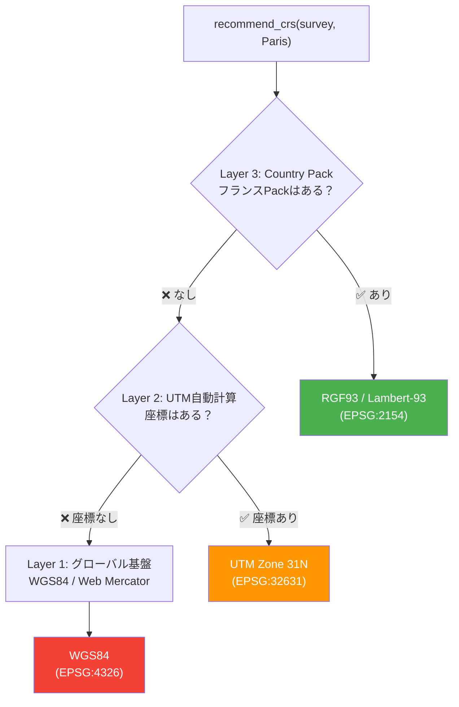
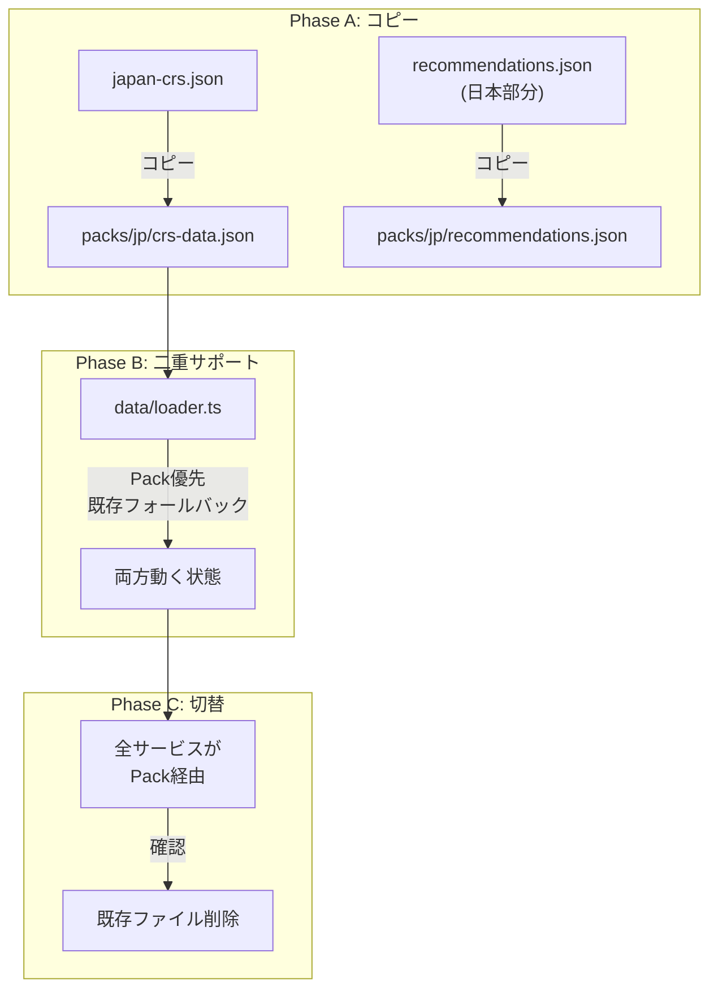

## はじめに ― 「日本では完璧に動く」その先

前回の記事（[GISの「座標系選び」をAIに任せる ― EPSG MCP サーバーを作った話](https://qiita.com/shuji-bonji/items/edfd9dfea83d155ac8e0)）で、座標参照系（CRS）の知識をAIエージェントに提供するMCPサーバーの概要を紹介しました。

9つのツール、47都道府県マッピング、北海道3系対応、638件のテスト。**日本の測量・GIS業務では、かなり実用的なものができた**という手応えがありました。

しかし、MCPサーバーとしてnpmに公開した以上、世界中の開発者が `npx @shuji-bonji/epsg-mcp` で起動できます。そのとき何が起こるか？

```
AI: 「パリで測量したいんですが、どのCRSを使えば？」

epsg-mcp: 「WGS84（EPSG:4326）をお勧めします」
```

**間違いではないが、全く役に立たない回答**。フランスなら RGF93 v2b（EPSG:9794）を基盤にLambert-93（EPSG:2154）を使うべきです。日本で「東京の測量」と聞けば即座にEPSG:6677（第IX系）を返せるのに、パリでは汎用回答しかできない。

この「品質の格差」をどう解消するか。それが本記事のテーマです。


## 格差の正体 ― 何が「知識」で、何が「計算」か

まず、格差の構造を分析します。日本の測量で `recommend_crs` を呼んだとき、サーバーの内部では何が起きているか？

```
入力: purpose=survey, prefecture="東京都"

→ 「東京都」は第IX系に属する              ← 知識（マッピングテーブル）
→ 第IX系のEPSGコードは6677               ← 知識（データ）
→ 測量には投影座標系が必要               ← 知識（推奨ルール）
→ JGD2000(EPSG:2451)ではなくJGD2011を使うべき  ← 知識（ベストプラクティス）
→ 東京都離島は別系(XIV, XVIII, XIX)に注意    ← 知識（地域固有の注意事項）

出力: EPSG:6677, score:100, warnings:[離島注意]
```

**全部「知識」です。計算は一切ない。**

これが、前回の記事で書いた「CRSは知識問題であって計算問題ではない」の具体像です。そして、この知識は**国ごとに完全に異なる構造**を持っています。

| 国 | 測地系 | 測量用投影座標系 | ゾーン体系 |
|---|---|---|---|
| 日本 | JGD2011 | 平面直角座標系 I〜XIX | 都道府県ベース（19系） |
| 米国 | NAD83(2011) | State Plane Coordinate System | 州ベース（120+ゾーン） |
| 英国 | OSGB36/ETRS89 | British National Grid | 単一グリッド+北アイルランド例外 |

構造が違うのに、同じインターフェースで「測量に最適なCRS」を返す必要がある。これが設計課題です。


## 3層フォールバックモデル ― 設計の核心

この課題に対する答えが、**3層フォールバックモデル**です。



### 各層の役割

**Layer 3（Country Pack）** は「専門家レベル」の回答。都道府県→系、州→SPCSゾーンのマッピング、旧測地系からの移行ガイド、地域固有の注意事項まで含みます。

**Layer 2（UTM自動計算）** は「そこそこ使える」回答。座標さえあれば、経度からUTMゾーンを算出して投影座標系を推奨できます。専門家レベルではないが、WGS84を返すよりはるかにマシ。

**Layer 1（グローバル基盤）** は最終防衛線。情報が何もないときでも、用途に応じたグローバルCRS（WGS84、Web Mercator）を返す。

**設計意図：回答品質のグレースフル・デグラデーション**です。Packがあれば最高品質、なくても「使える回答」は返す。


## CountryPack ― 知識のインターフェース設計

### なぜインターフェースが必要か

各国の座標系知識は構造が全く違います。

- 日本：19系の平面直角座標系、都道府県→系のマッピング、北海道は3系に跨る
- 米国：120以上のState Planeゾーン、州→ゾーンのマッピング、カリフォルニアは6ゾーン
- 英国：全土で単一のBritish National Grid、ただし北アイルランドはITMという別体系

これらを統一的に扱うために、`CountryPack` インターフェースを定義しました。

```typescript
interface CountryPack {
  metadata: PackMetadata;
  
  // データ提供
  getCrsData(): Promise<PackCrsDataSet>;
  getZoneMapping(): Promise<ZoneMapping>;
  getRecommendationRules(): Promise<PackRecommendationRules>;
  getValidationRules(): Promise<PackValidationRule[]>;
  getTransformationKnowledge(): Promise<PackTransformationKnowledge>;
  getBestPractices(): Promise<PackBestPractice[]>;
  getTroubleshootingGuides(): Promise<PackTroubleshootingGuide[]>;
  
  // ロジック
  selectZoneForLocation(location: LocationSpec): Promise<string | null>;
  isLocationInCountry(location: LocationSpec): boolean;
}
```

### 設計判断：7つのデータ + 2つのロジック

Packが提供するものは大きく2種類あります。

**データ（7メソッド）** はJSONファイルで表現可能な静的知識。CRS定義、ゾーンマッピング、推奨ルール、検証ルール、変換経路、ベストプラクティス、トラブルシュートガイド。

**ロジック（2メソッド）** はデータだけでは表現できない判定処理。`selectZoneForLocation` は「この場所にはどのゾーンが最適か」という判定で、北海道のように都市レベルで3系に分かれる場合にはロジックが必要です。`isLocationInCountry` は座標からの国判定で、バウンディングボックスによる推定を含みます。

```typescript
// JP Pack の selectZoneForLocation の実装例
async selectZoneForLocation(location: LocationSpec): Promise<string | null> {
  const mapping = await this.getZoneMapping();
  
  // 1. subdivision（都道府県）から直接マッピング
  if (location.subdivision) {
    const entry = mapping.entries[location.subdivision];
    if (entry) return entry.code;
    
    // 複数系にまたがる地域（北海道、鹿児島、沖縄）
    const multiZone = mapping.multiZoneRegions?.[location.subdivision];
    if (multiZone) {
      // 都市名で判定
      if (location.city && multiZone.cities[location.city]) {
        return multiZone.cities[location.city];
      }
      return multiZone.default;
    }
  }
  
  // 2. 座標から最寄りゾーンを判定
  if (location.centerPoint) {
    return this.determineZoneFromCoordinate(location.centerPoint);
  }
  
  return null;
}
```

### LocationSpec ― 「都道府県」を汎用化する

初期実装では `prefecture` フィールドで都道府県を指定していました。しかし米国では「州」、英国では「地方」です。そこで `subdivision` という統一フィールドを導入し、`prefecture` は後方互換のために `@deprecated` として残しました。

```typescript
interface LocationSpec {
  country?: string;       // ISO 3166-1 alpha-2: "JP", "US", "GB"
  subdivision?: string;   // 都道府県/州/地方の統一フィールド
  
  /** @deprecated Use subdivision instead */
  prefecture?: string;    // 後方互換
  
  city?: string;
  region?: string;
  boundingBox?: BoundingBox;
  centerPoint?: { lat: number; lng: number };
}
```

正規化関数で後方互換性を保証します。

```typescript
function normalizeLocation(location: LocationSpec): LocationSpec {
  const normalized = { ...location };
  
  // "Japan" → "JP", "USA" → "US" 等のエイリアス解決
  if (normalized.country) {
    normalized.country = normalizeCountry(normalized.country);
  }
  
  // prefecture → subdivision のマイグレーション
  if (normalized.prefecture && !normalized.subdivision) {
    normalized.subdivision = normalized.prefecture;
  }
  
  // subdivision から country を推定
  // "東京都" → JP, "California" → US, "Scotland" → GB
  if (normalized.subdivision && !normalized.country) {
    normalized.country = inferCountryFromSubdivision(normalized.subdivision);
  }
  
  return normalized;
}
```

この正規化は全ハンドラーの入口で実行され、既存のAPI（`{ prefecture: "東京都" }`）がそのまま動き続けることを保証しています。


## UTM自動計算 ― Layer 2 のシンプルな力

Layer 2はCountry Packが存在しない国・地域のための汎用フォールバックです。仕組みは驚くほどシンプル：

```typescript
function getUtmZone(lng: number): number {
  // 経度から1〜60のゾーン番号を算出
  return Math.floor((lng + 180) / 6) + 1;
}

function getUtmEpsgCode(zone: number, isNorth: boolean): string {
  // 北半球: EPSG:326xx, 南半球: EPSG:327xx
  const prefix = isNorth ? 326 : 327;
  return `EPSG:${prefix}${zone.toString().padStart(2, '0')}`;
}
```

パリ（経度2.35°）なら Zone 31N → `EPSG:32631`。東京（経度139.69°）ならZone 54N → `EPSG:32654`。

UTMは世界中どこでも使える投影座標系なので、Pack がなくてもそこそこ精度の高い距離・面積計算が可能です。ただし、各国の公式測量CRSではないため、測量目的には推奨度が下がります。

**この「使えるけどベストではない」という位置づけが重要です。** UTMを返すときは「Country Packが利用可能であれば、より適切な推奨が可能です」という注記を添えます。


## Strangler Fig パターン ― 安全な移行戦略

### なぜ一括リライトしなかったか

国際化の実装で最も悩んだのは、既存の日本専用コードをどう扱うかでした。

選択肢は2つ。

1. **一括リライト**：既存コードを捨てて、Pack ベースで全部書き直す
2. **Strangler Fig**：既存コードを残したまま、新構造を並行構築し、段階的に移行する

306件のテストが全てパスする安定した状態を壊すリスクは取りたくなかった。
そこで **Strangler Fig パターン**を採用しました。

### 具体的な移行手順



**Phase A（コピー）** では、既存ファイルは一切触りません。`japan-crs.json` の内容を `packs/jp/crs-data.json` にコピーし、`createJpPack()` ファクトリ関数を実装します。

**Phase B（二重サポート）** が核心です。`data/loader.ts` を改修して、PackがあればPackから読み、なければ既存ファイルから読む「二重サポート」を実装します。

```typescript
// 二重サポート期間中の findCrsById
async function findCrsById(code: string): Promise<CrsDetail | null> {
  // 1. Pack から検索（優先）
  const packResult = findCrsInPacks(code);
  if (packResult) return packResult;
  
  // 2. グローバルデータから検索
  const globalResult = globalIndex.get(code);
  if (globalResult) return globalResult;
  
  // 3. SQLite フォールバック（オプション）
  if (isSqliteAvailable()) {
    return findCrsBySqlite(code);
  }
  
  return null;
}
```

**Phase C（切替）** は、全テストがPassし、US Pack・UK Packでも動作確認できた後に、旧ファイルを削除します。

### 実際の結果

各フェーズでのテスト数推移が、この戦略の安全性を示しています：

| Version | テスト数 | 追加内容 | 既存テスト |
|---------|----------|----------|-----------|
| v0.4.0 | 379 | CI/CD、ツール定義英語化 | 全Pass |
| v0.5.0 | 463 (+84) | UTM自動計算、LocationSpec正規化 | 全Pass |
| v0.6.0 | 519 (+56) | CountryPack基盤、JP Pack切り出し | 全Pass |
| v0.7.0 | 519 | SQLite統合 | 全Pass |
| v0.8.0 | 566 (+47) | US Pack実装 | 全Pass |
| v0.9.0 | 638 (+72) | UK Pack、英語Prefecture対応 | 全Pass |

**一度もリグレッションを起こさず、306件→638件にテストを倍増させながら移行を完了しました。**


## 3つのPackから見える「汎用性」の検証

### JP Pack ― 参照実装

JP Packは最も複雑な実装です。19系の平面直角座標系、47都道府県→系のマッピング、北海道（3系）・沖縄（3系）のマルチゾーン対応が求められます。

```
src/packs/jp/
├── index.ts              # createJpPack() ファクトリ
├── constants.ts          # JP_BOUNDS, JP_PLANE_RECT 定数
├── crs-data.json         # JGD2011 + 平面直角座標系 I〜XIX
├── zone-mapping.json     # 47都道府県 → 系マッピング
├── recommendations.json  # 日本向け推奨ルール
├── transformations.json  # Tokyo Datum → JGD2000 → JGD2011
├── best-practices.json   # 日本の測量ベストプラクティス
└── troubleshooting.json  # 400mずれ等の既知の問題
```

### US Pack ― 構造の検証

US Packは「CountryPackインターフェースが日本以外でも機能するか」を検証するために実装しました。

米国のState Plane Coordinate System（SPCS）は120以上のゾーンを持ち、カリフォルニアは6ゾーン、テキサスは5ゾーンに分かれます。**日本の「北海道3系」と同じ構造**（MultiZoneConfig）で表現できたことが、インターフェース設計の妥当性を証明しました。

```json
{
  "multiZoneRegions": {
    "California": {
      "default": "EPSG:2229",
      "subRegions": {
        "Northern California": "EPSG:2225",
        "Southern California": "EPSG:2229"
      },
      "cities": {
        "Los Angeles": "EPSG:2229",
        "San Francisco": "EPSG:2227"
      },
      "note": "California has 6 State Plane zones"
    }
  }
}
```

### UK Pack ― 例外の扱い

UK Packは「単純に見えて例外がある」ケースの検証です。イギリス本土はBritish National Grid（EPSG:27700）の**単一グリッド**で、日本や米国のようなゾーン選択は不要。

しかし、北アイルランドはIrish Transverse Mercator（EPSG:2157）という**全く別の体系**を使います。この「地域による体系の切り替え」も、`selectZoneForLocation` のロジックで自然に表現できました。

```typescript
// UK Pack の selectZoneForLocation
async selectZoneForLocation(location: LocationSpec): Promise<string | null> {
  if (location.subdivision === 'Northern Ireland') {
    return UK_EPSG.ITM;   // EPSG:2157
  }
  return UK_EPSG.BNG;     // EPSG:27700
}
```

### 検証結果

3パックの実装を通じて確認できたこと。

| 検証項目 | 結果 |
|---------|------|
| CountryPackインターフェースの汎用性 | ✅ 日本・米国・英国で共通利用可能 |
| MultiZoneConfig の表現力 | ✅ 北海道3系もカリフォルニア6ゾーンも同じ構造 |
| Pack共存時の干渉 | ✅ JP/US/UK同時有効で問題なし |
| UTMフォールバックとの優先順位 | ✅ Pack → UTM → Global の順で正しく動作 |

## Pack配布モデル ― なぜ全同梱にしたか

Pack の配布方法として3つの選択肢がありました。

| 方式 | メリット | デメリット |
|------|---------|----------|
| 全同梱（採用） | `npx` 一発で動く | パッケージサイズ増 |
| 別パッケージ | サイズ最小 | 設定が煩雑 |
| 動的ダウンロード | 最新データ | オフライン不可 |

MCPサーバーは `claude_desktop_config.json` に1行書くだけで起動するのが理想です。別パッケージ方式だと「まずPackをインストールして、それを参照する設定を書いて…」と手順が増えます。

JSONデータ中心なので追加パックのサイズは数十KB〜数百KB程度。全同梱しても実用上問題ありません。

環境変数 `EPSG_PACKS` で有効なPackを制御します。

```jsonc
{
  "mcpServers": {
    "epsg": {
      "command": "npx",
      "args": ["@shuji-bonji/epsg-mcp"],
      "env": {
        "EPSG_PACKS": "jp,us,uk",  // 有効パック（デフォルト: "jp"）
        "EPSG_LANG": "ja"          // 出力言語（デフォルト: "en"）
      }
    }
  }
}
```

## SQLite統合 ― 「知識」と「データ」の境界

EPSG公式レジストリはSQLite形式（約15MB）で配布されています。これをオプションで利用可能にしました。

ここで重要なのは、**SQLiteとPackは代替関係ではなく補完関係**だということです。

```
SQLiteから取れるもの：
  name: "JGD2011 / Japan Plane Rectangular CS IX"
  projection: Transverse Mercator, central meridian 139.833°
  area: Japan - zone IX
  deprecated: false

SQLiteから取れないもの（JP Packだけが持つ「知識」）：
  対象都道府県: 東京/神奈川/千葉/埼玉/茨城/栃木/群馬/福島
  東京都離島は別系(XIV, XVIII, XIX)という注意事項
  測量推奨度: ★★★★★ / Web表示推奨度: ★☆☆☆☆
  JGD2000(EPSG:2451)からの移行ガイド
  「中央子午線から130km以内で最高精度」という実務知識
```

SQLiteは「CRSの定義データ」を提供し、Packは「CRSの使い方の知識」を提供する。データと知識は別物です。

SQLiteの主な用途は、Packがない国・地域でのフォールバック情報源。Packがあれば、SQLiteのデータはPackの補完的な役割に留まります。

## 出力言語の国際化

ツール定義（description、inputSchema）の英語化はv0.4.0で完了していましたが、サービス応答は日本語が混在していました。

メッセージ定数を `src/constants/messages.ts` に集約し、`EPSG_LANG` 環境変数で切り替え可能にしました：

```typescript
// messages.ts（簡略化）
const MESSAGES = {
  en: {
    purposes: {
      survey: 'Surveying',
      web_mapping: 'Web Mapping',
      // ...
    },
    warnings: {
      WEB_MERCATOR_AREA: 'Web Mercator significantly distorts area calculations',
      // ...
    }
  },
  ja: {
    purposes: {
      survey: '測量',
      web_mapping: 'Web地図表示',
      // ...
    },
    warnings: {
      WEB_MERCATOR_AREA: 'Web Mercatorは面積計算で大きな歪みが生じます',
      // ...
    }
  }
};
```

デフォルトは英語。`EPSG_LANG=ja` を設定すると日本語になります。MCPサーバーの性質上、AIエージェントが受け取った応答をユーザーの言語で解釈・説明するため、サーバー応答自体はどちらの言語でも実用上問題ありません。


## 実装を通じて得た知見

### 1. インターフェース設計は「3つ目」で安定する

JP Pack（1つ目）は参照実装。US Pack（2つ目）でインターフェースの汎用性を検証。UK Pack（3つ目）で「例外パターンも扱える」ことを確認。

3つ目を実装したときにインターフェース変更が不要だったことで、設計の安定性に確信を持てました。

### 2. 「二重サポート」は退屈だが安全

Strangler Fig パターンの二重サポート期間は、同じデータを2箇所から読めるようにする退屈な作業です。しかし、各フェーズで「既存テストが全Pass」を確認できることの安心感は大きい。

### 3. 「計算できるもの」と「知識が必要なもの」の線引き

UTM自動計算は「計算」で済みます。一方、「東京の離島は第IX系ではなく第XIV/XVIII/XIX系」という情報は計算では得られません。この線引きがそのまま Layer 2 と Layer 3 の境界です。

### 4. Pack のサイズは想像より小さい

JP Pack（最も複雑）で JSONファイル合計約50KB程度。知識は圧縮効率が良い。

### 5. 後方互換性は最初に決める

`prefecture` → `subdivision` のマイグレーション、`"Japan"` → `"JP"` のエイリアス解決は、正規化関数を1つ通すだけで実現できました。**API設計の初期段階で後方互換戦略を決めておくと、移行がスムーズです。**


## テスト戦略

国際化にあたって最も重視したのは「既存機能を壊さないこと」です。

### リグレッションの防壁

既存のテストスイート（v0.4.0時点で379件）は、リファクタリングの「防壁」として機能しました。Pack切り出しの各ステップで `npm test` を実行し、1件でも失敗したら進まない。

### Pack ごとの独立テスト

各Packは独立したテストスイートを持ちます。

```
tests/
├── packs/
│   ├── jp/index.test.ts    # JP Pack 単体テスト
│   ├── us/index.test.ts    # US Pack 単体テスト
│   └── uk/index.test.ts    # UK Pack 単体テスト
├── pack-manager.test.ts     # Pack管理システムテスト
└── integration/             # 複数Pack共存テスト
```

### 後方互換テストの例

```typescript
describe('Backward Compatibility', () => {
  it('prefecture still works (deprecated but supported)', async () => {
    const result = await recommendCrs('survey', { prefecture: '東京都' });
    expect(result.primary.code).toBe('EPSG:6677');
  });

  it('English prefecture names work', async () => {
    const result = await recommendCrs('survey', { 
      subdivision: 'Tokyo', country: 'JP' 
    });
    expect(result.primary.code).toBe('EPSG:6677');
  });

  it('"Japan" still works as country', async () => {
    const result = await recommendCrs('survey', { 
      country: 'Japan', prefecture: '北海道', city: '札幌市' 
    });
    expect(result.primary.code).toBe('EPSG:6679');
  });
});
```


## 今後の展望

### コミュニティPackの可能性

Country Pack 作成ガイド（`docs/creating-country-packs.md`）を公開しています。必要なのは：

1. `index.ts` ― CountryPack インターフェース実装
2. `crs-data.json` ― CRS定義データ
3. その他JSONファイル ― 推奨ルール、マッピング等

最小構成なら `index.ts` + `crs-data.json` の2ファイルだけで Pack が動きます。フランス、ドイツ、オーストラリア…各国の測量の専門家がPackを追加してくれれば、Layer 3 のカバレッジが広がります。

### SQLite活用の深化

現在のSQLite統合はCRS検索のフォールバックに留まっています。EPSG公式DBの変換パラメータやdeprecation情報を活用すれば、Layer 2 の精度向上が見込めます。


## まとめ

### 「日本専用」から「世界対応」への国際化を通じて得た設計上の結論

**知識はレイヤー化できる。** Country Packという「深い知識」、UTM自動計算という「汎用知識」、WGS84という「最低限の知識」。この3層構造により、どの国でも何らかの回答を返しつつ、専門知識があれば品質を上げられる。

**安全な移行は退屈な移行。** Strangler Figパターンの二重サポートは地味な作業だが、638件のテストを一度も壊さず完走できた。

**インターフェースは実装で検証する。** 設計書上では完璧に見えても、3つの異なるPack（日本、米国、英国）を実装して初めて汎用性を確認できた。

CRSという地味なドメインですが、「知識のモジュール化」「段階的品質劣化」「安全な移行」は、多くのシステム設計に通じる考え方だと思います。


## リンク

- **リポジトリ**: [shuji-bonji/epsg-mcp](https://github.com/shuji-bonji/epsg-mcp)
- **npm**: [@shuji-bonji/epsg-mcp](https://www.npmjs.com/package/@shuji-bonji/epsg-mcp)
- **Qiita記事（概要・使い方）**: [GISの「座標系選び」をAIに任せる](https://qiita.com/shuji-bonji/items/edfd9dfea83d155ac8e0)
- **Discussion #3**: [日本専用からの脱却](https://github.com/shuji-bonji/epsg-mcp/discussions/3)
- **Discussion #4**: [なぜCRSが「地味だけど致命的に重要」なのか](https://github.com/shuji-bonji/epsg-mcp/discussions/4)
- **Country Pack作成ガイド**: [docs/creating-country-packs.md](https://github.com/shuji-bonji/epsg-mcp/blob/main/docs/creating-country-packs.md)