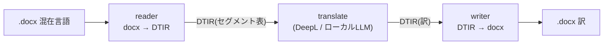
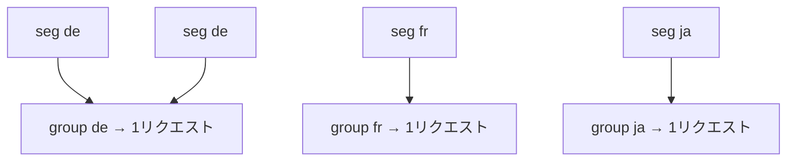

:::message
1つの Word に複数言語が段落ごとに混ざった書類を、**書式・表・目次を崩さず／API コストを抑えて**翻訳したい——この「本来の課題」を、**ドキュメント翻訳の中間表現 DTIR** という設計で解いた話です。実装の穴つぶしの詳細（再帰走査・glossary・サイズバッチ・段内書式保持）は [Qiita 版](https://qiita.com/shuji-bonji/items/b278df36c934377d8948) に書いたので、本記事は**設計の発想とローカルLLMでの利用**に絞ります。
:::

## 出発点：書類翻訳の現実的な 2 つの壁

DeepL コミュニティで「蘭・仏・独・日が段落ごとに混ざった docx をまとめて翻訳したい」という相談を見たのが発端でした。これを API で素直にやろうとすると、2 つの壁にぶつかります。

### 壁1：コスト

DeepL の **ドキュメント翻訳 API（`.docx` / `.pdf` 等）は、実際の文字数に関わらず 1 ファイルあたり最低 50,000 文字が課金**されます（[DeepL Help Center](https://support.deepl.com/hc/en-us/articles/360020685720-Usage-count-and-billing-in-DeepL-API)）。数段落のメモでも 1 ファイル＝5万文字ぶん。ファイル処理コストを賄うための仕様で、これ自体は妥当だと思います。が、**書類を大量に回すと効いてくる**。

かといって「段落ごとにテキスト API を叩く」と、今度はリクエスト数が爆発し、混在言語だと `source_lang` も段落ごとに変わる。

### 壁2：レイアウト崩れ

混在言語の書類には、表・結合セル・目次・ハイパーリンク・脚注・画像・段内の太字…が詰まっています。`.docx` の実体は zip ＋ XML で、**テキストと書式が `<w:r>`（ラン）単位で分かちがたく絡んでいる**。テキストを全部引っこ抜いて翻訳して順番に戻す、なんてやると書式も目次も画像位置も崩壊します。

:::message
つまり「翻訳 API をファイルに直接当てる」発想そのものが、コスト面でもレイアウト面でも筋が悪い。ここを**設計**で回避するのが本題です。
:::

## 方針：中間表現で「触っていいもの／ダメなもの」を分離する

解き方はシンプルで、**「翻訳対象のテキストだけ」を中立な中間表現(IR)に抜き出し、書式・構造・画像といった"触ると壊れるもの"は不透明な anchor(ロケータ)の裏に隠す**。この中間表現を **DTIR (Document Translation Intermediate Representation)** と呼んでいます。



この分離で、2 つの壁が両方ほどけます。

- **レイアウト**：翻訳ステージは**純粋なテキスト配列だけ**を見る。書式 XML を知らないので、書式を壊しようがない。書式・画像・`sectPr`・目次フィールドは IR に乗らない＝**原理的に崩れない**。
- **コスト**：ファイル単位のドキュメント API ではなく、**抜き出したテキストを `text[]` 配列にまとめてテキスト API に投げる**（`source_lang` を省略すれば各要素を個別に言語自動判定）。テキスト課金は実文字数なので壁1の最低課金を回避でき、コール数も「段落ごと」ではなく「配列バッチごと」に収まります。

## 設計の核

### fail-safe — IR に乗ったテキストだけ触る

reader は翻訳対象の `<w:t>` テキストだけをセグメント表に抽出し、書式 XML は `anchor.ref` に隠します。writer は元ファイルを基板に、anchor で要素を特定して **id 単位でテキストだけ差し替え**ます。

効能は明快で、**未対応の構造があっても「未翻訳のまま原語で残る」だけで、文書破壊は原理的に起きない**。「壊れるくらいなら訳されない方がマシ」な書類向けの、安全側の失敗モードです。

### バッチ翻訳でコール数を抑える（配列でまとめる）

**段落を `text[]` 配列にまとめて 1 リクエストで投げる**のが肝です。DeepL のテキスト API は配列入力を受け、`source_lang` を省略すると**各要素の言語を個別に自動判定**します（応答に項目ごとの `detected_source_language`）。「段落ごとに1リクエスト」をやめれば、コール数は **段落数 ÷ 配列上限** に収まります。

このパイプラインは、その配列を **source 言語でグループ化**して管理します（下図）。ただしこれは**用語集(glossary)を言語ペア単位で当てる**ため（DeepL の `glossary_id` は source→target ペアに紐づく）と source_lang を明示するためで、コール最小化が目的ではありません。



「1 リクエストは配列、連結しない、戻り配列長＝入力長を強制」という**境界保持**を契約にして、訳の取り違えを構造的に防いでいます。

:::message
**【追記・訂正】** 公開当初この節は「グループ化でコール数が*言語数*に収束＝コストの肝」と書いていましたが不正確でした。コール削減の本質は **配列でまとめる**ことで、DeepL は `source_lang` 省略時に配列の各項目を個別判定するため、言語ごとのグループ化は必須ではありません（小さな文書ではむしろ分断でコールが増えうる）。グループ化は glossary を言語ペア単位で当てるための実装都合です。
:::

### Translator 抽象 — エンジンを差し替え可能に

翻訳エンジンは `Translator` インタフェース 1 枚で抽象化しました。

```ts
interface Translator {
  translateBatch(texts: string[], opts: TranslateBatchOptions): Promise<string[]>;
}
```

実装は `DeeplHttpTranslator` と `LlmTranslator`（OpenAI 互換・クラウド/ローカル両対応）。**`LLM_BASE_URL` を差し替えるだけで DeepL でも Ollama でも同じパイプラインが動く**。この継ぎ目が、次の「ローカルLLM での利用」に効いてきます。

## ローカルLLM での利用 — コスト回避のもう一段

中間表現＋Translator 抽象のおかげで、**翻訳エンジンを丸ごとローカルLLM に差し替えられます**。API コストをゼロにしたい・社外にデータを出したくない、という要件への現実解です。

構成はシンプルで、翻訳エンジンとして Ollama を 1 台立て、`LLM_BASE_URL` をそこに向けるだけ。

```sh
# 例: ローカルの Ollama を翻訳エンジンに
LLM_MODEL=tower-plus:9b LLM_BASE_URL=http://localhost:11434/v1 TARGET_LANG=ja \
  npx tsx src/cli.ts input.docx output.ja.docx
```

ユーザI/F（会話駆動の Claude / ヘッドレス CLI）と翻訳エンジン（DeepL / ローカル）は**独立した軸**なので、組み合わせは 2×2 の 4 パターン。どれも同じ中間表現の上で動きます。

|                  | DeepL（クラウド） | ローカルLLM（Ollama） |
| ---------------- | ------------- | ---------------- |
| **Claude（会話駆動）** | a-2           | b-2              |
| **CLI（ヘッドレス）**   | a-3           | b-3              |

LLM に翻訳をさせるときの注意は、**「N 件入れて N 件返る」保証がない**こと。そこで構造化出力（JSON）を要求し、配列長を検証し、不一致なら是正リトライ、それでも揃わなければ例外、という**境界の作り込み**で吸収しています（ここは DeepL と違ってローカル特有の手当て）。

### エンジンの性格の違い（実機での発見）

同じパイプラインでも、エンジンによって得手不得手が出ました。

- **段内書式の保持（太字・色・リンク）**：各ランを `<x id>` タグで包んで翻訳し、訳側のタグから書式を復元する方式。**DeepL（`tag_handling=xml`）はタグを確実に保持**するので向いている。一方 **翻訳特化のローカルモデルはタグを邪魔物として落とし**がちで、その場合は安全側の collapse（書式を捨てて先頭ランに統一）へ自動フォールバック。
- **用語集（glossary）**：用語対をプロンプトに注入する方式は、**ローカルの翻訳特化モデルでも素直に従い**ました（タグは落とすのに、用語指示は守る）。「XML タグの保持」より「この語はこう訳せ」という自然言語の指示の方が通りやすいようです。

:::message
教訓：**エンジン特性は機能ごとに測るべし**。「ローカルLLM はダメ／DeepL は万能」のような雑な括りではなく、書式保持は DeepL 向き・用語固定はローカルでも効く、と機能単位で住み分ければよい。どちらに転んでも fail-safe なので、文書は壊れません。
:::

## 仕事レベルの書類に通すと出た 4 つの穴（要約）

基本設計は動きますが、契約書・技術文書を通すと穴が出ます。**実務文書で頻出する構造を 1 ファイルに詰めた "torture フィクスチャ" で機械的に定量化**しながら、4 つ塞ぎました（詳細と実コードは [Qiita 版](https://qiita.com/shuji-bonji/items/b278df36c934377d8948)）。

| 穴 | 症状（何が問題か） | どう塞いだか |
| --- | --- | --- |
| **① 再帰走査** | reader が段落の「直下」しか見ておらず、表のセル内・脚注・ハイパーリンク内・追跡変更内のテキストを丸ごと取りこぼす。リンクをまたぐ文は途中で分断もされる。 | 段落とランの探索を再帰化し、入れ子の奥（表／脚注／リンク内）まで拾う。writer も同じ構造パスで正しく書き戻す。 |
| **② 脱collapse** | 訳を入れ直す際、段内の太字・色・リンクが先頭ランの書式に統一されて消える。 | 各ランをタグで包んで翻訳し、訳側のタグから書式を復元して配り直す。復元に失敗した段落は安全に collapse へフォールバック。 |
| **③ サイズバッチ** | 単一言語の長い書類が「言語＝1リクエスト」で巨大化し、API のリクエスト上限や LLM のコンテキスト上限を超える恐れ。 | 件数・文字数の上限でチャンク分割する。ただし**段落（セグメント）の途中では絶対に割らない**ので、訳の再結合は崩れない。 |
| **④ glossary** | 「Authentication Token」のような専門用語が、段落ごとにバラバラの訳語になり一貫性が崩れる。品質スコアでは防げない。 | 用語対を 1 つの真実源にし、DeepL は `glossary_id`、ローカルLLM はプロンプト注入で、文書全体を同じ訳語に固定する。 |

いずれも fail-safe を保ち、既存契約は後方互換、既定挙動は不変（opt-in）で着地させています。

## DeepL への所感

最後に、当事者として一言。**DeepL のドキュメント翻訳 API がファイル単位で最低課金になるのは妥当**だと思います。ファイル解析・再構築のコストは実在しますし、UI のドキュメント翻訳体験はとても良い。本記事の設計は、それを否定するものではなく「**テキストとして賢く投げ直してコストとレイアウトを自前で握る**」という 1 つの回避実装にすぎません。

個人的な希望としては、**API は課金体系を凝るよりも翻訳精度の方に一層力を入れてほしい**。書式やファイル処理はこちら側で何とでもできるが、訳の質だけは差し替えが効かないので。

## まとめ

中間表現を 1 枚噛ませて「触っていいもの（テキスト）」と「触ってはいけないもの（構造・書式）」を**型の上で物理的に分ける**。たったこれだけで、**コスト（言語別バッチでテキスト課金に寄せる）とレイアウト（書式は触らないので原理的に崩れない）**の 2 つの壁が同時にほどけ、おまけにエンジンを DeepL ↔ ローカルLLM で差し替えられる。

docx に限らず、PDF や他フォーマットの「構造を壊さない自動処理」全般に効く設計だと思います。
