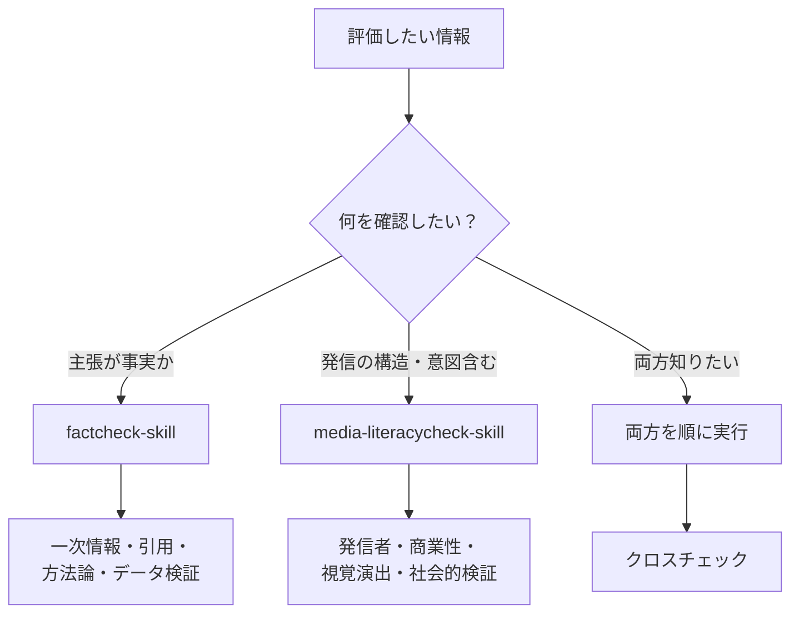
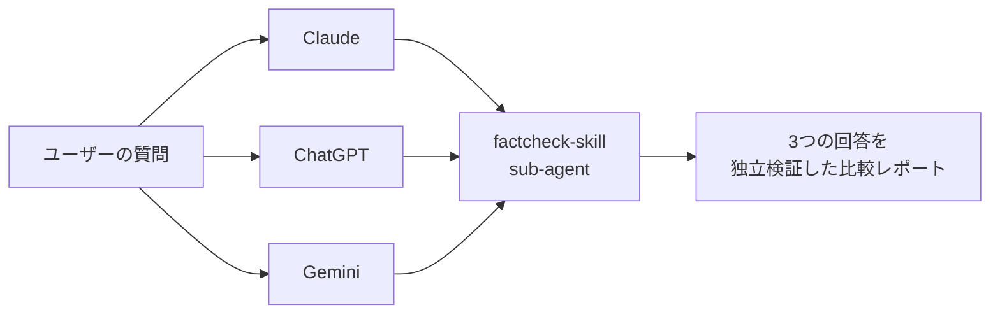

## はじめに

情報の信頼性を体系的に評価する 2 つの Claude Skill を公開しています。

- [shuji-bonji/factcheck-skill](https://github.com/shuji-bonji/factcheck-skill) — 20 項目 × 4 カテゴリで「**事実の正確性**」を検証
- [shuji-bonji/media-literacycheck-skill](https://github.com/shuji-bonji/media-literacycheck-skill) — 30 項目 × 6 カテゴリで「**情報の出され方**」を評価

本記事では「**実際にどんな場面で使えるか**」を立場別・シーン別に整理します。インストール手順は各リポジトリの README を参照してください。

### 2 つの Skill の違い

混同されがちですが、ファクトチェックとメディアリテラシーチェックは性質が異なります。

| | ファクトチェック | メディアリテラシーチェック |
| --- | --- | --- |
| 何を確認するか | 個別の主張・データが事実か | 情報がどう発信されているか |
| 主体 | 専門家・記者・検証機関 | 情報の受け手（個人） |
| 目的 | 真偽の判定 | 自己防衛的な批判的思考 |
| 対象範囲 | 具体的な発言・記事・数値 | メディア全般・SNS・発信構造 |
| 典型的な問い | 「この統計は正しいか」 | 「なぜこの記事はこの構成なのか」 |

両者は対立するものではなく相互補完の関係にあります。「事実は正しいが発信意図に偏りがある」情報も多いし、「発信者は誠実だが引用元のデータが古い」こともある。だから 2 つの Skill は**立場や目的によって使い分ける**ものです。両方インストールしておいて、状況に応じて呼び出すのが基本になります。

## 使い分けの全体像

最初に、どちらをいつ使うかの整理から。



| 状況 | 第一候補 | 補足 |
| --- | --- | --- |
| 投資・健康・科学的主張の真偽 | factcheck-skill | 一次情報・方法論の確認が中心 |
| ニュース記事の信頼性 | media-literacycheck-skill | 発信意図・編集姿勢も評価 |
| SNS 投稿のリテラシーチェック | media-literacycheck-skill | 視覚演出・感情訴求の検出 |
| 政府・公的データの裏取り | factcheck-skill | 引用元の確認可能性が肝 |
| LLM 出力のメタ検証 | 両方 | sub-agent モードで併用 |

ここから先は立場別の具体ユースケースです。

## 1. 個人ユーザー向け — 最も強いユースケース

最も日常的に効くのは個人利用です。

### 1-1. ニュース・SNS 情報の日常検証

X（旧 Twitter）や note、Qiita などで流れてくる情報の真偽を、その場で評価できます。

**呼びかけ例**:

> 「この記事をファクトチェックして」
> 「この X 投稿のリテラシー評価して: https://x.com/...」
> 「この主張の信頼性を 30 項目で評価して」

**出力イメージ**:

```
## メディアリテラシー評価レポート

### 評価対象
- タイトル: 「○○が△△を発表」
- 種別: X投稿（インフルエンサー）
- 評価日: 2026-05-22

### カテゴリ別スコア

| カテゴリ | ✅ | ❌ | ➖ | スコア | 判定 |
|---|---|---|---|---|---|
| 情報源の評価 | 2 | 3 | 0 | 2/5 | 🟠 |
| 内容の質 | 3 | 2 | 0 | 3/5 | 🟡 |
| 目的と意図 | 1 | 4 | 0 | 1/5 | 🔴 |
| 時系列と文脈 | 4 | 1 | 0 | 4/5 | 🟢 |
| 視覚的要素 | 2 | 0 | 3 | 2/2 | 🟢 |
| 社会的検証 | 1 | 4 | 0 | 1/5 | 🔴 |
| 合計 | 13 | 14 | 3 | 13/27 | 🟠 |

### 要注意ポイント
- 発信者の所属が確認できない
- 商業的利益との関係が開示されていない（推薦リンク多数）
- 他の信頼できる情報源で確認できない
...
```

「拡散すべきか」を判断する材料として使えます。

### 1-2. 投資・健康・教育などリスクが高い情報の精査

「○○すれば必ず儲かる」「△△で病気が治る」系の情報は、特に厳しく評価する必要があります。

**呼びかけ例**:

> 「この投資情報の信頼性を、特に **方法論** と **利害関係の開示** 観点で厳しめにチェックして」
> 「この健康法について、一次情報があるかと、専門家評価があるかを確認して」

`factcheck-skill` のクリティカル評価 6 項目（権威ある情報源・一次情報・複数独立情報源・匿名性・煽情表現・論理性）でほとんどの怪しい情報は弾けます。

### 1-3. 子どもの情報リテラシー教育

評価レポートを子どもと一緒に見ることで、「**なぜこの情報を疑うべきか**」を構造的に説明できます。

**呼びかけ例**:

> 「この YouTube サムネイルとタイトルを、子どもと一緒に見るための教材として評価して。クリックベイトの判断基準を分かりやすく解説して」

`media-literacycheck-skill` の **カテゴリ5: 視覚的要素**（サムネイル・グラフ操作・画像加工の有無）は、子どもが普段触れるコンテンツの裏側を見せるのに向いています。

### 1-4. 自分自身の AI 出力の検証

ChatGPT、Claude、Gemini、Perplexity などの出力をそのまま信じる前に、ハルシネーション検出を兼ねたチェックができます。

**呼びかけ例**:

> 「さっきの Claude の回答を、独立 sub-agent としてリテラシーチェックして。特に引用論文が実在するかを WebSearch (Web検索機能) で裏取りして」

両 Skill の **sub-agent モード**（`agents/` 配下の独立検証エージェント）が特に効きます。自己評価バイアスを排除するため、メインエージェントの会話文脈を渡さずに評価させます。

## 2. ビジネス・プロフェッショナル向け

業務での情報精査にも使えます。

### 2-1. ジャーナリスト・ライター

**取材前の情報源スクリーニング**:

> 「この情報源を取材候補として評価して。発信者の専門性、過去の発信の一貫性、利益相反の有無をチェック」

**記事公開前の最終検証**:

> 「この原稿の事実関係を 20 項目で検証して。特に引用元の確認可能性と、方法論の妥当性を厳しめに」

ファクトチェック機関（FIJ、JFC など）の検証結果も SKILL 内で参照するよう設計されているので、既知の偽情報パターンに引っかかった場合は警告が出ます。

### 2-2. PR・広報担当

**自社発信のリスクチェック**:

> 「このプレスリリース案を、第三者視点でリテラシーチェックして。**煽情的表現**と**バランスの取れた視点**の項目を厳しく見て」

自社の発信が「煽りすぎ」「片寄りすぎ」になっていないかをセルフチェックできます。

**競合他社の情報検証**:

> 「この競合のキャンペーン発表記事をファクトチェック。誇大表現・引用元・データの再現性を確認」

### 2-3. リサーチャー・アナリスト

**市場調査・政策調査**:

> 「このコンサル会社のレポートを評価して。**サンプル数・統計手法・データの公開性**と、**スポンサーシップの開示**を確認」

調査レポートは出典が明確でも、**サンプルが偏っている** / **スポンサー企業に有利な切り口** であることが多いので、`factcheck-skill` の **カテゴリ4: 文脈・バイアス評価** が刺さります。

### 2-4. コンサルタント

**クライアントへの提言の裏付け**:

> 「この提言書のデータ部分を全てファクトチェック。各統計の出典・年度・調査方法を確認して、信頼性スコアを項目別に出して」

クライアントの前で「このデータの出典は？」と聞かれて答えられない事態を避けられます。

## 3. 組織・教育機関向け

### 3-1. 企業内研修

メディアリテラシー研修・情報セキュリティ研修の**実践教材**として使えます。

**研修シナリオ例**:

1. 研修参加者に「明らかにおかしい情報」「やや怪しい情報」「信頼できる情報」の 3 つを配布
2. Skill で評価させて、スコアと判断根拠を見せる
3. 「人間の直感」と「30 項目チェック」のギャップを議論

評価レポートに**判断根拠が明示される**ため、研修参加者が「なぜそう判定されたか」を理解しやすいのが利点です。

### 3-2. 学校・大学

**情報リテラシー授業**:

> 「この Wikipedia 記事を 30 項目で評価して。生徒が読む際に **どの点を疑うべきか** を分かりやすく解説して」

**論文・レポート指導**:

> 「学生のレポート（添付）について、引用元の信頼性と方法論の妥当性を 20 項目で評価して。改善点を学生にフィードバックする形で」

### 3-3. ファクトチェック団体

専門機関による正式な検証の前の **初期スクリーニング** に。

**呼びかけ例**:

> 「これから検証する候補 10 件について、各々の信頼性を一括評価して。クリティカル評価で 4 個以上 ❌ のものを優先検証対象としてリストアップ」

トリアージ的に使うことで、限られたファクトチェッカーのリソースを重要案件に集中できます。

### 3-4. 行政・シンクタンク

**政策関連情報の多角的評価**:

> 「この政策提言を、**factcheck-skill** で事実関係を検証した上で、**media-literacycheck-skill** で発信意図・利害関係も評価して。両方の結果を統合レポートに」

2 つを順番に走らせて結果を統合するパターンは、政策研究や規制影響評価に向いています。

## 4. 先進的なユースケース

ここからは応用編。

### 4-1. AI 回答のメタ検証（二重チェック）

複数の LLM の出力を相互検証する仕組みが組めます。



**呼びかけ例**:

> 「Claude / ChatGPT / Gemini に同じ質問を投げた 3 つの回答を、それぞれ独立して factcheck-skill で評価して。特にハルシネーション（実在しない論文引用・誤った数値）の有無を比較して」

AI 出力の信頼性比較ベンチマークとしても使えます。

### 4-2. リアルタイム監視

特定トピック（選挙、災害、医療情報、新興技術）について、**情報フローを継続的に評価**する用途。

**スケジュール実行と組み合わせる**:

```
毎朝9時に、過去24時間の「#気になるハッシュタグ」投稿のうち
拡散数上位10件を取得し、各々をリテラシーチェックして
レポートを Slack に投稿する
```

選挙期間中の偽情報モニタリング、災害時のデマ検出、医療系トピックの広告／PR 識別など、**継続観測** が必要なシーンに向きます。

### 4-3. コンテンツ作成時のガードレール

ブログや YouTube の原稿執筆時に、**並行して Skill を走らせて**自己点検する。

**呼びかけ例**:

> 「今書いている記事の最新版を、media-literacycheck-skill で評価して。特に **感情的・扇動的な表現が少ない**、**バランスの取れた視点**、**利益相反の開示** を見て、足りない部分を指摘して」

書きながら「自分が今、どの方向に偏っているか」を構造的に確認できます。広告 PR 記事を書くときの法的リスクチェック（広告と記事の区別が明確か）にも有効です。

### 4-4. 学術・研究分野での応用

**論文サーベイ**:

> 「このリサーチクエスチョンに関連する論文 5 本を WebSearch で集めて、各論文の方法論・サンプル数・利益相反開示を factcheck-skill の **カテゴリ3: 検証・照合** で評価して、信頼性順にランキング」

**プレプリント評価**:

> 「arXiv のこの論文（査読前）を 20 項目で評価して。査読を経ていない情報を引用する際の **取り扱い注意点** を整理して」

## 注意点と限界

ユースケースの紹介だけでは片手落ちなので、限界も整理します。

### Skill の限界

- **LLM の知識カットオフに依存** する。最新情報については WebSearch を併用しないと評価が古くなる。
- **白黒つけるツールではない**。スコアは「相対的な信頼性の目安」であって、絶対的な真偽判定ではない。
- **評価項目自体に主観が入る**。「権威ある情報源」の定義は文化・分野によって変わる。日本のメディア環境を前提に作っているので、海外情報の評価ではやや偏る可能性。
- **画像・動画の直接的な真偽判定はできない**（画像加工の有無は LLM が見抜けない）。Google 画像検索や TinEye による逆検索を併用する必要がある。

### 推奨される運用

- **重要な判断は Skill 単独で決めない**。あくまで「人間の判断を補助する」ツールとして使う。
- **複数情報源でクロスチェックする**前段階のスクリーニングとして使う。
- **評価結果を共有する場合は、根拠（どの項目が ❌ になったか）も併せて伝える**。スコアだけ独り歩きさせない。

## 立場別おすすめ呼び方一覧

最後に、立場別の「最初の一声」をまとめておきます。コピペして使えます。

| 立場 | 最初の呼びかけ |
| --- | --- |
| 個人ユーザー | 「これメディアリテラシーチェックして 👉 [URL]」 |
| ジャーナリスト | 「取材前にこの情報源を 20 項目で評価して。匿名性と利害関係を厳しめに」 |
| PR 担当 | 「このプレスリリース案を第三者視点でリテラシーチェック。煽情表現とバランス重視で」 |
| リサーチャー | 「このレポートをファクトチェック。サンプル数・統計手法・スポンサー開示を確認」 |
| 教員 | 「このサイトを生徒と一緒に評価する教材として 30 項目で分析。なぜ疑うべきか解説して」 |
| AI 出力検証 | 「さっきの Claude の回答を sub-agent としてリテラシーチェック。引用論文の実在を WebSearch で裏取り」 |
| 継続監視 | 「毎朝、過去 24h の #ハッシュタグ 投稿上位 10 件をリテラシーチェックして Slack へ」 |

## まとめ

ファクトチェック／メディアリテラシーチェックの Skill は、**1 回作って終わり**ではなく、**立場と目的に応じて呼び分ける道具** です。

最初は個人で日常情報の確認に使い、慣れてきたら sub-agent モードで AI 出力のメタ検証、さらにスケジュール実行で継続監視、というように段階的に応用範囲を広げられます。

「白黒つける魔法の杖」ではなく、「自分が情報のどの側面を見落としているか」を構造的に教えてくれる **思考の補助輪** として使うのが、最も価値が出る使い方だと思っています。

なぜ 2 つの Skill に分けたのか、`SKILL.md` をどう設計したか、Anthropic Plugin Marketplace でどう公開するかなど、**実装と設計判断の詳細** は関連記事にまとめています。

## 関連リンク

- 関連記事: [ファクトチェックとメディアリテラシーチェックを2つのClaude Skill化してみた話](https://zenn.dev/shuji_bonji/articles/9fd9850011f3ae) 
- リポジトリ: [factcheck-skill](https://github.com/shuji-bonji/factcheck-skill) / [media-literacycheck-skill](https://github.com/shuji-bonji/media-literacycheck-skill)
- 派生元 PWA: [fact-checklist](https://github.com/shuji-bonji/fact-checklist) — 12 言語対応のファクトチェックリスト
- 国内ファクトチェック機関: [FIJ](https://fij.info/) / [JFC](https://factcheckcenter.jp/)

