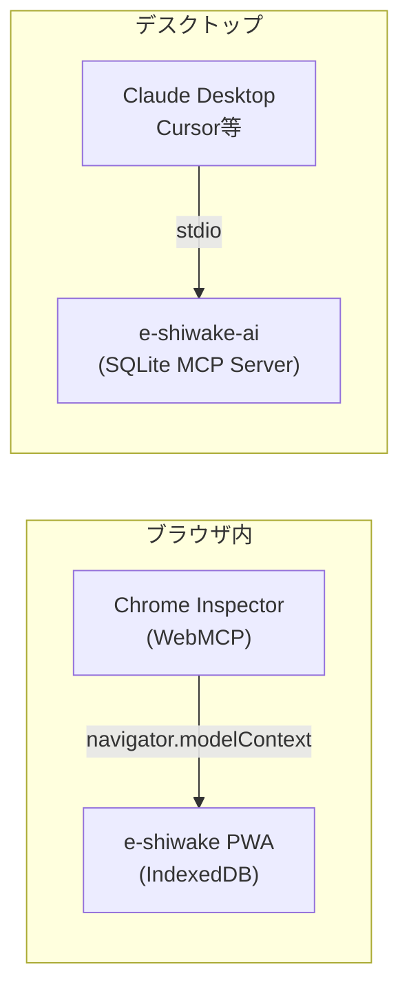

## はじめに

[前の記事](https://zenn.dev/shuji_bonji/articles/29b8d3ee2d89a9) では、会計 PWA「e-shiwake」に **WebMCP** を組み込んで、ブラウザ内の AI エージェントから仕訳操作できるようにしました。

ただし WebMCP には大きな制約がひとつあります。

> **Chrome 146+ の Canary 限定** で、一般ユーザーにはまだ届かない。

もうひとつの現実的な問題として、Claude Desktop や Cursor など「**デスクトップ上の AI エージェント**」とは接続できません。WebMCP はブラウザ内完結なので、ブラウザの外には出られないからです。

そこで作ったのが **[e-shiwake-ai](https://github.com/shuji-bonji/e-shiwake-ai)** です。

e-shiwake のビジネスロジックを丸ごと **Node.js の MCP サーバー**として切り出し、Claude Desktop から自然言語で仕訳・帳簿操作ができるようにしました。

```
# こんな会話ができる
「2025年の損益計算書を見せて」
「Amazonの消耗品費を全部リストアップして」
「打ち合わせのタクシー代3200円を旅費交通費で入力して」
```

この記事では、**なぜこの構成にしたか・どう実装したか・つまったところ**を共有します。

### 対象読者

- MCP サーバーを自作してみたい方
- TypeScript モノレポ（pnpm workspaces）の構成に興味がある方
- ローカルファースト PWA を AI エージェント対応させたい方


## e-shiwake とは

フリーランス・個人事業主向けの会計 PWA です。
年末年始の1週間で **Claude Code と協業**して作りました。

- SvelteKit + TypeScript + shadcn-svelte
- データは IndexedDB にローカル保存（サーバーなし・認証なし）
- 青色申告決算書・証憑管理・電子帳簿保存法対応
- 完全無料・広告なし

詳しくは作成時の記事をどうぞ👇
https://qiita.com/shuji-bonji/items/9620415935b9f25a2d6d


## e-shiwake-ai の概要

### アーキテクチャ

```
┌──────────────────────────────────────────────────┐
│  Claude Desktop（または他の MCP クライアント）       │
└──────────────────┬───────────────────────────────┘
                   │ MCP Protocol (stdio)
┌──────────────────▼───────────────────────────────┐
│  @e-shiwake/mcp-server                           │
│  ・22 個の MCP ツール定義                          │
│  ・Zod によるスキーマバリデーション                  │
│  ・Markdown レスポンスフォーマット                   │
├──────────────────────────────────────────────────┤
│  @e-shiwake/db                                   │
│  ・SQLite（better-sqlite3 / 同期 API）             │
│  ・リポジトリパターン                               │
│  ・WAL モード・外部キー制約 ON                      │
├──────────────────────────────────────────────────┤
│  @e-shiwake/core                                 │
│  ・型定義（JournalEntry, Account, Vendor …）      │
│  ・純粋関数（試算表・P/L・B/S・消費税計算）          │
│  ・ゼロ依存（Node.js / ブラウザ 共用）               │
└──────────────────────────────────────────────────┘
```

### パッケージ構成

```
e-shiwake-ai/
├── packages/
│   ├── core/         # @e-shiwake/core — 型定義・ビジネスロジック（ゼロ依存）
│   ├── db/           # @e-shiwake/db   — SQLite リポジトリ層
│   └── mcp-server/   # @e-shiwake/mcp-server — MCP エントリポイント
├── pnpm-workspace.yaml
└── tsconfig.base.json
```

pnpm workspaces で管理するモノレポです。`core → db → mcp-server` の依存順でビルドします。


## なぜ SQLite にしたか

元の e-shiwake は **IndexedDB（Dexie.js）** で動いています。ブラウザ用には最適ですが、Node.js の MCP サーバーでは使えません。

選択肢を整理するとこうなります。

| ストレージ | MCP サーバーで使える | ブラウザで使える | 同期 API |
|---|---|---|---|
| IndexedDB | ❌ | ✅ | ❌（Promise ベース）|
| SQLite（better-sqlite3）| ✅ | ❌ | **✅** |
| SQLite（sql.js / WASM）| ✅ | ✅ | △（非推奨） |

MCP サーバーは**同期 I/O のメリットが大きい**です。`better-sqlite3` は同期 API なので、`await` なしでクエリが書けます。コードがシンプルになり、トランザクションも直感的に扱えます。

```typescript
// 同期 API なので await 不要、トランザクションも素直に書ける
const transaction = db.transaction(() => {
    insertJournal.run(id, date, vendor, description, evidenceStatus, now, now);
    for (const line of journal.lines) {
        insertLine.run(line.id, id, line.type, line.accountCode, line.amount, ...);
    }
});
transaction(); // ← これだけ
```

### データの共有について

現状、e-shiwake（ブラウザ版）と e-shiwake-ai（MCP サーバー）は**データを共有しません**。

MCP サーバー専用の SQLite ファイルを持ちます。将来的には「ブラウザ版からエクスポートした JSON を MCP サーバーにインポートする」フローを整備したいと考えています（インポートツール自体は実装済みです）。


## クイックスタート

```bash
git clone https://github.com/shuji-bonji/e-shiwake-ai.git
cd e-shiwake-ai
pnpm install
pnpm run build
```

`claude_desktop_config.json` に追加：

```json
{
    "mcpServers": {
        "e-shiwake": {
            "command": "/path/to/.nvm/versions/node/v22.x.x/bin/node",
            "args": ["/path/to/e-shiwake-ai/packages/mcp-server/dist/index.js"],
            "env": {
                "E_SHIWAKE_DB_PATH": "/path/to/your/e-shiwake.db"
            }
        }
    }
}
```

:::message
`better-sqlite3` はネイティブモジュールです。ビルド時と実行時の Node.js バージョンが一致していないと起動できません。`"command": "node"` ではなく **絶対パスで指定**するのが確実です。
:::

---

## MCP ツール一覧（22個）

### 仕訳管理（7個）

| ツール名 | 説明 |
|---|---|
| `eshiwake_list_fiscal_years` | 利用可能な会計年度の一覧 |
| `eshiwake_list_journals` | 年度指定で仕訳一覧取得 |
| `eshiwake_get_journal` | ID 指定で仕訳詳細取得 |
| `eshiwake_create_journal` | 仕訳作成（複合仕訳対応） |
| `eshiwake_update_journal` | 仕訳更新 |
| `eshiwake_delete_journal` | 仕訳削除 |
| `eshiwake_delete_year_data` | 年度データ一括削除 |

### 勘定科目管理（5個）

| ツール名 | 説明 |
|---|---|
| `eshiwake_list_accounts` | 勘定科目一覧（タイプ別フィルタ可） |
| `eshiwake_get_account` | 科目コードで詳細取得 |
| `eshiwake_create_account` | 勘定科目追加（自動採番） |
| `eshiwake_update_account` | 勘定科目更新 |
| `eshiwake_delete_account` | 勘定科目削除（使用中は不可） |

### 取引先管理（5個）

| ツール名 | 説明 |
|---|---|
| `eshiwake_list_vendors` | 取引先一覧・名前検索 |
| `eshiwake_get_vendor` | ID 指定で詳細取得 |
| `eshiwake_create_vendor` | 取引先追加（名前重複チェック付き） |
| `eshiwake_update_vendor` | 取引先更新 |
| `eshiwake_delete_vendor` | 取引先削除 |

### 帳簿・レポート（5個）

| ツール名 | 説明 |
|---|---|
| `eshiwake_trial_balance` | 試算表（合計残高試算表）生成 |
| `eshiwake_profit_loss` | 損益計算書生成 |
| `eshiwake_balance_sheet` | 貸借対照表生成 |
| `eshiwake_tax_summary` | 消費税集計（10%・8%軽減・非課税等） |
| `eshiwake_export_data` | データを JSON エクスポート |


## 実装のポイント

### Zod によるバリデーション

WebMCP 版では軽量な自前バリデーターを書きましたが、MCP Server 版では **Zod** を使っています。`@modelcontextprotocol/sdk` が Zod スキーマを直接受け取れるので、型定義とバリデーションを1箇所にまとめられます。

```typescript
const CreateJournalSchema = z.object({
    date: z.string().regex(/^\d{4}-\d{2}-\d{2}$/, '日付は YYYY-MM-DD 形式で入力してください'),
    description: z.string().min(1).max(200),
    vendor: z.string().max(100).optional(),
    lines: z.array(
        z.object({
            type: z.enum(['debit', 'credit']),
            accountCode: z.string().length(4),
            amount: z.number().positive(),
            taxCategory: z.enum(['sales_10', 'sales_8', 'purchase_10', 'purchase_8',
                                  'exempt', 'out_of_scope', 'na']).optional()
        })
    ).min(2)
}).strict();

server.registerTool('eshiwake_create_journal', {
    title: '仕訳作成',
    description: '...',
    inputSchema: CreateJournalSchema,  // ← そのまま渡せる
    annotations: {
        readOnlyHint: false,
        destructiveHint: false,
        idempotentHint: false
    }
}, async (params) => {
    // params は型安全
});
```

### `@e-shiwake/core` の再利用

元の e-shiwake（SvelteKit）と e-shiwake-ai（MCP サーバー）で**ビジネスロジックを共有**できるのがモノレポ化の最大の恩恵です。

```typescript
// packages/core — SvelteKit でも Node.js でも動く純粋関数
export function generateTrialBalance(
    journals: JournalEntry[],
    accounts: Account[]
): TrialBalanceResult { ... }

export function generateProfitLoss(
    journals: JournalEntry[],
    accounts: Account[]
): ProfitLossResult { ... }
```

MCP サーバー側は DB から仕訳を取得してこの関数に渡すだけです。

```typescript
// packages/mcp-server
const journals = getJournalsByYear(params.fiscalYear);
const accounts = getAllAccounts();
const result = generateTrialBalance(journals, accounts);
// → Markdown テーブルとして返す
```

### スキーマとインデックス設計

SQLite のスキーマ初期化時に **WAL モード**と**外部キー制約**を有効化しています。フリーランス規模のデータ量でもベストプラクティスは守っておきたいところです。

```sql
-- インデックス（帳簿集計・検索で効く）
CREATE INDEX IF NOT EXISTS idx_journals_date ON journals(date);
CREATE INDEX IF NOT EXISTS idx_journal_lines_journal_id ON journal_lines(journal_id);
CREATE INDEX IF NOT EXISTS idx_journal_lines_account_code ON journal_lines(account_code);

-- パフォーマンス・整合性設定
PRAGMA journal_mode = WAL;
PRAGMA foreign_keys = ON;
```


## テスト

`@e-shiwake/core` と `@e-shiwake/db` は Vitest でユニットテストを書いています。合計 **289件** のテストが通っています。

```bash
pnpm --filter @e-shiwake/core test   # 163件
pnpm --filter @e-shiwake/db test     # 126件
pnpm --filter @e-shiwake/mcp-server test  # E2E 102件
```

DB テストはインメモリ SQLite を使っているので高速です（5〜10秒）。実際の 2025 年度データ（仕訳 76件・勘定科目 66件・取引先 27件）をフィクスチャとして使っており、現実的なシナリオで動作確認できています。


## WebMCP との使い分け

前の記事で実装した WebMCP と、今回の MCP サーバーを比較するとこうなります。



| 比較項目 | WebMCP（前回） | MCP Server（今回） |
|---|---|---|
| 対応 AI エージェント | Chrome 内蔵 AI のみ | Claude Desktop, Cursor 等 |
| ブラウザ要件 | Chrome 146+ 必須 | 不要 |
| データストア | IndexedDB（ブラウザ） | SQLite（ローカルファイル） |
| 実行環境 | ブラウザ内 JS | Node.js |
| UI リアルタイム更新 | ✅（CustomEvent） | ❌（CLI のみ） |
| 一般ユーザーへの到達 | まだ早い | **今すぐ使える** |

WebMCP は「ブラウザの AI とアプリが直結する未来」の布石です。一方 MCP サーバーは**今日から Claude Desktop で使える**実用的な手段です。両方維持する方針です。

## 使ってみてわかった：AIだけでは補えないもの

実際に Claude Desktop から日常的に使ってみると、**AI エージェントがフロントエンドを置き換えるには、まだ足りないものがある**とわかりました。

### 「何があるか知らないもの」は発見できない

会計には**試算表・損益計算書・貸借対照表**といった帳票があります。ただし、これらを知らない人がプロンプトで辿り着くのは難しい。

UI なら「試算表」というメニュー項目を見て「押してみよう」と思えます。プロンプトでは、存在を知っていないと頼めません。

```
# AI が得意なこと
「去年の消耗品費をまとめて」→ 知っている操作を素早く実行する

# AI が苦手なこと
帳票の種類を知らない人が「何を見ればいいか」を発見する
```

### 追加後の文脈が見えない

仕訳を1件追加したとき、AI が返すのは**その仕訳の情報だけ**です。

- 一覧の中でどこに挿入されたか
- 前後の仕訳との日付・金額の流れ
- 借方・貸方のバランスが全体として合っているか

こういった「前後の文脈」は、UI の一覧画面なら一目でわかります。テキスト出力では毎回フォーマットも変わるため、確認のたびに読み直す必要があります。

### AI と UI の役割分担

整理するとこうなります。

| 観点 | AI（プロンプト）| UI |
|---|---|---|
| 知っている操作を素早くやる | ✅ 強い | △ 画面遷移が必要 |
| 何があるか知らないものを探す | ❌ 弱い | ✅ メニューで発見できる |
| 追加後の文脈・前後関係を確認 | ❌ 弱い | ✅ 一覧で一目瞭然 |
| 出力フォーマットの一貫性 | ❌ 毎回異なる | ✅ 常に同じ |

**AI はベテランを速くする、UI は初心者を導く。**

この気づきをもとに、次のステップとして MCP クライアント（UI 付き）の開発を進めています。
## 今後の展望

- [ ] **MCP クライアント（UI 付き）の開発** — AI と既存 UI を組み合わせたフロントエンドの実装
- [ ] e-shiwake（ブラウザ版）からの JSON エクスポート → MCP サーバーへのインポートを簡単にする
- [ ] `search_journals` ツールの追加（現状は年度別取得のみ）
- [ ] 総勘定元帳（`eshiwake_ledger`）ツールの追加
- [ ] npx でワンコマンド起動できるようにする（`npx @e-shiwake/mcp`）


## まとめ

e-shiwake のビジネスロジックを MCP サーバーとして切り出した **e-shiwake-ai** を紹介しました。

- **モノレポ（pnpm workspaces）** で `core / db / mcp-server` を分離し、ビジネスロジックを再利用
- **SQLite + better-sqlite3** の同期 API でシンプルなリポジトリ層を実装
- **Zod** でスキーマとバリデーションを一元管理
- WebMCP（ブラウザ内）と MCP サーバー（デスクトップ）の**2本立て**で AI 連携をカバー

「自分の会計データを AI に説明しながら整理したい」という需要は確実にあると思っています。Claude に「去年の通信費をまとめて」と頼んだら帳簿から引いてきてくれる体験は、実際に使ってみると思った以上に便利でした。

フリーランスや個人事業主の方でぜひ試してみてください。

---

**e-shiwake-ai**（本記事）：
https://github.com/shuji-bonji/e-shiwake-ai

**e-shiwake**（ブラウザ版 PWA）：
https://github.com/shuji-bonji/e-shiwake

---

**シリーズ記事**

| # | 内容 | 掲載先 |
|---|---|---|
| 1 | 年末年始の1週間で会計ソフトを作った | [Qiita](https://qiita.com/shuji-bonji/items/9620415935b9f25a2d6d) |
| 2 | WebMCP でブラウザ内 AI エージェント連携 | [Zenn](https://zenn.dev/shuji_bonji/articles/29b8d3ee2d89a9) |
| 3 | MCP サーバーとして切り出した（本記事） | Zenn |