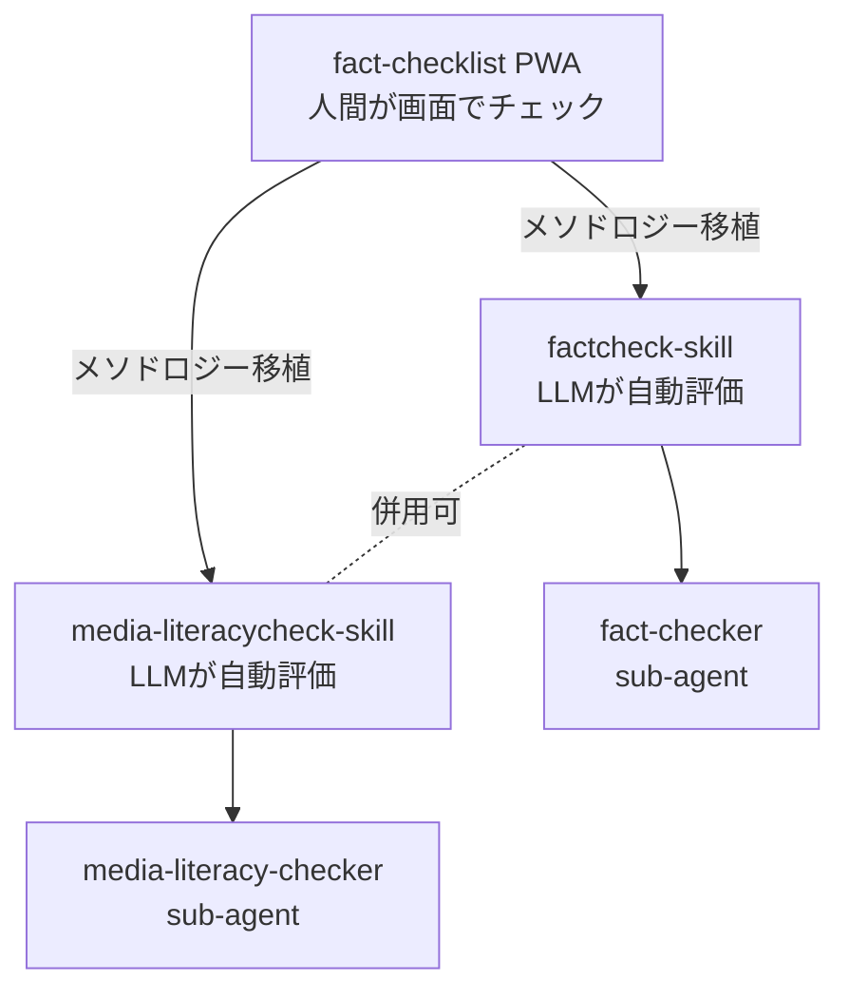
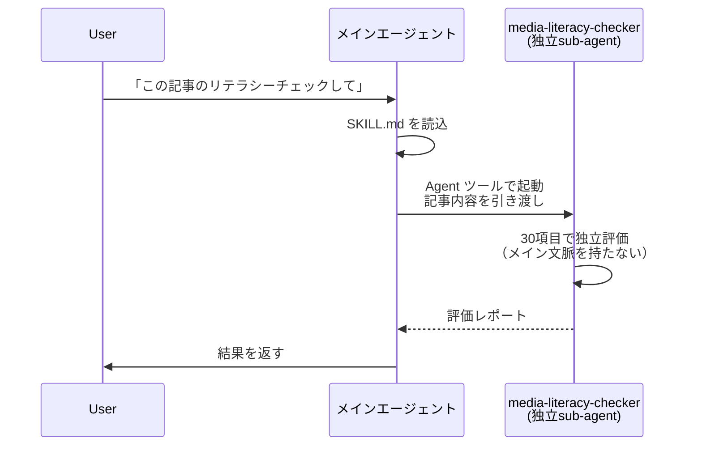
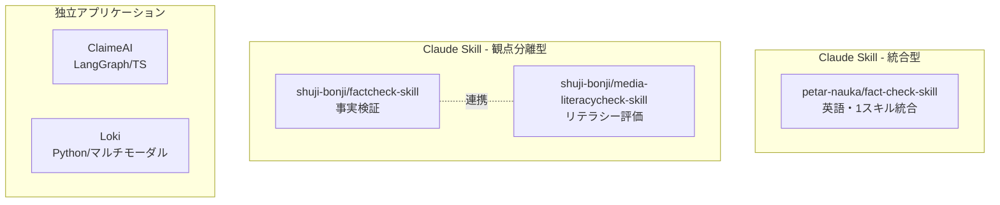
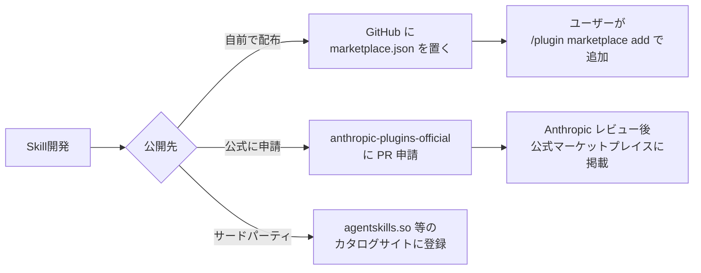

## はじめに

Claude Code / Cowork で動く **Agent Skill** として、情報の信頼性を体系的に評価する 2 つの Skill を公開しました。

- [shuji-bonji/factcheck-skill](https://github.com/shuji-bonji/factcheck-skill) — 20 項目 × 4 カテゴリでファクトチェック
- [shuji-bonji/media-literacycheck-skill](https://github.com/shuji-bonji/media-literacycheck-skill) — 30 項目 × 6 カテゴリでメディアリテラシー評価

どちらも筆者が以前から運用している 12 言語対応 PWA [shuji-bonji/fact-checklist](https://github.com/shuji-bonji/fact-checklist) の評価メソドロジーを LLM 向けに移植したものです。

「機能が似ている 2 つの Skill をなぜ分けたのか」「Claude Skill としてどう構成したか」「Anthropic Skills Registry でどう公開するか」を実装中心に整理します。

## なぜ Skill 化したのか

PWA 版の fact-checklist は、人間が画面でチェックリストを 1 項目ずつ評価する Web アプリです。ある程度は使われてきましたが、**毎回 20〜30 項目を人手で埋めるのは負荷が高い**という課題がありました。

一方、Claude Code や Cowork は LLM がエージェントとして動作する環境です。`SKILL.md` を `~/.claude/skills/` に置くだけで、特定のキーワードに反応して自動的に評価ロジックが起動する仕組みがあります。



同じ評価基準を **人間向け UI** と **LLM 向け Skill** の両方で提供する、というのが基本思想です。

## なぜ 2 つに分けたか

機能が重なる Skill を 2 つ作るのは一見冗長です。しかし、**ファクトチェックとメディアリテラシーチェックは目的・主体・観点が異なる**ため、意図的に分離しました。

### ファクトチェックとメディアリテラシーチェックの違い

両者は混同されがちですが、性質がはっきり異なります。

| | ファクトチェック | メディアリテラシーチェック |
| --- | --- | --- |
| 何を確認するか | 個別の主張・データが事実か | 情報がどう発信されているか |
| 主体 | 専門家・記者・検証機関 | 情報の受け手（個人） |
| 目的 | 真偽の判定 | 自己防衛的な批判的思考 |
| 対象範囲 | 具体的な発言・記事・数値 | メディア全般・SNS・発信構造 |
| 典型的な問い | 「この統計は正しいか」 | 「なぜこの記事はこの構成なのか」 |

ファクトチェックは「**この主張は事実か？**」を一次情報・引用・方法論・データの再現性などから検証します。一方メディアリテラシーチェックは「**この情報はどう発信されているか？**」を発信意図・商業的動機・視覚的演出・社会的検証まで含めて評価します。

両者は対立するものではなく、相互補完の関係にあります。「事実は正しいが、発信意図に偏りがある」情報も多いし、「発信者は誠実だが、引用元のデータが古い」こともある。

### 2 つの Skill としての分離

この 2 つの観点を 1 つの Skill にマージするより、**呼び出し側が意図的に選べる方が triggering 精度も上がる**と判断しました。読者の状況によって、

- 投資情報・科学的主張・統計データ → 事実関係を厳しく見たい → `factcheck-skill`
- ニュース記事・SNS 投稿・広告紛い → 発信意図まで含めて見たい → `media-literacycheck-skill`

のどちらが必要かは変わります。両 Skill の項目数とカテゴリ構造はこうなっています。

| | factcheck-skill | media-literacycheck-skill |
| --- | --- | --- |
| カテゴリ数 | 4 | 6 |
| 項目数 | 20 | 30 |
| 焦点 | 事実の正確性 | メディアリテラシー全般 |
| 追加観点 | — | 目的と意図、視覚的要素 |

両 Skill は独立しており、併用可能です。

## アーキテクチャ全体像

両 Skill は同じ構造を取っています。

```
factcheck-skill/                       media-literacycheck-skill/
├── SKILL.md                           ├── SKILL.md
├── agents/                            ├── agents/
│   └── fact-checker.md                │   └── media-literacy-checker.md
└── README.md                          └── README.md
```

メインの `SKILL.md` がトリガーで起動するメインスキル、`agents/` 配下が**独立検証用の sub-agent** です。次節以降でそれぞれ見ていきます。

## SKILL.md の中身

Claude Code / Cowork における Skill は、`SKILL.md` の冒頭 frontmatter に書かれた `description` と `name` が triggering の鍵になります。

`factcheck-skill/SKILL.md` の frontmatter から該当箇所だけ抜粋します。

```markdown
---
name: factcheck
description: |
  情報の信頼性を科学的・体系的に評価するファクトチェック・スキル。
  20項目×4カテゴリの評価フレームワークを使い、
  記事・URL・主張・Claudeの回答などあらゆる情報の信頼性をスコアリングする。
  「ファクトチェックして」「この情報は信頼できる？」「この記事の信頼性を評価して」
  「ソースを検証して」「この主張は本当？」「エビデンスを確認して」「情報の裏取りをして」
  などのリクエストで必ずこのスキルを使用すること。
  リサーチ結果のレビューや、AIの回答の自己検証にも使える。
---
```

ポイントは 3 つあります。

**1. description に発火フレーズを直接列挙する**

LLM は description を読んでこの Skill を起動すべきか判断します。「ファクトチェックして」「この情報は信頼できる？」など、**ユーザーが実際に投げそうな自然文を具体的に並べる**ことで、triggering の精度が大きく変わります。抽象的な「情報を検証するスキル」だけでは反応しにくい。

**2. ユースケースを多面的に書く**

「URL/記事/主張/AIの回答」と評価対象の幅を明示しています。これによって「Claude の回答を検証して」のような **メタな呼び出し** にも反応します。

**3. リサーチ結果のレビューにも使えると書く**

Cowork のように複数 Skill を併用するシーンでは、**他 Skill の出力をこれで検証する**ような使い方が想定できます。description にその用途を書いておくと、Claude が自発的に「先ほどの結果を factcheck-skill で検証しますか？」と提案するようになります。

### 評価項目の構造

本体部分は、4 カテゴリ × 20 項目のチェックリスト構造です。1 カテゴリだけ抜粋します。

```markdown
### カテゴリ1: クリティカル評価（6項目）

情報の根本的な信頼性を判断する最重要カテゴリ。
ここで❌が多い情報は、他カテゴリの評価に関わらず要注意。

#### 1. 権威ある情報源からの発表 `source-authority`

政府機関、学術機関、専門機関、査読済み論文、信頼できるメディアなど。

**判断基準**: 政府・公的機関（省庁、統計局、中央銀行）、
学術機関（大学、研究所、査読済み学術誌）、
専門機関、編集方針が明確な報道機関。

- ✅ 厚生労働省の統計データ、Nature誌の査読論文、日本銀行の公式発表
- ❌ 個人ブログの情報、匿名掲示板の投稿、広告目的のサイト
```

各項目に **判断基準** と **具体例（✅/❌）** を書いているのは、LLM が「曖昧な指示で判定がブレる」のを防ぐためです。Skill 設計時に痛感したのは、**「この基準で評価して」と書くだけでは不十分**で、`✅ こういうケース` / `❌ こういうケース` を併記しないと結果が安定しないということでした。

### 出力フォーマットの固定

評価結果は次のテーブル形式で出力するよう `SKILL.md` 末尾で指示しています。

```markdown
## ファクトチェック評価レポート

**対象**: [評価対象の情報・URL・主張]
**評価日**: [日付]

### 評価サマリー

| カテゴリ | ✅ | ❌ | ➖ | スコア | 判定 |
|---|---|---|---|---|---|
| クリティカル評価 | x | x | x | x/6 | 🟢/🟡/🟠/🔴 |
| 詳細評価 | x | x | x | x/6 | 🟢/🟡/🟠/🔴 |
| 検証・照合 | x | x | x | x/4 | 🟢/🟡/🟠/🔴 |
| 文脈・バイアス | x | x | x | x/4 | 🟢/🟡/🟠/🔴 |
| **総合** | **x** | **x** | **x** | **x/20** | **🟢/🟡/🟠/🔴** |

### 判定基準

- 🟢 **高い（80%以上）** — そのまま参考にできる
- 🟡 **中程度（60-79%）** — 他の情報源でクロスチェック推奨
- 🟠 **要注意（40-59%）** — 詳細なファクトチェックが必要
- 🔴 **低い（40%未満）** — 参考にしない・拡散しない
```

フォーマットを固定する理由は **二次利用しやすくするため** です。Markdown テーブルで出ていれば、Slack 投稿や Note 記事への貼り付け、後続の Skill での再パースが楽になります。判定アイコン（🟢/🟡/🟠/🔴）は **両 Skill で共通化** しています。ファクトチェックとメディアリテラシーチェックを併用したとき、結果の解釈ルールが統一されている方が読み手の認知負荷が下がるからです。

## sub-agent パターン — 自己評価バイアスの排除

両 Skill には `agents/` 配下に**独立検証用の sub-agent 定義**を置いています。

なぜ sub-agent を分けるのか。LLM のメインエージェントに「あなたの回答は正しい？」と聞いても、**自分の出力を正当化する方向にバイアスが働く**からです。これは「自己奉仕バイアス (Self-serving bias)」と呼ばれ、LLM の信頼性検証で頻繁に問題になります。

`media-literacycheck-skill/SKILL.md` から、sub-agent への委託フローを抜粋します。

```markdown
| 対象タイプ      | 取得方法                                               |
| ---------- | -------------------------------------------------- |
| URL        | WebFetch でコンテンツ取得                                  |
| テキスト（貼り付け） | そのまま分析                                             |
| LLM回答の検証   | agents/media-literacy-checker.md を sub-agent として起動 |

LLM回答の検証時は、**自分自身を評価するバイアス**を避けるため、
必ず Agent ツールで `agents/media-literacy-checker.md` を読み込んだ
独立エージェントに委託する。
```



sub-agent には**メインエージェントの会話文脈を渡さない**ことが重要です。「自分が直前に何を言ったか」を知らないからこそ、第三者として評価できます。

### LLM 出力のメタ検証

`SKILL.md` の末尾には「LLM 回答の検証モード」も書いています。

```markdown
## LLM回答の検証モード

LLMの回答を検証する場合は、以下の点を特に重視する：

1. **ハルシネーション検出**:
   具体的な数値、日付、人名、引用が実在するか WebSearch で裏取り
2. **情報の鮮度**:
   学習データのカットオフ以降の変化がないか確認
3. **バイアス**:
   特定の立場に偏っていないか、反対意見にも触れているか
4. **出典の実在性**:
   参照している論文・記事・統計が実際に存在するか確認

検証時は必ず `agents/media-literacy-checker.md` を Agent ツールで
独立エージェントとして起動し、自己評価バイアスを排除する。
```

これによって「Claude が出した提案レポートをもう一度 Claude にチェックさせる」というメタ的な使い方ができます。Cowork で長めのリサーチを走らせた後の **品質ゲート** として機能します。

## 関連プロジェクトとの比較

同じ問題意識で OSS が複数立ち上がっています。アーキテクチャと用途が違うので、それぞれの位置付けを整理しました。

### Claude Skill 形式の類似プロジェクト

**[petar-nauka/fact-check-skill](https://github.com/petar-nauka/fact-check-skill)**

Fact-checking、disinformation 検出、メディアリテラシーを **1 つの Skill に統合** したプロジェクト。SIFT メソドロジー、CRAAP test、prebunking science、claim decomposition を組み合わせている。Standard / Comparison / Prebunking / Quick Check の 4 モードを持ち、出力は HTML カード形式（dark/light theme 対応）。研究エビデンス（Clayton et al. 2020、Pennycook & Rand 2021 など）を `SKILL.md` に明記している点が特徴。

**筆者の Skill との違い**: あちらは英語前提で多言語 source triangulation、こちらは日本語ネイティブで FIJ / JFC など日本のファクトチェック機関を参照する設計。また「観点を 2 つに分離した方が triggering 精度が出る」という設計判断は筆者独自のもの。

### 非 Skill 形式の汎用ツール

**[BharathxD/ClaimeAI](https://github.com/BharathxD/ClaimeAI)** (TypeScript / LangGraph)

テキストを **検証可能な claim に分解** し、Tavily Search 経由で web 検索して検証する LangGraph ベースのシステム。Claim Extractor（Claimify メソドロジー）/ Claim Verifier / Fact Checker の 3 段パイプライン。Skill ではなく独立アプリケーションで、API 経由で組み込む形。

**[Libr-AI/OpenFactVerification (Loki)](https://github.com/Libr-AI/OpenFactVerification)** (Python)

長文を 5 段階パイプラインで処理する OSS 検証ツール。`claim 分解 → check-worthiness 評価 → クエリ生成 → エビデンス収集 → 検証` という流れで、テキスト・音声・画像・動画のマルチモーダル対応。Library と Web App の両形態で提供。論文 [arXiv:2410.01794](https://arxiv.org/abs/2410.01794) も出ている。

### 位置付けの整理



**選び方の目安**:

- LLM の対話の中で軽量に評価したい → Claude Skill 系（petar-nauka, shuji-bonji）
- パイプラインとして組み込みたい → ClaimeAI / Loki
- 観点を意図的に分けたい・日本語リソース重視 → shuji-bonji 系
- 英語圏で 1 スキル完結したい → petar-nauka

## Anthropic Skills Registry での公開

Skill を作ったら、公開して他の人にも使ってもらいたいところです。Anthropic 公式の枠組みは「**Plugin Marketplace**」という形を取っており、`.claude-plugin/marketplace.json` という manifest を Git ホスティングで公開すれば、誰でも自前マーケットプレイスを運用できます。

### 公開の選択肢



### 自前マーケットプレイスの最小構成

これが最も簡単な方法です。ディレクトリ構造はこうなります。

```
my-marketplace/
├── .claude-plugin/
│   └── marketplace.json
└── plugins/
    └── factcheck-plugin/
        ├── .claude-plugin/
        │   └── plugin.json
        └── skills/
            └── factcheck/
                └── SKILL.md
```

`marketplace.json` の最小例:

```json
{
  "name": "shuji-bonji-skills",
  "owner": {
    "name": "shuji-bonji",
    "email": "your-email@example.com"
  },
  "description": "情報リテラシー系 Claude Skill コレクション",
  "plugins": [
    {
      "name": "factcheck-skill",
      "source": {
        "source": "github",
        "repo": "shuji-bonji/factcheck-skill"
      },
      "description": "20項目×4カテゴリのファクトチェック・スキル",
      "version": "1.0.0",
      "author": { "name": "shuji-bonji" },
      "license": "MIT",
      "keywords": ["factcheck", "media-literacy", "japanese"]
    },
    {
      "name": "media-literacycheck-skill",
      "source": {
        "source": "github",
        "repo": "shuji-bonji/media-literacycheck-skill"
      },
      "description": "30項目×6カテゴリのメディアリテラシー評価スキル",
      "version": "1.0.0",
      "author": { "name": "shuji-bonji" },
      "license": "MIT",
      "keywords": ["media-literacy", "factcheck", "japanese"]
    }
  ]
}
```

ポイントを 2 つ。
:::message alert
**`name` フィールドの予約語に注意**

Anthropic は次のマーケットプレイス名を予約しています。これらは使えません。

```
claude-code-marketplace, claude-code-plugins, claude-plugins-official,
anthropic-marketplace, anthropic-plugins, agent-skills,
anthropic-agent-skills, knowledge-work-plugins, life-sciences,
claude-for-legal, claude-for-financial-services, financial-services-plugins
```

また `official-claude-plugins` や `anthropic-tools-v2` のような **公式を装う命名** も拒否されます。
:::

:::message
**`version` の扱い**

`version` を指定するとそれが pinning されます。新しい commit を push しても、`version` 文字列が変わらない限りユーザーには更新が届きません。逆に **`version` を省略すれば毎 commit が新バージョン扱い** になり、自動更新されます。個人開発で頻繁に更新するなら省略、安定運用したいなら明示的に bump する、という使い分けが推奨です。
:::

### ユーザー側のインストール手順

公開したマーケットプレイスは、ユーザー側でこう追加します。

```shell
# GitHub の owner/repo 形式で追加
/plugin marketplace add shuji-bonji/skills-marketplace

# 個別の plugin をインストール
/plugin install factcheck-skill@shuji-bonji-skills
/plugin install media-literacycheck-skill@shuji-bonji-skills
```

特定ブランチ・タグに pin する場合は `owner/repo@ref` 形式が使えます。

### ローカル検証

公開前にローカルで動作確認できます。

```shell
# ローカルディレクトリをマーケットプレイスとして追加
/plugin marketplace add ./my-marketplace

# 検証
claude plugin validate .

# 個別 plugin の検証
claude plugin validate ./plugins/factcheck-plugin
```

`claude plugin validate` は `marketplace.json` のスキーマ、重複 plugin 名、source path traversal、`plugin.json` の version 整合性をチェックします。`SKILL.md` の frontmatter も plugin ディレクトリ指定で検証してくれます。

### 公式マーケットプレイスへの申請

Anthropic が運営する公式マーケットプレイス [anthropics/claude-plugins-official](https://github.com/anthropics/claude-plugins-official) に掲載してもらう場合は、PR ベースの申請になります。品質・セキュリティ基準を満たす必要があり、当然レビューが入ります。

筆者の場合はまず**自前マーケットプレイスで公開**し、利用実績やフィードバックが溜まってから公式申請を検討する流れにしています。Skill 自体を 1 回作ったらおしまい、にはしたくないので。

### 第三者カタログサイト

Anthropic 公式の枠組みとは別に、コミュニティ運営のカタログサイトもあります。

- [agentskills.so](https://agentskills.so) — Agent Skill のカタログ
- [claudemarketplaces.com](https://claudemarketplaces.com) — Plugin / Marketplace 一覧
- [tessl.io / explainx.ai](https://tessl.io) — Skill レジストリ

これらに登録すると検索流入が増えます。GitHub の README にバッジを貼ってもらえる場合もあります。

## まとめ

2 つの Skill を作って公開する過程で得た知見をまとめます。

- **観点を分けた方が triggering 精度が上がる**。1 Skill に詰め込むより、目的別に分離して呼び出し側が選べる構造にする。
- **description に発火フレーズを直接列挙する** のが triggering 設計の肝。抽象表現ではなく、ユーザーが実際に投げそうな自然文を書く。
- **sub-agent を分けて自己評価バイアスを排除する**。`agents/` ディレクトリに独立検証エージェントを置くパターンは品質ゲートとして機能する。
- **`marketplace.json` で自前公開** は GitHub repo 1 つで完結する。公式申請より先に自前で出して試せる。
- **PWA → Skill の派生** は同じメソドロジーを human-facing と LLM-facing で両対応させる良いパターン。

実際の場面で 2 つの Skill をどう使い分けるか、立場別の推奨ユースケース（個人ユーザー・ジャーナリスト・教育機関・AI 出力のメタ検証など）は **関連記事** にまとめています。

## 関連リンク

- 関連記事: [情報の信頼性を体系的に評価する 2 つの Claude Skill を公開したので、その推奨ユースケースを提案](https://zenn.dev/shuji_bonji/articles/61492d78166e0f)
- リポジトリ: [factcheck-skill](https://github.com/shuji-bonji/factcheck-skill) / [media-literacycheck-skill](https://github.com/shuji-bonji/media-literacycheck-skill)
- 派生元 PWA: [fact-checklist](https://github.com/shuji-bonji/fact-checklist)
- Anthropic 公式 docs: [Create and distribute a plugin marketplace](https://code.claude.com/docs/en/plugin-marketplaces)
- Anthropic 公式リポジトリ: [anthropics/skills](https://github.com/anthropics/skills) / [anthropics/claude-plugins-official](https://github.com/anthropics/claude-plugins-official)
- 類似プロジェクト: [petar-nauka/fact-check-skill](https://github.com/petar-nauka/fact-check-skill) / [BharathxD/ClaimeAI](https://github.com/BharathxD/ClaimeAI) / [Libr-AI/OpenFactVerification](https://github.com/Libr-AI/OpenFactVerification)

