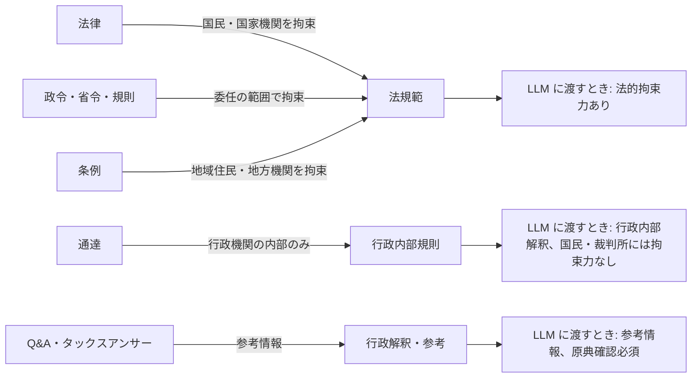
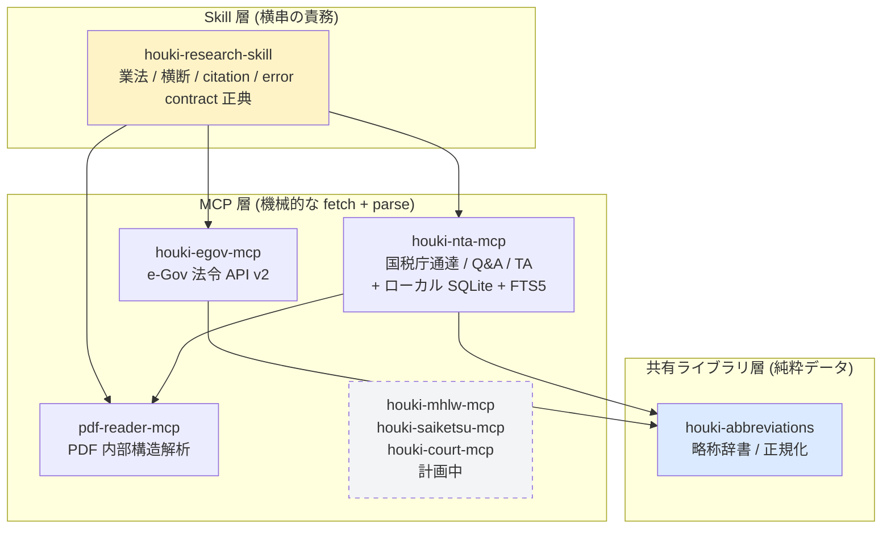
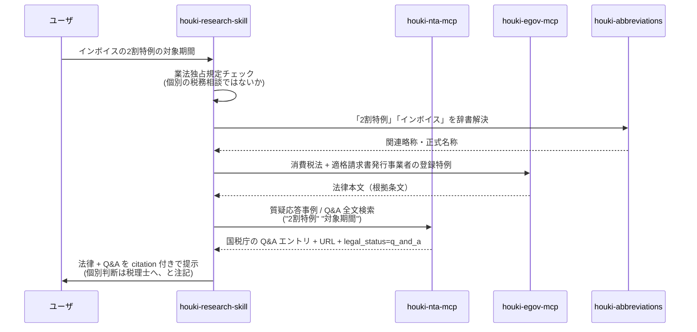

LLM に **日本の法令（憲法・法律・政令・省令・規則）** と、**国税庁の通達・Q&A** を一次情報として正確に引かせるための MCP サーバ群を GW で作りました。条例と、国税庁以外の通達は扱っていません。

成果物は次の 4 つです（すべて公開済み）。

| パッケージ | 役割 | 種別 |
| --- | --- | --- |
| [`@shuji-bonji/houki-egov-mcp`](https://www.npmjs.com/package/@shuji-bonji/houki-egov-mcp) | 日本の法令（憲法・法律・政令・省令・規則）を **e-Gov 法令 API v2** 経由で取得する MCP サーバ | MCP |
| [`@shuji-bonji/houki-nta-mcp`](https://www.npmjs.com/package/@shuji-bonji/houki-nta-mcp) | 国税庁（NTA）公式サイトの基本通達・改正通達・事務運営指針・文書回答事例・タックスアンサー・質疑応答事例を **ローカル SQLite に取得して FTS5 で全文検索** する MCP サーバ | MCP |
| [`@shuji-bonji/houki-abbreviations`](https://www.npmjs.com/package/@shuji-bonji/houki-abbreviations) | 日本の法令略称・通称の **共有辞書**（消基通・所基通など、各 MCP が共通で使う） | npm ライブラリ |
| [`houki-research-skill`](https://github.com/shuji-bonji/houki-research-skill) | houki MCP family を **横断的に使うための行動指針** を Claude に与える Claude Skill（業法独占規定・citation 標準化・横断オーケストレーション） | Claude Skill |

> Skill は MCP ではないですが、「LLM に法規を扱うときの振る舞いルールを揃えさせる」ためには **MCP だけでは足りない** と痛感したので、横串の責務を Skill 層として切り出しました。理由は後述します。

これらは [`shuji-bonji/claude-plugins`](https://github.com/shuji-bonji/claude-plugins) という個人 plugin marketplace から `/plugin install` できます（後述）。ドキュメントの入口は [houki-hub](https://shuji-bonji.github.io/houki-hub/) です。

:::message
**2026-09-08 追記。** この記事は 2026-05 の制作記録です。本文の版番号は執筆時点のまま残しています。

- 入口: [houki-hub（ドキュメント）](https://shuji-bonji.github.io/houki-hub/)
- いま引ける範囲: 法令は e-Gov 法令 API v2 に載っている憲法・法律・政令・省令・規則。通達・Q&A は国税庁のみ。条例は未対応
- 入れるとき: `/plugin marketplace add shuji-bonji/claude-plugins` のあと `/plugin install houki-research@shuji-bonji`（必要なら `houki-egov-mcp` / `houki-nta-mcp` も同じ marketplace から）
- 版の正: npm とサイトの [現状と予定](https://shuji-bonji.github.io/houki-hub/guide/roadmap)
:::


## なぜ作ったか？

ソフトウェア開発における **実現可能性調査（feasibility study）** で、法律やガイドラインを LLM に確認させる用途が、自分自身の体感としてどうしても欲しかったからです。

> 政府機関による法令 MCP の一般公開が（私が調べた限りでは）2026 年 5 月時点でまだ見送られている状況を踏まえ、自身の実務ニーズを満たすため、日本の法規 MCP ファミリー（houki family）を構築しました。e-Gov 法令 API v2 を基盤としつつ、通達や行政解釈までを横断的に扱えるよう拡張しています。

### 経験談 1：電子契約システム開発で疲弊した話

過去に電子契約システムの開発に関わったとき、**技術以外**の以下の課題で予想外に消耗しました。

- 電子契約における法律的な要件の解釈と、緩和措置による省庁ガイドラインの理解
- 認証鍵の扱い（立会人型署名サービスを提供する事業者が所有する鍵管理のセキュリティレベルの確認）
- タイムスタンプを施す際の TSA（時刻認証局）選定基準
- そもそもどの CA に証明書を発行してもらうべきか

これらは技術・運用コスト・法的観点が混ざった話で、特に **トラスト業務の法規調査** に Google 検索を駆使してかなりの時間を使いました。

当時も実験的に LLM は使っていたんですが、**暗号化や電子署名の仕組みそれ自体について平気で間違った回答を返す LLM** を、法規の解釈に使えるはずもなく、結局は人間が一次情報にあたるしかなかったんですよね。

### 経験談 2：個人事業主向けの仕訳ソフト開発で詰まった話

自分用に [`e-shiwake`](https://github.com/shuji-bonji)（個人事業主向け会計・仕訳ソフト）を作ったとき、簿記知識以外で手こずったのが **インボイス制度** と **電子帳簿保存法** でした。

- 課税事業者・免税事業者・適格請求書発行事業者の関係
- 「2 割特例」「少額特例」の適用条件
- 電帳法のスキャナ保存・電子取引保存の要件

ここで参照すべきは **法律本文（消費税法）** だけでなく、**国税庁の通達と Q&A**（消費税法基本通達、インボイス制度に関するＱ＆Ａ、タックスアンサー）でした。**通達は法律ではない**ので e-Gov には載りません。国税庁サイトを直接スクレイピングするしかない。

ここでも LLM は「もっともらしい嘘」を生成してきて、**「2 割特例の対象期間」を聞くたびに違う答えが返ってくる** という地獄を味わいました。


## 前提: 法令はそもそも「誰でも参照できる」べきもの

:::message
ここで一つ強調しておきたいのは、本プロジェクトは **「業として法律事務・税務業務に利用する」ことは想定していない** ということです。税理士法 52 条・弁護士法 72 条・司法書士法 3 条・社労士法 27 条が定める **業法独占** の領域には踏み込みません。**個人が自分の事業について確認する**、あるいは **実現可能性調査の補助** に用途を絞ります。
:::


一方で、**法令そのものを参照する権利**は、業の話ではなく **国民すべてに開かれているべきもの** です。ここを記事の中で一度きちんと整理しておきます。

### 公布義務 — 憲法と法律が要求していること

日本国憲法第 7 条 1 号は、天皇の国事行為として **法律・政令・条約の公布** を明示しています。

> 第 7 条　天皇は、内閣の助言と承認により、国民のために、左の国事に関する行為を行ふ。
> 一　憲法改正、法律、政令及び条約を公布すること。

そして法令公布の方法そのものについても、最高裁大法廷判決（最大判 昭和 32.12.28 刑集 11 巻 14 号 3461 頁）が **「特別の規定もしくは慣行が存しない限り官報をもつてされる」** と確認しています。日本の法体系では「**法令とは公にされ、誰もがその内容を確認できる状態に置かれてはじめて法令たりうる**」ことが憲法レベルで担保されているわけです。

そして拘束対象は法律本文だけではありません。**国民を直接拘束する規範** は次の 5 種類で、いずれも公にされ、誰でも入手可能でなければなりません。

| 種別 | 公布・公表の根拠 | 拘束対象 |
| --- | --- | --- |
| 法律 | 憲法 7 条 1 号 | 国民 |
| 政令 | 憲法 7 条 1 号 | 国民（委任の範囲） |
| 省令 | 国家行政組織法 **12 条** | 国民（委任の範囲） |
| 規則（庁・委員会の長官等） | 国家行政組織法 **13 条** | 国民（委任の範囲） |
| 条例・地方規則 | 地方自治法 **16 条** | 地域住民 |

> 余談だが、国家行政組織法 14 条 2 項は **「所管の諸機関及び職員に対し、訓令又は通達を発することができる」** と定めている。**通達は条文上、公布されるものではなく内部命令である** ことが、ここから読み取れる。だから通達を MCP の戻り値に並べるとき `legal_status` で「行政内部のみ」と区別する必要がある（後述）。

### 建前と現実のギャップ

ところが現実には・・・

- **法律・政令・省令・規則** は e-Gov 法令検索に集約されている（ただし API は v2 ベータ、MCP の一般公開はまだ見送られている）
- **条例** は各自治体サイトにバラバラ。横断検索は事実上困難
- **通達・行政解釈・Q&A** は公布物ですらなく「入手可能性」の建前外。しかし実務では事実上の影響力を持つ
- **改正履歴・施行日の追跡** は専門書か有料 DB に頼らざるを得ない

つまり「**公布義務はあるのに、機械可読（LLM 可読）な状態への整理は遅れている**」状態です。人間が Google 検索で引ける程度の入手可能性は満たしていても、**「LLM 時代の入手可能性」としては明らかに不足** していると感じます。

### 本プロジェクトの立ち位置

なので本ファミリーは

- **すでに公布され、国民の誰でも参照できる情報** を、機械可読（MCP）に整理する
- **業務としての法律解釈・税務判断** は士業の領域として明確に避ける
- 個人が **「自分の事業について確認する」「実現可能性を調査する」** ための道具に徹する

という立ち位置です。新しい権利を作っているわけでも、既存の士業と競合するわけでもなく、**「公布された情報を、LLM から引きやすくしているだけ」**。後述する `houki-research-skill` の「業法独占規定への注意喚起」も、この線引きを LLM の振る舞いとして強制するための仕掛けです。


## 技術的に、なぜ MCP なのか？

そもそも LLM は **「もっともらしい次の単語を選び続ける」** だけで、何が正しいかを判断していません。

なので、**学習済みの内容以外**（あるいは学習済みでも最新ではない情報）について回答精度を上げるには、

1. **検索する**（Web 検索ツールを併用する）
2. **揺るぎない指標を参照させる**（一次情報に対して直接アクセスさせる）

のどちらかしか手がない。1 は手軽ですが「検索結果の中の最ももっともらしいもの」に引きずられるので、技術仕様や法律のような **「正典が決まっている領域」** ではむしろ 2 のほうが安全です。

技術領域では、すでに以下のような **「指標 MCP」** を自分で作って LLM にアクセスさせています。

| MCP | 目的 |
| --- | --- |
| [`pdf-spec-mcp`](https://www.npmjs.com/package/@shuji-bonji/pdf-spec-mcp) | PDF の仕様書（ISO 32000-2 等）を LLM に把握させる |
| [`pdf-reader-mcp`](https://www.npmjs.com/package/@shuji-bonji/pdf-reader-mcp) | `pdf-spec-mcp` と組ませて、PDF の内部構造解析に特化した検査を行う |
| [`rfcxml-mcp`](https://www.npmjs.com/package/@shuji-bonji/rfcxml-mcp) | RFC を LLM に正典として参照させる |
| [`w3c-mcp`](https://www.npmjs.com/package/@shuji-bonji/w3c-mcp) | W3C 仕様（HTML / CSS / WebIDL 等）を LLM に正典として参照させる |
| [`epsg-mcp`](https://www.npmjs.com/package/@shuji-bonji/epsg-mcp) | EPSG コード（測地系 / 投影法）を正典化 |

これと同じことを **法的領域** でやれば、LLM の「もっともらしい嘘」をかなり潰せるはず、というのが今回の出発点です。

### 法的領域に手を出してみたら、思ったより面倒だった

「政府が API くらい用意してるでしょ」と思って調べてみたんですが、

- **e-Gov 法令 API v2 は存在する**。ただし MCP は一般公開されていない。**法令本文（憲法・法律・政令・省令・規則）に限る**。
- **省令・通達**は省庁ごとに **独自の HTML 構造で発行**されている。XML や PDF が混在し、Shift_JIS のページもある。スクレイピング前提。
- 国税庁の通達のように **PDF が一次情報** のものもあり、PDF の内部構造を LLM が扱えないと話にならない（→ ここで自作の `pdf-reader-mcp` が活きる）。
- 取得したデータを **共通フォーマットに正規化して、横断検索できる** 仕組みが必要。
- **業法独占規定**（税理士法 52 条 / 弁護士法 72 条 等）があるので、LLM が回答するときに **「これは個別具体の法律相談ではない」というフレーミング** を強制したい。

要するに、**「LLM に法規を引かせる」という一見シンプルな話の裏に**、エンコーディング・スクレイピング・PDF 解析・略称解決・業法配慮など、**地味な前処理が山のように積まれていた**わけです。


## そもそも「日本の法規」とは何か

このまま MCP の話に行く前に、用語整理だけ。**「法令」「法規」「law」** は守備範囲が違います。これを揃えていないと「e-Gov に載っていないものを e-Gov の MCP に問い合わせる」みたいな事故が起きます。

### 3 語の守備範囲

|               |            | 法律 | 政令 | 省令 | 規則 | 条例 | 通達 | 裁決 | 判例 |
| ------------- | ---------- | :--: | :--: | :--: | :--: | :--: | :--: | :--: | :--: |
| **法令 (hourei)** | 狭義・公式 | ●    | ●    | ●    | ●    | －   | －   | －   | －   |
| **法規 (houki)**  | 広義       | ●    | ●    | ●    | ●    | ●    | ●    | －   | －   |
| **law (英語)**    | 最広義     | ●    | ●    | ●    | ●    | ●    | ●    | ●    | ●    |

- **法令 (hourei)**：e-Gov の公式用語。**法律＋政令＋省令＋規則のみ**。通達・判例は含まない（行政内部文書・裁判所判断であり「法令」ではない）。
- **法規 (houki)**：より広い概念。**通達や条例まで含む**行政一般のルール。ただし判例は含めない流儀が多い。
- **law (英語)**：最広義。**判例も含むあらゆる法的規範**を指せる。

なので今回のファミリー名は **`houki-`**（法規）にしました。e-Gov だけでなく通達まで扱うため、`hourei-`（法令）では狭すぎる。一方、判例まで本気で扱うなら `law-` でもよかったのですが、**初版スコープは通達止まり**なので嘘になる。間を取って「法規」です。

> ちなみに、判例・裁決まで広げる構想はあって、`houki-saiketsu-mcp`（裁決全般、初版は国税不服審判所）と `houki-court-mcp`（判例全般、初版は民事判決オープンデータ API）を **family の枠** として用意してあります。実装はまだですが、命名は family の流儀に揃えてあります。

### 拘束力という観点での違い

実は MCP のレスポンス設計で **一番効いてくる**のがこれです。



通達は **最高裁 S43.12.24 判決で「国民・裁判所には拘束力がない」** と確定しています。なので、houki-nta-mcp のレスポンスには **すべての項目に `legal_status` フィールドを付けて、これは何の文書か（拘束力レベル）を LLM に明示する**設計にしてあります。**ここをサボると LLM が通達を法律と同列に扱う**ので、絶対に外せません。


## ファミリー全体像

ファミリー全体の構成はこうなっています。



### なぜこの 3 層構造にしたか（旧 houki-hub-mcp の反省）

最初は **単一の `houki-hub-mcp` に全部突っ込もうとして失敗**しました。段階的に **「単一 MCP → モジュール分割 → 共有ライブラリ抽出 → Skill 切り離し」** と分けていった結果、現在の 3 層に落ち着いています。

特に重要なのは **「LLM が法規を扱うときの振る舞いルール（業法独占規定への注意・citation の標準化）は MCP に入れてはいけない」** という判断です。MCP は「fetch + parse する道具」に徹し、**振る舞いのルールは Skill に書く**。これが Cowork mode / Claude Code から呼ぶときに一番きれいに動きます（採用しなかった Architecture A〜D の比較は GitHub の `DESIGN.md` に置いてあります）。


## 各コンポーネントの紹介

### `houki-egov-mcp` — 中核となる法令 MCP

[`@shuji-bonji/houki-egov-mcp`](https://www.npmjs.com/package/@shuji-bonji/houki-egov-mcp)（執筆時点 v0.3.0）

#### できること

- 法令 ID または法令番号で本文取得（`get_law`）
- 全文検索（`search_law` / `search_fulltext`）
- 改正履歴の取得（`get_law_revisions`）
- 目次取得（`get_toc`）
- 略称解決（`resolve_abbreviation`、`houki-abbreviations` 経由）
- 法令種別の説明（`explain_law_type`）

> 単に「日本の法令を検索して中身を読む」だけの目的でも普通に使えます。LLM 経由でなく、生の API として叩いても問題ない設計です。

#### 利用例（Claude に問い合わせるイメージ）

```text
ユーザ: 消費税法の「課税事業者」の定義を引いてくれる？

→ houki-research-skill が 略称「消基通」ではなく「消費税法」を選び、
→ houki-egov-mcp.search_law("消費税法") で法令 ID 取得
→ houki-egov-mcp.get_law(law_id) で本文取得
→ 該当条文（消費税法 9 条等）を citation 付きで返す
```

#### 主な技術的判断

- **法令データは XML（e-Gov 法令 API v2）**。XML パースなのでフォーマット問題は少ない。
- **同時リクエスト制御**。e-Gov サーバへの礼儀。
- **エラー contract**。後述する `houki-research-skill` の `ERROR-CODES.md` と語彙を揃える。

### `houki-nta-mcp` — 国税庁通達の MCP（裏に SQLite + FTS5）

[`@shuji-bonji/houki-nta-mcp`](https://www.npmjs.com/package/@shuji-bonji/houki-nta-mcp)（執筆時点 v0.9.3）

実は **family 内で一番重い**のがこれです。

#### 何が大変だったか

- 国税庁サイトは通達ごとに **HTML テンプレートが違う**（消基通・所基通・法基通で目次の組み方が別物）。**通達ごとに parser を切り替える**設計にしました。
- **Shift_JIS のページがある**（一部古い通達）。`iconv-lite` で UTF-8 化。
- **PDF が一次情報のものがある**（改正通達・事務運営指針）。ここで `pdf-reader-mcp` を呼びます。
- 全角・半角ゆらぎ、機種依存文字、罫線文字……。**「Normalize-everywhere」パターン**（DB 投入時も検索クエリも全部同じ正規化を通す）で吸収。
- 国税庁サイトに毎回 fetch していたら遅すぎる & 失礼。**ローカル SQLite に bulk DL → FTS5 で全文検索** する形に。**robots.txt 遵守 + rate limit + 私的利用範囲** が前提です。差分 bulk DL も実装済み。

#### 取り扱う文書種別

| 種別 | 拘束力 | 例 |
| --- | --- | --- |
| 基本通達 | 行政内部のみ | 消費税法基本通達、所得税基本通達、法人税基本通達 |
| 改正通達 | 行政内部のみ | 各通達の年次改正 |
| 事務運営指針 | 行政内部のみ | 不服申立、税務調査の運営方針 |
| 文書回答事例 | 個別事案への回答（参考） | 事前照会への文書回答 |
| タックスアンサー | 解説・参考情報 | 一般向け Q&A |
| 質疑応答事例 | 解説・参考情報 | 実務 Q&A |

レスポンスには **すべて `legal_status` フィールドを付けて文書種別ごとの拘束力を明示**します。

#### Phase の進み方

GW 中に v0.0.2 → **v0.9.3** まで一気に進みました。
Phase は概ね「① 実 URL 取得 + parser → ② SQLite + FTS5 → ③ PDF 取扱（pdf-reader 連携） → ④ 実機テスト + issue ドラフト → ⑤ Resilience baseline → ⑥ search relevance + 差分 bulk DL」という順序です（詳細は GitHub の CHANGELOG）。

### `houki-abbreviations` — 略称辞書（共有ライブラリ）

[`@shuji-bonji/houki-abbreviations`](https://www.npmjs.com/package/@shuji-bonji/houki-abbreviations)（執筆時点 v0.4.1）

法令の世界、**略称が地獄**です。

| 略称 | 正式名称 |
| --- | --- |
| 消基通 | 消費税法基本通達 |
| 所基通 | 所得税基本通達 |
| 法基通 | 法人税基本通達 |
| 措通 | 租税特別措置法（法人税編）の取扱について |
| 民訴 | 民事訴訟法 |
| 商登法 | 商業登記法 |

略称は **MCP ごとに別実装すると確実にズレる** ので、共有ライブラリ化しました。各エントリに `category` と `source_mcp_hint` を持たせて、各 MCP は自分の管轄エントリだけ処理し、管轄外は誘導 hint を返す形にしてあります。

v0.4.x で **検索拡張・逆引き・ルーティング・検証ヘルパー** が入って、単なる辞書から **「LLM が略称を扱うときの検証ハブ」** へ進化しています。

### `houki-research-skill` — 横串の Claude Skill

[`shuji-bonji/houki-research-skill`](https://github.com/shuji-bonji/houki-research-skill)

これは **MCP ではなく Claude Skill**（plugin として配布）です。「**LLM が法規を扱うときの行動指針**」を Claude に注入する役割で、責務は次の 5 つ。

1. **業法独占規定への注意喚起** — 税理士法 52 条 / 弁護士法 72 条 / 司法書士法 3 条 / 社労士法 27 条
2. **横断オーケストレーション** — 法律 → 政令 → 省令 → 通達 → 改正 → 添付 PDF → 行政解釈 → 判例 → 裁決 の階層順を強制
3. **citation の標準化** — 各 MCP の出典 URL・取得時刻・`legal_status` を統一フォーマット化
4. **業務外利用の境界設定** — 個人・調査用途前提の確認
5. **family error contract の正典** — `docs/ERROR-CODES.md`（語彙）/ `docs/ERROR-HANDLING.md`（解釈ポリシー）

> なぜ MCP に入れないのか？ → MCP は「fetch + parse する道具」であるべきで、**「税理士法 52 条があるからこの聞き方には注意して回答する」みたいな振る舞いルールを MCP に押し込むと、別の Skill から呼ばれた時の振る舞いまで縛ってしまう**からです。Skill に置けば「houki 系を引くときだけ業法独占規定への注意喚起と citation 整形を発動する」が綺麗に書ける。


## 配布: `shuji-bonji/claude-plugins` marketplace

houki family の成果物は、Anthropic 公式（`anthropics/claude-plugins-official`）と同じ form factor の **個人 marketplace** から install できるように整備しています。

[`shuji-bonji/claude-plugins`](https://github.com/shuji-bonji/claude-plugins)

| 状態 | plugin |
| --- | --- |
| **install 可能** | `houki-research` / `houki-egov-mcp` / `houki-nta-mcp` |
| 同じ marketplace にある関連 | `pdf-reader-mcp`（改正通達の PDF を読むとき。PDF Agent Stack 側） |

marketplace 全体の plugin 数は `claude-plugins` の README を見てください。

marketplace 自体は **薄い catalog**（`.claude-plugin/marketplace.json`）で、各 plugin の実体は元リポジトリに置く参照型です。リリース粒度を独立に保ちながら、利用者には「shuji-bonji の plugin はここから install」という統一の入口を提供できます。

```bash
# Claude Code / Cowork から
/plugin marketplace add shuji-bonji/claude-plugins
/plugin install houki-research@shuji-bonji
/plugin install houki-egov-mcp@shuji-bonji
/plugin install houki-nta-mcp@shuji-bonji
```

> houki 以外にも `rfcxml`, `w3c`, `epsg`, `ifc-core`, `xcomet`, `pdf-spec` 等の「正典 MCP」群を同じ流儀で配る予定。**「LLM に正典を引かせる道具箱」** として一括インストール できる状態を目指しています。


## 実際のユースケース

### ケース 1：「インボイス制度の 2 割特例の対象期間を調べて」



#### 実際のやり取り

```text
👤 ユーザ:
インボイス制度の「2割特例」って、いつまで使える経過措置でしたっけ？
```

```text
🛠 内部処理（houki-research-skill が指揮）:
 1. 業法独占規定チェック
    → 一般的な制度説明であり、個別の税務相談ではないと判定
 2. houki-egov-mcp.search_law(keyword="消費税法")
    → 363AC0000000108 (消費税法 / 昭和六十三年法律第百八号)
 3. houki-nta-mcp.nta_search_qa(keyword="2割特例")
    → 質疑応答事例 2 件ヒット
```

houki-nta-mcp の戻り値（抜粋・実機出力そのまま）:

```json
{
  "keyword": "2割特例",
  "results": [
    {
      "docType": "qa-jirei",
      "docId": "shohi/21/12",
      "title": "取戻し対象特定収入に係る特例（控除対象外仕入れに係る調整対象額の計算）",
      "sourceUrl": "https://www.nta.go.jp/law/shitsugi/shohi/21/12.htm",
      "snippet": "… するいわゆる「2割特例」の適用を受け …"
    },
    {
      "docType": "qa-jirei",
      "docId": "shohi/21/11",
      "title": "取戻し対象特定収入に係る特例（取戻し対象特定収入の判定）",
      "sourceUrl": "https://www.nta.go.jp/law/shitsugi/shohi/21/11.htm"
    }
  ],
  "legal_status": {
    "binds_citizens": false,
    "binds_courts": false,
    "binds_tax_office": false,
    "note": "タックスアンサー・質疑応答事例は国税庁の参考解説資料。法的拘束力はなく、実務判断は通達・法令本文に基づく必要がある"
  }
}
```

```text
🤖 Claude のユーザ向け応答:
「2割特例」は令和5年度税制改正で導入された経過措置で、免税事業者から
適格請求書発行事業者になった方の納税負担を軽減するものです。
適用期間は **令和5年10月1日から令和8年9月30日までの日の属する各課税期間**
（所得税法等の一部を改正する法律 令和5年法律第3号 附則）。

関連する国税庁 質疑応答事例:
- 取戻し対象特定収入に係る特例（控除対象外仕入れに係る調整対象額の計算）
  https://www.nta.go.jp/law/shitsugi/shohi/21/12.htm
- 取戻し対象特定収入に係る特例（取戻し対象特定収入の判定）
  https://www.nta.go.jp/law/shitsugi/shohi/21/11.htm
（出典取得: 2026-05-09 / 国税庁公式サイト）

⚠ 上記の質疑応答事例は国税庁の **参考解説資料** であり、法的拘束力はありません
（legal_status: binds_courts=false, binds_citizens=false）。
**個別の税務判断については税理士等の有資格者にご相談ください**
（税理士法 52 条による業務独占）。
```

ポイントは **legal_status を区別して返す** ところ。法律本文と Q&A を **同じ重み** で LLM に渡してしまうと、「Q&A に書いてあるからこれは確定」と誤読する。Skill 層が **必ず業法注意の一文を添える** のもここで効いてきます。

### ケース 2：「消基通の "棚卸資産" の取り扱いを引いて」

#### 実際のやり取り

```text
👤 ユーザ:
消基通の棚卸資産まわりの取扱いをざっと教えて
```

```text
🛠 内部処理:
 1. houki-egov-mcp.resolve_abbreviation(abbr="消基通")
    → { formal: "消費税法基本通達", source_mcp_hint: "houki-nta", … }
 2. houki-nta-mcp.nta_search_tsutatsu(keyword="棚卸資産")
    → 通達 10 件ヒット（所基通・法基通も含む）
 3. Skill 層で「消基通」スコープのみフィルタ
```

houki-egov-mcp.resolve_abbreviation の戻り値（実機出力そのまま）:

```json
{
  "abbr": "消基通",
  "resolved": {
    "abbr": "消基通",
    "formal": "消費税法基本通達",
    "law_id": null,
    "domain": "tax",
    "category": "kihon-tsutatsu",
    "source_mcp_hint": "houki-nta",
    "aliases": ["消費税法基本通達"],
    "note": "国税庁長官が発する消費税法の解釈通達。実務の主要参照"
  }
}
```

houki-nta-mcp.nta_search_tsutatsu の legal_status 部分:

```json
{
  "legal_status": {
    "binds_citizens": false,
    "binds_courts": false,
    "binds_tax_office": true,
    "note": "通達は行政内部文書。納税者・裁判所には直接的拘束力なし。ただし税務署員は職務として守る義務あり（最高裁 昭和43.12.24）"
  }
}
```

```text
🤖 Claude のユーザ向け応答:
「消基通」は **消費税法基本通達**（国税庁長官が発する解釈通達）の略称です。
棚卸資産まわりの主要な条項としては:

- **消基通 12-7-1** 課税事業者となった場合の棚卸資産の取得価額
  https://www.nta.go.jp/law/tsutatsu/kihon/shohi/12/06.htm
- **消基通 1-5-27** 自己建設資産が棚卸資産である場合の高額特定資産の判定
  https://www.nta.go.jp/law/tsutatsu/kihon/shohi/01/05.htm
- **消基通 1-5-28** 保有する棚卸資産を自己建設資産の原材料として使用した場合
  https://www.nta.go.jp/law/tsutatsu/kihon/shohi/01/05.htm
（出典取得: 2026-05-09）

⚠ 通達は **行政内部文書** で、納税者・裁判所には直接的な拘束力はありません
（最高裁 昭和43.12.24 判決）。実務判断にあたっては、消費税法本文・施行令・
施行規則と併せて確認してください。**個別の税務判断は税理士等にご相談ください**。
```

通達は行政内部文書なので **「これは法令ではなく行政庁の解釈」と LLM が明示** することが必要。`legal_status` フィールドが効いてくる場面です。略称解決でも **`source_mcp_hint`** が付くので、別 MCP 管轄のものをうっかり叩いて空振り…という事故が起きません。


## 今後やりたいこと

- **`houki-mhlw-mcp`**（厚労省通達）— 労働基準・社保系。フリーランスとしては個人的に欲しい。
- **`houki-saiketsu-mcp`**（裁決全般）— 初版は国税不服審判所（kfs.go.jp、約 1,950 件）。将来的に公取委・特許庁審判部など。
- **`houki-court-mcp`**（判例全般）— 民事判決オープンデータ API 公開待ち。
- ドキュメントサイト [houki-hub](https://shuji-bonji.github.io/houki-hub/) は 2026-09-08 に公開済み。一括 install 用の meta-package `@shuji-bonji/houki-hub` はまだ作っていない
- 英語ページと、厚生労働省の通達（`houki-mhlw-mcp`）より先に、法令メタデータの時系列（`houki-metadata-mcp`）を足す予定


## まとめ

LLM に法規を一次情報として正確に引かせる仕組みとして、

- **法令本文**は e-Gov 法令 API v2 経由で `houki-egov-mcp` に
- **通達 / Q&A**は国税庁から `houki-nta-mcp` に bulk DL（SQLite + FTS5）
- **略称辞書**は `houki-abbreviations` に共通化
- **横串の振る舞いルール**は `houki-research-skill`（Claude Skill）に分離
- 配布は **`shuji-bonji/claude-plugins`** marketplace に集約

という構造を作りました。**MCP に振る舞いを押し込まず、「fetch + parse」と「行動指針」を分けた**のが今回の一番の判断です。

ベースにあるのは「**法令はそもそも誰でも参照できるべきもの**」という憲法上の建前と、現実には **LLM 時代の入手可能性が不足している** という観察。本ファミリーは「公布された情報を LLM から引きやすくしているだけ」のツールであり、**業としての法律事務・税務業務への利用は想定外**、用途は **実現可能性調査の補助 / 個人用途の調べ物** に絞っています。

GW の自由研究としては満足。みなさんも、自分の業務で「LLM が雑に扱うと困る一次情報」がある領域は、MCP 化してみると良いかもしれません。


### リンク集

- [houki-hub（ドキュメントサイト）](https://shuji-bonji.github.io/houki-hub/)
- [houki-hub（GitHub）](https://github.com/shuji-bonji/houki-hub)
- [houki-egov-mcp (npm)](https://www.npmjs.com/package/@shuji-bonji/houki-egov-mcp)
- [houki-nta-mcp (npm)](https://www.npmjs.com/package/@shuji-bonji/houki-nta-mcp)
- [houki-abbreviations (npm)](https://www.npmjs.com/package/@shuji-bonji/houki-abbreviations)
- [houki-research-skill (GitHub)](https://github.com/shuji-bonji/houki-research-skill)
- [shuji-bonji/claude-plugins (marketplace)](https://github.com/shuji-bonji/claude-plugins) — `/plugin marketplace add shuji-bonji/claude-plugins` で利用可能
- [shuji-bonji の MCP 一覧 (npm)](https://www.npmjs.com/~shuji-bonji)

> 本記事は 2026-05 執筆です。本文中の版は執筆時点（houki-egov-mcp v0.3.0 / houki-nta-mcp v0.9.3 / houki-abbreviations v0.4.1 / pdf-reader-mcp v0.6.2 / houki-research-skill v0.1.0）です。2026-09-08 時点の入口は [houki-hub](https://shuji-bonji.github.io/houki-hub/)、版の正は npm とサイトの現状と予定です。
