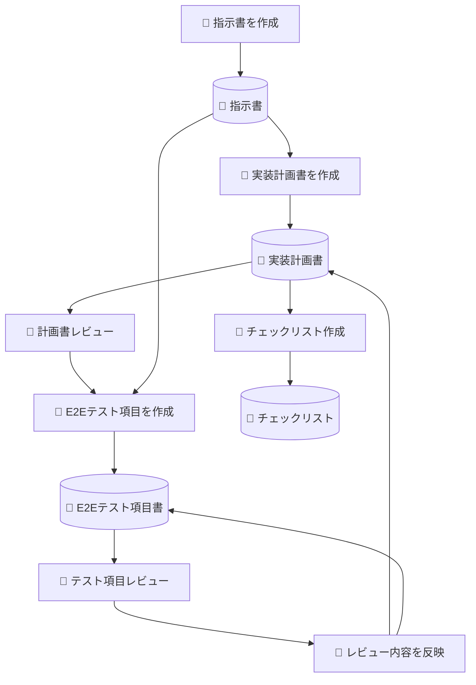
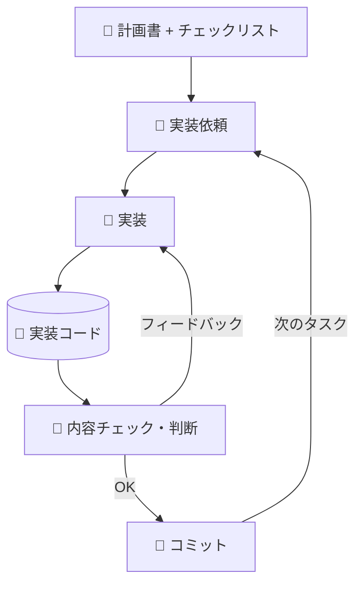
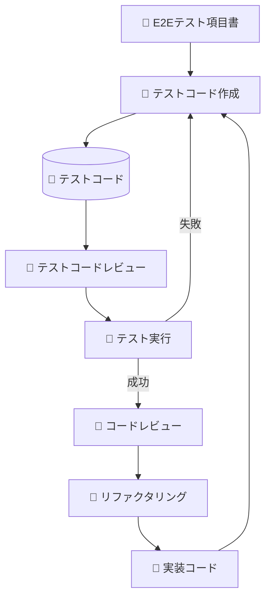
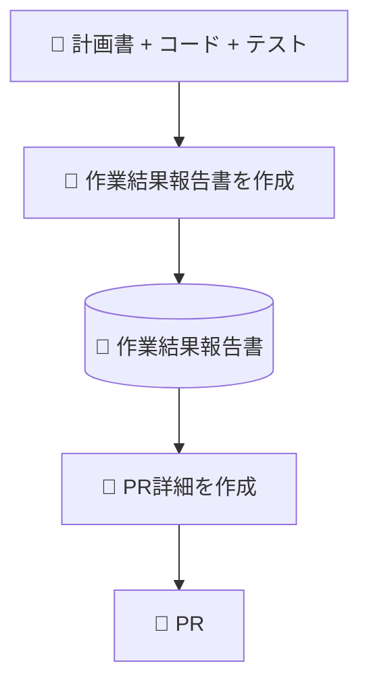

## はじめに

Claude Code には CLAUDE.md、Skills、MCP といった仕組みがあり、LLM の構造的制約に自動で対処してくれます。しかし現実の開発現場では、こうしたツール支援が使えないケースの方が多いのではないでしょうか。

- CLAUDE.md や `.github/copilot-instructions.md` などの設定が組織的に整備されていない
- チケット管理が Backlog、ソース管理が CodeCommit、認証もバラバラ
- ドメイン知識やガイドラインなどを組織的にSkill化していない
- MCP でチケットやリポジトリを直接参照できない。もしくはMCP自体利用出来ない
- コミットメッセージの規約が統一されておらず、`git log` がコンテキストとして機能しない

こうした環境でも、**LLM の構造的制約を理解していれば、手動で同じ対策を再現できます**。本記事では、筆者が実際の業務で行っている「プロンプト駆動開発」の手法を紹介します。

## LLM が抱える構造的制約（3つだけ覚えてほしい）

詳しくは[「LLMの構造的制約を Claude Code の設計を通じて理解する」](https://shuji-bonji.github.io/understanding-llm-through-claude-code/ja)にまとめていますが、プロンプト駆動開発で特に意識すべき制約は以下の3つです。

### Context Rot — コンテキストが長くなると品質が落ちる

LLM に渡すコンテキストが長くなるほど、回答の精度が下がります。「計画して、実装して、テストして、PRを作って」と一度に依頼すると、コンテキストが膨大になり品質が劣化します。

### Instruction Decay — 長いセッションで指示を忘れる

会話が長くなるにつれ、最初に渡した指示の影響力が薄れていきます。10ターン前に伝えたルールは、もう効いていないかもしれません。

### Sycophancy — 都合よく「できました」と言ってしまう

LLM はユーザーに同調しやすい傾向があります。明確な合格基準がないと、「一応動いているから大丈夫です」と甘い判断をしがちです。

## プロンプト駆動開発：4フェーズのワークフロー

これらの制約に対処するため、筆者は以下の4フェーズに分けて開発を進めています。

### 準備フェーズ



### 実装フェーズ



### テスト・品質フェーズ



### 完了フェーズ


:::message
各図の見方：👤がユーザーのアクション（レビュー・判断・コミット）、🤖がLLMのアクション（生成・実装・テスト）、📄が成果物です。

このフローでは、テスト実行もAIが行っているが、実際はテストコードを採用していない場合や、E2Eは手動でやっているとか、人とAIの責務は入れ替えて実施することが多いと思う。
:::


## なぜステップを分けるのか

一度に全てを依頼しない理由は、上述の構造的制約にあります。

| ステップ | 対処している構造的問題 |
|:--|:--|
| 指示書を事前に作成 | Knowledge Boundary（LLMが知らないプロジェクト文脈を明示的に注入） |
| 計画書を先に作成 → レビュー | Context Rot（一括実装によるコンテキスト膨張を防ぐ） |
| E2Eテスト項目を実装前に作成 | Sycophancy（先に合格基準を決めて甘い判断を防ぐ） |
| チェックリストを外部化 | Instruction Decay（長いセッションでの手順忘れを防ぐ） |
| タスクフェーズごとにコミット | Context Rot（フェーズ完了でセッションをリセットできる） |

ポイントは、これらが「なんとなくのベストプラクティス」ではなく、**LLM の構造的制約から論理的に導かれる対策**だということです。

## ステップ分割がもたらす副次的効果 — モデルの使い分け

ステップを分けることには、構造的制約への対処以外にもう一つ大きなメリットがあります。**タスクごとにモデルを切り替えられる**ことです。

### 別のモデルに「別の目」でレビューさせる

筆者がモデルを使い分け始めた動機は、実は「どのモデルが優れているか」ではありませんでした。実装したモデルとは**少しでも違う推論モデル**にレビューさせたかったのです。同じモデルに実装もレビューもさせると、自分の出力を肯定しやすい — これは Sycophancy の一種です。別のモデルに見てもらうことで、異なる視点からのチェックが入ります。

### Premium 消費のコスト管理

一般的によく企業で使われている、GitHub Copilot のビジネス枠では、モデルごとの Premium 消費量が異なります。筆者の環境では1日あたり約5%以内（20営業日で100%）に収める必要があり、全工程を高性能モデルで回すのは現実的ではありませんでした。

| タスク | モデル選択の考え方 |
|:--|:--|
| 実装（コード生成） | 最新Codex などバランスモデル（場合によっては手動実装） |
| コードレビュー・設計判断 | Claude など推論力の高いモデル |
| チェックリスト消化・定型チェック | 無料枠や軽量モデル |
| 狭い範囲の調査・確認 | 無料枠で十分 |
| 重要なアーキテクチャ判断 | Opus 4.6、High、xHigh（最高性能モデル） |

一括で「計画から実装までお願い」と依頼すると、全工程が同じモデルで処理されます。ステップが分かれていれば、「ここは無料枠で十分」「ここだけ Max を使おう」という判断ができます。実装はコストが重いので、状況によっては人間が手で書いてレビューだけ LLM に任せるという使い方もあります。

## 実践：成果物がコンテキストの代替になる

このワークフローの核心は、**成果物をファイルとして永続化し、次のステップでパスを指定してLLMに参照させる**ことです。

実際の業務では、あるチャットで計画書を作成し、**別のチャット**でそれを渡して実装を依頼します。

```
`<workspace path>/instructions.md`
上記指示より以下計画書を作成しました。
`<workspace path>/implementation-plan.md`
これを基に、実装をお願いします。
```

ポイントは**チャットを分けている**こと。計画書を作ったチャットのコンテキストには、レビューのやりとりや試行錯誤が蓄積されています。そのまま同じチャットで実装を依頼すると、不要なコンテキストが残ったまま作業が進んでしまいます。新しいチャットに必要な成果物だけを渡すことで、クリーンなコンテキストで実装を開始できます。これは Claude Code の `/clear` と同じ考え方です。

LLM にパスを渡すと、内容を読み込んでサマリーを表示し確認を求めてきます。この「理解確認」のステップが重要で、LLM が正しくコンテキストを把握しているか検証できます。


### 指示書に含めるもの

実際に筆者が作成している指示書の構成は以下の通りです。

- 概要（何を作るのか）
- 目的（なぜ作るのか）
- 仕様説明
- 作業起点（ブランチ構成、マージ済みの依存ブランチ、起点コミット）
- 作成・修正範囲
- 関連リソース（Issue番号、Discussion URL、Backlog URLなど）
- 注意事項（修正対象範囲を必ず守ること等、原則的なルール）

注意事項には「修正対象範囲を厳守すること」のような原則的なルールを書きます。LLM は指示が曖昧だとスコープ外のファイルまで手を出すことがあるため、明示的な制約が必要です。

これは実質的に、CLAUDE.md に書くような「プロジェクト文脈」を毎回明示的にプロンプトとして渡す行為です。常駐コンテキストが使えないなら、手動で注入するしかありません。


### プロジェクトフォルダの構成例

```
プロジェクトフォルダ/
├── docs/
│   ├── instructions.md        # 指示書（テンプレート化済み）
│   ├── implementation-plan.md # LLM が生成した実装計画書
│   ├── e2e-test-spec.md       # LLM が生成したE2Eテスト項目書
│   └── checklist.md           # LLM が生成したチェックリスト
├── references/
│   ├── ticket-123.md          # チケット内容の Markdown 化
│   ├── backend-api-spec.md    # バックエンド API 仕様
│   └── design-doc.md          # 設計ドキュメント
└── src/
```

`docs/` や `references/` などの作業用ドキュメントは `.gitignore` やステージング対象外にしておきます。これらはあくまで LLM とのやりとりのための中間成果物であり、リポジトリにコミットするのは実装コードだけです。


## 外部情報の Markdown 化 — 手動の Context Budget 管理

MCP でチケット管理システムやリポジトリに直接接続できない場合、手動でテキスト化してプロジェクトフォルダに配置するのが現実的な対処法です。

Backlog や GitHub Issue のチケット内容を Markdown にコピーし、バックエンドリポジトリの API 仕様をテキスト化し、関連する設計ドキュメントをローカルに保存します。

この手動変換は面倒ですが利点もあります。チケットの生データをそのまま渡すとコメント欄のやりとりや関係ない議論もコンテキストに入ってしまいますが、Markdown 化する過程で「LLM に必要な情報だけ」を抽出できます。ある意味、**手動の Context Budget 管理**です。


## コミットメッセージの品質が LLM 活用効率に直結する

`fix bug` や `update` のようなコミットメッセージが並んでいる環境では、`git log` が LLM のコンテキストとしてほぼ機能しません。

Conventional Commits のような規約があり、チケット番号が紐付いていれば：

```
feat(auth): add login flow (#123)
fix(api): handle timeout in payment service (#456)
```

LLM は Issue #123 を辿って背景を把握し、関連する変更を追跡できます。コミットメッセージ、ブランチ命名、PR テンプレートといった「開発プロセスのメタデータ」の品質が、LLM の活用効率に直結します。

これは LLM 以前からの課題ですが、AI 活用の文脈で改めて重要性が増しています。人間同士なら「あの時のあれ」で通じることも、LLM には通じません。

## 原理の対応表 — ツールが違っても対策は同じ

| 原理 | Claude Code での実現 | プロンプト駆動での実現 |
|:--|:--|:--|
| 常駐コンテキストは最小限に | CLAUDE.md 200行制限 | 指示書テンプレートの簡潔化 |
| 条件付き注入で分散 | `.claude/rules/` | ステップごとに必要な成果物だけパス指定 |
| オンデマンドで知識注入 | Skills | 成果物ファイルを参照させる |
| 外部情報を LLM が読める形に | MCP / llms.txt | Markdown 化してローカル保存 |
| セッションは短く保つ | `/compact` / `/clear` | タスクフェーズごとにコミット＋リセット |
| 機械的検証はコンテキスト外で | Hooks | CI/CD、手動テスト実行 |

## Agent Skills との補完関係

Addy Osmani の [agent-skills](https://github.com/addyosmani/agent-skills) はこのアプローチを体系化したもので、プロダクションレベルの開発ワークフローを Plain Markdown の Skill として定義しています。

- **Spec before code** — 実装前に仕様を定義（本記事の「指示書を事前に作成」に対応）
- **Plan-mode task breakdown** — 検証可能な単位へのタスク分割（「計画書を先に作成 → レビュー」に対応）
- **TDD with Prove-It pattern** — バグをまず失敗テストとして再現（「E2Eテスト項目を実装前に作成」に対応）
- **Anti-rationalization table** — エージェントがステップを飛ばす口実とその反論を事前に定義（Sycophancy 対策）

重要なのは、これらが **Plain Markdown** であること。Claude Code、Cursor、Windsurf、Copilot、Codex のどれでも使えます。本記事で紹介した手動プロセスも、Skill として定義すればツール支援のある環境で再利用可能になります。

https://github.com/addyosmani/agent-skills

## まとめ

プロンプト駆動開発は、ツール支援がない環境での「苦肉の策」に見えるかもしれません。しかし本質的には、LLM の構造的制約を理解した上での合理的な対処法です。

CLAUDE.md を手動で作れば常駐コンテキストになる。成果物をファイルに書き出してパス指定すれば Skills と同じ効果が得られる。フェーズごとにセッションを切れば `/compact` と同じことができる。

ツールが変わっても、原理は変わりません。

より詳しい解説（Context Rot、Lost in the Middle、Hallucination など8つの構造的問題の全体像）は、以下のサイトで公開しています。

https://shuji-bonji.github.io/understanding-llm-through-claude-code/

## 参考資料

- Osmani, A. (2025). "agent-skills: Production-grade engineering skills for AI coding agents." [github.com/addyosmani/agent-skills](https://github.com/addyosmani/agent-skills)
- Hong, K., Troynikov, A., & Huber, J. (2025). "Context Rot: How Increasing Input Tokens Impacts LLM Performance." Chroma Research. [research.trychroma.com](https://research.trychroma.com/context-rot)
