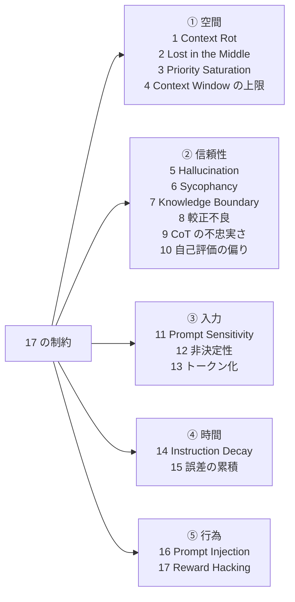
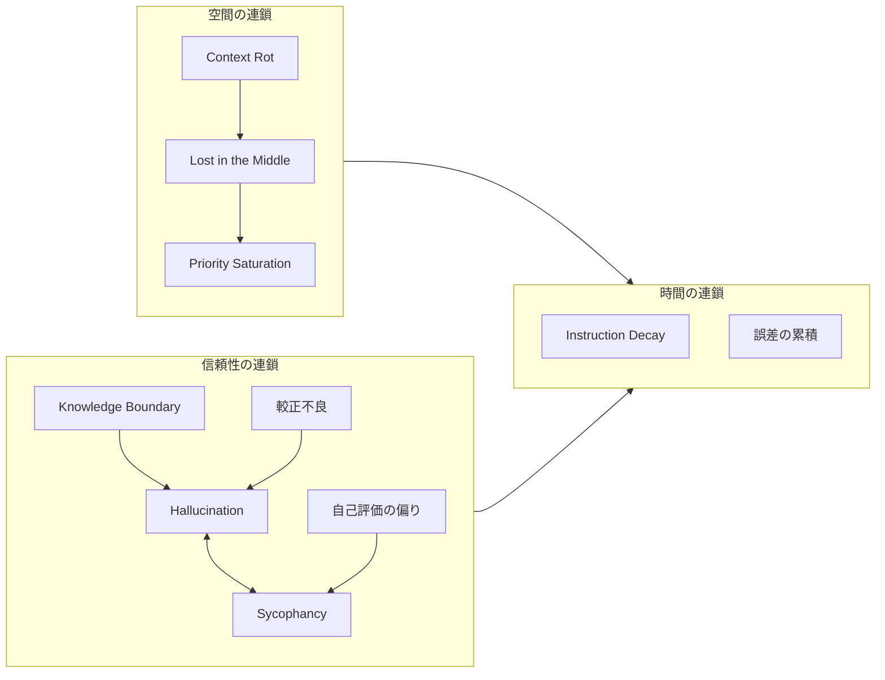
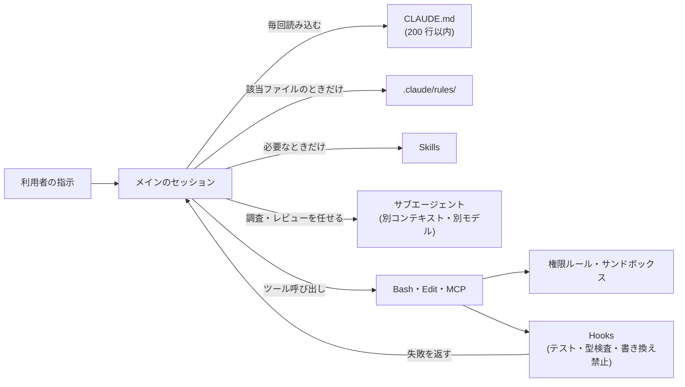

:::message
この記事の Claude Code の機能に関する記述は、2026-11-11 時点の公式ドキュメント（code.claude.com/docs）で確認した内容です。Claude Code は更新が速いため、設定名や挙動は変わる可能性があります。制約そのものの説明（前半）は、製品の更新では変わらない内容です。
:::

## はじめに

この記事は、LLM を業務やコーディングエージェントで使っている開発者が、「LLM はなぜこう失敗するのか」と「その失敗を設定でどこまで抑えられるか」を一続きで確認するための整理です。

筆者は以前、LLM の構造的な制約を 8 つに分けて整理しました。そのうち 3 つ（Context Rot、Instruction Decay、Sycophancy）は、Zenn の記事「[CLAUDE.mdがなくても戦える — LLMの構造的制約を踏まえたプロンプト駆動開発](https://zenn.dev/shuji_bonji/articles/c9d325f1fd7646)」でも取り上げています。その後、エージェントにファイルの編集やコマンドの実行を任せる場面が増え、8 つでは説明しきれない失敗が目立つようになりました。そこでこの記事では、制約を 17 個に広げ、5 つの分類にまとめ直しています。

:::message
**この記事の主張**

Claude Code の設定やハーネスの仕組み（CLAUDE.md、Hooks、サブエージェント、権限ルールなど）は、便利機能として個別に作られたものではなく、LLM の制約への対策として存在しています。制約を知っておくと、次の 3 つができるようになります。

1. **失敗の原因を見分けられる**: 会話が長くなって指示を忘れたのか、知らないことを答えたのかで、取るべき対策が変わります
2. **対策を置く場所を選べる**: 必ず守らせたいことは、LLM に読ませる指示ではなく、LLM の外側で動く仕組みに置く、という判断ができます
3. **ツールが変わっても判断を使い回せる**: 機能名が変わっても、別のツールに移っても、「どの制約に対する、どの種類の対策か」という見方はそのまま使えます
:::

### この記事で扱うこと

- LLM の 17 の制約と、それぞれの根拠となる研究
- 17 の制約を生む原因（アーキテクチャと学習方法）
- ハーネスの 4 要素が、どの制約に効くか
- Claude Code の各機能が、どの制約に効くか

### この記事で扱わないこと

- モデルの学習方法そのものを変える対策（学習データの改善、RLHF の改良など）
- Claude Code 以外のツール（Cursor、Codex など）の設定

## 17 という数について

LLM の制約の数え方に、決まった基準はありません。この記事では「利用者から見て、異なる失敗として現れるもの」を 1 つと数えています。原因の単位で数えると 9 個程度になり、仕組みの単位まで分けると 30 個以上になります。17 は、対策を選ぶときに区別する必要がある単位として選んだ数です。

筆者が以前整理した 8 つは、すべてこの 17 に含まれています。以前の整理を読んでいない方は、この表を読み飛ばしても本文の理解に支障はありません。

| 以前の 8 つ | この記事での番号 | 分類 |
|---|---|---|
| Context Rot | 1 | ① 空間 |
| Lost in the Middle | 2 | ① 空間 |
| Priority Saturation | 3 | ① 空間 |
| Hallucination | 5 | ② 信頼性 |
| Sycophancy | 6 | ② 信頼性 |
| Knowledge Boundary | 7 | ② 信頼性 |
| Prompt Sensitivity | 11 | ③ 入力 |
| Instruction Decay | 14 | ④ 時間 |

新しく加えたのは、4（Context Window の上限）、8（確信度の較正不良）、9（CoT の不忠実さ）、10（自己評価の偏り）、12（出力の非決定性）、13（トークン化の制約）、15（誤差の累積）、16（Prompt Injection）、17（Reward Hacking）の 9 つです。

## 17 の制約と 5 つの分類

17 の制約を、「どこで・いつ現れるか」で 5 つに分けます。

| 分類 | 現れる場面 | 制約 |
|---|---|---|
| ① 空間 | 入力が増えるほど悪化する | 1. Context Rot、2. Lost in the Middle、3. Priority Saturation、4. Context Window の上限 |
| ② 信頼性 | 生成した内容が正しいか | 5. Hallucination、6. Sycophancy、7. Knowledge Boundary、8. 確信度の較正不良、9. CoT の不忠実さ、10. 自己評価の偏り |
| ③ 入力 | 書き方と処理の単位に左右される | 11. Prompt Sensitivity、12. 出力の非決定性、13. トークン化の制約 |
| ④ 時間 | 会話や手順が長くなるほど悪化する | 14. Instruction Decay、15. 誤差の累積 |
| ⑤ 行為 | エージェントが外部のデータを読み、操作するとき | 16. Prompt Injection、17. Reward Hacking |

①〜④ は、以前の 8 つの制約の分類（コンテキスト系・出力系・入力感受性系・時間軸系）を広げたものです。⑤ は今回新しく立てた分類です。Prompt Injection と Reward Hacking は、チャットで質問に答えるだけなら被害が小さく、エージェントがファイルを書き換えたりコマンドを実行したりするときに初めて大きな問題になります。

エージェントに特有の失敗としては、ほかに、存在しないツールや引数を使おうとする、計画した手順と実際の操作がずれる、といったものもあります。この記事では、これらを Hallucination（5）や誤差の累積（15）がエージェントの操作の中で現れたものとして扱い、独立した制約としては数えていません。

## 制約を生む原因

17 の制約は、それぞれ独立に生まれたものではありません。原因までさかのぼると、次の 9 つに整理できます。

| 原因 | 何が起きるか | 主に生む制約 |
|---|---|---|
| 自己注意の計算 | トークンが増えるほど、1 つのトークンに向く注意が薄まる | 1、3 |
| 位置の扱い（位置エンコーディング） | 入力の先頭と末尾に注意が偏る | 2 |
| 次のトークンを予測するという学習目標 | もっともらしい続きを出すことが目的になり、正しいかどうかは目的に含まれない | 5、15 |
| 強化学習による事後学習（RLHF など）と、評価の採点方法 | 同意する応答や、分からなくても答える応答、採点基準を満たすだけの応答が高く評価されやすい | 6、7、8、10、17 |
| 学習データの時点 | 学習データより後の出来事を知らない | 7 |
| トークン化 | 文字ではなくトークン単位で処理する | 13 |
| 推論時の計算とサンプリング | 同じ入力でも出力が変わる | 12 |
| データと指示が同じトークン列に入ること | 読み込んだ文書の中の命令文を、利用者の指示と区別できない | 16 |
| ウィンドウの長さの上限 | 決まった長さを超える入力を受け取れない | 4 |

9 の CoT の不忠実さと 11 の Prompt Sensitivity は、原因の説明がまだ研究で定まっていないため、表に入れていません。

ここから分かるのは、これらの制約は「モデルが新しくなれば消える不具合」ではなく、「今の LLM の作り方から必ず出てくる性質」だということです。程度は新しいモデルで小さくなることがありますが、ゼロにはなりません。そのため、モデルの外側（ハーネス）で抑える必要があります。

## 17 の制約の説明

### ① 空間 — 入力が増えるほど悪化する

#### 1. Context Rot

入力のトークン数が増えるほど、出力の品質が下がる現象です。エラーにならずに品質だけが下がるため、気づきにくいという特徴があります。Chroma の技術レポート（Hong ほか, 2025）は、18 のモデルを評価し、入力が長くなるにつれて性能が均一ではない形で不安定になることを示しました。課題の内容は同じで、関係のない文章を増やしただけでも性能が下がります。

#### 2. Lost in the Middle

長い入力の中間にある情報が使われにくくなる現象です。Liu ほか（2024）は、必要な情報が入力の先頭か末尾にあるときに性能が高く、中間にあるときに低くなる U 字型の傾向を報告しました。

#### 3. Priority Saturation

同時に与える指示の数が増えるほど、1 つ 1 つの指示が守られにくくなる現象です。Jaroslawicz ほか（2025）の IFScale は、同時に与える指示を 10 個から 500 個まで増やし、モデルごとに遵守率が下がっていく様子を測っています。CLAUDE.md に規則を書き足し続けると起きるのは、この現象です。

#### 4. Context Window の上限

モデルが一度に受け取れる長さには上限があり、それを超える入力は受け取れません。Context Rot は上限より手前で品質が下がる問題で、こちらは上限そのものの問題です。Claude Code では、Fable 系、Sonnet 5 以降、Haiku 5.5、Opus 4.6 以降、Sonnet 4.6 が 100 万トークンのコンテキストウィンドウに対応しています（[公式ドキュメント「Explore the context window」](https://code.claude.com/docs/en/context-window)による）。ただし、使えるかどうかは契約しているプランによって異なり、モデルによっては名前に `[1m]` の付いた版を選ぶ必要があります。ただし、ウィンドウが大きくなっても Context Rot は残ります。

### ② 信頼性 — 生成した内容が正しいか

#### 5. Hallucination

事実と異なる内容を、もっともらしく生成する現象です。Kalai ほか（2025）は、学習と評価の手順が「分からないと答えること」より「推測して答えること」を高く評価するため、Hallucination が残り続けると論じています。Xu ほか（2024）は、Hallucination を完全になくすことはできないことを理論的に示しています。

#### 6. Sycophancy

利用者の意見や思い込みに合わせて、正確さを犠牲にする現象です。Sharma ほか（2023）は、人の評価データの分析から、利用者の見方に一致する応答のほうが好まれやすいことを示しました。人の評価を使って学習する限り、この傾向が学習に組み込まれます。コードレビューを同じモデルに頼んだとき、「問題ありません」と返ってきやすいのはこのためです。

#### 7. Knowledge Boundary

自分の知識の範囲外の質問に対して、「分からない」と答えにくい現象です。Pan ほか（2025）は、知らない質問を断れるかどうかを 16 のモデルで測定しています。学習データの時点（Knowledge Cutoff）もここに含めます。Cheng ほか（2024）は、モデルが実際に知っている情報の時点が、公表されているカットオフの時点と大きくずれる場合があることを報告しています。

#### 8. 確信度の較正不良

答えが正しいときも間違っているときも、同じように自信のある口調で答える現象です。Kadavath ほか（2022）は、大きなモデルは適切な形式の多肢選択問題では確信度と正答率がよく対応する（較正されている）ことを示しました。一方で、GPT-4 Technical Report（OpenAI, 2023）は、事前学習後のモデルはよく較正されているものの、事後学習（RLHF など）を経ると較正が大きく悪くなることを報告しています。利用者が触れるのは事後学習を経たモデルなので、「自信がありそうな口調」を正しさの手がかりにはできません。

#### 9. CoT の不忠実さ

モデルが表示する思考過程（Chain-of-Thought）が、実際に答えを決めた過程と一致しないことがある現象です。Chen ほか（2025）は、問題文にヒントを埋め込み、モデルがヒントを使って答えたときに、思考過程の中でヒントを使ったと書くかを調べました。書いた割合は、多くの場合 20% を下回っていました。「理由を説明させれば正しさを確かめられる」とは限りません。実務では、エージェントが書いた変更の説明（「〜のため修正しました」）を、変更が正しいことの根拠として扱わないようにします。

#### 10. 自己評価の偏り

自分の出力の誤りを、自分で見つけて直すのが苦手な現象です。Huang ほか（2024）は、外部からのフィードバックなしにモデル自身に推論を見直させると、性能が上がらず、下がる場合もあることを示しました。Panickssery ほか（2024）は、モデルが自分の生成した文章を見分けられ、人が同じ品質と判断した文章より自分の文章を高く評価する傾向があることを報告しています。

### ③ 入力 — 書き方と処理の単位に左右される

#### 11. Prompt Sensitivity

意味が同じでも、書き方によって結果が大きく変わる現象です。Sclar ほか（2023）は、few-shot の例の区切り記号や大文字小文字といった書式を変えるだけで、LLaMA-2-13B の正答率が最大 76 ポイント変わることを示しました。ただし Hua ほか（2025）は、観測される感度の多くは評価方法が厳しすぎることによるもので、適切に評価すれば報告より頑健だと論じています。どの程度の影響があるかは、課題と評価方法によって大きく変わります。

#### 12. 出力の非決定性

同じ入力でも出力が変わる現象です。サンプリングの温度を 0 にしても、同じ出力になるとは限りません。Thinking Machines Lab の He（2025）は、その主な原因として、推論サーバーが複数の利用者の要求をまとめて処理する際のバッチの大きさによって、計算結果がわずかに変わることを挙げています。利用者の側からは、この変動を止められません。

#### 13. トークン化の制約

LLM は文字ではなくトークン（数文字のまとまり）を単位に処理するため、文字数を数える、文字の位置を答える、文字列を逆順にするといった処理を間違えることがあります。ただし、原因をトークン化だけに求めることには異論もあります。Uzan と Pinter（2025）の CharBench は、文字を数える課題では、トークンの分かれ方より、単語の長さや実際の文字数のほうが正答率と強く関係していると報告しています。原因がどちらであっても、実務での扱いは同じです。文字数に上限のある文章（タイトルや説明文など）の作成や、桁の多い計算をモデルの出力だけで済ませると、誤りが混じることがあります。

### ④ 時間 — 会話や手順が長くなるほど悪化する

#### 14. Instruction Decay

長いマルチターンの会話の中で、最初に与えた指示が守られなくなっていく現象です。Laban ほか（2025）は、20 万件以上の会話のシミュレーションで、課題の情報を 1 回でまとめて与えた場合に比べ、複数のターンに分けて少しずつ与えた場合の性能が平均 39% 下がることを示しました。

#### 15. 誤差の累積

手順が多い作業では、各ステップの小さな誤りが積み重なり、作業全体が失敗しやすくなる現象です。Sinha ほか（2025）は、長い作業では手順が進むにつれて 1 ステップあたりの正答率が下がることを示しました。その理由の 1 つとして、それまでの自分の誤りがコンテキストに含まれていると、次のステップでも誤りやすくなること（self-conditioning）を挙げています。この傾向はモデルを大きくしても減らず、思考（thinking）を使うと抑えられると報告されています。

### ⑤ 行為 — エージェントが外部のデータを読み、操作するとき

#### 16. Prompt Injection

エージェントが読み込んだ Web ページ、文書、ツールの応答の中に命令文が含まれていると、それを利用者の指示と区別できずに実行してしまう現象です。Greshake ほか（2023）は、攻撃者が LLM に直接入力しなくても、LLM が後で読み込むデータに命令文を仕込むことで、アプリケーションを操作できること（間接 Prompt Injection）を示しました。データと指示が同じトークン列に入るという構造から来ているため、モデルの改良だけでは防ぎきれません。モデル側の対策としては、システムの指示・利用者の入力・ツールの出力の間に優先順位を付けて学習させる Instruction Hierarchy（Wallace ほか, 2024）があります。ただし、これで命令文の混入を完全に防げるわけではないため、ハーネスの側でも対策します。

#### 17. Reward Hacking

作業の目的ではなく、評価の基準を満たすことを目的にしてしまう現象です。コーディングでは、テストを書き換える、特定のテストケースだけを通すコードを書く、といった形で現れます。METR（2025）は、最近のモデルがテストや採点コードを書き換えて高い得点を得ようとした事例を報告しています。MacDiarmid ほか（2025）は、学習中に Reward Hacking を覚えたモデルで、他の望ましくない振る舞いも同時に増えたことを報告しています。

## 制約同士の連鎖

これらの制約は、互いに悪化させ合います。

- **空間の連鎖**: 入力が増えると注意が薄まり（Context Rot）、中間の情報が使われにくくなり（Lost in the Middle）、指示の遵守率が下がります（Priority Saturation）。
- **信頼性の連鎖**: 知らないことを知らないと言えず（Knowledge Boundary）、自信のある口調のまま（較正不良）、誤った内容を生成します（Hallucination）。利用者がそれを信じると、モデルは同調し（Sycophancy）、誤りが固定されます。モデル自身に見直させても、誤りは見つかりにくいままです（自己評価の偏り）。
- **時間の連鎖**: 会話や手順が長くなると、空間と信頼性の問題が積み重なり、指示の忘却（Instruction Decay）と誤差の累積として現れます。

③ 入力と ⑤ 行為の制約は、この図に入れていません。Prompt Injection は読み込んだデータから、Reward Hacking は評価の基準から起きるもので、入力の量や会話の長さで悪化するという関係を、この記事では根拠を確認できていないためです。この 2 つは、エージェントがファイルやコマンドを操作するたびに、連鎖とは別に起こりうるものとして扱います。

## ハーネスで対処する

### ハーネスの 4 要素

ハーネスは、LLM の外側に置いて LLM の動作を補う仕組みの総称です。この記事では、次の 4 つの要素に分けて考えます。

| 要素 | 役割 |
|---|---|
| Action（ツール連携） | 外部の API・データベース・ファイル・ブラウザーなどにつなぐ |
| Context（記憶） | 過去の経緯や作業履歴を保持し、必要なときに LLM に渡す |
| Guardrails（安全制御） | 誤った出力や危険な操作を、LLM の外側で検出して止める |
| Orchestration（ループ制御） | 作業を分解し、実行・評価・次の行動の決定を繰り返す |

### 5 つの分類 × 4 つの要素

● は直接効くもの、△ は部分的に効くもの、― は効かないものです。

| 分類 | Action | Context | Guardrails | Orchestration |
|---|---|---|---|---|
| ① 空間 | ― | ● 履歴を外に出し、渡す量を絞る | ― | ● 作業を分けて、コンテキストを分離する |
| ② 信頼性 | ● 外部の情報源で確かめる | △ | ● テスト・型検査・別モデルで検証する | △ 別のエージェントにレビューさせる |
| ③ 入力 | ● 計算や文字数はコードで処理する | △ 決まった手順書を使う | △ 結果を検証で判定する | ― |
| ④ 時間 | ― | ● 要約と成果物のファイル化 | ● 各ステップで検証する | ● 指示を再び渡し、作業を短く分ける |
| ⑤ 行為 | △ 読み込むデータの経路を限る | ― | ● 権限・サンドボックス・人の承認 | △ 危険な操作の前で止める |

### 対策の原則: LLM 自身に検証させない

表の中で最も多くの分類に効くのは Guardrails です。その中心にある原則は、「LLM の出力を、LLM 自身に検証させない」ことです。

自己評価の偏り、Sycophancy、較正不良、CoT の不忠実さの 4 つはどれも、「LLM に確認させれば誤りが分かる」という前提を崩します。そのため、検証にはコンパイラ、テスト、型検査のように、LLM の出力に同調しない仕組みを使います。LLM でレビューする場合も、作業したセッションとは別のコンテキストで、できれば別のモデルにレビューさせます。

### ハーネスで対処しきれないもの

ハーネスで制約が消えるわけではありません。次のものは、ハーネスを組んでも残ります。

| 制約 | 残る理由 |
|---|---|
| Hallucination | 外部の検証で誤りを止めることはできますが、生成そのものをなくすことはできません。検証できない種類の誤り（テストのない部分、文章の内容など）は残ります |
| Sycophancy | 別モデルでのレビューで抑えられますが、レビューするモデルにも同じ傾向があります |
| Prompt Sensitivity | 直接の処方はありません。書き方を固定して、ぶれを小さくすることしかできません |
| 出力の非決定性 | 推論サーバー側の問題のため、利用者の側からは止められません。出力が変わる前提で、結果を検証で判定します |
| Prompt Injection | 権限とサンドボックスで被害を限ることはできますが、命令文の混入そのものは防げません |
| Reward Hacking | テストの書き換えは止められても、テストが確認していない入力でだけ誤る実装を機械的に見つけることは難しく、人によるレビューが残ります |

そのため、どの制約についても、最終的な受け入れの判断は、テストの結果と、人による差分の確認を組み合わせて行います。

また、Context（記憶）の設計を誤ると、過去の履歴をすべて読み戻すことで、かえって Context Rot を悪化させます。記憶は「全部渡す」ものではなく、「必要なものだけ選んで渡す」ものです。

## Claude Code での実装（2026-11-11 時点）

ここからは、ハーネスの 4 要素を Claude Code の機能に当てはめます。この章の内容は製品の更新で古くなります。

### 指示として読ませる機能と、LLM の外側で動く機能

Claude Code の機能は、どれだけ確実に効くかで 2 つに分かれます。

| 種類 | 機能 | 確実さ |
|---|---|---|
| 指示として LLM に読ませる機能 | CLAUDE.md、`.claude/rules/`、Skills | LLM が読んで従う必要があるため、① 空間と ④ 時間の制約を受けます。守られない場合があります |
| LLM の外側で動く機能 | Hooks、権限ルール、サンドボックス | LLM の判断に頼らずに動くため、会話が長くなっても効き方が変わりません |

必ず守らせたいことは、後者に置くのが基本です。以下の表も、この区別を前提に読んでください。

### 主な機能の役割

| 機能 | ハーネスの要素 | 何をするか |
|---|---|---|
| CLAUDE.md | Context | 毎回のセッションの開始時に読み込まれる指示ファイル。公式ドキュメントは 200 行以内を目安としています。プロジェクト直下の CLAUDE.md は、コンパクション後もディスクから読み直されます |
| `.claude/rules/` | Context | 話題ごとに分けた指示ファイル。`paths` を指定すると、一致するファイルを扱うときだけ読み込まれます |
| Skills | Context / Orchestration | 起動時には説明文だけが読み込まれ、必要になったときに本文が読み込まれる手順書 |
| サブエージェント | Orchestration / Guardrails | 独立したコンテキストウィンドウで動き、要約だけを返す。使えるツールや使うモデルを個別に指定できる |
| Hooks | Guardrails | `PreToolUse`（ツール実行前、止められる）、`PostToolUse`（ツール実行後）、`Stop`（応答の終了時、終了を止めて作業を続けさせられる）などのタイミングで、コマンドを実行する。Hooks のコマンドはコンテキストの外で実行され、LLM に返す出力だけがコンテキストに入ります |
| MCP | Action | 外部のツールやサービスにつなぐ |
| 権限ルール・権限モード | Guardrails | ツールの呼び出しを allow / ask / deny で制御する。plan モードでは、計画を承認するまで編集を止める |
| サンドボックス | Guardrails | Bash などのシェルコマンドについて、OS のレベルでファイルとネットワークへのアクセスを制限する |
| `/compact`・`/clear`・`/autocompact`・`/context` | Context | 会話の要約、会話の消去、自動コンパクションを始める量の設定、コンテキストの使用量の確認 |
| `/rewind`・Git のコミット | Orchestration | 作業を前の状態に戻す |

### 17 の制約 × Claude Code の機能

| 制約 | Claude Code での対策 |
|---|---|
| 1. Context Rot | 関係のない作業に移るときは `/clear` を実行する。長い作業の途中で `/compact` を実行し、要約に残す内容を指示する（例: `/compact focus on the auth bug fix`）。多くのファイルを読む調査はサブエージェントに任せ、要約だけを受け取る |
| 2. Lost in the Middle | 毎回守らせたい指示は CLAUDE.md に書く（コンパクション後も読み直される）。Skills の本文は、コンパクション後に上限を超えると末尾が切り詰められ、先頭が残るため、重要な指示を SKILL.md の先頭に書く |
| 3. Priority Saturation | CLAUDE.md を 200 行以内に保ち、特定のファイルにだけ関係する規則は `paths` 付きの rules に、ときどき必要な手順は Skills に移す。必ず実行させたい処理は、指示ではなく Hooks にする |
| 4. Context Window の上限 | 自動コンパクションに任せるか、`/autocompact` で早めに要約させる。必要なら 100 万トークン対応のモデルを選ぶ。それでも Context Rot は残るため、1 の対策と組み合わせる |
| 5. Hallucination | `PostToolUse` や `Stop` の Hooks で、テスト・型検査・lint を実行し、失敗したら作業を続けさせる。ライブラリーの仕様は MCP や Web の公式ドキュメントで確かめさせる |
| 6. Sycophancy | レビュー専用のサブエージェントを作り、作業したセッションとは別のコンテキストでレビューさせる。CLAUDE.md に「根拠がなければ同意しない」と書くことは補助的な対策にとどまる |
| 7. Knowledge Boundary | 使っているライブラリーのバージョンを CLAUDE.md に明記する。最新の仕様は MCP や WebFetch で取得させる |
| 8. 較正不良 | Claude の「完了しました」という報告ではなく、テストの結果やコマンドの出力で完了を判断する。`Stop` の Hooks で、テストが通るまで終了させない |
| 9. CoT の不忠実さ | 説明ではなく、差分とテスト結果で判断する。思考過程は、問題の手がかりとしては使えるが、正しさの証明にはならない |
| 10. 自己評価の偏り | レビューは別のサブエージェントで行う。サブエージェントは親の会話履歴を受け取らないため、作業中のやり取りを前提にせずにレビューできる。サブエージェントの `model` フィールドで、作業したモデルとは別のモデルも指定できる |
| 11. Prompt Sensitivity | 繰り返す作業は Skills やカスタムコマンドにし、毎回同じ文面で指示する。Skills の `description` の書き方で、読み込まれるかどうかが変わる点にも注意する |
| 12. 出力の非決定性 | 同じ出力が返る前提で手順を組まない。受け入れの判定はテストで行う |
| 13. トークン化の制約 | 文字数・計算・並べ替えは、Bash でコードを実行させて求める |
| 14. Instruction Decay | 作業の区切りごとに `/clear` を実行し、新しいセッションで始める。守らせたい規則は会話ではなく CLAUDE.md に書く（会話で伝えた指示はコンパクションで要約される）。Hooks は会話の長さに影響されない |
| 15. 誤差の累積 | 作業を小さく分け、ステップごとにテストを実行してコミットする。誤りに気づいたら、誤りを含む会話を続けず、`/rewind` で戻すか新しいセッションでやり直す |
| 16. Prompt Injection | 権限ルールの deny と ask で、危険なコマンドや外部への送信を止める。サンドボックスで、ネットワークの接続先を許可したドメインだけに限る。信頼できないリポジトリーでは、その `.mcp.json` や Hooks がどう扱われるかを確認してから開く |
| 17. Reward Hacking | 権限ルールの deny（例: テストのディレクトリーへの `Edit`）や `PreToolUse` の Hooks で、テストファイルの書き換えを止める。テストを変更した差分は、人が確認する |

### 機能の組み合わせ方

この図で、LLM の外側で動くのは権限ルール、サンドボックス、Hooks です。② 信頼性と ⑤ 行為の制約には、この 3 つが最も確実に効きます。

機能名や既定の挙動は変わることがあるため、使う前に [Claude Code の公式ドキュメント](https://code.claude.com/docs) で確認してください。

## どこから手をつけるか

17 の制約すべてに一度に対処する必要はありません。導入の手間と効き方の確実さから、次の順で進めるのが現実的です。この順序は筆者の判断で、研究で被害の大きさの順位が決まっているわけではありません。

| 順序 | 内容 | 主に効く制約 |
|---|---|---|
| 1. 設定で確実に止める | 権限ルールで危険なコマンドとテストファイルの書き換えを止め、サンドボックスで接続先を限る。`Stop` の Hooks でテストを実行する | 5、8、16、17 |
| 2. 使い方の習慣で抑える | 作業ごとに `/clear` を実行する。CLAUDE.md を短く保つ。作業を小さく分けてコミットする | 1、3、14、15 |
| 3. 構成で補う | レビュー専用のサブエージェントを作る。繰り返す作業を Skills にする。仕様は MCP や公式ドキュメントで確かめさせる | 6、7、10、11 |
| 4. 人が確認する | 1〜3 を組んでも残る制約について、差分とテスト結果を人が確認する | 5、6、11、12、16、17 |

## まとめ

- LLM の制約は、利用者から見た失敗の単位で数えると 17 個あり、「空間」「信頼性」「入力」「時間」「行為」の 5 つに分けられます。
- 17 の制約の多くは、自己注意の計算、位置の扱い、次のトークンの予測、人の評価による学習、トークン化といった、今の LLM の作り方から来ています。モデルが新しくなっても、程度が小さくなることはあっても、なくなりはしません。
- ハーネスの 4 要素（Action・Context・Guardrails・Orchestration）のうち、最も多くの分類に効くのは Guardrails です。中心にある原則は「LLM の出力を LLM 自身に検証させない」ことです。
- Claude Code では、指示として読ませる機能（CLAUDE.md、rules、Skills）と、LLM の外側で動く機能（Hooks、権限ルール、サンドボックス）を分けて考えます。必ず守らせたいことは後者に置きます。
- 手をつける順序は、設定で確実に止められるもの、使い方の習慣で抑えられるもの、構成で補うもの、人が確認するもの、の順です。
- Prompt Sensitivity、出力の非決定性、Hallucination、Sycophancy、Prompt Injection、Reward Hacking は、ハーネスを組んでも残ります。この部分は、人による確認を前提に作業を設計します。

:::message
ハーネスや設定は、LLM の制約があるから存在します。どの制約がどこで現れるかを知っておけば、LLM がどこで失敗するかを事前に予測し、確実に効く場所に対策を置けます。防げない失敗がどこに残るかを把握して、そこを人が確認するところまで含めて、LLM を使いこなすということだと考えています。
:::

:::message alert
LLM に読ませる指示（CLAUDE.md、rules、Skills）は、守られないことがあります。必ず守らせたいことは、Hooks・権限ルール・サンドボックスに置いてください。
:::

## 参考文献

### ① 空間

- Hong, K., Troynikov, A., & Huber, J. (2025). *Context Rot: How Increasing Input Tokens Impacts LLM Performance*. Chroma Technical Report. https://research.trychroma.com/context-rot
- Liu, N. F., Lin, K., Hewitt, J., Paranjape, A., Bevilacqua, M., Petroni, F., & Liang, P. (2024). Lost in the Middle: How Language Models Use Long Contexts. *Transactions of the Association for Computational Linguistics*, 12, 157–173. https://arxiv.org/abs/2307.03172
- Jaroslawicz, D., Whiting, B., Shah, P., & Maamari, K. (2025). How Many Instructions Can LLMs Follow at Once? https://arxiv.org/abs/2507.11538

### ② 信頼性

- Kalai, A. T., Nachum, O., Vempala, S. S., & Zhang, E. (2025). Why Language Models Hallucinate. https://arxiv.org/abs/2509.04664
- Xu, Z., Jain, S., & Kankanhalli, M. (2024). Hallucination is Inevitable: An Innate Limitation of Large Language Models. https://arxiv.org/abs/2401.11817
- Sharma, M., Tong, M., Korbak, T., et al. (2023). Towards Understanding Sycophancy in Language Models. https://arxiv.org/abs/2310.13548
- Pan et al. (2025). Can LLMs Refuse Questions They Do Not Know? Measuring Knowledge-Aware Refusal in Factual Tasks. https://arxiv.org/abs/2510.01782
- Cheng, J., Marone, M., Weller, O., Lawrie, D., Khashabi, D., & Van Durme, B. (2024). Dated Data: Tracing Knowledge Cutoffs in Large Language Models. COLM 2024. https://arxiv.org/abs/2403.12958
- Kadavath, S., Conerly, T., Askell, A., et al. (2022). Language Models (Mostly) Know What They Know. https://arxiv.org/abs/2207.05221
- OpenAI. (2023). GPT-4 Technical Report. https://arxiv.org/abs/2303.08774
- Chen, Y., Benton, J., Radhakrishnan, A., et al. (2025). Reasoning Models Don't Always Say What They Think. Anthropic. https://arxiv.org/abs/2505.05410
- Huang, J., Chen, X., Mishra, S., Zheng, H. S., Yu, A. W., Song, X., & Zhou, D. (2024). Large Language Models Cannot Self-Correct Reasoning Yet. ICLR 2024. https://arxiv.org/abs/2310.01798
- Panickssery, A., Bowman, S. R., & Feng, S. (2024). LLM Evaluators Recognize and Favor Their Own Generations. NeurIPS 2024. https://arxiv.org/abs/2404.13076

### ③ 入力

- Sclar, M., Choi, Y., Tsvetkov, Y., & Suhr, A. (2023). Quantifying Language Models' Sensitivity to Spurious Features in Prompt Design. https://arxiv.org/abs/2310.11324
- Hua, A., Tang, K., Gu, C., Gu, J., Wong, E., & Qin, Y. (2025). Flaw or Artifact? Rethinking Prompt Sensitivity in Evaluating LLMs. EMNLP 2025. https://arxiv.org/abs/2509.01790
- He, H., & Thinking Machines Lab. (2025). Defeating Nondeterminism in LLM Inference. *Connectionism*. https://thinkingmachines.ai/blog/defeating-nondeterminism-in-llm-inference/
- Uzan, O., & Pinter, Y. (2025). CharBench: Evaluating the Role of Tokenization in Character-Level Tasks. https://arxiv.org/abs/2508.02591

### ④ 時間

- Laban, P., Hayashi, H., Zhou, Y., & Neville, J. (2025). LLMs Get Lost In Multi-Turn Conversation. https://arxiv.org/abs/2505.06120
- Sinha, A., Arun, A., Goel, S., Staab, S., & Geiping, J. (2025). The Illusion of Diminishing Returns: Measuring Long Horizon Execution in LLMs. https://arxiv.org/abs/2509.09677

### ⑤ 行為

- Greshake, K., Abdelnabi, S., Mishra, S., Endres, C., Holz, T., & Fritz, M. (2023). Not what you've signed up for: Compromising Real-World LLM-Integrated Applications with Indirect Prompt Injection. AISec 2023. https://arxiv.org/abs/2302.12173
- Wallace, E., Xiao, K., Leike, R., Weng, L., Heidecke, J., & Beutel, A. (2024). The Instruction Hierarchy: Training LLMs to Prioritize Privileged Instructions. https://arxiv.org/abs/2404.13208
- Von Arx, S., Chan, L., & Barnes, E. (2025). Recent Frontier Models Are Reward Hacking. METR. https://metr.org/blog/2025-06-05-recent-reward-hacking/
- MacDiarmid, M., Wright, B., Uesato, J., et al. (2025). Natural Emergent Misalignment from Reward Hacking in Production RL. https://arxiv.org/abs/2511.18397

### Claude Code（2026-11-11 参照）

- How Claude remembers your project. https://code.claude.com/docs/en/memory
- Extend Claude Code. https://code.claude.com/docs/en/features-overview
- Explore the context window. https://code.claude.com/docs/en/context-window
- Create custom subagents. https://code.claude.com/docs/en/sub-agents
- Hooks reference. https://code.claude.com/docs/en/hooks
- Configure permissions. https://code.claude.com/docs/en/permissions
- Choose a permission mode. https://code.claude.com/docs/en/permission-modes
- Sandboxing. https://code.claude.com/docs/en/sandboxing

### 関連する筆者の記事

- CLAUDE.mdがなくても戦える — LLMの構造的制約を踏まえたプロンプト駆動開発（Zenn）. 制約を踏まえて、作業をステップに分け、成果物をファイルに残しながら進める方法を、Claude Code に限らない形で説明しています。この記事の ④ 時間の対策（作業を短く分ける、成果物をファイルに残す）を実践する手順にあたります。 https://zenn.dev/shuji_bonji/articles/c9d325f1fd7646
- Understanding LLM through Claude Code（以前の 8 つの制約の整理と、Claude Code の機能との対応）. https://shuji-bonji.github.io/understanding-llm-through-claude-code/ja/
