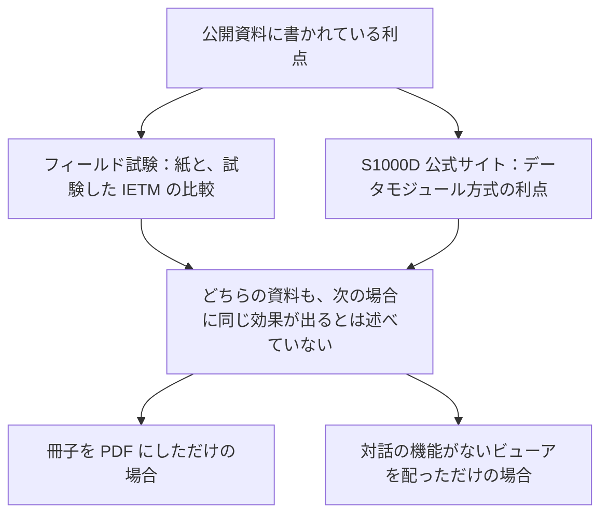

IETM と S1000D の利点として公開資料に書かれているのは、大きく分けて 2 つです。一つは、米軍のフィールド試験で示された、整備の成績の向上と技術者からの高い評価です。もう一つは、S1000D の公式サイトが挙げる、データの再利用、更新費用の削減、適用による絞り込みといった、データを管理するうえでの利点です。ただし、どちらの資料も、導入すれば自動的に同じ効果が得られるとは述べていません。

この章では、資料に書かれている利点と、導入の前に知っておくべき留意点を分けて説明します。数値は、その数値が書かれている資料と一緒に示します。資料が条件付きで述べていることを、いつでも得られる効果としては扱いません。

:::message
フィールド試験は 1980 年代から 1992 年にかけて行われたもので、対象は S1000D ではありません。また、S1000D の公式サイトに書かれている割合（%）は、特定の事業で測定した結果として示されたものではありません。
:::

この図は、2 つの資料が述べている利点と、その利点が当てはまらない場合を示したものです。データの流れを表すものではありません。

## フィールド試験で示された利点

Joseph J. Fuller の 1994 年の論文は、海軍と空軍のフィールド試験の結果をまとめて、次の点を挙げています。どの数値がどの試験のものかは示されていません。

- 技術者の多くが IETM の方が望ましいと答えました。アンケートでは、下士官の技術者の約 90% が、対話的な整備情報を電子で受け取る方が紙より好ましく、使いやすいと答えました。
- 整備の成績は統計的に有意に向上し、特にトラブルシューティングで向上が大きくなりました。経験の浅い技術者ほど向上が大きく、経験のある技術者も紙より有意に良い成績でした。IETM を使った経験の浅い技術者の成績は、十分に訓練を受けた経験者とほぼ同じになりました。
- 故障の修理にかかる時間、正常な部品を誤って取り外す件数、訓練の必要量、整備によるシステムの停止時間が減りました。整備データの報告も、より正確で漏れのないものになりました。

これらは、紙のマニュアルと、試験で使われた IETM を比べた結果です。S1000D の特定の版や特定のビューアを使えば、現在の装備でも同じ程度の効果が出る、とは論文は述べていません。各試験の名前と時期は「歴史的背景と登場の経緯」の章にまとめています。

Jorgensen の概説は、紙のマニュアルの問題として、作成と管理の費用、自動化された後方支援への組み込みにくさ、使いにくさによる整備の遅れ、正常な部品の誤った交換、訓練時間の増加を挙げています。IETM の対話的な表示は、これらの問題を解決するために導入されたものです。

## S1000D の公式サイトが挙げる利点

S1000D の公式サイトの利点のページは、まず、効果が得られるかどうかは導入の方針や基盤など、いくつもの要因によって変わると断っています。そのうえで、利点を、データ、執筆、訓練、ライフサイクル費用の 4 つに分けて挙げています。

本書の内容に特に関係するのは、データの相互運用とメタデータ、情報を小さな単位に分けて管理できること、再利用と更新費用の削減、適用による絞り込み、LSAR などの元データとの連携、既存の資料への適用です。

:::details 公式ページに書かれている利点
- スキーマなどによって、データの形のレベルで相互運用できる。
- 情報のまとまりごとに、一貫したメタデータが付く。
- 特定の企業に依存しない、公開された標準に基づいている。やり取りしやすい、小さな SGML／XML のファイルで扱える。
- 紙の冊子の構成にとらわれず、情報を単位ごとに分けて管理できる。
- モジュールなので、データを再利用できる。再利用は最大 40% になり得る。
- データモジュールの考え方により、更新の費用を最大 30% 削減し得る。
- 適用（applicability）を条件にした検索と取り出しなど、情報を絞り込みやすい。
- 後方支援の分析データ（例として LSAR が挙げられている）と連携できる。
- データモジュールの考え方は、新しい資料だけでなく既存の資料にも適用でき、実際に適用されてきた。
:::

:::message alert
40% と 30% は、公式ページで “up to”（最大で）と書かれている上限の値です。どの事業で、どのような条件で測定したかは、ページに書かれていません。公式サイト自身も、効果はさまざまな要因によって変わると断っています。契約の効果の見積もりに、この 2 つの数字をそのまま使わないでください。
:::

同じページにある “International standard, ISO 8879” は、SGML の国際規格の番号です。S1000D が ISO 規格であることを示すものではありません。

## 導入の前に知っておくべきこと

### 導入しただけでは効果は出ない

S1000D の利点のページが書いているとおり、効果は導入の方針と基盤によって変わります。Fuller の試験の結果も、試験で使われた IETM の表示方法についてのものです。どちらの資料も、ビューアを配っただけ、または紙の冊子を PDF にしただけで、同じ効果が出るとは述べていません。また、著者が作った対話（質問と分岐）を持たないものは、クラスの定義では IETM に入りません。

### 「IETM」という言葉だけでは機能が決まらない

Tri-Service が定めたクラスは、機能の多さを段階で示した目安です。たとえば Class 3 と Class 4 は、画面が似ていても原データの管理方法が違います。Jorgensen は、既存のシステムでは、費用の大きい Class 4 よりも別のクラスの方が適している場合があると書いています。

必要な機能は、陸軍の MIL-STD-40051 の機能マトリックス、または S1000D の機能マトリックスを契約に含めて指定します。含めなければ、検索、印刷、診断システムとの連携、部品の発注のうち、どれが必須なのかが決まりません。

### CSDB とビューアは仕様に含まれない

S1000D の公式サイトは、共通ソースデータベース（Common Source Data Base、CSDB）の機能を定めないと明記しています。ビューアのプログラムも、仕様の配布物には含まれていません。データをやり取りできても、技術者が使う画面と、執筆者が使う作業環境は、事業ごとに用意する必要があります。公式サイトが利点に挙げている「複数のメーカーのオーサリングツールから選べる」ことも、この役割分担があってこそ意味を持ちます。

### 版を移行するときは人の作業が必要になる

公式のダウンロードページによると、メジャー版（1 桁目が変わる改訂）には前の版との互換性がなく、データの変換には人の作業が必要です。マイナー版は自動で変換できます。長く維持する CSDB では、どの版でデータを持つかを、事業として決めておく必要があります。

### 既存の資料の変換は、新しく書くのとは違う

利点のページは、データモジュールの考え方を既存の資料にも適用でき、実際に適用されてきたと述べています。一方で公式サイトは、既存の資料の扱いを、実装する人向けの別の話題としても取り上げています。Jorgensen も、既存の紙のマニュアルを電子化したものは、新規開発向けの仕様の機能をすべては持てないことが多いと書いています。変換にかかる費用や、どこまで対話の機能を作り直すかは、公開されている割合の数字からは判断できません。

### 事業のルールが違えば、データを渡しただけではそろわない

ビジネスルール（Business Rules Exchange、BREX）という DM の種類があるのは、仕様が多くの点を事業ごとに決められるようにしているからです。米空軍は、事業ごとにプロジェクトの BREX を作ることを求めています。ほかの事業から DM を受け取るときは、相手の BREX と自分の BREX の違いによって、どの DM が検査で不合格になるかが決まります。

## 出典

- Joseph J. Fuller. *IETMs: From Research to Reality*. https://www.navsea.navy.mil/Portals/103/Documents/NSWC_Carderock/CALS94F.pdf
- Eric L. Jorgensen. *The Interactive Electronic Technical Manual Overview*. https://www.navsea.navy.mil/Portals/103/Documents/NSWC_Carderock/Cals94j.pdf
- S1000D. *Benefits*. https://s1000d.org/?page_id=57
- S1000D. *About S1000D*（CSDB の機能は定めない）. https://s1000d.org/?page_id=101
- S1000D の版番号の説明。https://users.s1000d.org/
- MIL-STD-40051-1B 附属書 A、および MIL-STD-3048A の Functionality matrix の定義。

## この章のポイント

- 公開資料で確認できる利点は、DoD のフィールド試験の結果（紙と比べた整備成績の向上と、約 90% の技術者が IETM を好んだこと）と、S1000D の公式サイトが条件付きで挙げるデータの再利用、更新、絞り込みです。40% と 30% は公式サイトが示す上限の値で、特定の事業で測定した結果ではありません。
- 効果は導入の方針と基盤によって変わります。PDF にしたり、ビューアを配ったりしただけでは、試験で使われたような IETM にはなりません。
- CSDB とビューアの製品は仕様に含まれません。必要な機能は機能マトリックスで契約に書き、メジャー版の移行には人の作業による変換が必要です。
