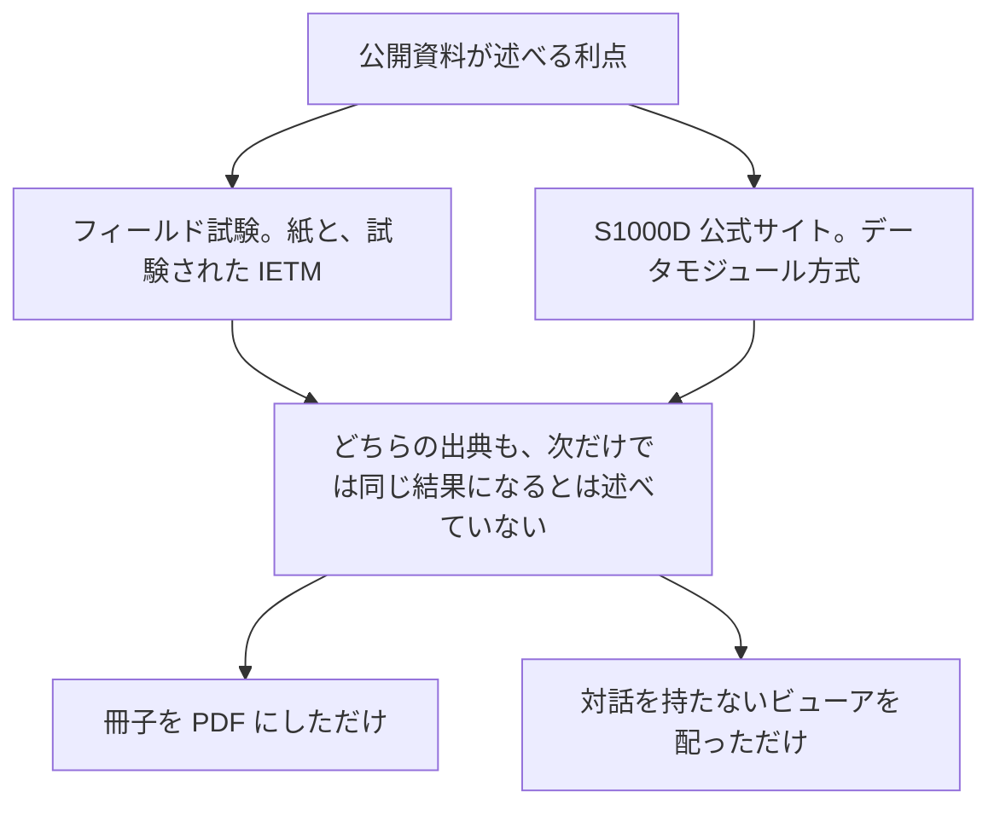

この章では、対話型電子技術マニュアル（Interactive Electronic Technical Manual、IETM）および S1000D を導入するときに、公開資料が述べている利点と、同じ資料から読み取れる留意点を分けて書きます。数値は、その数値が載っている資料に紐づけます。資料が条件付きで述べているものを、常に得られる効果としては書きません。

## 概要

利点は二つの系統に分かれます。一つは、1980 年代から 1992 年にかけての米国の軍のフィールド試験が、IETM という提示方式について述べたものです。もう一つは、S1000D の公式サイトが、データモジュール方式について述べているものです。

:::message
試験の対象は S1000D ではありません。サイトの百分率は、特定の事業の測定結果としては書かれていません。
:::

留意点の中心は、効果は実装の戦略と基盤に依存すること、クラスや機能は契約で指定しないと決まらないこと、仕様のメジャー版は後方互換でないこと、です。

矢印はデータの流れではありません。二つの出典が述べている範囲と、それらが同じ結果になるとは述べていないものを分けた図です。

## 詳細

### フィールド試験が述べている利点

Joseph J. Fuller の 1994 年の論文は、海軍と空軍のフィールド試験をまとめて、次を述べています。個別の試験へ数値を一つずつ割り当ててはいません。

- 技術者の多数が IETM を望ましいとした。質問紙では、下士官の技術者の約 90% が、対話的な整備情報の電子的な提供を紙より好み、使いやすいと答えた。
- 整備の成績は有意に改善し、とくにトラブルシューティングで改善した。経験の浅い技術者の改善は大きく、経験者も紙より有意に良かった。IETM を使うと、経験の浅い技術者の実効は、高度に訓練された経験者にほぼ並んだ。
- 是正整備の時間の短縮、正常部品の誤った取り外しの減少、整備データ収集報告の正確さと完全さの向上、訓練要求の削減、整備に伴うシステムの停止時間の短縮。

これらは、紙のマニュアルと、試験された IETM の提示を比べた結果です。S1000D の特定の版、特定のビューア、現在の装備に、同じ幅で再現する、とは論文は述べていません。試験の名前と時期は、歴史の章にあります。

Jorgensen の概説が、紙の問題として挙げているのは、製作と管理の費用、自動的な後方支援への組み込みにくさ、使いにくさによる整備の遅れ、正常部品の誤交換、訓練時間の増加です。IETM の対話的な提示は、この問題への回答として導入されています。

### S1000D の公式サイトが述べている利点

公式の利点ページは、最初に、実現は実装の戦略や基盤など複数の要因に依存する、と書いています。そのうえで、データ、執筆、訓練、ライフサイクル費用の四つに利点を分けています。本書がとくに関係するのは、データ水準の相互運用とメタデータ、情報をオブジェクトとして区切ること、再利用と更新費用の上限表現、適用による絞り込み、LSAR のようなソースデータとの連結、既存資料への適用です。

:::details 公式ページが挙げている記載
- スキーマなどによる、データ水準での相互運用。
- 情報のまとまりに一貫して付くメタデータ。
- 独占的でなく、開かれた標準に基づくこと。交換しやすい、より小さい SGML／XML のファイル。
- 情報の対象を、紙の冊子の制約ではなく情報のオブジェクトとして区切れること。
- モジュールであるためデータの再利用ができ、再利用は 40% まであり得る、という記載。
- データモジュールの概念により、更新費用を 30% まで削減し得る、という記載。
- 適用（applicability）を条件にした検索と取り出しなど、情報の絞り込みが容易であること。
- 後方支援の分析データ（LSAR が例として挙げられている）と連結し得ること。
- データモジュールの概念を、新規だけでなく既存の資料にも適用でき、実際に適用されてきた、という記載。
:::

:::message alert
40% と 30% は、このページが “up to”（最大で）と書いている上限の表現です。測定した事業名、母数、前後の条件はページにありません。公式サイト自身が、実現は要因に依存すると断っています。契約の効果見積もりに、この二つの数字をそのまま使わないでください。
:::

同じページの “International standard, ISO 8879” は、SGML の規格番号です。S1000D が ISO 規格であることの根拠にはなりません。

### 留意点

公開資料から、導入の前に分けておくべきことは次のとおりです。

**効果は自動では出ない。** S1000D の利点ページが、戦略と基盤に依存すると書いているとおりです。Fuller の試験結果も、試験された提示方式についてのものです。ビューアを配っただけで、紙の冊子を PDF にしただけで、同じ結果になるとはどちらも述べていません。著者の対話（質問と分岐）が情報の中にないものは、クラスの定義上、IETM ではありません。

**「IETM」という語だけでは機能が決まらない。** Tri-Service のクラスは spectrum 上の点であり、Class 3 と Class 4 は画面が似ていても原データの管理が違います。Jorgensen は、既存システムでは費用の大きい Class 4 より別のクラスが妥当な場合がある、と書いています。機能の要否は、陸軍の MIL-STD-40051 の機能マトリックス、または S1000D の機能マトリックスを契約に含めて指定します。含めなければ、検索、印刷、診断との接続、部品発注のどれが必須かは決まりません。

**格納製品とビューアは仕様の外にある。** S1000D は、共通ソースデータベース（Common Source Data Base、CSDB）の機能を定義しない、と公式サイトが明記しています。ビューアの実行プログラムも仕様の配布物には含まれません。データが交換できても、作業者の画面と、編集者の作業環境は事業ごとに作ります。複数の供給者のオーサリングツールがある、という公式サイトの利点は、この分担があって初めて意味を持ちます。

**版をまたぐと変換に人手が要る。** 公式のダウンロード説明は、メジャー版（最初の桁が変わる改訂）は後方互換ではなく、情報の変換に人手の介在が要る、と述べています。マイナー版は自動変換できる、としています。長期に維持する CSDB は、どの版でデータを保持するかを事業の決定として持たなければなりません。

**既存資料の変換は、新規に書くことと同じではない。** 利点ページは、データモジュールの概念を既存資料へ適用でき、適用されてきた、と述べています。同時に公式サイトは、既存資料への対処を実装者向けの独立した話題として挙げています。Jorgensen は、既存の紙からの変換物は、新規開発向け仕様の機能をすべて持てないことが多い、と書いています。変換の費用や、どこまで対話を作り直すかは、公開の百分率では決まりません。

**事業の規則が違うと、同じ S1000D でも交換しただけでは揃わない。** ビジネスルール交換（Business Rules Exchange、BREX）が種類として存在するのは、仕様が事業の選択を残しているからです。米空軍はプロジェクト BREX を要求しています。相手の DM を受け取るときは、相手の BREX と自分の BREX の差が、検査で何を不合格にするかを決めます。

## 出典

- Joseph J. Fuller. *IETMs: From Research to Reality*. https://www.navsea.navy.mil/Portals/103/Documents/NSWC_Carderock/CALS94F.pdf
- Eric L. Jorgensen. *The Interactive Electronic Technical Manual Overview*. https://www.navsea.navy.mil/Portals/103/Documents/NSWC_Carderock/Cals94j.pdf
- S1000D. *Benefits*. https://s1000d.org/?page_id=57
- S1000D. *About S1000D*（CSDB は機能を定義しない）. https://s1000d.org/?page_id=101
- S1000D の版番号の説明。https://users.s1000d.org/
- MIL-STD-40051-1B 附属書 A、および MIL-STD-3048A の Functionality matrix の定義。

## この章のポイント

- 確認できる利点は、DoD のフィールド試験（紙と比較した整備成績と、約 90% の選好）と、S1000D 公式サイトが条件付きで挙げるデータの再利用・更新・絞り込みである。40% と 30% はサイトの上限表現であり、特定事業の測定値ではない。
- 効果は戦略と基盤に依存する。PDF 化やビューアの配布だけでは、試験された IETM にはならない。
- CSDB とビューアの製品は仕様の外にあり、機能はマトリックスで契約に書き、メジャー版の変更は人手のいる変換になる。
