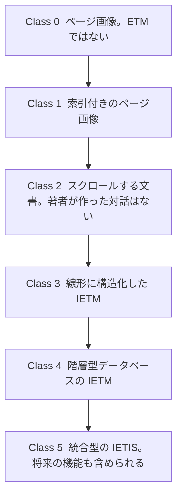

クラスは、米国国防総省（Department of Defense、DoD）が電子技術マニュアル（Electronic Technical Manual、ETM）を、機能の多さによって Class 0 から Class 5 までの 6 段階に分けたものです。IETM と呼べるのは、著者が作った対話を持つ Class 3 以上です。ただし、クラス番号を一つ指定しただけでは、調達する IETM の機能は決まりません。そのため、のちの契約では、機能マトリックス（Functionality Matrix）を使って必要な機能を一つずつ指定するようになりました。

この章では、各クラスの定義と、クラスと機能マトリックスの関係を説明します。

## クラスの全体像

米国の陸・海・空軍の合同作業部会（Tri-Service IETM Working Group）は、ETM を Class 0 から Class 5 までの 6 段階に分けました。ページ画像をそのまま保管しただけのものから、ほかのシステムと統合したデータベース型のものまでを、機能の多さの順に並べています。

両端の 2 つは、ほかと性格が違います。

- Class 0 は ETM ではありません。定義を書いた Eric L. Jorgensen は、分類の全範囲（“a full spectrum”）を示すために Class 0 を含めた、と説明しています。
- Class 5 は、当時まだ開発されていなかった機能や、実運用に使えるほど成熟していなかった機能も含められるように、内容の上限を定めていません。

IETM と呼べるのは Class 3 以上です。Class 1 と Class 2 は ETM ですが、著者が作った対話を持たないため IETM には入りません。

実在のシステムは、どれか一つのクラスにぴったり当てはまるとは限りません。同じ論文の中で、Class 3 と Class 4 は利用者から見ると同じように見えることがあること、既存のマニュアルを変換したものは新規開発向けの仕様の機能をすべては持たないことが書かれています。

## Class 0 から Class 5 の定義

次の表は、Jorgensen が Tri-Service の定義として書いた内容を短くまとめたものです。契約に使うときは原文を確認してください。

| クラス | 原文の名称 | データの持ち方 | 利用者から見た動き |
| --- | --- | --- | --- |
| 0 | Non-Electronically-Indexed Page Images。ETM ではない | 電子保管またはオンデマンド印刷のためのページ画像 | 画面でページを見られる。オンラインで使うための詳しい索引はない |
| 1 | Electronically Indexed Page Images | ページ画像に索引を付け、目的のページへ自動で移れるようにしたもの。例は米海軍の Advanced Technical Information System（ATIS） | 図書館や調査での閲覧に使う。本文を文字として全文検索できるとは限らない |
| 2 | Electronic Scrolling Documents | ASCII の文書に索引とハイパーテキストを加えたもの。紙の原稿を単純に変換したものが多く、タグを付ける以外に専門家が書き直すことはほとんどない | 文書の中を移動できる。著者による誘導や、内容に応じて次の画面を出す機能（NEXT）は、ごく限られるか、まったくない |
| 3 | Linear Structured IETMs | MIL-D-87269 のタグを使った SGML で、可能な限り構造化する。ただし文書は線形のままで、階層型データベースではない。表示は MIL-M-87268 のハイパーテキスト提示に従う | 著者が作った誘導がある。質問のダイアログや、内容に応じて次の画面を出す機能を使える |
| 4 | Hierarchically Structured IETMs | 重複のないリレーショナルデータベース、またはオブジェクト指向の階層型データベースとして執筆し、維持する。実行時のデータベースにまとめ、MIL-M-87268、MIL-D-87269、MIL-Q-87270 に従って対話的に表示する | 画面は Class 3 とよく似ていることがある。主な違いは原データの管理方法にある |
| 5 | Integrated Data-Base IETIS | Class 4 の IETM を、ほかの業務システムのデータと統合した統合電子技術情報システム（Integrated Electronic Technical Information System、IETIS）。エキスパートシステムの規則、診断、コンピュータで管理する訓練などを含む | 当時は未開発だった機能や、実運用にはまだ成熟していなかった機能も含められる |

## IETM と呼べるクラスの条件

Jorgensen は、IETM と呼ぶための条件として、著者が対話の機能を情報の中に作り込んでいることを挙げています。対話の例は、プロンプト、利用者にデータを入力させるダイアログ、利用者が選ぶ分岐です。この条件で各クラスを見ると、次のようになります。

- **Class 4** は IETM の仕様に完全に従います。改訂できる原データを、データベース管理システムで管理します。
- **Class 3** は、原データを改訂可能なデータベースで管理していない点で、Class 4 の仕様を完全には満たしません。それでも Class 4 の機能の多くを持ち、利用者からは Class 4 と同じように見えることがあります。違うのは原データの管理方法です。
- **Class 5** は Class 4 の機能をすべて持ち、さらに機能を追加したものです。Class 4 の IETM 仕様にも従います。
- **Class 1 と Class 2** は、著者が作った対話を情報の中に持たない ETM です。Class 1 は印刷ページの画像です。Class 2 はページ区切りをなくしてスクロールできるようにした文書で、操作はビューアが提供します。著者が入れられるのは、文書内のほかの箇所へのハイパーテキストのリンクだけです。

:::message alert
「PDF は Class 2 である」とは言えません。画像だけの PDF は Class 0 または Class 1 に近く、テキストとハイパーリンクを持つ線形の PDF は Class 2 に近い、という程度の対応しか付けられません。クラスはファイル形式の分類ではありません。
:::

同じ論文によると、1992 年の 3 仕様が正式に規定しているのは Class 4 です。軍は新規のシステムには Class 4 を求める一方、既存のシステムでは Class 1、2、3 も受け入れる必要がありました。費用の大きい Class 4 よりも、別のクラスの方が適している場合があることを、定義を作った側が認めていたことになります。

## 機能マトリックスが必要になった理由

クラスは、よくある機能の組み合わせに名前を付けたものです。注釈を付けられるか、部品の発注とつながるか、動的な診断ができるかといった個々の機能は、クラス番号では契約に書けません。Class 3 と Class 4 の画面がよく似ることからも分かるとおり、番号だけでは納品物を特定できません。

そのため、調達の文書では、機能マトリックスを使って必要な機能を一つずつ選ぶようになりました。公開資料で確認できる機能マトリックスは、次の 2 つです。

:::message alert
この 2 つは別の表です。行の定義も、どの契約で効力を持つかも異なります。
:::

1. **米陸軍の MIL-STD-40051-1B 附属書 A**
   線形と非線形の IETM の機能と、技術内容の選択表を定めています。附属書 A は規格の必須の部分で、機能の具体的な水準は附属書 A の機能マトリックスに従うよう、本文が指示しています。マトリックスの目的は、IETM の調達側が、産業界にも通じる言葉で要求を書けるようにすることです。記入した機能マトリックスと内容選択表は、契約書、作業記述書などの契約文書に含めたときに、契約上の拘束力を持ちます。
2. **S1000D に付属する機能マトリックス**
   米空軍の MIL-STD-3048A は、これを「IETM とページ型の出版物の両方について、必要な機能の水準を調達側が指定するためのツール」と定義しています。機能は、理論、診断、部品など、技術出版物のデータの種類ごとに指定できます。S1000D Issue 5.0 のダウンロード一式の説明にも、Functionality matrix が含まれています。

MIL-STD-40051-1B の表では、機能ごとに複雑さを示す数値が、線形の列と非線形の列に分けて書かれています。この数値は、その IETM 全体のクラス番号ではありません。例を挙げます。

| 機能 | 線形の列 | 非線形の列 | 区分 |
| --- | --- | --- | --- |
| Dynamic Diagnostics | 適用なし（NA） | 5 | Diagnostics and Prognostics |
| Prognostics | NA | 5 | Diagnostics and Prognostics |
| System Simulation | 4 | 4 | Diagnostics and Prognostics |

区分は全部で 12 あります。配布媒体（CD-ROM、DVD、ネットワーク）、注釈、印刷、外部の業務処理（不具合の報告、部品の発注、整備データの収集など）が、それぞれ個別の行として並んでいます。クラス番号よりも具体的に要求を書けます。

:::details 附属書 A の 12 の区分
Access、Annotation、Delivery and Distribution、Diagnostics and Prognostics、External Processes、Graphics、Linking、Navigation and Tracking、Printing、Special Content、Updates、User Operation Mode。
:::

:::message alert
S1000D のマトリックスと陸軍のマトリックスを、一つのチェックリストとして混ぜて使わないでください。どちらも「クラス番号だけでは機能を指定できない」という問題に対応するものですが、行の定義と、効力を持つ契約の規格が違います。
:::

なお、クラスという分類が廃止されたわけではありません。1994 年の定義は、今もクラスを理解するための一次資料です。その後の調達規格では、クラス番号に加えて、またはクラス番号の代わりに、機能の一覧で要求を書くようになっています。

## 出典

- Eric L. Jorgensen. *The Interactive Electronic Technical Manual Overview: "Setting the Stage"*. https://www.navsea.navy.mil/Portals/103/Documents/NSWC_Carderock/Cals94j.pdf
- Department of Defense. MIL-STD-40051-1B. 附属書 A（IETM の機能、表示、内容選択）。ASSIST から 2026-10-14 に取得したテキスト。規格自身が、使用前に現行版であることを確認するよう求めています。
- Department of Defense. MIL-STD-3048A(USAF). 用語 3.2.11（Functionality matrix）。https://everyspec.com/MIL-STD/MIL-STD-3000-9999/download.php?spec=MIL-STD-3048A.054327.pdf
- S1000D Issue 5.0 のダウンロード一式の説明（Functionality matrix を含む）。https://users.s1000d.org/

## この章のポイント

- Tri-Service の作業部会は、ETM を機能の多さの順に Class 0 から Class 5 までの 6 段階に分けました。Class 0 は ETM ではなく、Class 5 は将来の機能も含められるように上限を定めていません。
- IETM と呼べるのは、著者が作った対話を持つ Class 3 以上です。Class 3 と Class 4 は画面が似ていても、原データの管理方法が違います。PDF などのファイル形式とクラスは対応しません。
- 必要な機能は機能マトリックスで指定します。陸軍の MIL-STD-40051 の表と S1000D の表は別のものです。マトリックスの数値は、IETM 全体のクラス番号ではありません。
