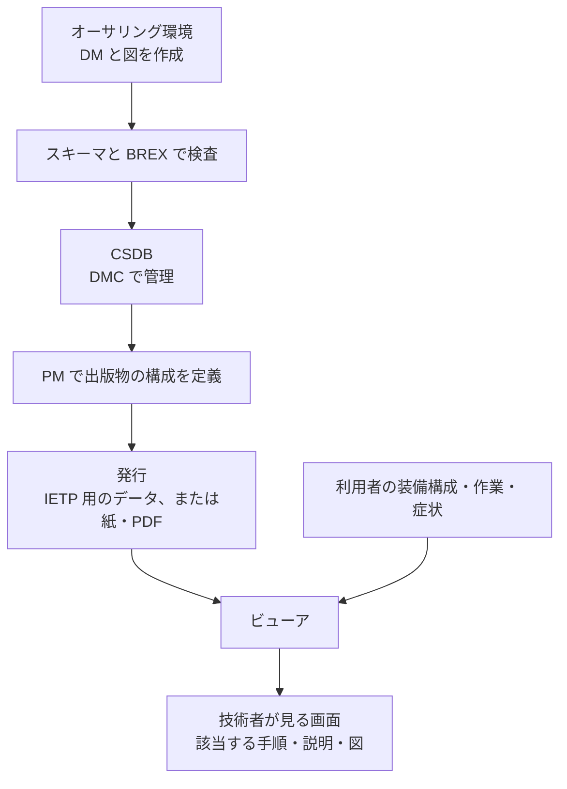

IETM や IETP は、情報を作る「オーサリング環境」、情報を保管し管理する「CSDB」、情報を技術者の画面に表示する「ビューア」の 3 つの構成要素で成り立っています。S1000D が定めているのは、この 3 つの間でやり取りするデータの形です。オーサリングのソフトウェアやビューアの製品は指定していません。

この章では、S1000D に従う場合を中心に、3 つの構成要素の役割と、データがどう流れるかを説明します。

| 構成要素 | 役割 | 仕様が決めていること |
| --- | --- | --- |
| オーサリング環境 | データモジュール（Data Module、DM）と図を作る | 作った XML が、スキーマと、事業で採用したビジネスルール（Business Rules Exchange、BREX）に合っていること。編集ソフトの製品は指定しない |
| 共通ソースデータベース（Common Source Data Base、CSDB） | DM、図、パブリケーションモジュール（Publication Module、PM）を保管し管理する | 保管と管理が必要であること。具体的な機能は定めていないと、公式サイトに明記されている |
| ビューア | PM と DM から、利用者が見る画面を作る | IETP に持たせる機能は、機能マトリックスで指定できる。ビューアのソフトウェアは仕様に含まれない |

米国の MIL-PRF-87268A は、IETM の内容と、それを表示する電子表示装置（Electronic Display System、EDS）の操作画面の両方に要求を定めていました。これに対して S1000D は、データの形を共通にし、画面にどの機能を持たせるかは事業ごとに機能マトリックスで選ぶ、という分担になっています。

## オーサリング環境

執筆者は、冊子の章を最初から最後まで続けて書くのではなく、DM を一つずつ作ります。一つの DM は識別・状態の部分と内容の部分を持ち、データモジュールコード（Data Module Code、DMC）で識別します。説明、手順、図付きの部品情報、故障は、それぞれ別の種類の DM として作ります。

オーサリング環境に必要なのは、次のことができることです。

- XML を編集できる。
- DMC や適用の情報を漏れなく入力できる。
- 図を DM の外にあるファイルとして参照できる。

作った DM は、使う版の XML スキーマと、その DM が参照する BREX で検査します。スキーマは仕様として許される形を決め、BREX は事業がさらに絞り込んだルールを決めます。通常は、この 2 つの検査に合格した DM を CSDB に正式に登録します。

S1000D の公式サイトは、仕様に準拠したオーサリングツールを複数のメーカーから選べることを、利点の一つに挙げています。公式サイトが特定の製品を推奨しているわけではありません。

## CSDB

CSDB は、DM を保管する場所の名前です。公式サイトは、CSDB の機能は定めないと書いています。事業に必要なのは、作った DM を保管し、DMC で取り出せること、そして版、適用、品質保証の状態を管理できることです。

作業の流れ、アクセス権、ほかのシステムとの連携は、仕様の外で事業ごとに決めます。同じ S1000D のデータを扱っていても、CSDB の製品が違えば操作画面も違います。事業や組織の間でやり取りするのは、製品の画面ではなく、DM、PM、図のファイルです。

## ビューア

ビューアは、CSDB の内容を、整備技術者や操作者が見る画面にします。S1000D では、この画面向けの出版物を IETP と呼びます。米軍の文書では、ほぼ同じものを IETM と呼びます。

ビューアが行う処理は、公開されている仕様の範囲では次のとおりです。

- PM に書かれた構成に従って、参照されている DM を集めます。
- 適用の情報と利用者の装備の構成を照らし合わせ、当てはまらない DM を表示しません。一つの DM の中でも、当てはまらない段落やステップを表示しません。公式の利点のページは、この適用による絞り込みを利点に挙げています。詳しくは「Data Module の種類と構造」の章で説明しています。
- 事業が機能マトリックスで選んだ機能（検索、印刷、注釈、外部システムとの連携など）を提供します。米空軍の MIL-STD-3048A は、S1000D の機能マトリックスで、IETP だけでなくページ型の出版物の機能も指定できると定義しています。

MIL-PRF-87268A が規定したダイアログ、つまり質問に答えるまで次へ進めず、答えによって次の手順が変わる動作は、ビューアだけでは実現できません。データの側に質問や条件が書かれている必要があります。S1000D では、質問、変数、条件と、次に表示する DM の順序を、主に Process データモジュールに書きます。Procedural の DM には、そのときに表示するステップの本文を書きます。データの側にこうした記述がなければ、ビューアがどれだけ高機能でも対話的な表示にはなりません。

## データの流れ

データが作られてから技術者の画面に表示されるまでの流れは、次のとおりです。

1. 執筆者が DM と図を作ります。識別・状態の部分には、DMC、適用、BREX への参照を書きます。
2. スキーマと BREX で検査し、CSDB に保管します。
3. PM で、どの DM をどの順序と階層で出版物に入れるかを定義します。PM には技術情報の本文をコピーしません。
4. 発行の処理で、IETP 用のデータや、ページ型の出力（紙や PDF）を作ります。なお、公式のダウンロードページによると、メジャー版が違うデータの変換には人の作業が必要です。
5. ビューアが、利用者の装備、作業、症状に合わせて DM を選び、画面を組み立てます。

:::message
この図は処理の順序を示したものです。検査をオーサリング環境と CSDB のどちらで行うか、発行したデータを CSDB の外に書き出すか、ビューアが CSDB を直接読むかといった製品の構成は、仕様では決まっていません。
:::

## 仕様に含まれないもの

S1000D の公式サイトは、CSDB の機能を定めないと明記しています。ビューアのプログラムも、仕様のダウンロード一式（仕様書、スキーマ、サンプル、既定の BREX、機能マトリックス）には含まれていません。

また、米国の MIL-HDBK-511 が扱う相互運用は、ブラウザを共通の入口にして、利用者が異なる IETM を行き来できるようにするものです。S1000D の CSDB の製品仕様ではありません。

:::message alert
「S1000D 準拠」という説明は、データが仕様と事業の BREX に合っていることを指す場合があります。オーサリング環境、CSDB、ビューアが同じ製品であることや、操作画面がほかの事業と同じであることを意味するものではありません。画面にどの機能が必要かは、機能マトリックスで選んだ結果を契約に含めて、初めて決まります。
:::

## 出典

- S1000D. *About S1000D*（DM、CSDB の機能は定めない）. https://s1000d.org/?page_id=101
- S1000D. *Benefits*（複数のメーカーのオーサリングツール、適用による絞り込み）. https://s1000d.org/?page_id=57
- S1000D のダウンロードの説明（スキーマ、Default BREX、Functionality matrix。ビューアの製品は含まれない）. https://users.s1000d.org/
- MIL-PRF-87268A（IETM と電子表示装置、ダイアログ）. https://www.navsea.navy.mil/Portals/103/Documents/NSWC_Carderock/s87268a.pdf
- MIL-STD-3048A の Functionality matrix の定義。
- MIL-HDBK-511 の適用範囲。https://apps.dtic.mil/sti/tr/pdf/ADA445614.pdf

## この章のポイント

- IETM と IETP の構成要素は、オーサリング環境、CSDB、ビューアの 3 つです。仕様は、このどれについても製品を指定していません。
- データは DM として作られ、スキーマと BREX で検査されて CSDB に入り、PM で出版物の構成が決まります。
- 技術者が見る画面は、ビューアが装備、作業、症状に合わせて DM を選び、さらに DM の中の該当する段落やステップを表示した結果です。質問と分岐は主に Process データモジュールに書きます。どの機能が必要かは、機能マトリックスで決まります。
