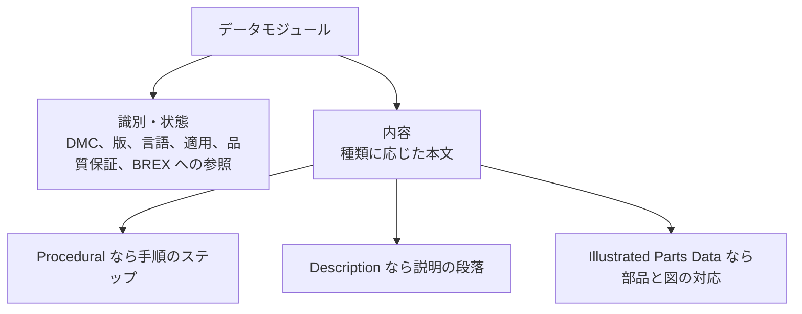
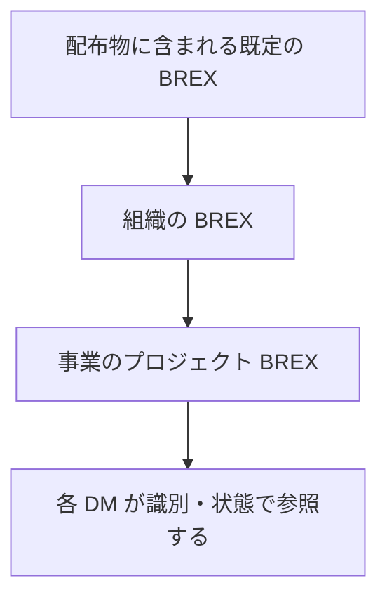

この章では、S1000D のデータモジュール（Data Module、DM）にどのような種類があり、一つの DM がどのような構造を持つかを説明します。DM は、プラットフォーム、システム、または構成品についての独立した情報の単位です。共通ソースデータベース（Common Source Data Base、CSDB）から、データモジュールコード（Data Module Code、DMC）で取り出します。

種類の完全な一覧は版に依存します。ここには、公式の概要ページが例として挙げているものと、構造を理解するために必要なビジネスルール交換（Business Rules Exchange、BREX）を書きます。

## 概要

DM は二つに分かれます。識別・状態の部分（identification and status section）は、管理、適用、品質保証、取り出しのための情報です。内容の部分（contents section）は、利用者が作業を行い、またはシステムを理解するための情報そのものです。内容の部分の形は、DM の種類によって違います。

BREX は、その事業が S1000D をどう使うかという規則を、機械が検査でき、人も読める DM として交換するための種類です。

## 詳細

### 公式サイトが例示する種類

S1000D の概要ページは、情報の種類の例として次を挙げています。括弧内は、この章での短い説明です。公式ページは定義を一行ずつは与えていないので、括弧内は名称から読み取れる範囲に留め、要素の中身は仕様書に譲ります。

| 公式ページの例 | この章での位置づけ |
| --- | --- |
| Crew | 乗員・操作者向けの情報 |
| Description | システムの記述。本書の「Descriptive」はこれを指す |
| Procedural | 手順 |
| Fault | 故障の切り分けや報告に関する情報 |
| Illustrated Parts Data | 図解された部品情報 |
| Schedules | 予定・計画に関する情報。ページはこれ以上の定義を与えていない |
| Wiring | 配線に関する情報 |
| Process Module | 手順そのもの（Procedural）とは別の項目として挙げられている。複数の情報にまたがる処理のまとまりを表すために使われる、と本書が断定できる公式の一文は、概要ページにはない |
| Business Rules Exchange | 事業の規則を交換する DM。後述 |

同じページの見出し構造では、この箇条書きの直後に CSDB が続いています。CSDB は情報の種類ではなく、DM を入れる格納場所です。種類の一覧には含めません。

版によって種類は増えます。Issue 2.3（2009 年に公開されていたスキーマ）には、上の表に対応する `descript.xsd`、`proced.xsd`、`fault.xsd`、`ipd.xsd`、`schedul.xsd`、`wrngdata.xsd`、`process.xsd`、`brex.xsd`、`crew.xsd` に加え、`container.xsd` や相互参照表のスキーマが別ファイルでありました。Issue 7 の全種類を、この章は転記していません。採用する版の仕様とスキーマを見てください。

Illustrated Parts Data は、ATA の Illustrated Parts Catalogue と目的が近い部品情報です。ただし S1000D の公式ページが使っている名称は Illustrated Parts Data です。ATA のカタログ仕様と同一だとは、ここでは書きません。

### 識別・状態と内容

初心者向けに、一つの手順 DM が何を持つかを抽象化すると次のようになります。要素名の全文は版のスキーマにあります。



識別・状態の部分が公式に担う四つは、CSDB 内の管理、適用の管理、品質保証プロセスの管理、取り出しの制御です。DMC、版番号、発行日、言語、セキュリティ、適用、BREX への参照は、この部分に置かれます。米空軍の MIL-STD-3048 が示す BREX 参照は、`brexDmRef` の中に、参照先 BREX の DMC を入れる形です。

次は、その参照の位置だけを示す見取り図です。版のスキーマからの抜粋ではありません。

```xml:brex-ref-outline.xml
<!-- 見取り図であり、版のスキーマからの抜粋ではない -->
<!-- 確認できた要素名は brexDmRef だけである -->
<識別・状態>
  <!-- DMC、版、言語、適用、品質保証 -->
  <brexDmRef>
    <!-- 参照先 BREX の DMC -->
  </brexDmRef>
</識別・状態>
```

:::message
`brexDmRef` は、米空軍の MIL-STD-3048 が示している要素名です。外側の「識別・状態」は本書の説明用のラベルであり、スキーマの要素名ではありません。属性名の全文は、採用する版のスキーマを見てください。
:::

内容の部分は種類ごとに違います。Descriptive はシステムの説明です。Procedural は、技術者が順に行うステップです。Illustrated Parts Data は、図と部品の対応です。Fault は、症状から切り分けへ進む情報です。共通なのは、内容が識別・状態から分離されているため、同じ管理情報の仕組みを種類が違っても使えることです。

適用の情報は内容の本文に埋め込まず、識別・状態の側で管理します。ビューアは、利用者の装備構成とこの適用情報を突き合わせ、該当しない DM を出さない、という使い方ができます。公式の利点ページは、これを適用による絞り込みとして挙げています。

### BREX

BREX は Business Rules Exchange の略であり、それ自身が一つの DM の種類です。S1000D は多くの箇所で、事業が選ぶことを残しています。どの要素を使うか、仕様が許すより厳しく何を必須にするか、どのコードを許すか、は事業の決定です。その決定を、関係者の間で交換し、各 DM がそれに従っているかを検査できるようにしたものが BREX です。

確認できた事実は次のとおりです。

- 公式の概要ページは、Business Rules Exchange を情報の種類の例に含めている。
- Issue 5.0 のダウンロード一式には、Default BREX module と Business Rules template が含まれる。
- 米空軍の MIL-STD-3048 は、S1000D の Chapter 4.10 に対応する事業規則として、事業がプロジェクト BREX を作成して使うこと、および層状の BREX として上位の BREX をすべて含めることを要求している。例では、プロジェクトの DM が参照する BREX のさらに先に、空軍の BREX がある。

層状とは、仕様に付く既定の BREX の上に組織の BREX を重ね、さらに事業の BREX を重ねる、という関係です。各 DM は、自分に適用される BREX を識別・状態の部分で参照します。BREX も DM なので、人が読める説明と、機械が検査に使う規則を同じオブジェクトに含められます。



上の図は、米空軍の MIL-STD-3048 が要求する層状の関係を、本書の説明に沿って描いたものです。

:::message
S1000D のすべての版のすべての事業に、プロジェクト BREX の作成が必須だ、と本書は一般化しません。その「必須」を文面で確認したのは、米空軍の MIL-STD-3048 です。S1000D 側で確認したのは、BREX という種類と、既定の BREX が配布物に含まれることです。事業の契約がどの層までを要求するかは、その事業のビジネスルールを見てください。
:::

BREX はビューアの操作画面を規定するものではありません。規定するのは、CSDB に入る DM が、その事業の決めた S1000D の使い方に合っているかです。

## 出典

- S1000D. *About S1000D*（種類の例、二つの部分、CSDB）. https://s1000d.org/?page_id=101
- S1000D. *Benefits*（適用による絞り込み）. https://s1000d.org/?page_id=57
- S1000D Issue 5.0 のダウンロード説明（Default BREX module、Business Rules template）. https://users.s1000d.org/
- S1000D Issue 2.3 の公開スキーマ一覧。http://www.s1000d.org/S1000D_2-3/xml_schema_flat/
- Department of Defense. MIL-STD-3048 系。Chapter 4.10 に対する事業 BREX の要求と `brexDmRef` の例。ASSIST から 2026-09-28 に取得されたテキスト。

## この章のポイント

- 公式の概要が例示する種類には、Description、Procedural、Fault、Illustrated Parts Data、Schedules、Wiring、Crew、Process Module、BREX がある。完全な一覧は版による。
- 構造は識別・状態と内容の二つである。DMC、適用、品質保証、BREX への参照は識別・状態の側にあり、本文は内容の側にある。
- BREX は事業の規則を交換し、DM を検査するための DM である。米空軍の規格は、上位を含むプロジェクト BREX の作成と使用を要求している。
