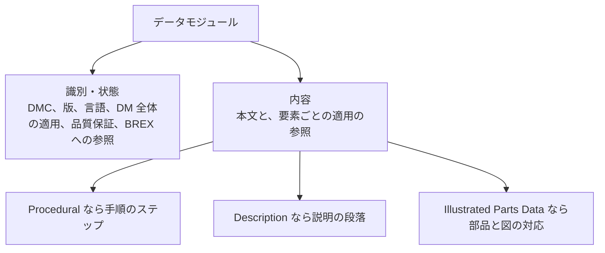
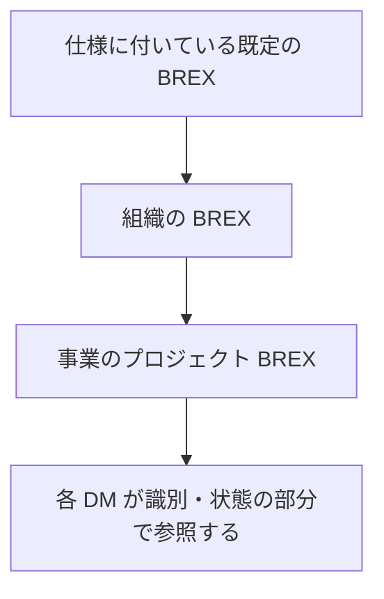

S1000D のデータモジュール（Data Module、DM）には、説明、手順、故障、部品、配線など、書く情報の種類ごとに型が用意されています。どの種類の DM も、管理用の情報を入れる「識別・状態の部分」と、本文を入れる「内容の部分」の 2 つでできています。内容の部分の形は種類によって違いますが、識別・状態の部分の仕組みはすべての種類で共通です。

この章では、公式サイトが例として挙げている DM の種類と、DM の内部の構造を説明します。あわせて、対話的な表示を記述する Process データモジュールと、事業のルールを定める BREX（Business Rules Exchange）という 2 つの特別な種類も取り上げます。DM の種類の完全な一覧は版によって違うため、ここでは主なものに絞ります。

## 公式サイトが挙げている DM の種類

S1000D の概要ページは、DM の種類の例として次のものを挙げています。公式ページには種類ごとの定義が書かれていないため、右の列は名称と公開資料から分かる範囲の説明です。要素の詳しい内容は仕様書を確認してください。

| 公式ページの名称 | 内容 |
| --- | --- |
| Crew | 乗員や操作者向けの情報 |
| Description | システムの説明。本書で「Descriptive」と書いているのはこの種類 |
| Procedural | 作業の手順 |
| Fault | 故障の切り分けや報告に関する情報 |
| Illustrated Parts Data | 図付きの部品情報 |
| Schedules | 整備計画の情報。点検の間隔や定期整備のように、何をどの間隔で行うかを扱う |
| Wiring | 配線に関する情報 |
| Process Module | 質問、条件、DM を表示する順序など、対話的な表示の流れを記述する。詳しくは次の節で説明する |
| Business Rules Exchange | 事業のルールをまとめた DM。詳しくは後の節で説明する |

公式ページでは、この一覧のすぐ後に CSDB の説明が続いていますが、CSDB は DM の種類ではなく、DM を保管する場所です。

DM の種類は、版が新しくなるにつれて増えています。たとえば 2009 年時点で公開されていた Issue 2.3 のスキーマには、上の表に対応する `descript.xsd`、`proced.xsd`、`fault.xsd`、`ipd.xsd`、`schedul.xsd`、`wrngdata.xsd`、`process.xsd`、`brex.xsd`、`crew.xsd` のほかに、`container.xsd` や相互参照表のスキーマが別のファイルとしてありました。Issue 7 のすべての種類は、この章では扱っていません。使う版の仕様書とスキーマで確認してください。

いくつかの種類について補足します。

- **Illustrated Parts Data** は、ATA の Illustrated Parts Catalogue（図解部品カタログ）と目的が近い部品情報です。ただし、ATA のカタログの仕様と同じものかどうかは、本書では扱いません。
- **Schedules** について、公式の概要ページは名前しか示していません。Issue 4.0 を解説した公開の実装資料では、整備計画の情報（maintenance planning information）と説明されています。S シリーズの S4000P（予防整備の仕様）と目的は近いものの、S4000P の出力そのものだとは公式ページは述べていません。

## Process データモジュール

Process データモジュールは、技術者の答えや装備の状態に応じて、どの DM をどの順序で表示するかを記述する種類です。公式の概要ページは名前を挙げているだけですが、Issue 4.0 を解説した公開の実装資料では、装備の状態に応じて整備情報を動的に表示するためのものと説明されています。内容の大部分は、どの DM をどう表示するかを書いた、プログラムのスクリプトに近いものです。

Process データモジュールで使う要素の名前として、次のものが公開資料で確認できます。

- `dmSeq`：DM を表示する順序
- `dmIf`：条件による分岐
- `dmLoop`：繰り返し
- `variable`：変数
- `dialog`：利用者への質問

`dialog` は S1000D の既定の BREX でも検査の対象になっています。ほかの要素名は、Process データモジュールを編集する公開のツールが扱っている範囲から確認したものです。要素同士の親子関係は仕様書の process の章に書かれていますが、本書ではそこまでは扱いません。Issue 4.1 の `process.xsd` は公開されています。

第 1 章で説明した MIL-PRF-87268A のダイアログ、つまり質問への答えによって次に表示する手順が変わる仕組みに、S1000D で主に対応するのがこの Process データモジュールです。役割は次のように分かれます。

- **Procedural の DM**：表示するステップの本文を持つ。
- **Process の DM**：質問、変数、条件に応じて、どの DM をどの順序で表示するかを記述する。

対話の仕組みは、手順の DM の中に分岐を書くことだけではありません。DM をまたいだ流れは、Process の DM が受け持ちます。

## 識別・状態の部分と内容の部分

一つの手順の DM が持つ情報を簡単にまとめると、次のようになります。要素名の正確な一覧は、版のスキーマで確認してください。



### 識別・状態の部分

公式サイトによると、識別・状態の部分は、CSDB での管理、適用の管理、品質保証の手続きの管理、取り出しの制御の 4 つを担います。具体的には、DMC、版の番号、発行日、言語、セキュリティ区分、DM 全体の適用、BREX への参照がここに入ります。

BREX への参照について、米空軍の MIL-STD-3048 は、`brexDmRef` という要素の中に、参照する BREX の DMC を書く形を示しています。次の例は、参照を書く位置だけを示したもので、版のスキーマからの抜粋ではありません。

```xml:brex-ref-outline.xml
<!-- 位置を示すための例で、版のスキーマからの抜粋ではない -->
<!-- 確認できた要素名は brexDmRef だけ -->
<識別・状態>
  <!-- DMC、版、言語、適用、品質保証 -->
  <brexDmRef>
    <!-- 参照する BREX の DMC -->
  </brexDmRef>
</識別・状態>
```

:::message
`brexDmRef` は、米空軍の MIL-STD-3048 に書かれている要素名です。外側の「識別・状態」は説明のために付けたラベルで、スキーマの要素名ではありません。属性名などの詳細は、使う版のスキーマで確認してください。
:::

### 内容の部分

内容の部分は、DM の種類によって形が違います。Description はシステムの説明、Procedural は技術者が順に行うステップ、Illustrated Parts Data は図と部品の対応、Fault は症状から故障箇所を切り分けるための情報です。内容の部分が識別・状態の部分から分かれているので、種類が違っても同じ管理の仕組みを使えます。

### 適用の付け方

適用（applicability）は、DM 全体に付ける方法と、DM の中の段落やステップに付ける方法の 2 通りがあります。

- **DM 全体の適用**：識別・状態の部分に書きます。Issue 4 以降の公開資料では、`identAndStatusSection` の中の `dmStatus` にある `applic` という要素です。
- **段落やステップの適用**：内容の部分の要素に `applicRefId` 属性を付け、あらかじめ定義しておいた適用の条件を参照します。

適用の条件を定義する `referencedApplicGroup` を置く場所は、版によって違います。公開の実装資料によると、Issue 4.0.1 までは識別・状態の部分に置くのが一般的で、Issue 4.1 以降は内容の部分に置く形になっています。

そのため、表示の絞り込みは「DM を表示するかどうか」だけでなく、「一つの DM の中で、どの段落やステップを表示するか」の単位でも行われます。条件の値は、次の 3 つの表で管理します。

| 表 | 扱うもの |
| --- | --- |
| 適用相互参照表（Applicability Cross-reference Table、ACT） | 製品の属性（型式、搭載装備など） |
| 条件相互参照表（Conditions Cross-reference Table、CCT） | 製品の属性以外の条件（環境、作業の状況など） |
| 製品相互参照表（Products Cross-reference Table、PCT） | 個々の製品（機体番号ごとの構成など） |

この 3 つの表を使う方法は、本書が参照した公開資料では Issue 3.0 以降について説明されています。それより前の版にも同じ表があるかは確認していません。公式の利点のページが挙げている「適用による絞り込み」には、DM 単位と DM 内の要素単位の両方が含まれると考えられます。

## BREX

BREX（Business Rules Exchange）は、事業ごとの S1000D の使い方のルールをまとめた DM です。

S1000D は、多くの点を事業ごとに決められるようにしています。どの要素を使うか、仕様よりも厳しく何を必須にするか、どのコードを使ってよいか、といったことは、事業ごとに決めます。BREX は、その決定を関係者の間で共有し、各 DM がルールに従っているかを機械で検査できるようにするためのものです。BREX も DM の一種なので、人が読む説明と、機械が検査に使うルールを、一つのファイルにまとめて持てます。

BREX について、公開資料で次のことが確認できます。

- 公式の概要ページは、Business Rules Exchange を DM の種類の例に挙げています。
- Issue 5.0 のダウンロード一式には、既定の BREX（Default BREX module）と、ビジネスルールのひな形（Business Rules template）が含まれています。
- 米空軍の MIL-STD-3048 は、S1000D の Chapter 4.10 に対応するルールとして、事業ごとにプロジェクトの BREX を作って使うこと、そして上位の BREX をすべて含む階層構造にすることを求めています。規格の例では、プロジェクトの DM が参照する BREX の上位に、空軍全体の BREX があります。

BREX の階層構造とは、仕様に付いている既定の BREX の上に組織の BREX を重ね、さらにその上に事業の BREX を重ねる関係です。各 DM は、自分に適用される BREX を識別・状態の部分で参照します。



上の図は、米空軍の MIL-STD-3048 が求める BREX の階層構造を示したものです。

:::message
プロジェクトの BREX を作ることを必須としているのは、本書が確認した範囲では米空軍の MIL-STD-3048 です。S1000D のすべての版、すべての事業で必須かどうかは確認していません。事業の契約でどの階層まで求められるかは、その事業のビジネスルールを確認してください。
:::

BREX が決めるのは、CSDB に入れる DM が、その事業で決めた S1000D の使い方に合っているかどうかです。ビューアの操作画面を決めるものではありません。

## 出典

- S1000D. *About S1000D*（種類の例、2 つの部分、CSDB）. https://s1000d.org/?page_id=101
- S1000D. *Benefits*（適用による絞り込み）. https://s1000d.org/?page_id=57
- S1000D Issue 5.0 のダウンロードの説明（Default BREX module、Business Rules template）. https://users.s1000d.org/
- S1000D Issue 2.3 の公開スキーマ一覧。http://www.s1000d.org/S1000D_2-3/xml_schema_flat/
- Adobe FrameMaker 10, *Data module types*（Issue 4.0 の Process と Schedule の説明）。https://help.adobe.com/en_US/framemaker/s1000d/WS9ad62b8fb4f8a997-4a02f1412e146f7d2a-8000.html
- S1000D の既定の BREX が `dialog` を検査の対象に含むこと。Boeing が公開している Issue 3.0 の既定の BREX の XML。http://www.boeing.com/commercial/cas_xml/s1000d/3-0BE1-2/brex/DMC-AE-A-04-10-0301-00A-022A-D_002-00.XML
- Process データモジュールの要素名（`dmSeq`、`dmIf`、`dmLoop`、`variable`、`dialog`）。Oxygen XML Editor 向けの公開スタイルシート `process.css` が対象にしている範囲。仕様書の親子関係は扱っていない。https://github.com/amexio-nantes/oxygen-asd-s1000d/blob/master/s1000d/style/process.css
- Naval Surface Warfare Center Carderock Division. *NAVSEA S1000D Tool Acquisition and Guidance*（適用の注釈、`applicRefId`、ACT、CCT、PCT）。https://www.navsea.navy.mil/portals/103/documents/nswc_carderock/navsea%20s1000d%20taag.pdf
- Contenta S1000D の適用に関する公開資料（Issue 3.0、4.0、4.1 以降で `applic` と `referencedApplicGroup` の位置が変わること）。https://docs.rws.com/en-US/contenta-s1000d-5.9-866363/applicability-15710
- Department of Defense. MIL-STD-3048 系。Chapter 4.10 に対応するプロジェクト BREX の要求と、`brexDmRef` の例。ASSIST から 2026-09-28 に取得したテキスト。

## この章のポイント

- 公式サイトが挙げる DM の種類には、Description、Procedural、Fault、Illustrated Parts Data、Schedules、Wiring、Crew、Process Module、BREX があります。完全な一覧は版によって違います。Schedules は整備計画、Process は質問と条件に応じて DM の表示の流れを記述する種類です。
- DM は、識別・状態の部分と内容の部分の 2 つでできています。DM 全体の適用、品質保証、BREX への参照は識別・状態の部分にあり、段落やステップの適用は内容の部分から `applicRefId` で参照します。絞り込みは DM 単位だけではありません。
- BREX は、事業のルールを共有し、DM がルールに従っているかを検査するための DM です。米空軍の規格は、上位の BREX を含むプロジェクトの BREX を作って使うことを求めています。
