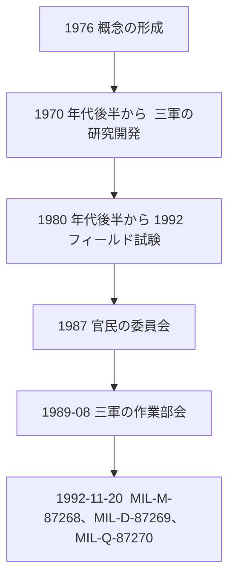

この章では、対話型電子技術マニュアル（Interactive Electronic Technical Manual、IETM）が米国の軍で検討され、1990 年代に仕様へ落ちるまでの経緯を整理します。個別装備の採用実績を網羅するものではありません。確認できた公開論文の範囲に限って書きます。

## 概要

米国の軍は 1970 年代後半から、紙とマイクロフォームの技術マニュアルでは、現場の技術者の使い勝手を改善できない、という問題に取り組んでいます。1980 年代に三軍が研究開発とフィールド試験を行い、1987 年に官民の委員会、1989 年に三軍の作業部会ができ、1992 年 11 月 20 日に最初の IETM 仕様一式が正式発行されました。1990 年代には、新規装備だけでなく、既存の紙マニュアルを電子へ移す必要が前面に出ています。

## 詳細

### 紙とマイクロフォームでは届かなかった相手

Joseph J. Fuller（NSWC Carderock）の 1994 年の論文は、経緯を次のように整理しています。1960 年代から 1970 年代にかけ、海軍は技術マニュアルの問題を緩和するためにマイクロフォームを導入しました。保管場所は減り、マニュアル維持にも限られた効果がありました。しかし、最も改善が必要だった相手、つまり現場の技術者には改善が届きませんでした。

同じ論文は、艦隊の技術マニュアルについて、使いにくさ誤りの多さが、システムの高い可動性を妨げる要因として繰り返し指摘されてきた、と述べています。Jorgensen の概説も、紙の技術マニュアルは製作と管理の費用が大きく、自動的な後方支援の仕組みへ組み込みにくく、使いにくさから整備を遅らせ、正常部品の誤交換と訓練時間を増やす、と問題を置いています。

装備が複雑になるにつれ、この紙の問題は拡大しました。Fuller は、1970 年代後半から 1980 年代を通じて、三軍がヒューマンファクタ、後方支援、コンピュータ技術を当てて解決に動いた、と書いています。初期の研究拠点として、陸軍の Fort Eustis の Communicative Technology Office、空軍の Wright-Patterson 空軍基地の Human Resources Laboratory（のち Armstrong Laboratory）、メリーランド州 Bethesda の David Taylor Research Center（のち NSWC Carderock Division）を挙げています。

### 1980 年代の研究開発

確認できた主なプログラムは次のとおりです。

| プログラム | 主体 | 位置づけ |
| --- | --- | --- |
| Navy Technical Information Presentation System（NTIPS） | 海軍 | IETM の概念実証と原型。Fuller がプログラム管理者 |
| Computer-based Maintenance Aid System（CMAS）、のち Integrated Maintenance Information System（IMIS） | 空軍 | 技術者向けのコンピュータ支援。のちに三軍共同の試験へ接続 |
| Miniaturized Electronic Information Delivery System（MEIDS） | 陸軍 | Jorgensen が主要プログラムの一つとして記載 |

Jorgensen は、これらにより三軍が、運用・整備・後方支援において IETM が実現可能であり望ましいことを示した、とまとめています。Fuller 自身は、概念の形成を 1976 年に始めた、と論文末尾の略歴で述べています。

### フィールド試験で論文が述べていること

Fuller の論文は、IETM と紙を技術者の実効で比べる試験を、運用条件の下で行ったと書いています。名が挙がっているのは、海軍の F-14A と AN/SPA-25D、空軍の Offutt・Grissom と F-16、1992 年の F/A-18 共同試験です。

:::details 論文が名を挙げている試験
- 1980 年代後半、海軍。F-14A のラダートリム系統を、Miramar 海軍航空基地で試験。結果報告書は David Taylor Research Center の DTRC-88-036（1988 年 9 月）。
- 同時期、海軍。AN/SPA-25D レーダーリピータを、Norfolk 海軍基地で試験。DTRC-88-035（1988 年 9 月）。
- 空軍。1984 年に Offutt 空軍基地、1985 年に Grissom 空軍基地。1989 年に F-16 のアビオニクスを Homestead 空軍基地で試験。
- 1992 年、空軍・海軍・海兵隊の共同試験。Beaufort 海兵隊航空基地で、可搬の表示装置に F/A-18 の火器管制の IETM を出して試験。
:::

この論文の “Measurable Benefits” が、これらの試験のまとまりについて述べている結果は次のとおりです。

:::message
数値の一つ一つを個別試験へ割り当ててはいません。これ以上細かい成功率（たとえば「紙では 58%」のような対比）は、Fuller のこの論文の当該節にその対比が見当たらなかったため書きません。個別報告書（DTRC-88-035 など）の原数値は、今回その報告書自体を読んでいないので転記しません。
:::

- 技術者の多数が IETM を望ましいとした。
- 整備の成績は有意に改善し、とくにトラブルシューティングで改善した。
- 経験の浅い技術者の改善は大きく、経験者も紙より有意に良かった。IETM を使うと、経験の浅い技術者の実効は、高度に訓練された経験者にほぼ並んだ。
- 是正整備の時間の短縮、正常部品の誤った取り外しの減少、整備データ収集報告の正確さと完全さの向上、訓練要求の削減、整備に伴うシステムの停止時間の短縮。
- 質問紙では、下士官の技術者の約 90% が、対話的な整備情報の電子的な提供を紙より好み、使いやすいと答えた。

### 標準が必要になった理由と 1992 年

試験が良い結果を示したあと、装備の製造者が新規取得で IETM の提供を提案するようになりました。Fuller は、このままでは軍の間および軍の内部で、やり方とハードウェア、ソフトウェアが分裂する、と OSD の CALS 担当が標準化の必要を認めた、と書いています。

:::message
引用した論文は CALS を略称のまま使っています。展開形は文書と時期で異なるため、本書では特定の一語に固定しません。
:::

経緯の節目は次のとおりです。

- 1987 年。OSD の CALS 担当と Aerospace Industries Association（AIA）が、Joint Industry/Government Pageless TM Committee を設置。オーサリング、データ交換、提示・交付の概念と機能仕様を検討した。
- 1989 年 8 月。OSD が Tri-Service Working Group for IETMs を設置。海軍が議長。構成は陸軍（MRSA）、海軍（Carderock Division / NSWC）、空軍（AFMC/ENC）。IETM の仕様、ハンドブック、教材を作ることが当初の任務で、Defense CALS Executive への助言も担った（Eric L. Jorgensen、1992 年 12 月 10 日の説明資料）。
- 1992 年 11 月 20 日。次の 3 仕様を正式発行。
  - MIL-M-87268。内容、スタイル、形式、利用者とのやり取り。
  - MIL-D-87269。改訂可能な IETM データベース。
  - MIL-Q-87270。IETM と関連技術情報の品質保証。

Jorgensen の 1992 年資料は、1990 年 6 月の最初の無制限配布から、官民のコメント、1992 年 9 月の軍の最終承認を経て 11 月に正式発行された、と経過を刻んでいます。

### 1990 年代に本格化したときの制約

冷戦終結のあと、新規開発（new start）の多くは遅れ、または縮小しました。Jorgensen は、その結果、IETM を求める事業の多くが、既存の紙マニュアルを変換する側になった、と書いています。既存データには制約があるため、新規開発向けの 3 仕様の機能をすべて持たない電子マニュアルが現れました。クラスという分類は、この変換物を含めて並びを示すために導入されています。クラスの中身は次の章で扱います。

Fuller は 1994 年の時点で、三軍の新規装備が Tri-Service の仕様で IETM を取得しつつある例を挙げています。これは 1994 年の論文が「取得に IETM の方式を採っている」と書いた一覧であり、各事業の最終的なクラスや、その後の仕様の乗り替えまでは、この論文からは分かりません。

:::details 1994 年の論文が挙げている取得の例
- 空軍: F-22
- 海軍: Fixed Distribution System（Integrated Underwater Surveillance Systems の構成要素）、AEGIS、F-18E/F、AN/BSY-2
- 陸軍: Comanche（RAH-66）、Apache Longbow、Paladin
- 共同事業: V-22、JSTARS
:::

同じ論文は、商業分野（自動車、航空会社、鉄道、船舶修理）での非軍事の適用を 1994 年の調査が認めたこと、国際的には NATO の NH-90 と European Fighter Aircraft へ IETM が提案されていたこと、そして AECMA の 1000D 委員会と DoD 仕様の調和が議題になっていたことを記しています。AECMA は、のちに S1000D を維持する欧州側の前身です。S1000D 自体の来歴は、標準の章と S1000D の章で公式サイトの記述に沿って扱います。

## 出典

- Joseph J. Fuller, Naval Surface Warfare Center, Carderock Division. *IETMs: From Research to Reality*. https://www.navsea.navy.mil/Portals/103/Documents/NSWC_Carderock/CALS94F.pdf
- Eric L. Jorgensen. *The Interactive Electronic Technical Manual Overview: "Setting the Stage"*. https://www.navsea.navy.mil/Portals/103/Documents/NSWC_Carderock/Cals94j.pdf
- Eric L. Jorgensen, David Taylor Model Basin / NSWC Carderock. *DOD Interactive Electronic Technical Manuals (IETMs)*. 1992-12-10. https://www.navsea.navy.mil/Portals/103/Documents/NSWC_Carderock/CALS92J.pdf

## この章のポイント

- 検討の起点は 1970 年代後半の米国の軍である。マイクロフォームは保管を減らしたが、現場の技術者の使い勝手は残った。
- 1980 年代の NTIPS、CMAS／IMIS、MEIDS と、F-14A、AN/SPA-25D、F-16、F/A-18 などの試験が、仕様化の前段である。Fuller の論文は約 90% の選好と、整備成績の改善をまとめとして述べている。個別試験の細かい成功率は、本書では原報告書を確認していないため書かない。
- 1987 年の官民委員会、1989 年の三軍作業部会を経て、1992 年 11 月 20 日に MIL-M-87268、MIL-D-87269、MIL-Q-87270 が発行された。1990 年代は、新規開発の縮小により、既存マニュアルの変換が主要な現実になった。
