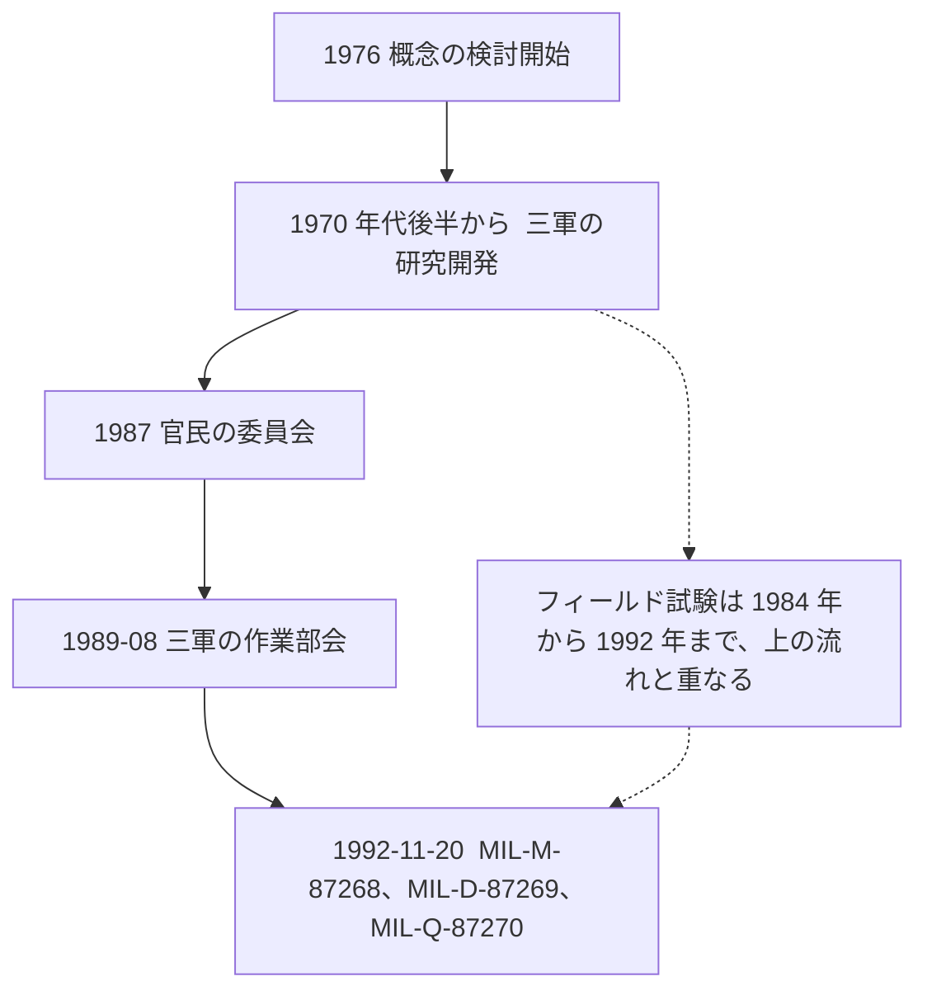

IETM は、紙の技術マニュアルが現場の技術者にとって使いにくいという米軍の問題から生まれました。1970 年代後半に研究が始まり、1980 年代に陸・海・空軍が試作とフィールド試験を重ね、1992 年 11 月 20 日に最初の仕様一式が発行されました。1990 年代に入ると、新しい装備のマニュアルを作るよりも、既存の紙のマニュアルを電子化する仕事が中心になりました。

この章では、仕様が発行されるまでの経緯を、公開されている論文に沿って説明します。個々の装備で IETM がどこまで採用されたかを網羅するものではありません。

実線は、概念の検討から 3 つの仕様の発行までの主な出来事です。点線のフィールド試験は、1984 年の Offutt 空軍基地での試験から 1992 年の F/A-18 の試験まで続いており、1987 年の委員会や 1989 年の作業部会と同じ時期に並行して行われています。

## マイクロフォームで解決しなかった問題

米海軍水上戦センター（NSWC）Carderock 部門の Joseph J. Fuller は、1994 年の論文で経緯を次のように説明しています。海軍は 1960 年代から 1970 年代にかけて、技術マニュアルの問題を減らすためにマイクロフォーム（マイクロフィルムなど）を導入しました。保管場所は減り、マニュアルの維持にも多少の効果がありました。しかし、最も困っていた現場の技術者にとっては、使いやすさは変わりませんでした。

Fuller によると、艦隊の技術マニュアルは使いにくく誤りも多いため、システムの稼働率を下げる原因として繰り返し指摘されていました。Jorgensen の概説も、紙の技術マニュアルの問題として、次の点を挙げています。

- 作成と管理に費用がかかる。
- 自動化された後方支援の仕組みに組み込みにくい。
- 使いにくいため整備が遅れる。
- 正常な部品を誤って交換してしまう。
- 訓練に時間がかかる。

装備が複雑になるにつれて、これらの問題は大きくなりました。Fuller によると、陸・海・空軍は 1970 年代後半から 1980 年代を通じて、人間工学、後方支援、コンピュータ技術を使って解決に取り組みました。初期の研究拠点として、次の 3 つが挙げられています。

- 陸軍：Fort Eustis の Communicative Technology Office
- 空軍：Wright-Patterson 空軍基地の Human Resources Laboratory（のちの Armstrong Laboratory）
- 海軍：メリーランド州 Bethesda の David Taylor Research Center（のちの NSWC Carderock Division）

## 1980 年代の研究開発

主な研究開発プログラムは次のとおりです。

| プログラム | 実施した軍 | 内容 |
| --- | --- | --- |
| Navy Technical Information Presentation System（NTIPS） | 海軍 | IETM の概念を実証するための試作。Fuller がプログラム管理者を務めた |
| Computer-based Maintenance Aid System（CMAS）、のちの Integrated Maintenance Information System（IMIS） | 空軍 | 技術者の整備作業をコンピュータで支援するシステム。のちに三軍共同の試験につながった |
| Miniaturized Electronic Information Delivery System（MEIDS） | 陸軍 | Jorgensen が主要なプログラムの一つとして挙げている |

Jorgensen は、これらのプログラムによって、運用・整備・後方支援に IETM が使えること、そして IETM を使うべきであることを三軍が示した、とまとめています。また Fuller は、論文末尾の略歴で、1976 年に IETM の概念の検討を始めたと書いています。

## フィールド試験の結果

Fuller の論文によると、IETM と紙のマニュアルで技術者の作業成績を比べる試験が、実際の運用に近い条件で行われました。対象は、海軍の F-14A と AN/SPA-25D、空軍の Offutt・Grissom の両基地と F-16、そして 1992 年の F/A-18 の共同試験です。

:::details 論文に挙げられている試験
- 1980 年代後半、海軍：F-14A のラダートリム系統を、Miramar 海軍航空基地で試験。結果は David Taylor Research Center の報告書 DTRC-88-036（1988 年 9 月）。
- 同じ時期、海軍：AN/SPA-25D レーダーリピーターを、Norfolk 海軍基地で試験。報告書は DTRC-88-035（1988 年 9 月）。
- 空軍：1984 年に Offutt 空軍基地、1985 年に Grissom 空軍基地で試験。1989 年には F-16 のアビオニクスを Homestead 空軍基地で試験。
- 1992 年、空軍・海軍・海兵隊の共同試験：Beaufort 海兵隊航空基地で、持ち運べる表示装置に F/A-18 の火器管制の IETM を表示して試験。
:::

論文の “Measurable Benefits” の節は、これらの試験全体の結果として、次の点を挙げています。

- 技術者の多くが、IETM の方が望ましいと答えた。
- 整備の成績は、統計的に有意に向上した。特にトラブルシューティングで向上が大きかった。
- 経験の浅い技術者ほど向上が大きく、経験のある技術者も紙より有意に良い成績だった。IETM を使った経験の浅い技術者の成績は、十分に訓練を受けた経験者とほぼ同じになった。
- 故障の修理にかかる時間、正常な部品を誤って取り外す件数、訓練の必要量、整備によるシステムの停止時間が減り、整備データの報告はより正確で漏れのないものになった。
- アンケートでは、下士官の技術者の約 90% が、対話的な整備情報を電子で受け取る方が紙より好ましく、使いやすいと答えた。

:::message
論文はこれらを試験全体の結果として述べており、どの数値がどの試験のものかは示していません。個々の試験の詳しい数値は各報告書（DTRC-88-035 など）にありますが、本書はその報告書を参照していないため載せていません。
:::

## 標準化が必要になった理由

試験で良い結果が出たあと、装備のメーカーは、新しい装備の調達で IETM を提供すると提案するようになりました。Fuller によると、国防長官府（OSD）の CALS 担当は、このままでは軍ごと、また同じ軍の中でも、作り方やハードウェア、ソフトウェアがばらばらになると考え、標準化が必要だと判断しました。

:::message
引用した論文は CALS を略称のまま使っています。CALS の正式名称は時期と文書によって変わっているため、本書では一つに決めずに略称のまま使います。
:::

標準化の主な出来事は次のとおりです。

- **1987 年**：OSD の CALS 担当と米国航空宇宙工業会（Aerospace Industries Association、AIA）が、Joint Industry/Government Pageless TM Committee を設置しました。執筆、データ交換、表示と配布について、概念と機能の仕様を検討しました。
- **1989 年 8 月**：OSD が Tri-Service Working Group for IETMs を設置しました。議長は海軍で、陸軍（MRSA）、海軍（Carderock Division / NSWC）、空軍（AFMC/ENC）で構成されました。当初の任務は、IETM の仕様、ハンドブック、教材を作ることで、国防総省の CALS 責任者（Defense CALS Executive）への助言も行いました（Eric L. Jorgensen、1992 年 12 月 10 日の説明資料）。
- **1992 年 11 月 20 日**：次の 3 つの仕様が正式に発行されました。
  - MIL-M-87268：内容、スタイル、形式、利用者とのやり取り
  - MIL-D-87269：改訂可能な IETM データベース
  - MIL-Q-87270：IETM と関連する技術情報の品質保証

Jorgensen の 1992 年の資料によると、仕様の草案は 1990 年 6 月に初めて一般に配布され、官民からの意見を受けて 1992 年 9 月に軍の最終承認を得て、11 月に正式に発行されました。

## 1990 年代の状況

冷戦が終わると、新しい装備の開発（new start）の多くが延期または縮小されました。Jorgensen によると、その結果、IETM を必要とする事業の多くは、既存の紙のマニュアルを電子化する仕事になりました。既存のデータには限界があるため、新規開発向けの 3 つの仕様の機能をすべては備えない電子マニュアルが作られるようになりました。こうした電子化したマニュアルも含めて段階を示すために導入されたのが、次の章で説明するクラスの分類です。

Fuller は、1994 年の時点で三軍の新しい装備が Tri-Service の仕様で IETM を調達し始めている例を挙げています。ただし、これは 1994 年時点の一覧であり、各事業が最終的にどのクラスの IETM を作ったか、その後どの仕様に移ったかは、この論文からは分かりません。

:::details 1994 年の論文に挙げられている調達の例
- 空軍：F-22
- 海軍：Fixed Distribution System（Integrated Underwater Surveillance Systems の構成要素）、AEGIS、F-18E/F、AN/BSY-2
- 陸軍：Comanche（RAH-66）、Apache Longbow、Paladin
- 共同事業：V-22、JSTARS
:::

同じ論文には、ほかにも次のことが書かれています。

- 1994 年の調査で、自動車、航空会社、鉄道、船舶修理などの民間分野にも IETM の考え方が使われていることが確認された。
- 国際的には、NATO の NH-90 と European Fighter Aircraft に IETM が提案されていた。
- AECMA の 1000D 委員会と DoD の仕様をすり合わせることが議題になっていた。

AECMA は、のちに S1000D を維持する欧州の団体（現在の ASD）の前身です。S1000D の経緯は、[「主要な標準の概要」](https://zenn.dev/shuji_bonji/books/ietm-overview/viewer/standards)と[「S1000D の基本」](https://zenn.dev/shuji_bonji/books/ietm-overview/viewer/s1000d-basics)の章で、公式サイトの説明に沿って扱います。

## 出典

- Joseph J. Fuller, Naval Surface Warfare Center, Carderock Division. *IETMs: From Research to Reality*. https://www.navsea.navy.mil/Portals/103/Documents/NSWC_Carderock/CALS94F.pdf
- Eric L. Jorgensen. *The Interactive Electronic Technical Manual Overview: "Setting the Stage"*. https://www.navsea.navy.mil/Portals/103/Documents/NSWC_Carderock/Cals94j.pdf
- Eric L. Jorgensen, David Taylor Model Basin / NSWC Carderock. *DOD Interactive Electronic Technical Manuals (IETMs)*. 1992-12-10. https://www.navsea.navy.mil/Portals/103/Documents/NSWC_Carderock/CALS92J.pdf

## この章のポイント

- IETM の検討は、1970 年代後半の米軍で始まりました。マイクロフォームで保管場所は減りましたが、現場の技術者にとっての使いにくさは解決しませんでした。
- 1980 年代の NTIPS、CMAS／IMIS、MEIDS の研究開発と、F-14A、AN/SPA-25D、F-16、F/A-18 などのフィールド試験が、仕様化の土台になりました。Fuller の論文は、試験全体の結果として、整備成績の向上と、約 90% の技術者が IETM を好んだことを挙げています。
- 1987 年の官民委員会と 1989 年の三軍作業部会を経て、1992 年 11 月 20 日に MIL-M-87268、MIL-D-87269、MIL-Q-87270 が発行されました。1990 年代は新規開発が縮小したため、既存のマニュアルの電子化が中心になりました。
