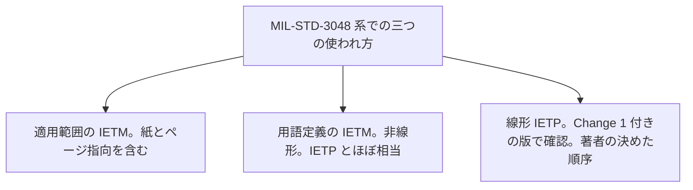

この章では、対話型電子技術マニュアル（Interactive Electronic Technical Manual、IETM）と、対話型電子技術出版物（Interactive Electronic Technical Publication、IETP）が何を指すかを並べます。日常会話ではほぼ同じものを指して使われることが多い一方、契約と規格では指す範囲がずれます。

IETM は、主として米国国防総省（Department of Defense、DoD）の文書が使ってきた語です。IETP は、S1000D が画面向けの対話的な技術出版物に使っている語です。米空軍の MIL-STD-3048 系は、両方を定義したうえで、互いにほぼ相当する（roughly equivalent）と書いています。

:::message
「ほぼ相当する」は「どの契約でも同じ成果物だ」という意味ではありません。同じ語でも、参照する規格、版、クラス、機能マトリックスが違えば、作るものは違います。
:::

## 米空軍の規格が置いている定義

MIL-STD-3048A(USAF) の用語は、次のとおりです。公開されている MIL-STD-3048C とされるファイルにも、同じ二つの定義が見えます。B 版は、2026 年 9 月に ASSIST から取得された目次で、IETM と IETP の両方を用語として持っています。本書が文面を追えた定義は A 版です。改訂のたびに語が微妙に変わる可能性は残るので、契約で指定された版を見てください。

用語定義の対は、次の二つに短縮できます。全文に近い要約はトグルに置きます。

| 語 | この定義が指すもの |
| --- | --- |
| IETM | 非線形の表示のために非線形に執筆する。対話的な手順の誘導を持つ。S1000D の IETP とほぼ相当する |
| IETP | 説明、運用、整備の情報を、対話的な画面向けに編成する。条件分岐と、実行時に評価するパラメータを含む。米国でより一般的な語である IETM とほぼ相当する |

:::details MIL-STD-3048A の定義の要約
IETM は、非線形の表示のために、非線形の形で執筆された技術マニュアルである。構成は技術情報への到達を容易にし、表示装置は対話的な手順の誘導、移動の指示、補足情報を提供する。IETM は、整備マニュアルの情報を、整備データ収集、訓練文書、補給との接続、データ提示の制御など、整備を補う後方支援データとやり取りしやすくする。これは S1000D の語である IETP とほぼ相当する。

IETP は、製品の説明、運用、整備に必要な情報の集合であり、電子表示装置上で利用者へ対話的に提示するよう最適に編成され体裁化されている。利用者のフィードバックに基づく条件分岐を含む。パラメータは実行時に評価され、その値は文脈と利用者の入力に依存し得る。これは、米国でより一般的な語である IETM とほぼ相当する。
:::

この対は、S1000D を実装する米軍規格が、二つの語を roughly equivalent と書いている例です。実用上はほぼ同義で扱ってよい、と読めます。ただし、すぐ下に書くとおり、同じ規格の適用範囲では IETM の幅がこれより広くなります。

## MIL-STD-3048 系の中でも、IETM の幅は一定ではない

注意が要るのは、MIL-STD-3048 の適用範囲の書き方です。A 版以降の適用範囲は、S1000D で作成する空軍の技術出版物のうち、紙、ページ指向、画面表示の IETM を、アーキテクチャや表示装置を問わず対象にする、と書いています。ここでは IETM が、画面の対話物だけでなく紙とページ指向も含む傘の語になっています。

一方、上に引用した用語定義の IETM は「非線形の表示のための非線形の執筆」です。MIL-STD-3048（Change 1 付き。本文が S1000D Issue 4.0／4.0.1 に適用すると限定している版）は、別に線形 IETP を定義しています。線形 IETP は、技術データが逐次的または文書指向で表示されるものであり、並びは著者によってあらかじめほぼ決められ、ページ型の文書の順序を再現することが多い、というものです。既定の経路が一般にあります。

したがって、空軍の MIL-STD-3048 系では、確認できた範囲で次の三つの使われ方があります。

:::message
線形 IETP の定義文を追えたのは、本文が S1000D Issue 4.0／4.0.1 に適用すると限定している Change 1 付きの版までです。後の改訂にも同じ条項が残るかは、今回その条項を追えていません。
:::

| 使われ方 | 指しているもの |
| --- | --- |
| 適用範囲の「IETM」 | S1000D で作る技術出版物全体。紙とページ指向を含む |
| 用語定義の「IETM」 | 非線形に執筆し、非線形に表示するもの。S1000D の IETP とほぼ相当 |
| 線形 IETP | ページ型に近い、著者の決めた順序で進む提示 |

会話で「IETM と IETP は同じ」と言うとき、人はたいてい用語定義の対を指しています。契約の適用範囲を読むときは、紙やページ指向が IETM という語の下に入っていないかを見てください。

## DoD のクラスとの関係

前の章の Class 3 以上が、著者の対話を持つ IETM です。S1000D の IETP は、その定義上、条件分岐と実行時の評価を含みます。機能の水準は、S1000D の機能マトリックスで別途指定します。MIL-STD-3048A は、このマトリックスを、IETM とページ指向の出版物の両方の機能を指定する調達ツールだと定義しています。

:::message alert
次の言い方は不正確です。

- 「IETP と書いてあれば S1000D の特定の版で、特定の機能まですべて入っている」
- 「IETM と書いてあれば DoD の Class 4 である」
- 「IETP は IETM より常に上位である」またはその逆
:::

正確な読み方は、語がどちらの伝統から来たかを見たうえで、成果物を決める文書（S1000D の版、事業のビジネスルール、機能マトリックス、DoD のクラスまたは MIL-STD-40051 の線形／非線形）を見ることです。

## 使い分けが残る理由

語の分布は、規格の出自に沿っています。

- 米国の取得文書、とくに 1992 年の MIL-M-87268 系と、その後の軍種別の作成規格は IETM を使います。
- S1000D の本文は、画面向けの対話的な成果物を IETP と呼びます。S1000D は欧州の AECMA（のち ASD）で始まり、現在は ASD、AIA、ATA e-Business Program が共同で出しています。詳細は次の章です。
- 両方を一度に使う事業、たとえば米空軍の S1000D 実装は、MIL-STD-3048 のように両方を定義して対応関係を書きます。

インドの Joint Services Guide（JSG）0852 は IETM を標題に使います。これは米国の MIL 仕様そのものではなく、インド国防省のガイドです。中身の要求は、標準の章で触れる範囲に留めます。

実務では、相手が S1000D のコミュニティなら IETP、米国の契約文脈なら IETM と言うと通じやすい、という傾向はあります。通じることと、検収条件が一致することは別です。

## 出典

- Department of Defense. MIL-STD-3048A(USAF). 用語 3.2.17（IETM）、3.2.18（IETP）、3.2.11（Functionality matrix）、および適用範囲。https://everyspec.com/MIL-STD/MIL-STD-3000-9999/download.php?spec=MIL-STD-3048A.054327.pdf
- Department of Defense. MIL-STD-3048(USAF) Change 1. 用語 3.3.67（Linear IETP）。本文は S1000D Issue 4.0／4.0.1 に適用すると限定している。後の版の同じ条項は未確認。
- MIL-STD-3048C とされる公開ファイルにも、IETM と IETP の同じ定義が見える。GovTribe に掲載された USAF の契約添付。https://govtribe.com/file/government-file/rfp-attch-16-mil-std-3048c-capability-task-ref-dot-pdf
- MIL-STD-3048B(USAF) の目次（ASSIST、2026-09-28 取得）は IETM と IETP の項を持つ。定義の全文は、この目次取得だけでは確認していない。
- Eric L. Jorgensen. クラス定義。https://www.navsea.navy.mil/Portals/103/Documents/NSWC_Carderock/Cals94j.pdf

## この章のポイント

- IETM は主として米国 DoD の語、IETP は S1000D の語である。米空軍の MIL-STD-3048 は、両者を roughly equivalent と定義している。
- 適用範囲の IETM は紙とページ指向を含む。用語定義の IETM は非線形の画面提示を指し、IETP とほぼ相当する。線形 IETP は、Change 1 付きの版で別定義として確認した。
- 実用上はほぼ同義で通ることが多い。契約上の成果物は、語ではなく、版、ビジネスルール、機能マトリックス、クラスまたは線形／非線形の指定で決まる。
