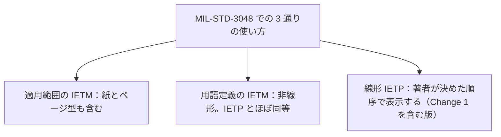

IETM（Interactive Electronic Technical Manual、対話型電子技術マニュアル）と IETP（Interactive Electronic Technical Publication、対話型電子技術出版物）は、ほぼ同じものを指す語です。IETM は主に米国国防総省（Department of Defense、DoD）の文書で使われてきた語で、IETP は国際仕様の S1000D が使う語です。米空軍の規格 MIL-STD-3048 も、二つの語を「ほぼ同等（roughly equivalent）」と定義しています。

ただし、契約や規格の中では、同じ「IETM」という語が指す範囲が文書によって違うことがあります。この章では、二つの語の定義と、その範囲の違いを説明します。

:::message
「ほぼ同等」は、「どの契約でも同じものを納品する」という意味ではありません。同じ語を使っていても、参照する規格、版、クラス、機能マトリックスが違えば、作るものは変わります。
:::

## 米空軍の規格による定義

[MIL-STD-3048A](https://everyspec.com/MIL-STD/MIL-STD-3000-9999/download.php?spec=MIL-STD-3048A.054327.pdf)(USAF) は、IETM と IETP を次のように定義しています。要点を表にまとめ、定義の詳しい内容は折りたたみの中に載せます。

| 語 | 定義の要点 |
| --- | --- |
| IETM | 非線形に表示するために、非線形に執筆した技術マニュアル。対話的に手順を誘導する。S1000D の IETP とほぼ同等 |
| IETP | 製品の説明、運用、整備の情報を、画面で対話的に表示するよう構成したもの。条件分岐と、実行時に値が決まるパラメータを含む。米国でより一般的な IETM とほぼ同等 |

:::details MIL-STD-3048A の定義の要約
**IETM**：非線形に表示するために、非線形の形で執筆した技術マニュアルです。技術情報にたどり着きやすい構成になっており、表示装置は、対話的な手順の誘導、移動の指示、補足情報を提供します。整備マニュアルの情報を、整備データの収集、訓練文書、補給とのやり取り、表示の制御など、整備を支えるほかの後方支援データと連携しやすくします。S1000D の IETP とほぼ同等です。

**IETP**：製品の説明、運用、整備に必要な情報をまとめたもので、電子表示装置で利用者に対話的に表示できるよう構成し、体裁を整えたものです。利用者からの入力に応じた条件分岐を含みます。パラメータの値は実行時に決まり、その値は状況や利用者の入力によって変わることがあります。米国でより一般的な語である IETM とほぼ同等です。
:::

S1000D を採用している米軍の規格が、二つの語をほぼ同等と定義しているので、実務ではほぼ同じ意味で使って問題ありません。ただし、次の節で説明するとおり、同じ規格の「適用範囲」では、IETM がもっと広い意味で使われています。

同じ二つの定義は、MIL-STD-3048C とされる公開ファイルにも書かれています。B 版も、ASSIST の目次に IETM と IETP の項があります。本書で定義の文面まで確認したのは A 版です。改訂で表現が変わる可能性もあるので、契約で指定された版を確認してください。

## 同じ規格の中でも IETM の範囲は一つではない

注意が必要なのは、MIL-STD-3048 の適用範囲です。A 版以降の適用範囲には、「S1000D で作成する空軍の技術出版物のうち、紙、ページ型、画面表示の IETM を、アーキテクチャや表示装置にかかわらず対象とする」と書かれています。ここでの IETM は、画面での対話的な表示だけでなく、紙やページ型の出版物も含む、広い意味で使われています。

一方、前の節で見た用語の定義では、IETM は「非線形に表示するために非線形に執筆したもの」です。

さらに、MIL-STD-3048（Change 1 を含む版）では、これとは別に「線形 IETP」を定義しています。線形 IETP は、技術データを順番に、または文書の形で表示するものです。表示の順序はほぼ著者があらかじめ決めており、ページ型の文書と同じ順序になることが多く、通常は決まった進み方があります。なお、この版は本文で、S1000D Issue 4.0／4.0.1 に適用すると範囲を限定しています。

まとめると、米空軍の MIL-STD-3048 には、次の 3 通りの使い方があります。

| 使い方 | 指しているもの |
| --- | --- |
| 適用範囲の「IETM」 | S1000D で作る技術出版物の全体。紙とページ型も含む |
| 用語定義の「IETM」 | 非線形に執筆し、非線形に表示するもの。S1000D の IETP とほぼ同等 |
| 線形 IETP | ページ型に近く、著者が決めた順序で進む表示 |

:::message
線形 IETP の定義は、S1000D Issue 4.0／4.0.1 を対象とする Change 1 を含む版で確認しました。それより後の版に同じ定義があるかは確認していません。
:::

ふだん「IETM と IETP は同じ」と言うときは、用語定義の二つを指していることがほとんどです。契約書の適用範囲を読むときは、紙やページ型の出版物が「IETM」に含まれていないかを確認してください。

## DoD のクラスとの関係

前の章で説明したとおり、著者が作った対話を持つ IETM は Class 3 以上です。S1000D の IETP は、定義に条件分岐と実行時の判断が含まれています。どの機能をどの水準で持たせるかは、S1000D の機能マトリックスで別に指定します。MIL-STD-3048A は、この機能マトリックスを、IETM とページ型の出版物の両方について機能を指定する調達のツールと定義しています。

:::message alert
次の読み方は正しくありません。

- 「IETP と書いてあれば、S1000D の特定の版で、すべての機能が入っている」
- 「IETM と書いてあれば、DoD の Class 4 である」
- 「IETP は常に IETM より上位である」、またはその逆
:::

語だけで納品物は決まりません。その語が米国の規格と S1000D のどちらから来たのかを確認したうえで、納品物を決める文書を読んでください。具体的には、S1000D の版、事業のビジネスルール、機能マトリックス、そして DoD のクラスまたは MIL-STD-40051 の線形／非線形の指定です。

## 二つの語が使い分けられている理由

どちらの語を使うかは、規格の成り立ちによって決まっています。

- 米国の調達文書、特に 1992 年の MIL-M-87268 などの仕様と、その後の各軍の作成規格は、IETM を使います。
- S1000D は、画面向けの対話的な出版物を IETP と呼びます。S1000D は欧州の AECMA（現在の ASD）で作られ、現在は ASD、AIA、ATA e-Business Program が共同で発行しています。詳しくは次の章で説明します。
- 米空軍の S1000D 採用のように両方の語を使う事業では、MIL-STD-3048 のように両方を定義して、対応関係を示しています。

インドの Joint Services Guide（JSG）0852 も、標題に IETM を使っています。これは米国の MIL 仕様ではなく、インド国防省のガイドです。内容は[「主要な標準の概要」](https://zenn.dev/shuji_bonji/books/ietm-overview/viewer/standards)の章で触れる範囲にとどめます。

実務では、S1000D を使う相手には IETP、米国の契約の話をする相手には IETM と言うと伝わりやすい傾向があります。ただし、言葉が通じることと、検収の条件が一致することは別の問題です。

## 出典

- Department of Defense. MIL-STD-3048A(USAF). 用語 3.2.17（IETM）、3.2.18（IETP）、3.2.11（Functionality matrix）、および適用範囲。https://everyspec.com/MIL-STD/MIL-STD-3000-9999/download.php?spec=MIL-STD-3048A.054327.pdf
- Department of Defense. MIL-STD-3048(USAF) Change 1. 用語 3.3.67（Linear IETP）。本文で S1000D Issue 4.0／4.0.1 に適用すると限定している。後の版の同じ条項は未確認。
- MIL-STD-3048C とされる公開ファイル。IETM と IETP について同じ定義がある。GovTribe に掲載された USAF の契約添付資料。https://govtribe.com/file/government-file/rfp-attch-16-mil-std-3048c-capability-task-ref-dot-pdf
- MIL-STD-3048B(USAF) の目次（ASSIST、2026-09-28 取得）。IETM と IETP の項がある。定義の全文は未確認。
- Eric L. Jorgensen. クラスの定義。https://www.navsea.navy.mil/Portals/103/Documents/NSWC_Carderock/Cals94j.pdf

## この章のポイント

- IETM は主に米国 DoD の語で、IETP は S1000D の語です。米空軍の MIL-STD-3048 は、二つを「ほぼ同等」と定義しています。
- 同じ MIL-STD-3048 でも、適用範囲の IETM は紙やページ型を含み、用語定義の IETM は非線形の画面表示を指します。さらに Change 1 を含む版では、著者が決めた順序で表示する線形 IETP が別に定義されています。
- 実務ではほぼ同じ意味で通じます。ただし、契約で何を納品するかは、語ではなく、版、ビジネスルール、機能マトリックス、クラスや線形／非線形の指定で決まります。
