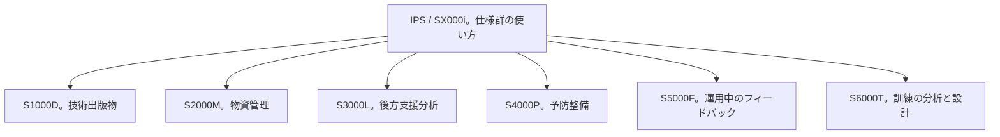

この章では、S1000D が単独の仕様ではなく、製品支援の一連の仕様の一つであることを説明します。一連の仕様は S シリーズと呼ばれ、その対象領域は統合製品支援（Integrated Product Support、IPS）です。以前の文書は、同じ領域を統合後方支援（Integrated Logistics Support、ILS）と呼んでいます。

Aerospace Industries Association（AIA）は、S シリーズを、技術データが途切れずに渡ることを目的とする製品支援の仕様群だと説明しています。S1000D はその中の、技術出版物の仕様です。部品の所要、後方支援分析、予防整備、運用中のフィードバック、訓練は、それぞれ別の仕様が扱います。

S1000D だけを採用しても、これらの仕様を自動的に採用したことにはなりません。逆に、ほかの仕様が S1000D のデータモジュールを置き換えるわけでもありません。

## なぜ一連の仕様なのか

AIA の説明では、1993 年に NATO の同盟国が、技術データと製品支援のデータを、相互運用できる共通のソースデータ交換を通じてデジタルに交換する、ILS 仕様の統合された一式が必要だ、と表明しました。いま公開されている一式の開発と統治は、S1000D Council と S-Series IPS Council による国際的な取り組みです。Council と Steering Committee には、AIA、ASD（Aerospace, Security and Defence Industries Association of Europe）、および S1000D に限って ATA e-Business Program の、産業界と DoD／MoD のメンバーが加わります。

AIA は、航空宇宙・防衛のために作られた仕様だが、適用は分野を問わない、とも書いています。例として海事、海中、鉄道、建設、農業を挙げています。S1000D の公式サイトも、防衛の陸・海・空、民間航空、建設、船舶を用途に挙げています。

## 確認できた仕様の一覧

次の表は、AIA の S シリーズのページが、無償で入手できる一式として挙げているものです。S1000D 公式サイトの外部リンクは、SX000i を “guide”、ほかを specification または procedure specification と呼び分けています。表の説明文は AIA のページの表現に合わせ、SX000i だけは両方の呼び方を残します。

| 仕様 | AIA のページが付ける説明 |
| --- | --- |
| SX000i | International specification for Integrated Product Support（IPS）。S1000D 公式サイトの外部リンクは “International guide for the use of the S-Series IPS specifications” とも紹介している |
| S1000D | 共通ソースデータベースを用いる技術出版物のための国際仕様 |
| S2000M | 物資管理（material management）の国際仕様 |
| S3000L | 後方支援分析（Logistics Support Analysis、LSA）の国際手順仕様 |
| S4000P | 予防整備を開発し、継続的に改善するための国際仕様 |
| S5000F | 運用中のデータフィードバックの国際仕様 |
| S6000T | 訓練の分析と設計の国際手順仕様 |

S1000D は ASD、AIA、ATA／A4A が共同で開発します。残りの仕様は AIA と ASD が共同で開発する、と S シリーズのサイトの著作権表示は区別しています。ATA が加わるのは S1000D だけ、という理解で読んでください。

AIA のページが無償公開の一式として挙げているのは、上の7つです。これ以外を公式でない、とは読めません。S シリーズのサイトは、仕様をまたいで使う次の文書も公開しています。

| 文書 | サイトが説明する役割 |
| --- | --- |
| SX001G | S シリーズ共通の用語集 |
| SX002D | 複数の仕様に共通するデータ要素の共通データモデル。仕様をまたいでデータを揃えるための文書 |
| SX004G | UML モデルの読み方。SX002D を含む |
| SX005G | XML スキーマの実装ガイド。サイトは、S1000D 以外の仕様に適用する、と書いている |

SX000i のダウンロードページは、S1000X（S1000D への入力データ仕様、Issue 1.0、2021年4月）を掲げつつ、2021年の S シリーズ一式には含まれない、と注記しています。本書は S1000X を上の一式には数えません。SX003X のように、参照した公式の資源ページでは確認できなかった番号も、一式に加えません。

## S1000D と隣の仕様の関係

S1000D が扱うのは、人が読む技術情報を、データモジュールとして作り、共通ソースデータベースに置き、出版物へ編成することです。隣の仕様が扱う問いは別です。

:::message
図の矢印は、SX000i が全体の使い方を扱う、という意味です。データが必ずこの向きに流れる、という交換仕様の図ではありません。交換の詳細は各仕様を見てください。
:::

- S2000M は、物資をどう管理するかです。技術出版物の手順そのものではありません。
- S3000L は、後方支援の分析をどう行うかです。S1000D の利点ページは、S1000D のデータを LSAR（後方支援分析の記録）のようなソースデータと連結し得る、と述べています。連結の具体的な交換形式は、このページには書かれていません。
- S4000P は、予防整備の項目をどう作り、どう改善するかです。S1000D の Schedules という情報の種類と目的が近い箇所はありますが、Schedules の DM が S4000P の出力そのものだ、とは公式の概要ページは述べていません。
- S5000F は、運用に入ったあとのデータをどう戻すかです。IETP の画面で技術者が見る手順とは別の、フィードバックの流れです。
- S6000T は、訓練をどう分析し設計するかです。IETM のビューアが手順を表示することとは、成果物が違います。
- SX000i は、これらの仕様を IPS としてどう組み合わせて使うかの横断的な文書です。個々の仕様の代わりにはなりません。

## IETM との関係

米国の IETM は、技術者へ技術情報を対話的に出すという提示の概念から始まりました。S1000D の IETP は、その提示の元になるデータを、国際的に交換できる単位で作る仕様です。S シリーズの残りの仕様は、その技術情報の周囲にある製品支援、つまり部品、分析、予防整備、現場からのデータ、訓練を、別のデータとして交換するためのものです。

一つの画面の中に部品発注や整備データの収集を出すことは、米陸軍の機能マトリックスでは External Processes の行として選べます。

:::message alert
その行を選んだことと、S2000M や S5000F に準拠したこととは同じではありません。画面の機能要求と、交換するデータの仕様は、契約の中で別々に指定します。
:::

## 出典

- Aerospace Industries Association. *S-Series IPS Specifications*. https://www.aia-aerospace.org/standards/s-series-ips/
- S1000D. *External Links*（SX000i を guide と紹介し、S2000M から S6000T を列挙）. https://s1000d.org/?page_id=44
- S-Series サイトの著作権表示（S1000D は AIA、ATA／A4A、ASD。他は AIA と ASD）。https://www.s-series.org/
- S-Series. *Resource center*（SX001G、SX002D、SX004G、SX005G）。https://www.s-series.org/resource-center/
- SX000i のダウンロードページ（S1000X は 2021 年の一式に含まれない、という注記）。https://www.s-series.org/sx000i/downloads/
- S1000D. *Benefits*（LSAR との連結を例示）. https://s1000d.org/?page_id=57
- S1000D. *About S1000D*. https://s1000d.org/?page_id=101

## この章のポイント

- S1000D は、IPS のための S シリーズの一つであり、担当は技術出版物である。1993 年の NATO の問題提起は、ILS 仕様を一式としてデジタルに交換することだった。
- AIA が無償公開の一式として挙げるのは、技術出版物、物資管理、後方支援分析、予防整備、運用中のフィードバック、訓練、そして SX000i である。公式サイトは、そのほかに用語集 SX001G、共通データモデル SX002D、UML の読み方 SX004G、XML 実装ガイド SX005G を公開している。S1000X は、SX000i のダウンロードページが 2021 年の一式に含まれないとしている。
- 画面の機能マトリックスで外部処理を選ぶことと、隣の S シリーズ仕様に準拠することは、別の契約条件である。
