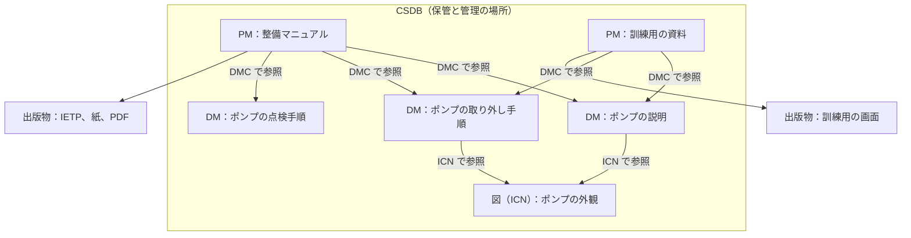

S1000D は、技術情報を「データモジュール」という小さな単位に分けて管理し、必要な単位を組み合わせて出版物を作るための国際仕様です。各データモジュールにはコードを付け、共通ソースデータベース（Common Source Data Base、CSDB）にまとめて保管します。出版物を作るときは、どのデータモジュールをどの順序で並べるかを、別のファイルで指定します。

公式サイトは、この考え方を「本を中心にした管理から、情報を中心にした管理への移行」の土台だと説明しています。この章では、S1000D の中心となる 4 つの概念を説明します。

| 用語 | 役割 |
| --- | --- |
| データモジュール（Data Module、DM） | 単独で保管し、取り出して使える情報の単位 |
| データモジュールコード（Data Module Code、DMC） | CSDB から DM を取り出すための識別コード |
| 共通ソースデータベース（Common Source Data Base、CSDB） | DM を保管し管理する場所。具体的な機能は仕様では定めていない |
| パブリケーションモジュール（Publication Module、PM） | どの DM をどの構成で出版物にするかを指定するもの。技術情報の本文は持たない |

S1000D は、欧州航空宇宙防衛工業会（ASD）、米国航空宇宙工業会（AIA）、ATA e-Business Program が共同で発行しています。仕様は無料でダウンロードでき、2026 年 10 月時点の公式一覧には Issue 7 があります。要素の細かい内容は版によって変わるため、この章では、公式の概要ページと、複数の版に共通する構造に絞って説明します。

S1000D では、画面に表示する対話的な出版物を IETP（Interactive Electronic Technical Publication）と呼びます。米国の文書で使われる IETM とほぼ同じものです。

## データモジュール

公式サイトは、データモジュールを次のように定義しています。データモジュールは、装備、システム、構成品についての説明、手順、運用のデータを含む、独立した情報の単位です。CSDB に保管し、データモジュールコードを使って取り出せるように作ります。

一つの DM は、「一つの作業」「一つの説明」「一つの故障の切り分け」のように、それだけで意味が通るまとまりです。冊子の「第 3 章」のように、前後のページがないと意味が通らない分け方とは違います。更新と再利用も、この DM の単位で行います。

## DM の 2 つの部分

DM は、識別・状態の部分（identification and status section）と、内容の部分（contents section）の 2 つでできています。

公式サイトによると、識別・状態の部分には次の 4 種類の情報を持たせます。

- CSDB の中で DM を管理するための情報
- DM がどの装備に当てはまるか（適用、applicability）を管理するための情報
- 品質保証の手続きを管理するための情報
- 取り出しを制御するための情報

内容の部分には、作業を行うためや、システムを理解するために利用者が必要とする情報そのものを書きます。説明の DM か手順の DM かによって、内容の部分の形は変わります。DM の種類は次の章で説明します。

### 適用（applicability）

適用とは、その情報がどの装備のどの構成に当てはまるかを、データとして持たせることです。公式の利点のページは、「メタデータと内容による、適用を条件にした検索と取り出し」を S1000D の利点に挙げています。複数の派生型の情報を同じ CSDB に入れておき、利用者の装備に合う情報だけを取り出して表示できます。

紙のマニュアルでは「この派生型の場合はこのページ」と注記し、どれを読むかは読み手が判断していました。適用の情報を持たせると、その判断をシステムに任せられます。出し分けは DM 単位だけでなく、DM の中の段落やステップの単位でもできます。詳しくは次の章で説明します。

## データモジュールコード

DMC は、CSDB から DM を一つに特定して取り出すためのコードです。次の表は、米空軍の MIL-STD-3048 が、BREX（事業のルールを定めた DM）を参照する例として示している DMC の構成要素です。空軍の BREX を指す値なので、一般の整備手順の例ではありません。

| 要素 | 例の値 | 意味 |
| --- | --- | --- |
| modelIdentCode | USAF | どの製品（モデル）の情報か |
| systemDiffCode | 0A00 | 同じモデルの中での違い |
| systemCode | 00 | システムの番号 |
| subSystemCode | 0 | サブシステムの番号 |
| subSubSystemCode | 0 | サブサブシステムの番号 |
| assyCode | 00 | アセンブリの番号 |
| disassyCode | 00 | 分解の段階 |
| disassyCodeVariant | 00 | 分解の段階のバリエーション |
| infoCode | 022 | 情報の種類 |
| infoCodeVariant | A | 情報の種類のバリエーション |
| itemlocation | D | 情報がどの位置にある品目に関するものか。文字の意味は版のコード表で決まる |

systemCode から assyCode までは、装備をシステムからアセンブリまで階層に分けて番号を付ける標準番号体系（Standard Numbering System、SNS）の一部です。infoCode は、説明、手順、部品、故障などの情報の種類を表します。同じアセンブリでも、「説明」と「取り外しの手順」は infoCode が違う別々の DM になります。

コードの桁数や使う文字は、版と事業のルールで決まります。上の表は、各要素が何を表すかを示すためのものです。

:::message
表の値は、DMC の文字列を区切って作ったものではありません。MIL-STD-3048（Change 1）と MIL-STD-3048B の本文が、`dmCode` の属性として `systemDiffCode="0A00"`、`disassyCodeVariant="00"`、`itemlocation="D"` と書いているものです。`itemlocation` は規格の本文にある属性名で、版によっては `itemLocationCode` と書くこともあります。

S1000D の例でよく見る形は、これとは違います。公開されている Issue 4.2 の既定の BREX は `S1000D-F-04-10-0301-00A-022A-D` で、systemDiffCode は 1 文字、disassyCodeVariant は英字です。どちらかが誤りなのではなく、桁数や文字の種類は事業のルールで決まります。
:::

次のコードブロックは、上の表と同じ値を並べたものです。公式のスキーマからの抜粋でも、正式な DMC の文字列でもありません。

```text:usaf-brex-dmc-example.txt
# MIL-STD-3048 が BREX を参照する例として示した構成要素
# 一般の整備手順の例ではない
# itemlocation は MIL-STD-3048 の本文にある属性名
# よく見る S1000D-F-04-10-0301-00A-022A-D とは桁数が違う

modelIdentCode      = USAF
systemDiffCode      = 0A00
systemCode          = 00
subSystemCode       = 0
subSubSystemCode    = 0
assyCode            = 00
disassyCode         = 00
disassyCodeVariant  = 00
infoCode            = 022
infoCodeVariant     = A
itemlocation        = D
```

## CSDB

公式サイトは、CSDB を次のように定義しています。CSDB は、データモジュールを保管し管理する場所です。S1000D は CSDB の機能を定めておらず、事業で作ったデータモジュールを保管し管理する必要がある、とだけ述べています。

つまり CSDB は、特定のソフトウェア製品の名前ではありません。ファイルサーバー、データベース、構成管理ツールの組み合わせなど、どう実現するかは事業ごとに決めます。仕様が求めているのは、DM を DMC で保管し、取り出せることです。製品の画面や作業の流れまでは決めていません。

CSDB で管理するのは DM だけではなく、図や PM も含まれます。図には DM とは別の識別番号が付き、複数の DM から参照できます。この識別番号を情報管理番号（Information Control Number、ICN）と呼びます。ICN の付け方は版の仕様で確認してください。ここでは、図は DM の中に埋め込まず、CSDB の中の別のファイルとして参照する、という点を押さえておけば十分です。

## パブリケーションモジュール

公式の概要ページは、DM と CSDB については定義していますが、PM の定義は載せていません。公開されている資料から、PM の役割は次のように説明できます。

- Issue 2.3 の公開スキーマの一覧では、`pm.xsd` が、説明用や手順用の DM のスキーマとは別のファイルになっています。PM は DM の一種ではなく、別の種類のファイルです。
- 米空軍の MIL-STD-3048 は、故障探求のマニュアル（フォルトマニュアル）について PM を作り、その下に置いた PM で内容を分けるように求めています。

PM には、どの DM を、どの階層と順序で出版物に入れるかを書きます。手順の本文や図の実体は DM と図のファイルにあり、PM はそれらを参照して、目次にあたる構造を作ります。同じ DM を、別の出版物の PM から参照することもできます。公式サイトが利点に挙げている「モジュールなので再利用できる」ことを、出版物の側から見ると、この仕組みになります。

:::message
公式サイトは、データの再利用が最大 40%（up to 40%）になり得ると書いていますが、その条件は示していません。この数値の扱いは「導入の利点と留意点」の章で説明します。
:::

次の図は、DM、図、PM、CSDB の関係を、保管と参照の向きで示したものです。DM と図は架空の例です。



この図から、次の三点が読み取れます。

- DM、図、PM は、どれも CSDB の中に別々に保管されます。データが DM から PM へ順に流れていくわけではありません。
- PM は本文を持たず、DMC で DM を参照するだけです。同じ DM（ポンプの説明）を、二つの PM が使い回しています。
- 図は DM の中に埋め込まず、ICN で参照します。同じ図を、複数の DM が参照できます。

利用者の装備や作業に合わせて、ビューアが DM を選んで表示する流れは、「IETM と IETP の構成要素」の章で説明します。

## 出典

- S1000D. *About S1000D*（Data Module、Data Module Structure、CSDB）. https://s1000d.org/?page_id=101
- S1000D. *Benefits*（適用による検索と取り出し、再利用）. https://s1000d.org/?page_id=57
- S1000D Issue 2.3 の公開スキーマ一覧（`pm.xsd` が DM のスキーマとは別にある）. http://www.s1000d.org/S1000D_2-3/xml_schema_flat/
- Department of Defense. MIL-STD-3048 系。`dmCode` の構成要素、プロジェクト BREX の DMC、フォルトマニュアルのパブリケーションモジュール。ASSIST から 2026-09-28 に取得したテキスト、および MIL-STD-3048A。
- S1000D の版番号の説明。https://users.s1000d.org/
- MIL-STD-3048（Change 1）および MIL-STD-3048B の `dmCode` 属性（`systemDiffCode="0A00"`、`disassyCodeVariant="00"`、`itemlocation="D"`）。公開されている規格のテキスト。
- Issue 4.2 の既定 BREX として公開されているファイル `DMC-S1000D-F-04-10-0301-00A-022A-D`。公式サイトのダウンロード一式では確認していない。https://github.com/kibook/S1000D/blob/master/csdb/DMC-S1000D-F-04-10-0301-00A-022A-D_001-00_EN-US.XML

## この章のポイント

- DM は単独で意味が通る情報の単位で、識別・状態の部分と内容の部分でできています。取り出すときの鍵が DMC です。
- DMC は、モデル、システムの階層（SNS）、分解の段階、情報の種類を組み合わせて、DM を一つに特定します。
- CSDB は DM を保管し管理する場所で、具体的な機能は仕様では決まっていません。PM は技術情報の本文を持たず、どの DM をどの構成で出版物にするかを指定します。
