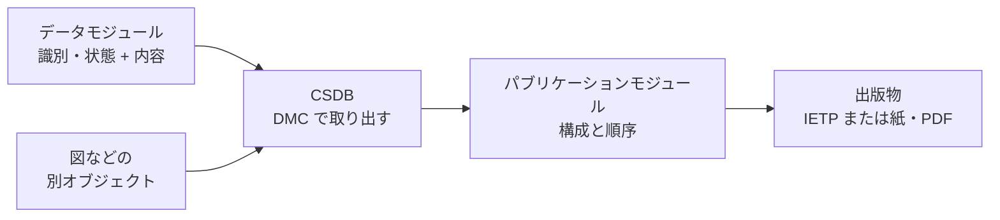

この章では、S1000D が技術情報をどう分割し、どう識別し、どう一冊の出版物に戻すかを説明します。S1000D は、共通ソースデータベースを用いる技術出版物のための国際仕様です。維持者は Aerospace, Security and Defence Industries Association of Europe（ASD）、Aerospace Industries Association of America（AIA）、ATA e-Business Program です。画面に出す対話的な成果物は、対話型電子技術出版物（Interactive Electronic Technical Publication、IETP）と呼ばれます。米国の文書では、ほぼ相当する語として対話型電子技術マニュアル（Interactive Electronic Technical Manual、IETM）が使われます。

公式サイトは、これらの概念が「本のパラダイムから、情報のパラダイムへ移る」ための土台だ、と述べています。

## 概要

中核は四つです。

| 用語 | 役割 |
| --- | --- |
| データモジュール（Data Module、DM） | 独立して格納し、取り出して使える情報の単位 |
| データモジュールコード（Data Module Code、DMC） | CSDB からその DM を取り出す識別子 |
| 共通ソースデータベース（Common Source Data Base、CSDB） | DM を保持し管理する格納場所。製品としての機能は仕様が定めない |
| パブリケーションモジュール（Publication Module、PM） | どの DM をどの構成で出版物にするかを示すオブジェクト。技術内容そのものは持たない |

仕様は無償でダウンロードできます。2026 年 10 月時点の公式一覧には Issue 7 があります。要素の詳細は版で増減します。

:::message
この章は、公式の概要ページと、版をまたいで確認できた構造に限って書きます。Issue 7 の表紙日付は、仕様書を開いていないため断定しません。
:::

## 詳細

### データモジュール

公式サイトの定義は次のとおりです。データモジュールは独立した情報の単位であり、プラットフォーム、システム、または構成品についての記述的、手順的、または運用上のデータを含む。CSDB へ格納し、データモジュールコードを識別子として取り出せる形で作る。

一つの DM は、一つの作業、一つの説明、一つの故障の切り分け、のように、ほかへ依存せずに意味が通る塊です。冊子の「第3章」のような、前後のページがないと成立しない切れ方ではありません。更新、再利用、適用の判断は、この塊に対して行います。

### 二つの部分

各 DM は、識別・状態の部分（identification and status section）と、内容の部分（contents section）から成ります。

識別・状態の部分が提供する情報は、公式サイトが四つ挙げています。

- CSDB の中で DM を管理するための情報
- DM の適用（applicability）を管理するための情報
- 品質保証のプロセスを管理するための情報
- 取り出しを制御するための情報

内容の部分は、作業を行うため、またはシステムを説明するために利用者が必要とする情報そのものです。説明なのか手順なのかで、内容の部分の形は変わります。種類は次の章で扱います。

適用とは、その DM がどの装備のどの構成に当てはまるかをデータとして持たせることです。同じ CSDB に複数の派生の情報を置いておき、利用者の装備に合うものだけを検索して出す、という動きは、公式の利点ページが「メタデータと内容による、適用を条件にした検索と取り出し」として挙げています。紙の「この派生のときはこのページ」という注記を、読み手の判断にだけ頼らないための仕組みです。

### データモジュールコード

DMC は、CSDB から DM を一意に取り出すためのコードです。米空軍の MIL-STD-3048 が BREX 参照の例として示している構成要素は、次のとおりです。値は空軍の BREX を指す例であり、一般の整備手順の見本ではありません。

| 要素 | 例の値 | この章での説明 |
| --- | --- | --- |
| modelIdentCode | USAF | どの製品（モデル）か |
| systemDiffCode | 0A00 | 同一モデルの中の差分 |
| systemCode | 00 | システムの番号 |
| subSystemCode | 0 | サブシステム |
| subSubSystemCode | 0 | サブサブシステム |
| assyCode | 00 | アッセンブリ |
| disassyCode | 00 | 分解の段階 |
| disassyCodeVariant | 00 | その分解段階のバリアント |
| infoCode | 022 | 情報の種類 |
| infoCodeVariant | A | 情報の種類のバリアント |
| item location | D | 情報がどの位置の品目に関するか。文字の意味は版のコード表による。ここでは断定しない |

systemCode から assyCode までは、装備をシステムからアッセンブリへ分けた番号体系である標準番号体系（Standard Numbering System、SNS）の一部です。infoCode が、説明、手順、部品、故障といった情報の種類を表します。同じアッセンブリについて「説明」と「取り外し手順」は、別の infoCode を持つ別の DM になります。

コードの桁数と文字種は版と事業の規則で決まります。上の表は、フィールドが何かの見取り図です。スキーマ上の属性名の綴りは、採用する版のスキーマを見てください。

次のコードブロックは、上の表と同じ値を並べた見取り図です。公式スキーマからの抜粋ではなく、連結した正式な DMC 文字列でもありません。

```text:usaf-brex-dmc-example.txt
# MIL-STD-3048 が BREX 参照の例として示した構成要素
# 一般の整備手順の見本ではない
# item location の文字の意味は、版のコード表による。ここでは断定しない

modelIdentCode      = USAF
systemDiffCode      = 0A00
systemCode          = 00
subSystemCode       = 0
subSubSystemCode    = 0
assyCode            = 00
disassyCode         = 00
disassyCodeVariant  = 00
infoCode            = 022
infoCodeVariant     = A
item location       = D
```

### CSDB

公式サイトの定義は次のとおりです。CSDB は、データモジュールを保持し管理するための格納場所である。S1000D はその機能を定義しない。事業の中で作られたデータモジュールを保持し管理する必要がある、と述べるだけである。

したがって CSDB は、特定のソフトウェア製品の名前ではありません。ファイルサーバ、データベース、構成管理ツールの組み合わせなど、実現は事業が選びます。仕様が保証するのは、DM を DMC で格納し取り出せることであり、製品の画面やワークフローではありません。

管理の対象には DM だけでなく、図や PM も含まれます。図には、DM とは別の識別子が与えられ、複数の DM から参照できます。識別子の正式名は情報管理番号（Information Control Number、ICN）です。ICN の符号化規則は版の仕様に譲り、この章では「図は DM に埋め込まず、CSDB 上の別オブジェクトとして参照する」ことだけを押さえます。

### パブリケーションモジュール

公式の概要ページは、DM と CSDB を定義していますが、PM の定義文は載せていません。確認できた事実から、役割は次のように言えます。

- Issue 2.3 の公開スキーマ一覧では、`pm.xsd` が、記述用や手順用のデータモジュールのスキーマとは別のファイルとして置かれている。PM は DM の一種というより、別種のオブジェクトである。
- 米空軍の MIL-STD-3048 は、フォルトマニュアルについてパブリケーションモジュールを作り、下位のパブリケーションモジュールで内容を分ける、という使い方を要求している。

PM が持つのは、どの DM を、どの階層と順序で出版物に含めるかです。手順の本文や図の実体は DM と図オブジェクトの側にあり、PM はそれらへの参照で目次に相当する構造を作ります。同じ DM を、別の出版物の PM から参照できます。モジュールであるため再利用できる、という公式サイトの記載を、出版物の構成の側から見た形がこれです。

:::message
公式ページは再利用の上限を 40% までと書いていますが、その条件は示していません。数値の扱いは、利点の章にまとめます。
:::



ビューアが利用者の装備と作業に合わせて DM を選ぶ処理は、次の構成要素の章でデータの流れとして見ます。

## 出典

- S1000D. *About S1000D*（Data Module、Data Module Structure、CSDB）. https://s1000d.org/?page_id=101
- S1000D. *Benefits*（適用による検索と取り出し、再利用）. https://s1000d.org/?page_id=57
- S1000D Issue 2.3 の公開スキーマ一覧（`pm.xsd` が DM のスキーマと別に存在する）. http://www.s1000d.org/S1000D_2-3/xml_schema_flat/
- Department of Defense. MIL-STD-3048 系。`dmCode` の構成要素、プロジェクト BREX の DMC、フォルトマニュアルのパブリケーションモジュール。ASSIST から 2026-09-28 に取得されたテキスト、および MIL-STD-3048A。
- S1000D の版番号の説明。https://users.s1000d.org/

## この章のポイント

- DM は独立した情報の単位で、識別・状態と内容の二つの部分を持つ。取り出しの鍵が DMC である。
- DMC は、モデル、システム階層（SNS）、分解、情報の種類を組み合わせて DM を一意にする。
- CSDB は格納と管理の場所であり、仕様は製品の機能を定めない。PM は技術内容を持たず、どの DM をどの構成で出版物にするかを示す。
