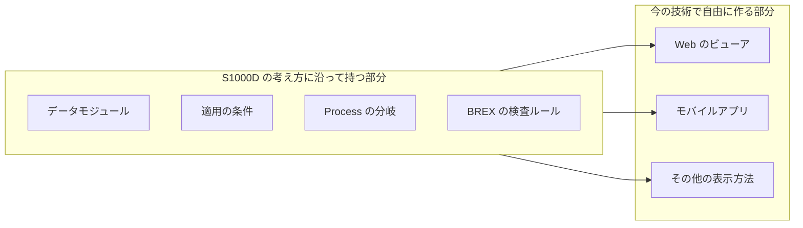

S1000D の価値は、「対話型のマニュアル」という考え方そのものよりも、それを実際に動かすためのデータの決まりにあります。情報をどの単位に分けるか、どの装備に当てはまるかをどう書くか、事業ごとのルールをどう検査するか、質問と分岐をどう記述するか。こうした決まりが、1980 年代から現在まで改訂を重ねながら、防衛や民間航空の現場で使われてきました。

しかも S1000D が決めているのはデータの形だけで、画面を表示するビューアは指定していません。データを S1000D の考え方に沿って持てば、表示は Web 技術など、今の技術で自由に作れます。

この章では、ここまでの章で確認した事実を整理したうえで、S1000D から何を受け取れるかについての著者の見解を述べます。

## これまでの章で確認した事実

### 長く改訂が続いている

- 公式サイトによると、S1000D は 1980 年代前半に、ASD の前身である AECMA の航空宇宙向けの標準として始まりました（「主要な標準の概要」の章）。
- Issue 2 から対象が陸と海の装備にも広がり、公式サイトは現在の用途として、防衛（陸・海・空）、民間航空、建設、船舶を挙げています。
- 2026 年 10 月時点で、公式のダウンロードの一覧には Issue 7 があり、仕様書の表紙の日付は 2026-07-16 です（「現在の動向と参考情報」の章）。
- 版の改訂は、Steering Committee が変更提案（Change Proposal Form）を審議して行います。変更の提案を審議して改訂する仕組みが、仕様の運営に組み込まれています。

### データの形だけを決めている

- 米国の MIL-PRF-87268A は、IETM の内容と、それを表示する電子表示装置の操作画面の両方に要求を定めていました（「IETM と IETP の構成要素」の章）。
- これに対して S1000D は、オーサリング環境、CSDB、ビューアの間でやり取りするデータの形を定め、製品は指定していません。公式サイトは CSDB の機能を定めないと明記しており、ビューアのプログラムも仕様の配布物には含まれていません。
- 画面にどの機能を持たせるかは、事業ごとに機能マトリックスで選びます。

## 著者の見解

:::message
ここからは、上の事実をもとにした著者の見解です。公式サイトや規格が述べている内容ではありません。
:::

### 価値の中心は、使われ続けてきたデータの決まり

操作マニュアルを画面で動かそうとすると、次のような問題に必ず突き当たります。

| 作る側が突き当たる問題 | S1000D の答え | 説明している章 |
| --- | --- | --- |
| 情報をどの単位で分けて、更新し、再利用するか | データモジュール（DM）と、DM を一つに特定するデータモジュールコード（DMC） | S1000D の基本 |
| 機種や構成の違いを、どう書き分けて出し分けるか | 適用（applicability）。DM 単位と、段落・ステップ単位の両方で指定できる。条件の値は ACT、CCT、PCT で管理する | Data Module の種類と構造 |
| 質問と分岐、表示の順序をどう記述するか | Process データモジュール（`dialog`、`dmIf`、`dmSeq` など） | Data Module の種類と構造 |
| 書き手ごとのばらつきを、どう検査するか | BREX。事業のルールを、機械で検査できる DM として持つ | Data Module の種類と構造 |
| 一つの情報を、複数の出版物でどう使い回すか | パブリケーションモジュール（PM）が DM を参照して出版物の構成を作る | S1000D の基本 |

どれも、マニュアルを電子化しようとした人が自分で設計し始め、途中で行き詰まる種類の問題です。S1000D には、その答えが、国際的な合意と長年の利用を経た形で、無料の仕様として公開されています。著者は、ここに S1000D の一番の価値があると考えています。

### 表示は今の Web 技術で作れる

S1000D がビューアを指定していないことは、「導入の利点と留意点」の章では、画面を事業ごとに用意しなければならない負担として説明しました。しかし見方を変えると、表示の技術を自由に選べるということでもあります。

1990 年代の IETM は、専用の電子表示装置で動かすことが前提でした。今はブラウザが動く端末であれば、タブレットでも作業用のノートパソコンでも、同じ情報を表示できます。適用による出し分けや Process の分岐は、Web アプリケーションの状態管理の考え方とも相性の良い処理です。

### 準拠することと、考え方を取り入れることは別

S1000D を活用する方法は、完全に準拠することだけではありません。

- **完全に準拠する**：防衛や航空の事業では、S1000D への準拠が契約の条件になります。この場合は、契約で指定された版、ビジネスルール、機能マトリックスに従います。
- **考え方を取り入れる**：一般の製造業の操作マニュアルなどでは、S1000D の仕様全体に従うのは負担が大きすぎることがあります。その場合でも、データモジュール、適用、Process、BREX といった考え方を、自分たちのデータ設計に取り入れることはできます。将来 S1000D の XML に変換できる形で持っておけば、準拠が必要になったときにも対応しやすくなります。

IETM という語は、1990 年代の米軍の調達用語として、今では古く見えるかもしれません。しかし、その考え方を支えるデータの決まりは、S1000D として現在も改訂が続いています。本書が IETM の定義から始めて S1000D まで説明してきたのは、この 2 つのつながりを示すためです。

## 出典

この章の事実は、次の章で示した出典に基づいています。

- 「主要な標準の概要」：S1000D の経緯と運営、版番号の決まり。https://s1000d.org/?page_id=101 、https://s1000d.org/?page_id=61 、https://users.s1000d.org/
- 「現在の動向と参考情報」：Issue 7 の掲載と、仕様書の表紙の日付。https://s1000d.org/
- 「IETM と IETP の構成要素」：CSDB の機能を定めないこと、ビューアが配布物に含まれないこと、MIL-PRF-87268A が画面にも要求を定めていたこと。https://www.navsea.navy.mil/Portals/103/Documents/NSWC_Carderock/s87268a.pdf
- 「S1000D の基本」「Data Module の種類と構造」：DM、DMC、PM、適用、Process、BREX の説明。

## この章のポイント

- S1000D は、1980 年代前半から現在の Issue 7 まで改訂が続き、防衛、民間航空、建設、船舶で使われている仕様です。決めているのはデータの形だけで、ビューアは指定していません。
- 著者の見解では、S1000D の一番の価値は、データモジュール、適用、Process、BREX といった、長く使われて固まってきたデータの決まりにあります。
- データを S1000D の考え方に沿って持てば、表示は Web 技術など今の技術で作れます。完全に準拠するか、考え方を取り入れるかは、事業の分野と契約によって選べます。
