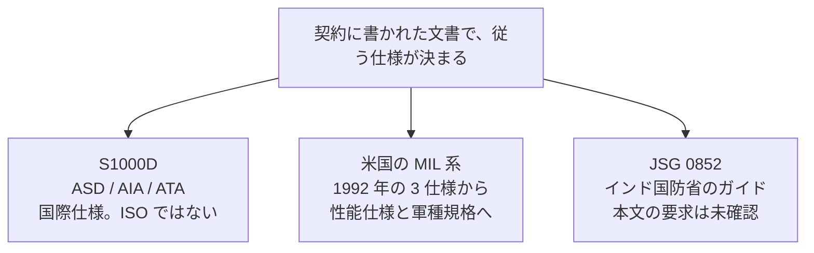

この章では、対話型電子技術マニュアル（Interactive Electronic Technical Manual、IETM）と対話型電子技術出版物（Interactive Electronic Technical Publication、IETP）の周りで、公開情報から確認できる主な標準を並べます。どれか一つが世界共通の必須規格だ、という整理にはしません。事業がどれを契約に書くかで、従う文書が決まります。

## 概要

国際的に広く参照される作成仕様は S1000D です。技術出版物を、共通ソースデータベース（Common Source Data Base、CSDB）を使って作るための国際仕様であり、Aerospace, Security and Defence Industries Association of Europe（ASD）、Aerospace Industries Association of America（AIA）、ATA e-Business Program が共同で出しています。

:::message alert
S1000D は ISO 規格ではありません。公式の利点ページにある “International standard, ISO 8879” は SGML の国際規格です。S1000D 自身が ISO 8879 である、とも読めません。
:::

米国では、1992 年の三軍共通の 3 仕様が起点です。その後、提示とデータベースの仕様は性能仕様へ改められ、軍種ごとの作成規格（陸軍の MIL-STD-40051、空軍の S1000D 実装規則 MIL-STD-3048 など）が機能の指定を担っています。インドには、別系統の Joint Services Guide（JSG）0852 があります。

## 詳細

### S1000D

公式サイトの標題は、「共通ソースデータベースを用いる技術出版物のための国際仕様」です。技術出版物の作成仕様であり、仕様書、スキーマ、サンプルは同サイトから無償でダウンロードできます。

維持の主体は、公式サイトが次のように説明しています。1980 年代前半に、当時 AECMA と呼ばれた ASD の航空宇宙標準として始まり、現在の共同発行者は ASD、AIA、ATA e-Business Program です。Issue 2 で対象は陸と海へ広がりました。

:::details 公式サイトが説明する維持の経緯
- 概念は 1980 年代前半、当時 AECMA と呼ばれた ASD の航空宇宙標準として始まった。当時、民間の航空機事業の多くは ATA 100、軍の事業は各国の仕様に従っていた。
- AECMA の Customer and Product Support Committee が Documentation Working Group を置き、ATA 100 を元に民間と軍の文書を調和させることを選んだ。軍の代表を加えた Augmented Documentation Working Group が、のちに Technical Publications Specification Maintenance Group、さらに S1000D Steering Committee へ引き継がれた。
- 現在の共同発行者は ASD、AIA、ATA e-Business Program である。三者の覚書から S1000D Council が置かれ、開発全体の統治を担う。Steering Committee は Change Proposal Form（CPF）を処理し、仕様の版を出す。
- Issue 2 で、対象は陸と海へ広がった。公式の概要は、軍と民間の装備、出版物、建設、方針手順、法務文書、組織の文書などへ適用し得ると述べている。トップページは、防衛（陸・海・空）、民間航空、建設、船舶を現在の用途として挙げている。
:::

版番号の読み方は、ダウンロードページが説明しています。

| 変更の種類 | 番号の動き | 互換 |
| --- | --- | --- |
| メジャー | 最初の桁。例は 3.0 から 4.0 | 後方互換ではない。変換には人手の介在が要る |
| マイナー | 2 桁目。例は 2.0 から 2.1 | 後方互換であり、人手なしの自動変換ができる |
| パッチ | 3 桁目の文字。例は 4.1.A。Issue 4.1 より前は数字 | 軽微な訂正と不具合修正。新しい技術的機能は入らない |

:::message
2026 年 10 月時点の公式ダウンロード一覧には、Issue 7 が Issue 6 や Issue 5.0 と並んで載っています。Issue 7 のオンラインデータ辞書の日付は 2026-08-27 です。発行日そのものは、仕様書の表紙をこの調査では開いていないため、本書では断定しません。使う版は契約と、公式サイトの現行一覧で確認してください。
:::

後の版の実体は XML スキーマです。本書では S1000D を、ASD・AIA・ATA が維持する国際仕様として扱います。

データモジュールや CSDB の中身は、次の二つの章で公式サイトの定義に沿って説明します。

### 米国の MIL 系

1992 年 11 月 20 日に出た最初の一式は、MIL-M-87268（内容、スタイル、形式、利用者とのやり取り）、MIL-D-87269（改訂可能なデータベース）、MIL-Q-87270（品質保証）です。

その後の確認できた変化は次のとおりです。

| 文書 | 確認できた内容 |
| --- | --- |
| MIL-PRF-87268A（1995-10-01） | MIL-M-87268（1992-11-20）を置き換える。IETM の一般内容、スタイル、形式、利用者とのやり取り。IETM はデジタル形式で、電子表示装置により整備技術者または操作者へ対話表示する |
| MIL-PRF-87269 | 改訂可能な IETM データベースの性能仕様。公開の仕様目録は、MIL-DTL-87269C に置き換えられたと記している。現行の有効性は ASSIST で確認すること |
| MIL-Q-87270 | Fuller の 1997 年の説明資料は、廃止されたと記している |
| MIL-HDBK-511 | IETM の相互運用のハンドブック。利用者一人が、市販の表示装置で、出所と内部形式を問わず技術情報を見て、リンク先の別の ETM または IETM へ進めることを目標にする。五つのクラスすべてを対象にすると書いている |
| MIL-STD-40051-1B | 陸軍の、線形および非線形 IETM の技術内容、スタイル、形式、機能。機能の指定は附属書 A の機能マトリックス |
| MIL-STD-3048 系 | 空軍が S1000D で技術出版物を作るときのビジネスルール。紙、ページ指向、画面の IETM を対象にする。IETM と IETP の対応は前の章で扱った |

MIL-HDBK-511 が扱う相互運用は、データそのものの相互運用のすべてではありません。ハンドブックの適用範囲は、共通の利用者インタフェース、つまりブラウザを通じた相互運用の論点を示すことだ、と本文が限定しています。データが同じスキーマで交換できることとは別の問題です。S1000D が狙うのは、主としてデータの側の共通化です。

これらの文書の現行版、廃止、置き換えは、本書の調査日以降にも変わります。ASSIST の表示を、契約の指定版と突き合わせてください。

### JSG 0852

JSG 0852 は、インド国防省の標準化局（Directorate of Standardisation, Department of Defence Production）が扱う Joint Services Guide の一つで、標題は Interactive Electronic Technical Manual です。公開されているファイルの表題には、JSG 0852:2019（Second Revision）とあります。承認者として、情報技術の標準化小委員会の議長が記されています。

:::message alert
この全文は、標準化局の公開目録から今回取得できていません。目録の閲覧で 0852 の現行エントリを特定することも、調査の時点ではできていません。したがって本書は、ガイドの機能要求、レベルの定義、データベース方式については書きません。ベンダー資料が JSG 0852 と S1000D の優劣や、SQL と XML の違いとして説明している内容は、一次資料で確認できないため採用しません。
:::

位置づけとして確かなのは、米国の MIL 仕様とも S1000D とも別の、インドの軍向けガイドだということです。契約に JSG 0852 とあれば、S1000D や MIL-PRF-87268 を満たせば足りる、とは読めません。逆も同じです。

## 出典

- S1000D 公式サイト。概要、組織、ダウンロード時の版番号の説明。https://s1000d.org/ および https://s1000d.org/?page_id=101 、https://s1000d.org/?page_id=61 、https://users.s1000d.org/
- MIL-PRF-87268A（1995-10-01）。https://www.navsea.navy.mil/Portals/103/Documents/NSWC_Carderock/s87268a.pdf
- Eric L. Jorgensen, 1992-12-10 の仕様発行の説明。https://www.navsea.navy.mil/Portals/103/Documents/NSWC_Carderock/CALS92J.pdf
- Joseph J. Fuller, 1997 年の説明資料（MIL-Q-87270 の廃止、MIL-PRF への移行）。https://www.navsea.navy.mil/Portals/103/Documents/NSWC_Carderock/Fuller97.pdf
- MIL-HDBK-511。DTIC ADA445614。https://apps.dtic.mil/sti/tr/pdf/ADA445614.pdf
- MIL-STD-40051-1B 附属書 A。ASSIST から 2026-10-14 に取得されたテキスト。
- MIL-PRF-87269 と MIL-DTL-87269C の関係は、公開仕様目録の記載による。https://everyspec.com/MIL-PRF/MIL-PRF-080000-99999/MIL-PRF-87269_28804/
- JSG 0852:2019（Second Revision）の表題は、公開アップロードの先頭頁から確認した。ガイド本文の要求は、標準化局サイトから再取得していない。

## この章のポイント

- S1000D は、ASD、AIA、ATA e-Business Program が共同で維持する国際仕様であり、ISO 規格ではない。版によって後方互換でない。
- 米国の起点は 1992 年の MIL-M-87268、MIL-D-87269、MIL-Q-87270 である。その後は性能仕様、相互運用ハンドブック、軍種ごとの作成規格へ分かれている。現行の有効性は ASSIST で確認する。
- JSG 0852 はインド国防省の IETM 向け Joint Services Guide である。米国の MIL 仕様や S1000D の別名ではない。本文の要求は、公式全文を確認していないため本書では扱わない。
