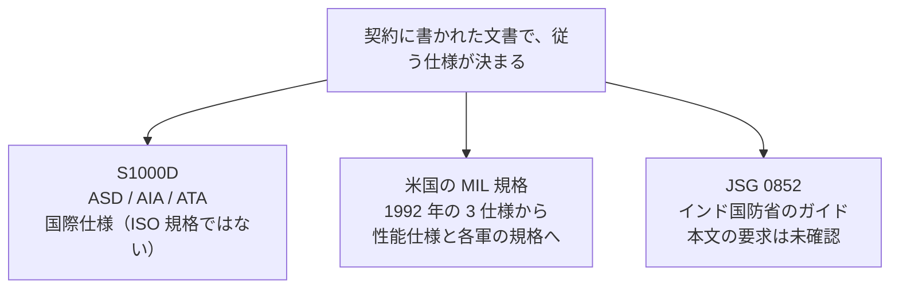

IETM と IETP に関係する主な標準は、国際仕様の S1000D、米国の軍用規格（MIL 規格）、インドの JSG 0852 の 3 系統です。世界共通で必ず従うべき規格が一つあるわけではなく、事業の契約にどの文書が書かれているかによって、従う規格が決まります。

この章では、それぞれの標準の成り立ちと位置づけを説明します。

## S1000D

S1000D は、共通ソースデータベース（Common Source Data Base、CSDB）を使って技術出版物を作るための国際仕様です。公式サイトでの正式な名称も「共通ソースデータベースを用いる技術出版物のための国際仕様」です。欧州航空宇宙防衛工業会（Aerospace, Security and Defence Industries Association of Europe、ASD）、米国航空宇宙工業会（Aerospace Industries Association of America、AIA）、ATA e-Business Program の 3 団体が共同で発行しています。仕様書、スキーマ、サンプルは、公式サイトから無料でダウンロードできます。

:::message alert
S1000D は ISO 規格ではありません。公式サイトの利点のページに “International standard, ISO 8879” とありますが、ISO 8879 は SGML の国際規格の番号です。S1000D が ISO 規格であることを示すものではありません。
:::

公式サイトによると、S1000D は 1980 年代前半に、ASD の前身である AECMA の航空宇宙向けの標準として始まりました。Issue 2 から、対象が陸と海の装備にも広がっています。

:::details 公式サイトが説明する S1000D の経緯
- 1980 年代前半、ASD の前身の AECMA で、航空宇宙向けの標準として検討が始まりました。当時、民間航空機の事業の多くは ATA 100 に従い、軍の事業は各国の仕様に従っていました。
- AECMA の Customer and Product Support Committee は Documentation Working Group を設け、ATA 100 をもとに民間と軍の文書を統一する方針をとりました。軍の代表を加えた Augmented Documentation Working Group は、のちに Technical Publications Specification Maintenance Group となり、さらに S1000D Steering Committee に引き継がれました。
- 現在は ASD、AIA、ATA e-Business Program が共同で発行しています。3 団体の覚書に基づいて S1000D Council が置かれ、仕様の開発全体を管理しています。Steering Committee は、変更提案（Change Proposal Form、CPF）を審議し、新しい版を発行します。
- Issue 2 から、対象が陸と海の装備にも広がりました。公式の概要ページは、軍と民間の装備、出版物、建設、方針や手順、法務文書、組織の文書などにも使えると述べています。トップページでは、現在の用途として、防衛（陸・海・空）、民間航空、建設、船舶を挙げています。
:::

### 版番号の読み方

S1000D の版番号の付け方は、ダウンロードページで次のように説明されています。

| 変更の種類 | 番号の変わり方 | 互換性 |
| --- | --- | --- |
| メジャー | 1 桁目が変わる（例：3.0 → 4.0） | 前の版との互換性はない。データの変換には人の作業が必要 |
| マイナー | 2 桁目が変わる（例：2.0 → 2.1） | 前の版と互換性があり、人の作業なしで自動変換できる |
| パッチ | 3 桁目の文字が変わる（例：4.1.A）。Issue 4.1 より前は数字 | 小さな訂正と不具合の修正のみ。新しい機能は追加されない |

:::message
2026 年 10 月時点で、公式のダウンロード一覧には Issue 7 が、Issue 6 や Issue 5.0 と並んで掲載されています。Issue 7 の仕様書の表紙の日付は 2026-07-16 です。オンラインデータ辞書のページにある 2026-08-27 は辞書のページの日付で、発行日ではありません。使う版は、契約と公式サイトの最新の一覧で確認してください。
:::

後の版では、仕様の本体は XML スキーマとして提供されています。データモジュールや CSDB の具体的な内容は、「S1000D の基本」と「Data Module の種類と構造」の章で説明します。

## 米国の MIL 規格

米国の IETM の規格は、1992 年 11 月 20 日に発行された次の 3 つの仕様から始まりました。

- MIL-M-87268：内容、スタイル、形式、利用者とのやり取り
- MIL-D-87269：改訂可能なデータベース
- MIL-Q-87270：品質保証

その後、表示とデータベースの仕様は性能仕様（MIL-PRF）に改められ、機能の指定は各軍の作成規格（陸軍の MIL-STD-40051、空軍が S1000D を使うためのルールを定めた MIL-STD-3048 など）が担うようになりました。主な文書は次のとおりです。

| 文書 | 内容 |
| --- | --- |
| MIL-PRF-87268A（1995-10-01） | MIL-M-87268（1992-11-20）を置き換えた仕様。IETM の内容、スタイル、形式、利用者とのやり取りを定める。IETM を、電子表示装置で整備技術者や操作者に対話的に表示するデジタル形式のマニュアルと規定している |
| MIL-PRF-87269 | 改訂可能な IETM データベースの性能仕様。公開されている仕様の目録には、MIL-DTL-87269C に置き換えられたと書かれている。現在も有効かは ASSIST で確認する |
| MIL-Q-87270 | Fuller の 1997 年の説明資料によると、廃止された |
| MIL-HDBK-511 | IETM の相互運用のためのハンドブック。利用者が市販の表示装置を使って、作成元やデータ形式にかかわらず技術情報を閲覧し、リンク先の別の ETM や IETM に移れるようにすることを目標にしている。5 つのクラスすべてを対象としている |
| MIL-STD-40051-1B | 陸軍の規格。線形と非線形の IETM の技術内容、スタイル、形式、機能を定める。機能は附属書 A の機能マトリックスで指定する |
| MIL-STD-3048 系 | 空軍が S1000D で技術出版物を作るときのビジネスルール。紙、ページ型、画面表示の IETM を対象にする。IETM と IETP の関係は前の章で説明した |

MIL-HDBK-511 の相互運用は、ブラウザを共通の入口にして、利用者が異なる IETM を行き来できるようにするものです。ハンドブックの本文も、適用範囲を共通の利用者インターフェースの問題に限定しています。データを同じスキーマで交換できるかどうかは、これとは別の問題です。S1000D が主に目指しているのは、データの側の共通化です。

これらの文書の現行版、廃止、置き換えは、今後も変わる可能性があります。ASSIST で最新の状態を確認し、契約で指定された版と照らし合わせてください。

## JSG 0852

JSG 0852 は、インド国防省の標準化局（Directorate of Standardisation, Department of Defence Production）が管理する Joint Services Guide の一つで、標題は Interactive Electronic Technical Manual です。公開されているファイルには JSG 0852:2019（Second Revision）と書かれており、承認者は情報技術の標準化小委員会の議長です。

:::message alert
本書は JSG 0852 の全文を標準化局の公開目録から入手できておらず、現行版も特定できていません。そのため、ガイドの機能要求、レベルの定義、データベースの方式については書きません。JSG 0852 と S1000D の優劣や、SQL と XML の違いとして説明しているベンダーの資料もありますが、一次資料で確認できないため採用していません。
:::

確かなのは、JSG 0852 が米国の MIL 規格とも S1000D とも別の、インドの軍向けのガイドだということです。契約で JSG 0852 が指定されている場合、S1000D や MIL-PRF-87268 を満たしていれば足りるとは言えません。その逆も同じです。

## 出典

- S1000D 公式サイト。概要、組織、ダウンロードページの版番号の説明。https://s1000d.org/ 、https://s1000d.org/?page_id=101 、https://s1000d.org/?page_id=61 、https://users.s1000d.org/
- 著者が入手した S1000D Issue 7 のパッケージ（表紙は “Issue No. 7”、日付は 2026-07-16）。入手先は https://users.s1000d.org/
- MIL-PRF-87268A（1995-10-01）。https://www.navsea.navy.mil/Portals/103/Documents/NSWC_Carderock/s87268a.pdf
- Eric L. Jorgensen, 1992-12-10 の仕様発行の説明資料。https://www.navsea.navy.mil/Portals/103/Documents/NSWC_Carderock/CALS92J.pdf
- Joseph J. Fuller, 1997 年の説明資料（MIL-Q-87270 の廃止、MIL-PRF への移行）。https://www.navsea.navy.mil/Portals/103/Documents/NSWC_Carderock/Fuller97.pdf
- MIL-HDBK-511。DTIC ADA445614。https://apps.dtic.mil/sti/tr/pdf/ADA445614.pdf
- MIL-STD-40051-1B 附属書 A。ASSIST から 2026-10-14 に取得したテキスト。
- MIL-PRF-87269 と MIL-DTL-87269C の関係は、公開されている仕様の目録による。https://everyspec.com/MIL-PRF/MIL-PRF-080000-99999/MIL-PRF-87269_28804/
- JSG 0852:2019（Second Revision）の標題は、公開されているファイルの 1 ページ目で確認した。本文の要求は、標準化局の公開目録からは確認していない。

## この章のポイント

- S1000D は、ASD、AIA、ATA e-Business Program が共同で発行する国際仕様で、ISO 規格ではありません。メジャー版の間には互換性がありません。
- 米国の IETM の規格は、1992 年の MIL-M-87268、MIL-D-87269、MIL-Q-87270 から始まりました。その後、性能仕様、相互運用のハンドブック、各軍の作成規格に分かれています。現在も有効かは ASSIST で確認します。
- JSG 0852 は、インド国防省の IETM 向けのガイドです。米国の MIL 規格や S1000D とは別の文書です。本文の要求は確認できていないため、本書では扱いません。
