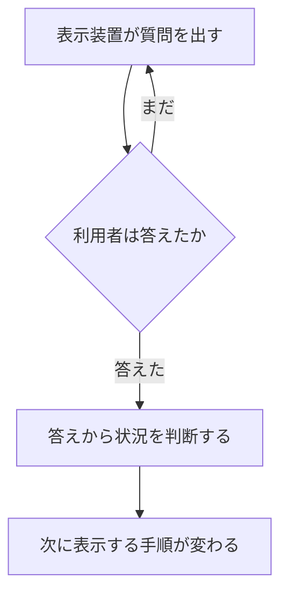

IETM（Interactive Electronic Technical Manual、対話型電子技術マニュアル）は、装備の運用や整備に必要な技術情報を、技術者の作業や入力に合わせて画面に出し分ける電子マニュアルです。著者があらかじめ質問と分岐を情報の中に組み込んでおき、技術者の答えに応じて、次に表示する手順を変えます。紙のマニュアルをスキャンしたり PDF にしたりしただけのものは、IETM には入りません。

IETM という語は、米国国防総省（Department of Defense、DoD）が 1970 年代後半から研究し、1992 年に仕様としてまとめたものに由来します。同じ考え方は、のちに国際仕様の S1000D を通じて、民間航空、船舶、建設などの分野にも広がりました。S1000D では、画面向けの対話的な成果物を IETP（Interactive Electronic Technical Publication）と呼びます。両者の関係は[「IETM と IETP の関係」](https://zenn.dev/shuji_bonji/books/ietm-overview/viewer/ietm-vs-ietp)の章で説明します。

この章では、IETM の定義を米国の仕様と論文で確かめ、紙のマニュアルや PDF との違いを整理します。

:::message
本書では Interactive を「対話型」と訳します。日本の公的機関が定めた公式の訳語は、参照した公的資料の範囲では見つかりませんでした。
:::

## 仕様と論文による定義

1995 年 10 月 1 日に発行された [MIL-PRF-87268A](https://www.navsea.navy.mil/Portals/103/Documents/NSWC_Carderock/s87268a.pdf) は、IETM を次のように規定しています。IETM はデジタル形式の技術マニュアルで、電子表示装置（Electronic Display System、EDS）を使って、整備技術者またはシステムの操作者に対話的に表示するよう設計されたものです。この仕様は、IETM の内容、スタイル、形式、利用者とのやり取りについて、共通の要求を定めています。

同じ時期に、米海軍水上戦センター（Naval Surface Warfare Center、NSWC）Carderock 部門の Eric L. Jorgensen は、IETM を「紙の技術マニュアルと同じ機能を持ち、多くの場合は紙を完全に置き換えるもの」と説明しています。紙と違うのは、電子表示装置に表示する前提で作り直してあること、画面に合わせた体裁であること、利用者と対話できることの 3 点です。

つまり IETM は、運用・整備・後方支援に必要な技術情報を技術者に届けるという紙のマニュアルの役割を、そのまま画面向けに作り直したものです。

## 一度に表示する情報の量

紙のマニュアルはページを順に並べたものです。図は別のページにあることが多く、本文には「図を参照」と書かれます。読み手は、目次、索引、ページをめくる操作で必要な箇所を探します。

Jorgensen によると、IETM は一度に表示する情報を必要な分に絞ります。ある文を表示するときに、その文に対応する図や、図の該当部分を同じ画面に出せます。作業の説明と図が別のページに分かれないことが、画面にする利点の一つです。

技術情報の多くは、装置の構成品、運用上のサブシステム、故障モードの一覧のように、もともと構造を持っています。紙ではその構造がページの並びに埋もれてしまい、読み手が自分で読み取るしかありません。IETM では、その構造をコンピュータが扱える形で持っておき、ビューアが必要な部分だけを取り出して表示します。

## 対話の仕組み

IETM の「対話」とは、利用者の入力によって、次に何を表示するかが決まることです。

MIL-PRF-87268A は、ダイアログを「表示装置が利用者に出す質問」と規定しています。利用者は答えるまで次の処理へ進めません。答えが入力されると、システムは利用者の状況を判断できるので、その答えに応じて次に表示する手順が変わります。

Jorgensen も同じ動作を、利用者に情報を求め、その入力をもとに次に表示する情報を決めること、と説明しています。これにより、IETM は手順の途中で技術者を誘導できます。紙のマニュアルでは、どちらへ進むかの判断は読み手に任されます。

上の図は、MIL-PRF-87268A が規定するダイアログの流れを示したものです。

技術者の作業に当てはめると、次のような動きになります。

- **作業による出し分け**：これから行う作業（取り外し、点検、復旧など）に対応する手順だけを表示します。
- **構成による出し分け**：同じ製品でも派生型や搭載装備が違う場合に、当てはまらない情報を表示しません。この出し分けの条件を、データの側に適用情報（applicability）として持たせるのが、後の章で扱う S1000D の方法です。DoD の対話の仕様では、質問への答えから状況を判断し、条件に合う手順を表示します。
- **故障による出し分け**：症状やテスト結果を入力すると、次に確認すべき箇所へ進みます。Jorgensen は、技術情報を構造化する例として、トラブルシューティングの故障モードを挙げています。

ここで大事なのは、質問も分岐も、著者があらかじめ情報の中に組み込んでいることです。これが、電子技術マニュアル（Electronic Technical Manual、ETM）のうちどれを IETM と呼ぶかを分ける条件になります。詳しくは[「クラスと Functionality Matrix」](https://zenn.dev/shuji_bonji/books/ietm-overview/viewer/classes)の章で説明します。索引を付けただけのページ画像は、電子化されていても IETM ではありません。

## 更新の単位

紙のマニュアルを改訂するときは、ページを差し替えるか、冊子を発行し直します。管理する単位は冊子とページです。

Jorgensen は、IETM のデータベースでは、その用途に必要なデータだけを、必要なときにビューアが表示すると説明しています。同じ原データから、部品の閲覧画面や訓練の資料など、別の形で表示することもできます。そのため原データは、特定の紙面のレイアウトに合わせず、内容として管理します。

その結果、更新の作業は「冊子を印刷し直す」ことから、「原データの該当部分を直し、表示はビューアが組み立て直す」ことに変わります。どこまで細かい単位で直せるかは、後の章で扱うクラスや、S1000D のデータモジュールによって決まります。

## 紙、PDF、IETM の比較

PDF は、電子で配布できる点では紙と違います。しかし、中身の構造が紙のページのままであれば、探し方や対話の点では紙とほとんど変わりません。

:::message alert
PDF にしたものが IETM になるわけではありません。索引を付けただけのページ画像も、電子化されていても IETM ではありません。
:::

| 観点 | 紙のマニュアル | 単純な PDF | IETM |
| --- | --- | --- | --- |
| 探し方 | 目次、索引、ページ送りを使い、読み手が冊子の構成をたどる | ページ送り、文字列検索、しおりを使う。本文が画像だけの場合は文字列検索ができない | 画面に出す情報を必要な分に絞る。質問への答えや、著者が用意した分岐によって次の情報へ進む |
| 更新 | ページの差し替え、または冊子の改訂 | ファイルごとの差し替えになりやすい。中の 1 手順だけを正式に差し替える仕組みは、PDF 自体にはない | 原データをデータベースや独立した情報の単位で管理する方式では、該当する単位だけを更新し、表示はビューアが組み立てる |
| 対話 | どちらへ進むかは読み手が判断する。図は別のページにあることが多い | リンクを付けても、ほかの箇所への参照だけなら対話はほとんどない | 著者が質問と分岐を情報の中に組み込む。答えに応じて次の手順が変わる。本文に対応する図を同じ画面に出せる |

MIL-PRF-87268A が利用者として想定しているのは、整備技術者とシステムの操作者です。Jorgensen は、同じ原データから訓練資料や部品情報も出せることを、データベースの用途として挙げています。ただし IETM の中心にあるのは、作業中の技術者が、必要な技術情報に画面ですぐたどり着けることです。

## 出典

- Department of Defense. MIL-PRF-87268A, *Manuals, Interactive Electronic Technical: General Content, Style, Format, and User-Interaction Requirements*. 1995-10-01（MIL-M-87268, 1992-11-20 を置き換え）. NSWC Carderock が公開している PDF. https://www.navsea.navy.mil/Portals/103/Documents/NSWC_Carderock/s87268a.pdf
- Eric L. Jorgensen, Carderock Division, Naval Surface Warfare Center. *The Interactive Electronic Technical Manual Overview: "Setting the Stage"*. https://www.navsea.navy.mil/Portals/103/Documents/NSWC_Carderock/Cals94j.pdf

規格の改訂状況は、契約の時点で ASSIST（Acquisition Streamlining and Standardization Information System）の現行版を確認してください。上の PDF は、定義を確認するために参照した公開版です。

## この章のポイント

- IETM は、紙の技術マニュアルの役割を、画面上の対話的な表示に作り直したものです。もとは米国 DoD の用語です。
- 対話とは、利用者の入力に応じて次に表示する情報が決まることです。質問と分岐は、著者があらかじめ情報の中に組み込みます。
- 紙や単純な PDF との違いは、探し方（読み手がページをたどるか、システムが必要な部分を出すか）、更新の単位、対話の有無の 3 点にあります。PDF にしただけでは IETM にはなりません。
