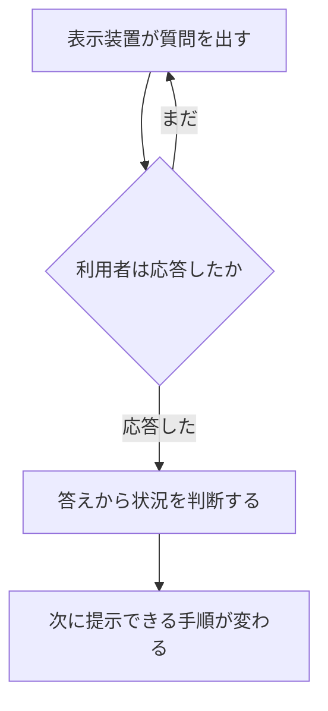

この章では、対話型電子技術マニュアル（Interactive Electronic Technical Manual、IETM）が何であるかを定義し、紙のマニュアルおよび単純な PDF との違いを整理します。IETM という語は米国国防総省（Department of Defense、DoD）の取り組みから広まった用語です。後の章で扱う S1000D の用語とは、ここで一度切り分けておきます。

:::message
本書では Interactive を「対話型」と訳します。日本の公的機関が、この語に一つの公式訳語を定めていることは、参照した公的資料の範囲では確認できませんでした。
:::

IETM は、紙の技術マニュアルと同じ役割、つまり運用・整備・後方支援に必要な技術情報を技術者へ渡す役割を、電子画面向けに作り直したものです。単なる紙の電子コピーではありません。

1995 年 10 月 1 日発行の MIL-PRF-87268A は、IETM を次のように規定しています。IETM はデジタル形式であり、電子表示装置（Electronic Display System、EDS）によって、整備技術者またはシステムの操作者へ対話的に表示するよう設計される、というものです。この仕様は、一般的な内容、スタイル、形式、および利用者とのやり取りに関する共通要求を定めています。

同じ時期に Carderock 部門の海軍水上戦センター（Naval Surface Warfare Center、NSWC）の Eric L. Jorgensen がまとめた概説は、IETM を「紙の技術マニュアルと機能的に等価であり、多くの場合は紙を全面的に置き換えるもの」と説明しています。違いは、電子表示装置に出す前提で設計し直してあること、画面向けの体裁であること、そして利用者と対話できることにあります。

## 画面に出す情報の単位が違う

紙のマニュアルは、ページの連なりです。図は別ページにあることが多く、本文は “図を見よ” と参照します。読み手は、目次、索引、ページをめくる動作で必要な箇所へたどり着きます。

Jorgensen の説明では、IETM は一度に出す情報を絞ります。ある文を表示するとき、その文に対応する図、または図の該当部分を同時に出せます。紙で一般的な “図を見よ” より、見ている作業とその図が離れにくい、という点が画面化の狙いです。

情報の中身がハードウェア構成品、運用上のサブシステム、故障モードの一覧のように構造を持っていても、紙ではその構造はページの並びの中に埋もれます。読み手が構造を解釈します。IETM では、その構造を計算機が扱える形にしておき、ビューアが必要な部分だけを取り出します。

## 対話とは、次に何を出すかを利用者の入力で決めること

MIL-PRF-87268A は、ダイアログを「表示装置が利用者へ出す質問」と規定しています。利用者は応答するまで次の処理へ進めません。応答が済むと、利用者の状況について一定の判断ができ、その答えに応じて、次に提示できる手順が変わります。

Jorgensen は同じ動作を、利用者へ情報を求め、その入力に基づいて次に表示する情報を決めること、と説明しています。この仕組みにより、IETM は手順の途中で読み手を誘導できます。紙では、分岐の判断は読み手に残ります。

上の図は、MIL-PRF-87268A が規定するダイアログを流れにしたものです。

技術者の作業に即して言うと、次のような動きです。

- 作業に応じて選ぶ。これから行う作業（取り外し、点検、回復など）に対応する手順だけを出す。
- 構成に応じて選ぶ。同じ製品でも派生や搭載装備が違うとき、該当しない情報を最初から混ぜない。この選別をデータ側の適用情報（applicability）として明示的に持つのは、後の章で扱う S1000D のやり方です。DoD の対話仕様では、質問への答えから状況を判断し、次の手順を条件付きで出します。
- 故障に応じて選ぶ。症状やテスト結果を入力すると、次に見るべき切り分けへ進む。Jorgensen は、技術情報の組織化の例としてトラブルシューティングの故障モードを挙げています。

質問も分岐も著者の側で情報の中に作り込んであることが、後の章で述べる「電子技術マニュアル（Electronic Technical Manual、ETM）のうち、どれを IETM と呼ぶか」の境目です。索引が付いただけのページ画像は、電子化されていても IETM ではありません。

## 更新の単位が違う

紙の改訂は、差替えページまたは冊子の再発行です。管理の対象は冊子とページです。

Jorgensen は、IETM のデータベースについて、ある用途に必要なデータだけを、必要な時点でビューアが提示する、と説明しています。同じ原データから、部品の閲覧や訓練資料など別の提示も作り得ます。その場合、原データは特定の紙面体裁に縛られず、論理的な内容として維持します。更新は「冊子を刷り直す」ことではなく、「原データの該当部分を直し、表示はビューアが組み直す」方向へ変わります。どの粒度で直せるかは、後の章のクラスと、S1000D のデータモジュールに依存します。

## 紙、単純な PDF、IETM

単純な PDF は、配布が電子であるという点では紙と違います。しかし情報の構造が紙のページのままなら、探し方と対話の性質は紙に近い側に残ります。

:::message alert
PDF であれば IETM である、とは言えません。索引が付いただけのページ画像も、電子化されていても IETM ではありません。
:::

| 観点 | 紙のマニュアル | 単純な PDF | IETM |
| --- | --- | --- | --- |
| 探し方 | 目次、索引、ページ送り。読み手が冊子の構造をたどる | ページ送り、文字列検索、しおり。本文が画像だけの場合、文字列検索はできない | 画面向けに情報を絞る。質問への応答や、著者の用意した分岐で次の情報へ進む。索引のみのページ画像は、この列には入らない |
| 更新 | 差替えページ、または冊子の改版 | ファイル単位の差替えになりやすい。中の1手順だけを公式に差し替える仕組みは PDF 自体にはない | 原データをデータベースまたは独立した情報単位で維持する方式では、該当単位を更新し、表示はビューアが組む |
| 対話 | 分岐は読み手が判断する。図は参照先のページにあることが多い | リンクがあっても、作り込みが相互参照だけなら対話は限られる | 著者が問いと分岐を情報の中に持たせる。答えに応じて次の手順が変わる。対応する図を本文と同時に出せる |

MIL-PRF-87268A が想定する相手は、整備技術者とシステムの操作者です。訓練資料や部品情報を同じ原データから出す、という拡張は Jorgensen がデータベースの用途として述べていますが、IETM の中核は、作業中の技術者が画面上で必要な技術情報に到達できることにあります。

## 出典

- Department of Defense. MIL-PRF-87268A, *Manuals, Interactive Electronic Technical: General Content, Style, Format, and User-Interaction Requirements*. 1995-10-01（MIL-M-87268, 1992-11-20 を supersede）. NSWC Carderock が公開している PDF. https://www.navsea.navy.mil/Portals/103/Documents/NSWC_Carderock/s87268a.pdf
- Eric L. Jorgensen, Carderock Division, Naval Surface Warfare Center. *The Interactive Electronic Technical Manual Overview: "Setting the Stage"*. https://www.navsea.navy.mil/Portals/103/Documents/NSWC_Carderock/Cals94j.pdf

規格の改訂状況は、契約の時点で ASSIST（Acquisition Streamlining and Standardization Information System）の現行版を確認してください。上の PDF は、定義を確認できた公開版です。

## この章のポイント

- IETM は、紙の技術マニュアルの役割を、電子画面向けの対話的な提示へ作り直したものである。DoD の用語である。
- 対話とは、利用者の入力に応じて次に表示する情報を決めることである。問いと分岐が情報の中に作り込まれている。
- 紙や単純な PDF との差は、探し方（読み手がページをたどるか、システムが必要な単位を出すか）、更新の単位、対話の有無にある。PDF であること自体は IETM ではない。
