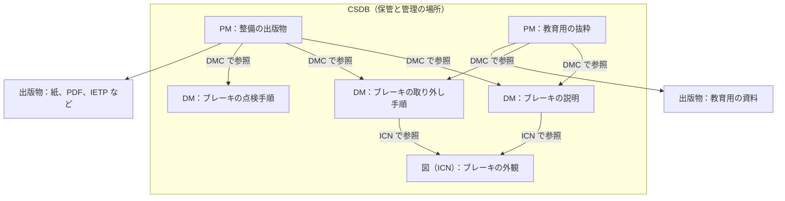

公式の概要は、S1000D の主要な概念が、刊行プログラムの土台になり、本を中心にしたやり方から情報を中心にしたやり方への移行を可能にする、と書いています。英語の文は次のとおりです。

> These concepts underpin a publications program using S1000D, and enable a move from a book paradigm to an information one.

本を中心にする、とは、整備手順書や部品カタログを、それぞれの冊子として作り、改訂するやり方です。ある手順が三つの冊子に重複していても、直すときは三回直します。情報を中心にする、とは、その手順を一つの単位として保管し、必要な冊子や画面がその単位を参照するやり方です。直す対象は、その単位です。

この章では、その移行を支える四つの用語を、公式の役割に沿って整理します。

| 用語 | 公式の資料が与えている役割 |
| --- | --- |
| データモジュール（Data Module、DM） | 独立した情報の単位。プラットフォーム、システム、構成品についての記述、手順、運用のデータを含む。データモジュールコードを識別子として、共通ソースデータベースに保管し、取り出す |
| データモジュールコード（Data Module Code、DMC） | DM を取り出すための識別子。どの製品の、どの部分の、どんな種類の情報かを表す |
| 共通ソースデータベース（Common Source Data Base、CSDB） | DM を収め、管理する保管場所。仕様はその機能を定めていない。プログラムで作った DM を保持し管理する必要がある、とだけ述べている |
| パブリケーションモジュール（Publication Module、PM） | 出版物の内容と構造を定義するオブジェクト。技術情報の本文そのものは持たず、DM などを参照して出版物を組み立てる。概要ページに定義の文はなく、役割は仕様の該当章とスキーマで確認する |

四つのうち、DM、DMC、CSDB の定義文は公式の概要ページにあります。PM は概要ページの定義の対象に入っていません。第7章で、Issue 7 の第4.9章とスキーマの位置から役割を説明します。

Issue 7 の第1.2章と第4.2章は、DM を “the smallest self-contained information unit within a technical publication”（技術刊行物の中の、最小の自己完結した情報の単位）と定義しています。概要ページは、プラットフォーム、システム、構成品についての記述、手順、または運用のデータを含む独立した単位、と書いています。対象の言い方が違います。本書は、概要の文を概要の定義、Issue 7 の文をその版の定義として併記します。

次の図は、四つの用語の関係を、保管と参照の向きで示したものです。DM と図は架空の例です。自転車サンプルの実際の構成ではありません。

図から読み取ってほしいのは、次の三点です。

- DM、図、PM は、どれも CSDB の中の別々のオブジェクトです。データが DM から PM へ順に流れていくわけではありません。
- PM は技術情報の本文を持たず、DMC で DM を参照します。同じ DM（ブレーキの説明）を、二つの PM が参照できます。
- 図は DM の本文に埋め込まず、ICN で参照します。同じ図を、複数の DM が参照できます。

## 本から情報へ、何が変わるか

変わるのは、管理の単位です。章やページは、出版物を読者に渡すときの並べ方です。S1000D では、その並べ方を DM の本文に埋め込みません。DM は、それだけで保管し、取り出せる単位です。どの DM をどの順で出版物にするかは、PM が参照として持ちます。

このため、同じ DM を、整備手順の出版物と、教育用の抜粋の、両方から参照できます。参照している側を増やしても、手順の本文の保管場所は一つです。公式の利点のページは、モジュールであることによる再利用を利点に挙げ、再利用が最大 40% になり得る、更新費用が最大 30% 下がり得る、と書いています。同じページは、利点の実現が実装の方針や基盤などに依存するとも書いています。数値は、条件つきの記述です。Issue 7 の第1.2章も、利点の列挙の中に、技術情報の維持費用が下がる、という項目を含みます。本書は、この数値とこの項目を、導入すれば費用が下がるという約束としては扱いません。

## CSDB は製品名ではない

CSDB という語は、特定のソフトウェアの商品名ではありません。公式の概要は、CSDB を DM を収め管理する保管場所だと定義したうえで、S1000D はその機能を定めていないと明言しています。Issue 7 の第4.2章は、同じ境界を、CSDB の設計と実装の規則は定めず、ソフトウェア実装から独立した情報オブジェクトのデータ構造だけを定める、と書いています。ファイルをディレクトリに置くこと、データベースに入れること、構成管理の仕組みと組み合わせることの、どれを選ぶかはプログラムが決めます。

Issue 7 の第4.2章が保管の対象として挙げるのは、DM、DM が呼び出す図・マルチメディアその他のデータ、ICN メタデータファイル、データ管理リスト、コメント、PM、データ更新ファイル、データ送付票です。図、マルチメディア、その他のデータを除き、これらのオブジェクトは XML で作ります。図は DM の中に埋め込まず、参照します。

英語版の Wikipedia は、S1000D はツールを提供せず、推奨もしない、とまとめています。この一文は公式の概要の引用ではありません。概要が機能を定めていない、という記述と方向は一致します。本書も、CSDB 製品を推奨しません。

CSDB に入るのは DM だけではありません。図、PM、コメントなど、交換の対象になるオブジェクトがあります。図には DM とは別の識別子が付き、複数の DM から参照できます。この識別子を情報管理番号（Information Control Number、ICN）と呼びます。番号の桁の構成は版で決まります。ここでは、図を DM の本文に埋め込んだ画像ファイルとして扱わず、CSDB の中の別のオブジェクトとして参照する、という共通の整理だけを押さえておきます。

Issue 4.2 の既定 BREX は、交換される XML の CSDB オブジェクトのルート要素を、`dmodule`、`pm`、`ddn`、`dml`、`comment`、`dataUpdateFile`、`scormContentPackage`、`icnMetadataFile` のいずれかだとして検査し、仕様の Chap 1.4.2 を引いています。これは Issue 4.2 の記述です。他の版の一覧は、その版の仕様で確認します。

## 四つの用語を契約書で読むとき

契約が「S1000D に従った CSDB を構築すること」と書いていても、仕様は CSDB の画面やワークフローを決めていません。契約が別に、保管、承認、交換、検索の要求を書いているかを見ます。

契約が「DMC を付与すること」と書いていれば、第5章の読み方でコードを分解できます。Issue 7 の第4.3章は、情報コードを3文字にするなど、フィールドごとの長さの範囲を示し、その範囲の中の符号化方針をプロジェクトの決定にしています。仕様の例と、契約の桁数が違っていても、その版の範囲の中であれば、どちらかが誤植だとは限りません。

契約が「PM を納品すること」と書いていれば、納品物は本文の XML だけではなく、どの DM をどの構造で出版物にするかを書いた PM を含みます。本文だけを集めて渡しても、出版物の定義にはなりません。

## 出典

- S1000D. *About S1000D*（Principal Concepts、Data Module、CSDB）. https://s1000d.org/?page_id=101
- S1000D. *Benefits*（再利用と更新費用の記述、実現は要因に依存する）. https://s1000d.org/?page_id=57
- Wikipedia. *S1000D*（ツールを提供も推奨もしない、という二次的なまとめ。2026-10-07 版の記述）. https://en.wikipedia.org/wiki/S1000D
- Issue 4.2 の既定 BREX として流通しているファイル（スキーマ位置は `http://www.s1000d.org/S1000D_4-2/xml_schema_flat/brex.xsd`。公式ダウンロードの複製であり、公式サイトそのものではない）. https://github.com/kibook/S1000D/blob/master/csdb/DMC-S1000D-F-04-10-0301-00A-022A-D_001-00_EN-US.XML
- 著者が入手した S1000D Issue 7 のパッケージ（第1.2章、第4.2章。表紙の日付は 2026-07-16）。入手先は https://users.s1000d.org/

## この章のポイント

- 公式は、S1000D の主要概念を、本から情報への移行を可能にするものだと説明している。
- DM は独立した情報の単位、DMC はその識別子、CSDB は保管場所である。概要は CSDB の機能を定めないと言い、Issue 7 の第4.2章は設計と実装の規則を定めないと言う。
- PM は本文を持たず、出版物の内容と構造を定義する。四つのうち、概要ページに定義の文があるのは DM と CSDB である。
