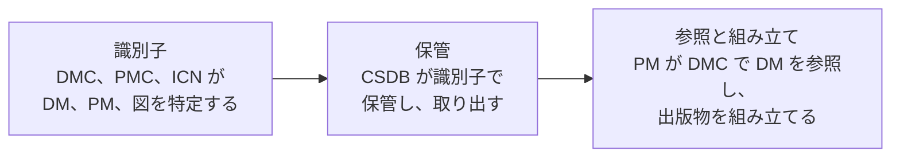
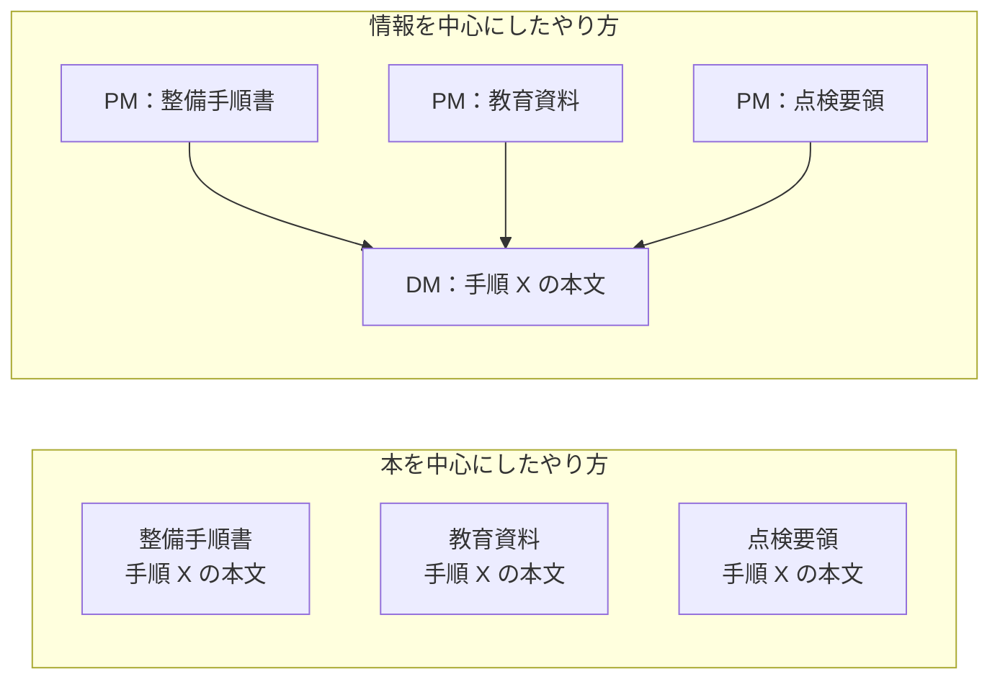
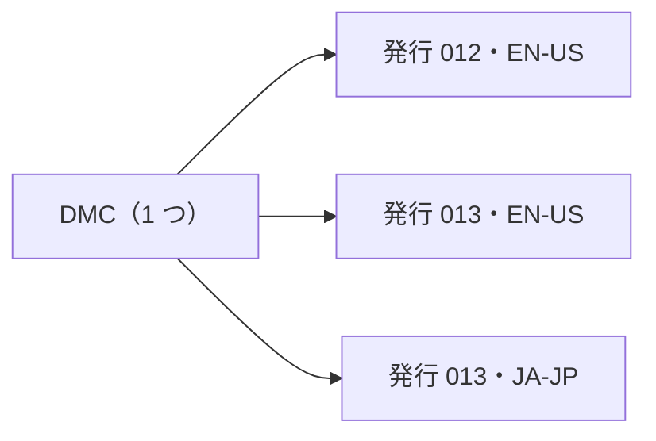
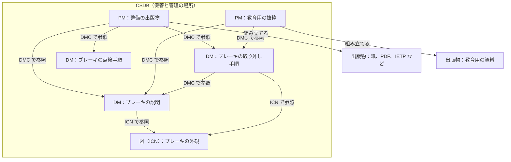

S1000D では、技術情報をデータモジュール（DM）という単位で作り、出版物の構成をパブリケーションモジュール（PM）で定義します。DM はデータモジュールコード（DMC）、PM はパブリケーションモジュールコード（PMC）という識別子を、それぞれ自分の中に持っています。共通ソースデータベース（CSDB）は、この識別子で DM と PM を保管し、取り出します。PM は DM の本文を持たず、DMC で DM を参照し、その並び順と入れ子で出版物の構成を定義します。

この章では、これらの関係を「識別子」「保管」「参照と組み立て」の三つに分けて説明します。

[公式の概要ページ](https://s1000d.org/?page_id=101)は、こうした仕様の主要な概念（principal concepts）が、「本を中心にしたやり方から、情報を中心にしたやり方への移行」を可能にすると説明しています。

> These concepts underpin a publications program using S1000D, and enable a move from a book paradigm to an information one.

「本を中心にしたやり方」とは、整備手順書や部品カタログを、それぞれ一冊の冊子として作り、冊子ごとに改訂するやり方です。同じ手順が三冊に載っていれば、直すときも三回直します。「情報を中心にしたやり方」とは、その手順を一つの単位として保管し、必要な冊子や画面がその単位を参照するやり方です。直すのは、その単位一つだけです。

左は、同じ本文が三冊にそれぞれ書かれているので、直すときは三か所を直します。右は、本文が一つの DM にだけあり、三つの PM がそれを参照しているので、直すのは一か所です。

## この章で使う語

| 用語 | 役割 | 定義している資料 |
| --- | --- | --- |
| データモジュール（Data Module、DM） | 独立した情報の単位。プラットフォーム、システム、構成品についての説明、手順、運用のデータを含む | 公式の概要ページ、Issue 7 の第1.2章と第4.2章。定義の文は[第4章](https://zenn.dev/shuji_bonji/books/s1000d-intro/viewer/data-module-structure)で説明します |
| パブリケーションモジュール（Publication Module、PM） | 出版物の内容と構造を定義するもの。技術情報の本文は持たず、DM などを参照して出版物を組み立てる | Issue 7 の第4.9章 |
| データモジュールコード（Data Module Code、DMC） | DM の識別子。どの製品の、どの部分の、どんな種類の情報かを表す | 公式の概要ページ、Issue 7 の第4.3章 |
| パブリケーションモジュールコード（Publication Module Code、PMC） | PM の識別子。どの発行者の、どの出版物の、何巻目かを表す | Issue 7 の第4.9.2章 |
| 情報管理番号（Information Control Number、ICN） | 図やマルチメディアのファイルの識別子 | 各版の仕様 |
| 共通ソースデータベース（Common Source Data Base、CSDB） | DM、PM、図などを保管し、管理する場所。仕様はその機能を定めていない | 公式の概要ページ、Issue 7 の第4.2章 |

公式の概要ページが扱っているのは、DM、DMC、CSDB です。PM と PMC は、概要ページには出てきません。本書では、PM と PMC を Issue 7 の第4.9章と第4.9.2章をもとに説明します。

## 識別子

DM、PM、図には、それぞれ別の種類の識別子が付きます。

| 対象 | 識別子 | 書かれている場所 | 構成の説明 |
| --- | --- | --- | --- |
| DM | DMC | DM 自身の識別・状態の部分（Issue 4.0 以降は `dmCode` 要素） | [第5章](https://zenn.dev/shuji_bonji/books/s1000d-intro/viewer/data-module-code) |
| PM | PMC | PM 自身の識別・状態の部分（Issue 4.0 以降は `pmCode` 要素） | [第7章](https://zenn.dev/shuji_bonji/books/s1000d-intro/viewer/publication-and-ietp) |
| 図、マルチメディア | ICN | 図のファイル名と、ICN メタデータファイル | 各版の仕様 |

DMC と PMC は、どちらもモジュールの外にある管理番号ではなく、モジュール自身の中に書かれています。CSDB や、ほかのモジュールは、この識別子を読んでモジュールを特定します。

識別子が表すのは、「どのモジュールか」だけです。DM を改訂して発行番号が上がっても、別の言語に翻訳しても、DMC は変わりません。発行番号と作業中番号（発行情報）、言語は、識別子とは別の情報として、同じ識別・状態の部分に書かれます。そのため、一つの DMC に対して、発行や言語の違う複数のファイルがあり得ます。CSDB の中のファイルを一つに決めるのは、識別子、発行情報、言語の組み合わせです。Issue 7 の第4.9.2章も、PMC について、発行情報と合わせて S1000D の中で一意な識別になると書いています。

ファイル名にも、この組み合わせが表れます。Issue 7 の自転車サンプルの DM と PM のファイル名を分けると、次のようになります。

| ファイル名の部分 | DM の例 | PM の例 |
| --- | --- | --- |
| 識別子の種類 | `DMC-` | `PMC-` |
| 識別子 | `S1000DBIKE-AAA-D00-00-00-00AA-041A-A` | `S1000DBIKE-B6865-EPWG1-00` |
| 発行番号 | `013` | `006` |
| 作業中番号 | `00` | `00` |
| 言語 | `EN-US` | `EN-US` |

DM のファイル名は `DMC-S1000DBIKE-AAA-D00-00-00-00AA-041A-A_013-00_EN-US.XML`、PM のファイル名は `PMC-S1000DBIKE-B6865-EPWG1-00_006-00_EN-US.XML` です。どちらも、識別子の後ろに `_` で発行情報と言語が続きます。

一つの DMC に、発行や言語の違うファイルが複数あり得ることを示した図です。発行番号と言語の値は、説明のための例です。

DMC と PMC は、先頭のモデル識別コードだけが共通です。

| | DMC | PMC |
| --- | --- | --- |
| 表すもの | 何についての、どんな種類の情報か | どの発行者の、どの出版物の何巻目か |
| 主な区切り | モデル識別、システム差分、SNS、分解、情報コード、アイテムロケーション | モデル識別、発行者、出版物の番号、巻 |
| 仕様の章（Issue 7） | 第4.3章 | 第4.9.2章 |

## 保管

CSDB は、DM と PM を、識別子で保管し、取り出すための場所です。公式の概要ページは、DM は DMC を識別子として CSDB に保管し、取り出すと書いています。

### CSDB は製品名ではない

CSDB は、特定のソフトウェアの製品名ではありません。公式の概要ページは、CSDB を DM を保管し管理する場所と定義したうえで、S1000D はその機能を定めていないと明記しています。Issue 7 の第4.2章も、CSDB の設計と実装の規則は定めず、ソフトウェアの実装から独立した情報のデータ構造だけを定める、と書いています。

| 仕様が定めること | 仕様が定めず、プロジェクトや製品が決めること |
| --- | --- |
| 保管する情報のデータ構造（DM、PM などの XML の形） | CSDB の設計と実装、機能、画面、作業の流れ |
| 識別子の構成（DMC、PMC、ICN） | ファイルをフォルダーに置くか、データベースに入れるか、構成管理の仕組みと組み合わせるか |
| | 識別子で検索するための索引を作るかどうか |

:::message
英語版の Wikipedia も、S1000D はツールを提供せず、推奨もしないとまとめています。これは公式の文書ではありませんが、概要ページの記述と同じ方向です。本書でも、CSDB の製品は推奨しません。
:::

### CSDB に保管するもの

CSDB に保管するのは DM だけではありません。Issue 7 の第4.2章は、保管の対象として次のものを挙げています。

| 保管するもの | 形式 | 最上位の要素（Issue 4.2 の既定 BREX） |
| --- | --- | --- |
| DM | XML | `dmodule` |
| DM が使う図、マルチメディア、その他のデータ | それぞれのファイル形式 | — |
| ICN メタデータファイル | XML | `icnMetadataFile` |
| データ管理リスト | XML | `dml` |
| コメント | XML | `comment` |
| PM | XML | `pm` |
| データ更新ファイル | XML | `dataUpdateFile` |
| データ送付票 | XML | `ddn` |

最上位の要素の列は、Issue 4.2 の既定 BREX が、やり取りする XML のファイルの最上位の要素として認めているものです（仕様の Chap 1.4.2 を根拠にした検査）。Issue 4.2 の一覧には、このほかに SCORM のコンテンツパッケージ（`scormContentPackage`）がありますが、Issue 7 の第4.2章の一覧にはありません。要素名は版によって変わることがあるので、ほかの版ではその版の仕様で確認してください。

図は DM の本文に埋め込まず、ICN を付けて、CSDB の中の別のファイルとして保管します。ICN の桁の構成は版によって決まります。

## 参照と組み立て

CSDB の中の DM、PM、図は、お互いを識別子で参照します。参照を DMC だけで書けば、DM を改訂しても PM の参照は変わりません。参照に発行番号と言語まで書く場合は、DM を改訂したときに PM の参照も更新します。どちらにするかはプロジェクトが決めます。詳しくは[第7章](https://zenn.dev/shuji_bonji/books/s1000d-intro/viewer/publication-and-ietp)で説明します。

| 参照する側 | 参照される側 | 使う識別子 | 内容 |
| --- | --- | --- | --- |
| PM | DM | DMC | 出版物に入れる DM を指定します。一つの PM は多数の DM を参照し、一つの DM は複数の PM から参照されます |
| PM | ほかの PM | PMC | 出版物の中に、別の出版物を組み込みます |
| PM | S1000D の外の出版物 | 出版物のコードや題名（`externalPubRef` に書く） | S1000D で作っていない、従来の出版物を組み込みます |
| DM | ほかの DM | DMC | 本文から、ほかの DM を参照します。たとえば手順の DM から、説明の DM を参照します |
| DM | 図 | ICN | 本文の中に図を表示します。一つの図を、複数の DM から参照できます |

PM は、この参照を出版物の項目（Issue 7 では `pmEntry` 要素）の中に書き、項目の並び順と入れ子で、出版物の順序と階層を定義します。項目の中に置けるものは、[第7章](https://zenn.dev/shuji_bonji/books/s1000d-intro/viewer/publication-and-ietp)で説明します。

次の図は、参照の関係を、架空の DM と図で示したものです。

DM、図、PM は、どれも CSDB の中に別々に保管され、識別子でつながっています。データが DM から PM へ順に流れていくわけではありません。

出版物を作るときは、PM の項目の順序と階層に沿って、参照している DM を CSDB から取り出し、紙、PDF、IETP の形にします。出力の種類は[第7章](https://zenn.dev/shuji_bonji/books/s1000d-intro/viewer/publication-and-ietp)で説明します。

## 本から情報へ移ると何が変わるか

変わるのは、管理の単位です。章やページは、出版物を読者に渡すときの並べ方にすぎません。S1000D では、この並べ方を DM の本文に書き込みません。DM は、それだけで保管し、取り出せる単位です。どの DM をどの順に並べて出版物にするかは、PM が参照として持ちます。

このため、同じ DM を、整備手順の出版物からも、教育用の抜粋からも参照できます。参照する出版物が増えても、手順の本文の保管場所は一つのままです。

公式の[利点のページ](https://s1000d.org/?page_id=57)は、モジュールにすることで再利用ができる点を利点に挙げ、再利用は最大 40%、更新の費用の削減は最大 30% になり得ると書いています。Issue 7 の第1.2章も、利点の一つに技術情報の維持費用の削減を挙げています。

:::message alert
利点のページは、利点が得られるかどうかは導入の方針や基盤などによって変わる、とも書いています。本書では、これらの数値を、導入すれば必ず費用が下がるという意味には扱いません。
:::

## 契約書を読むときの注意

- 契約に「S1000D に従った CSDB を構築すること」とあっても、仕様は CSDB の画面や作業の流れを決めていません。保管、承認、交換、検索について、契約が別に要求を書いているかを確認してください。
- 契約に「DMC を付与すること」とあれば、[第5章](https://zenn.dev/shuji_bonji/books/s1000d-intro/viewer/data-module-code)の読み方でコードを分解できます。Issue 7 の第4.3章は、情報コードは 3 文字というように、フィールドごとの長さの範囲を示し、その範囲の中でどう符号化するかはプロジェクトが決めるとしています。仕様の例と契約の桁数が違っていても、その版の範囲の中であれば、どちらかが誤りとは限りません。
- 契約に「PM を納品すること」とあれば、本文の XML だけでなく、どの DM をどの構成で出版物にするかを書いた PM も納品物に含まれます。本文だけを集めて渡しても、出版物を定義したことにはなりません。PMC の付け方も、DMC と同じようにプロジェクトが決めます。たとえば Issue 7 では、発行者の属性 `pmIssuer` の使い方が、プロジェクトの決定点 BRDP-S1-00365 です。

## 出典

- S1000D. *About S1000D*（Principal Concepts、Data Module、CSDB）. https://s1000d.org/?page_id=101
- S1000D. *Benefits*（再利用と更新費用の記述、実現は要因に依存する）. https://s1000d.org/?page_id=57
- Wikipedia. *S1000D*（ツールを提供も推奨もしない、という二次的なまとめ。2026-10-07 版の記述）. https://en.wikipedia.org/wiki/S1000D
- Issue 4.2 の既定 BREX として公開されているファイル（スキーマの位置は `http://www.s1000d.org/S1000D_4-2/xml_schema_flat/brex.xsd`。公式パッケージの複製）. https://github.com/kibook/S1000D/blob/master/csdb/DMC-S1000D-F-04-10-0301-00A-022A-D_001-00_EN-US.XML
- 著者が入手した S1000D の仕様パッケージ。入手先は https://users.s1000d.org/
  - Issue 4.0：XML スキーマパッケージの `pm.xsd`（`pmCode`）
  - Issue 7：第1.2章、第4.2章、第4.3章、第4.9章、第4.9.2章、自転車サンプルの DM と PM。表紙の日付は 2026-07-16

## この章のポイント

- DM と PM は、それぞれ自分の中に識別子（DMC、PMC）を持っています。ファイルを一つに決めるのは、識別子、発行情報、言語の組み合わせです。図には ICN が付きます。
- CSDB は、DM、PM、図などを識別子で保管し、取り出す場所です。CSDB の機能と実装は、仕様では定められていません。
- PM は本文を持たず、DM、ほかの PM、S1000D の外の出版物を参照し、項目の並び順と入れ子で出版物の構成を定義します。
