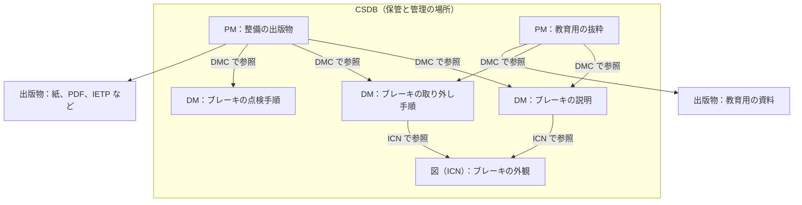

S1000D の中心にあるのは、データモジュール（DM）、データモジュールコード（DMC）、共通ソースデータベース（CSDB）、パブリケーションモジュール（PM）の四つの概念です。情報を DM という単位で作り、DMC という識別コードを付けて CSDB に保管し、PM で必要な DM を選んで出版物にまとめます。公式の概要ページは、これらの概念が「本を中心にしたやり方から、情報を中心にしたやり方への移行」を可能にすると説明しています。

> These concepts underpin a publications program using S1000D, and enable a move from a book paradigm to an information one.

「本を中心にしたやり方」とは、整備手順書や部品カタログを、それぞれ一冊の冊子として作り、冊子ごとに改訂するやり方です。同じ手順が三冊に載っていれば、直すときも三回直します。「情報を中心にしたやり方」とは、その手順を一つの単位として保管し、必要な冊子や画面がその単位を参照するやり方です。直すのは、その単位一つだけです。

この章では、四つの概念の役割を、公式の資料に沿って説明します。

## 四つの概念

| 用語 | 公式の資料での役割 |
| --- | --- |
| データモジュール（Data Module、DM） | 独立した情報の単位。プラットフォーム、システム、構成品についての説明、手順、運用のデータを含む。データモジュールコードを識別子として、共通ソースデータベースに保管し、取り出す |
| データモジュールコード（Data Module Code、DMC） | DM を取り出すための識別子。どの製品の、どの部分の、どんな種類の情報かを表す |
| 共通ソースデータベース（Common Source Data Base、CSDB） | DM を保管し、管理する場所。仕様はその機能を定めておらず、作った DM を保管し管理する必要がある、とだけ述べている |
| パブリケーションモジュール（Publication Module、PM） | 出版物の内容と構造を定義するもの。技術情報の本文は持たず、DM などを参照して出版物を組み立てる |

DM、DMC、CSDB の定義は、公式の概要ページに書かれています。PM の定義は概要ページにはないため、第7章で、Issue 7 の第4.9章とスキーマをもとに説明します。

DM の定義には、二つの言い方があります。概要ページは、プラットフォーム、システム、構成品についての説明、手順、運用のデータを含む独立した単位と書いています。Issue 7 の第1.2章と第4.2章は、“the smallest self-contained information unit within a technical publication”（技術刊行物の中で、それだけで完結する最小の情報の単位）と定義しています。本書では、両方を併記します。

## 四つの概念の関係

次の図は、四つの概念の関係を、保管と参照の向きで示したものです。DM と図は、説明のための架空の例です。

この図から、次の三点が読み取れます。

- DM、図、PM は、どれも CSDB の中に別々に保管されます。データが DM から PM へ順に流れていくわけではありません。
- PM は技術情報の本文を持たず、DMC で DM を参照します。同じ DM（ブレーキの説明）を、二つの PM が参照できます。
- 図は DM の本文に埋め込まず、ICN で参照します。同じ図を、複数の DM が参照できます。

## 本から情報へ移ると何が変わるか

変わるのは、管理の単位です。章やページは、出版物を読者に渡すときの並べ方にすぎません。S1000D では、この並べ方を DM の本文に書き込みません。DM は、それだけで保管し、取り出せる単位です。どの DM をどの順に並べて出版物にするかは、PM が参照として持ちます。

このため、同じ DM を、整備手順の出版物からも、教育用の抜粋からも参照できます。参照する出版物が増えても、手順の本文の保管場所は一つのままです。

公式の利点のページは、モジュールにすることで再利用ができる点を利点に挙げ、再利用は最大 40%、更新の費用の削減は最大 30% になり得ると書いています。ただし同じページは、利点が得られるかどうかは導入の方針や基盤などによって変わる、とも書いています。Issue 7 の第1.2章も、利点の一つに技術情報の維持費用の削減を挙げています。本書では、これらの数値を、導入すれば必ず費用が下がるという意味には扱いません。

## CSDB は製品名ではない

CSDB は、特定のソフトウェアの製品名ではありません。公式の概要ページは、CSDB を DM を保管し管理する場所と定義したうえで、S1000D はその機能を定めていないと明記しています。Issue 7 の第4.2章も、CSDB の設計と実装の規則は定めず、ソフトウェアの実装から独立した情報のデータ構造だけを定める、と書いています。ファイルをフォルダーに置く、データベースに入れる、構成管理の仕組みと組み合わせる、のどれを選ぶかは、プロジェクトが決めます。

英語版の Wikipedia も、S1000D はツールを提供せず、推奨もしないとまとめています。これは公式の文書ではありませんが、概要ページの記述と同じ方向です。本書でも、CSDB の製品は推奨しません。

### CSDB に保管するもの

CSDB に保管するのは DM だけではありません。Issue 7 の第4.2章は、保管の対象として、DM、DM が使う図・マルチメディア・その他のデータ、ICN メタデータファイル、データ管理リスト、コメント、PM、データ更新ファイル、データ送付票を挙げています。図、マルチメディア、その他のデータ以外は、XML で作ります。

図には、DM とは別の識別番号が付きます。この識別番号を情報管理番号（Information Control Number、ICN）と呼びます。番号の桁の構成は版によって決まります。図は DM の本文に埋め込まず、CSDB の中の別のファイルとして参照するので、同じ図を複数の DM から参照できます。

Issue 4.2 の既定 BREX は、やり取りする XML のファイルの最上位の要素が、`dmodule`、`pm`、`ddn`、`dml`、`comment`、`dataUpdateFile`、`scormContentPackage`、`icnMetadataFile` のいずれかであることを、仕様の Chap 1.4.2 を根拠に検査しています。これは Issue 4.2 での一覧です。ほかの版の一覧は、その版の仕様で確認してください。

## 契約書を読むときの注意

- 契約に「S1000D に従った CSDB を構築すること」とあっても、仕様は CSDB の画面や作業の流れを決めていません。保管、承認、交換、検索について、契約が別に要求を書いているかを確認してください。
- 契約に「DMC を付与すること」とあれば、第5章の読み方でコードを分解できます。Issue 7 の第4.3章は、情報コードは 3 文字というように、フィールドごとの長さの範囲を示し、その範囲の中でどう符号化するかはプロジェクトが決めるとしています。仕様の例と契約の桁数が違っていても、その版の範囲の中であれば、どちらかが誤りとは限りません。
- 契約に「PM を納品すること」とあれば、本文の XML だけでなく、どの DM をどの構成で出版物にするかを書いた PM も納品物に含まれます。本文だけを集めて渡しても、出版物を定義したことにはなりません。

## 出典

- S1000D. *About S1000D*（Principal Concepts、Data Module、CSDB）. https://s1000d.org/?page_id=101
- S1000D. *Benefits*（再利用と更新費用の記述、実現は要因に依存する）. https://s1000d.org/?page_id=57
- Wikipedia. *S1000D*（ツールを提供も推奨もしない、という二次的なまとめ。2026-10-07 版の記述）. https://en.wikipedia.org/wiki/S1000D
- Issue 4.2 の既定 BREX として公開されているファイル（スキーマの位置は `http://www.s1000d.org/S1000D_4-2/xml_schema_flat/brex.xsd`。公式パッケージの複製）. https://github.com/kibook/S1000D/blob/master/csdb/DMC-S1000D-F-04-10-0301-00A-022A-D_001-00_EN-US.XML
- 著者が入手した S1000D Issue 7 のパッケージ（第1.2章、第4.2章。表紙の日付は 2026-07-16）。入手先は https://users.s1000d.org/

## この章のポイント

- 公式の概要ページは、S1000D の中心概念を、本を中心にした管理から情報を中心にした管理へ移るためのものだと説明しています。
- DM は独立した情報の単位、DMC はその識別子、CSDB は保管の場所です。CSDB の機能と実装は、仕様では定められていません。
- PM は本文を持たず、DM を参照して出版物の内容と構造を定義します。
