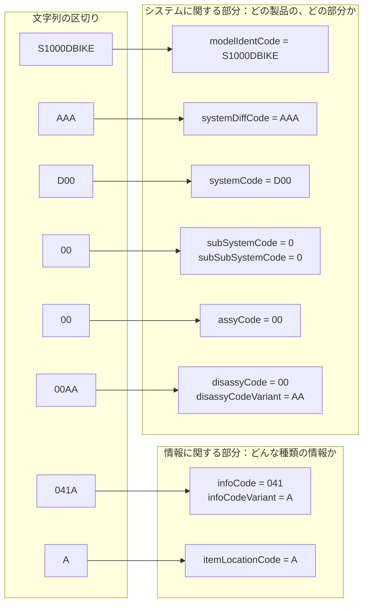

データモジュールコード（Data Module Code、DMC）は、共通ソースデータベースからデータモジュールを一つに特定して取り出すためのコードです。DMC は、前半の「どの製品の、どの部分の情報か」と、後半の「その部分についての、どんな種類の情報か」の二つに分けて読みます。

この章では、DMC の構成と、公式の自転車サンプルを使った読み方を説明します。

:::message
フィールドの長さの範囲は版が定め、その範囲の中でどの長さを使うかはプロジェクトが決めます。Issue 7 の第4.3章では、使える文字は英大文字と数字で、範囲は次のとおりです。

| フィールド | Issue 7 の第4.3章の範囲 |
| --- | --- |
| モデル識別コード | 2 文字から 14 文字 |
| システム差分コード | 1 文字から 4 文字 |
| アセンブリコード | 2 文字または 4 文字 |
| 分解コード | 2 文字 |
| 分解コードのバリアント | 1 文字から 3 文字 |
| 情報コード | 3 文字 |
| 情報コードのバリアント | 1 文字 |
| アイテムロケーションコード | 英大文字 1 文字 |

どう符号化するかは、プロジェクトの決定点 BRDP-S1-00331 です。この章で例に使う公式サンプルの桁数は、この範囲の中の一例です。ほかの版の範囲は、その版の第4.3章で確認してください。
:::

## DMC の二つの部分

DMC は、システムに関する部分と、情報に関する部分に分かれます。

**システムに関する部分**は、製品と、その製品の中の位置を表します。次のコードが入ります。

- モデル識別コード（model identification code）
- システム差分コード（system difference code）
- 標準番号体系（Standard Numbering System、SNS）
- 分解コード（disassembly code）とそのバリアント

SNS は、システム、サブシステム、サブサブシステム、アセンブリという階層です。仕様が用意しているのは階層の枠だけで、どの番号の範囲をたとえばブレーキ系統と呼ぶかは、プロジェクトが SNS として定義します。

**情報に関する部分**は、その位置について何を書いた情報かを表します。情報コード（information code）、そのバリアント、アイテムロケーションコード（item location code）が入ります。同じブレーキでも、「どう作られているかの説明」と「取り外しの手順」は、情報コードが違う別の DM になります。

Issue 4.1 以降のスキーマでは、これらの値は `dmCode` 要素の属性として書きます。属性名は、`modelIdentCode`、`systemDiffCode`、`systemCode`、`subSystemCode`、`subSubSystemCode`、`assyCode`、`disassyCode`、`disassyCodeVariant`、`infoCode`、`infoCodeVariant`、`itemLocationCode` です。Issue 4.2、Issue 6、Issue 7 の既定 BREX と自転車サンプルも、同じ属性名を使っています。Issue 3.0 以前では、同じ内容を属性ではなく子要素で書きます。この違いは[第11章](https://zenn.dev/shuji_bonji/books/s1000d-intro/viewer/issues-and-cautions)で説明します。

### 訓練用の DM の区画

訓練用、または人の作業能力の向上（人的パフォーマンス技術）のための DM には、Issue 7 の第4.3章で三つ目の区画が加わります。学習コード（learn code）は 3 文字で、先頭は `H` または `T` です。学習イベントコード（learn event code）は英大文字 1 文字です。DMC の最小の長さは、この区画を含まない場合は 17 文字、含む場合は 21 文字です。ファイル名でアイテムロケーションコードの後ろにさらに文字が続く場合は、その版の第4.3.9章と第4.3.10章を確認してください。

## 公式サンプルで読む

仕様のダウンロードには、自転車を題材にしたサンプルデータ（Bike sample data set）が含まれています。Issue 4.1 と Issue 5.0 のダウンロードの説明は、このサンプルを架空の製品の XML の例と説明し、適合性の試験集ではないこと、このデータを処理できても S1000D に適合していることにはならないことを書いています。

Issue 7 の自転車サンプルにある、次のコードを読んでみます。ファイル名は `DMC-S1000DBIKE-AAA-D00-00-00-00AA-041A-A_013-00_EN-US.XML` です。

```text
S1000DBIKE-AAA-D00-00-00-00AA-041A-A
```

この DM の `techName` は “Bicycle”、`infoName` は “Description of how it is made”（どのように作られているかの説明）です。スキーマの宣言は `http://www.s1000d.org/S1000D_7/xml_schema_flat/descript.xsd` です。

Issue 7 の第4.3章によると、DMC の中のハイフンは区切りを見やすくするためのもので、属性の値には含まれません。また、一つの区切りが一つの属性とは限りません。このコードの区切りと属性の対応は、次のとおりです。

| 部分 | 属性名 | 値 | この例での意味 |
| --- | --- | --- | --- |
| システム | modelIdentCode | S1000DBIKE | サンプルの自転車という製品 |
| システム | systemDiffCode | AAA | 同じ製品の中の違い。このサンプルでは 3 文字 |
| システム | systemCode | D00 | SNS のシステム。3 文字 |
| システム | subSystemCode | 0 | サブシステム。次の 1 文字と合わせて `00` と書かれる |
| システム | subSubSystemCode | 0 | サブサブシステム |
| システム | assyCode | 00 | アセンブリ。この例では 2 文字 |
| システム | disassyCode | 00 | 分解コード。次のバリアントと合わせて `00AA` と書かれる |
| システム | disassyCodeVariant | AA | 分解コードのバリアント。この例では 2 文字 |
| 情報 | infoCode | 041 | 情報の種類。この DM の標題は「どのように作られているかの説明」 |
| 情報 | infoCodeVariant | A | 情報コードのバリアント。`041` と合わせて `041A` と書かれる |
| 情報 | itemLocationCode | A | Issue 7 の第4.3.8章では、製品に取り付けられた品目に関する情報 |

文字列を左から読むと、`S1000DBIKE`、`AAA`、`D00`、`00`、`00`、`00AA`、`041A`、`A` です。4 番目の `00` はサブシステム `0` とサブサブシステム `0`、5 番目の `00` はアセンブリ、`00AA` は分解コードとそのバリアント、`041A` は情報コードとそのバリアントです。SNS を続けて書くと `D000000`（`D00` + `0` + `0` + `00`）になります。

次の図は、同じ文字列の区切りと属性の対応です。左は文字列を先頭から順に区切ったもの、右は対応する属性です。



SNS は、`systemCode` から `assyCode` までの四つの属性で、図の `D00`、`00`、`00` の三つの区切りにまたがっています。

### 階層が違えば別の DM

同じ Issue 7 のサンプルには、システムコードが `DA1` の記述 DM（`S1000DBIKE-AAA-DA1-00-00-00AA-041A-A`）もあります。`techName` は “Brake system”、`infoName` は自転車全体の DM と同じ “Description of how it is made” です。情報コードが同じでも、SNS の階層が違えば別の DM になります。

サンプルには、モデル識別コードが `BRAKE` の記述 DM もあります。`S1000DBIKE` の中のブレーキ系統と、`BRAKE` という別の製品は、別の DM です。Issue 6 のサンプルにも、同じ DMC の DM があります。各ファイルの発行番号は、[付録](https://zenn.dev/shuji_bonji/books/s1000d-intro/viewer/package-notes)にまとめています。

## 同じ概念でも桁数が違う例

Issue 7 の既定 BREX（[第8章](https://zenn.dev/shuji_bonji/books/s1000d-intro/viewer/brex)で説明します）の DMC は、次のとおりです。

```text
S1000D-J-04-10-0301-00A-022A-D
```

`J` はシステム差分コード、`10` はサブシステム `1` とサブサブシステム `0`、`0301` は 4 文字のアセンブリ、`00A` は分解コードと 1 文字のバリアントです。

自転車サンプルと比べると、システム差分コードは自転車サンプルが 3 文字（`AAA`）、既定 BREX が 1 文字（`J`）です。アセンブリは、自転車サンプルが 2 文字、既定 BREX が 4 文字です。どちらも Issue 7 の第4.3章の範囲の中で、範囲の中のどれを使うかがプロジェクトの符号化の方針です。

既定 BREX のシステム差分コードは版によって違い、Issue 4.2 の複製では `F`、Issue 6 では `H`、Issue 7 では `J` です。ほかの属性は同じです。ほかの版の既定 BREX の値を流用しないように注意してください。三つのファイルの詳しい比較は、付録にまとめています。

## 情報コードの読み方

情報コードは 3 文字です。先頭の文字がおおまかな分類を表し、残りの文字がその分類の中の種類を表します。プロジェクトは、仕様が認める範囲で独自のコードを追加できます。追加できる範囲の条件は、その版の情報コードの章に書かれています。

本書で確認した例は、次のとおりです。意味は、その DM の標題や、Issue 7 の本文から読み取ったものです。

| 情報コード | 確認した内容 |
| --- | --- |
| `041` | Issue 6 と Issue 7 の自転車サンプルで、“Description of how it is made” という `infoName` が付いた記述の DM |
| `022` | BREX の DM。Issue 6 と Issue 7 の第4.10.2.4章と、同梱の既定 BREX に書かれている。Issue 4.2 の複製も同じ値を検査している |
| `024` | 人が読むビジネスルールの DM。Issue 6 と Issue 7 のビジネスルールのテンプレートで確認した。[第8章](https://zenn.dev/shuji_bonji/books/s1000d-intro/viewer/brex)で説明する |

情報コードの全体の表（先頭の文字ごとの意味など）は、各版の第8.4章と既定 BREX にあります。表をすべて覚えてからサンプルを読む必要はありません。サンプルの DM を一つ開き、その情報コードを表で引く、という順で十分です。

### アイテムロケーションコード

Issue 7 の第4.3.8章によると、アイテムロケーションコードは英字 1 文字で、次の値があります。

| 値 | Issue 7 の第4.3.8章の説明 |
| --- | --- |
| A | 製品に取り付けられた品目に関する情報 |
| B | 製品から取り外された主要アセンブリに取り付けられた品目に関する情報 |
| C | 作業台の上の品目に関する情報。製品から外したかどうかは問わない |
| D | A、B、C の三つすべてに関する情報。ほかの組み合わせは使えない |
| T | 訓練の DM に関する情報。学習コードを使う場合の扱いは、第4.3.9章と第4.3.10章を参照する |

自転車の記述のサンプルは `A`、既定 BREX は `D` です。ほかの版の値が同じとは限りません。

## ファイル名と DMC を区別する

CSDB の中のファイル名は、DMC より長いことがあります。Issue 7 の既定 BREX のファイル名は、次の形です。

```text
DMC-S1000D-J-04-10-0301-00A-022A-D_001-00_EN-US.XML
```

先頭の `DMC-` は接頭辞、アンダースコアの後ろの `001-00` は発行番号と作業中番号、`EN-US` は言語です。DMC は、アンダースコアより前の `S1000D-J-04-10-0301-00A-022A-D` の部分です。発行が進んでも、言語が増えても、DMC は変わりません。変わるのは発行番号と言語の部分です。

なお、ファイル名の発行番号と、XML の中の `issueInfo` が一致しないファイルもあります（付録を参照）。識別には、ファイル名ではなく XML の中の識別子を使ってください。

## 出典

- S1000D. *About S1000D*（DMC を識別子として保管し取り出す）. https://s1000d.org/?page_id=101
- S1000D. Issue 4.1 のダウンロード説明（Bike sample は架空の製品であり、適合性試験集ではない）. https://users.s1000d.org/ProductDescription.aspx?ProductID=16
- S1000D. Issue 5.0 のダウンロード説明（Bike sample を同梱物として説明）. https://users.s1000d.org/ProductDescription.aspx?ProductID=34
- Issue 4.1 のスキーマを参照する公開テンプレート（`dmCode` の属性名）. https://github.com/oxygenxml/S1000D/blob/master/templates/Data%20Module.xml
- Issue 4.2 の既定 BREX. https://github.com/kibook/S1000D/blob/master/csdb/DMC-S1000D-F-04-10-0301-00A-022A-D_001-00_EN-US.XML
- 著者が入手した S1000D Issue 6 のパッケージ（第4.10.2.4章、既定 BREX、自転車サンプル、情報コード `024` のテンプレート）。入手先は https://users.s1000d.org/
- 著者が入手した S1000D Issue 7 のパッケージ（第4.3章、第4.3.8章、第4.10.2.4章、既定 BREX、自転車サンプル）。入手先は https://users.s1000d.org/
- 自転車サンプルのコードと標題が印刷されている公開の出版物（Docuneering 社による印刷）. https://www.docuneering.com/s1000d/demo/pdf/PMC-S1000DBIKE-C3002-LOAP1-00_000-02_EN-US.pdf

## この章のポイント

- DMC は、「どの製品のどの部分か」を表す部分と、「どんな種類の情報か」を表す部分に分かれます。Issue 7 では、訓練用の DM に学習コードの区画が加わります。
- 自転車サンプル `S1000DBIKE-AAA-D00-00-00-00AA-041A-A` と既定 BREX は、同じ種類のフィールドを違う桁数で持っています。桁数は、版の範囲の中でプロジェクトが決めます。
- ハイフンは区切りで、属性の値には含まれません。発行番号、作業中番号、言語は DMC には含まれません。
