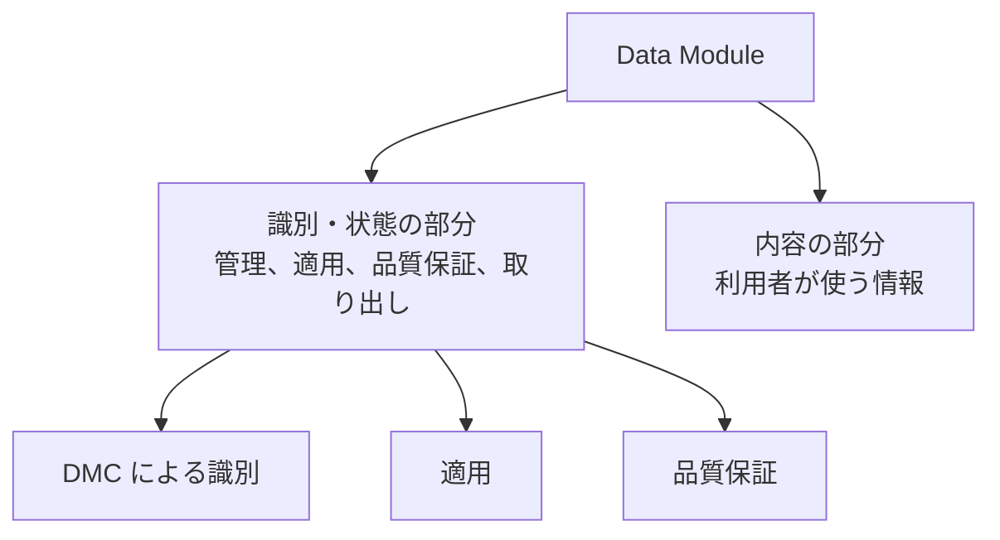
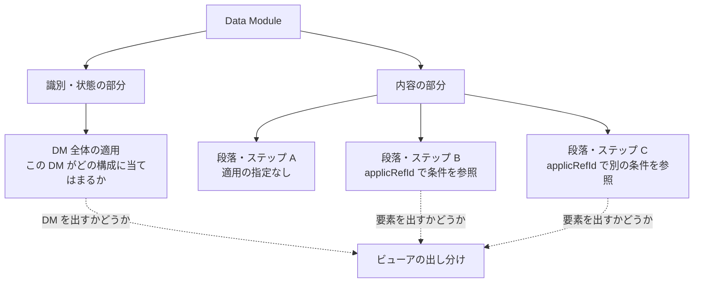

データモジュール（Data Module、DM）は、種類が違っても、外側の形は共通です。どの DM も、管理のための情報を入れる「識別・状態の部分」（identification and status section）と、利用者が読む情報を入れる「内容の部分」（contents section）の二つでできています。内容の部分の形は種類によって違いますが、識別・状態の部分の役割は、どの種類でも同じです。

この二つの分け方は、公式の概要ページが概念として説明している構造です。XML の要素名は版によって変わります。たとえば識別・状態の部分は、Issue 4.0 以降は `identAndStatusSection`、それより前の版では `idstatus` のような名前です。Issue 6 と Issue 7 の自転車サンプルと既定 BREX も `identAndStatusSection` を使っています。タグの名前で検索するときは、先に対象の版を決めてください。版ごとの名前の違いは第11章で説明します。

## 識別・状態の部分

公式の概要ページによると、識別・状態の部分は、次の四つを管理するための情報を持ちます。

- CSDB の中で DM を管理するための情報
- DM の適用（applicability）を管理するための情報
- 品質保証の手続きを管理するための情報
- 取り出しを制御するための情報

### 識別子と発行情報

管理のための情報の中心は、その DM を一つに特定する識別子、データモジュールコード（Data Module Code、DMC）です。DMC の読み方は第5章で説明します。

DMC だけでは、「どの発行の、どの言語の DM か」は決まりません。そのため、識別・状態の部分には、DMC を表す `dmCode` と並んで、言語（`language`）と発行情報（`issueInfo`）があります。`issueInfo` は、発行番号（issue number）と作業中番号（inwork）を持ちます。この要素名は、Issue 4.1、Issue 4.2、Issue 6、Issue 7 のサンプルで確認したものです。それより前の版では、同じ情報を別の要素名で持ちます。

ファイル名では、DMC の後ろに `_001-00_EN-US` のように付きます。`001` が発行番号、`00` が作業中番号、`EN-US` が言語です。これらは DMC の一部ではなく、「同じ DMC の、ある発行の、ある言語のファイル」を指すための情報です。たとえば Issue 7 の自転車サンプル `DMC-S1000DBIKE-AAA-D00-00-00-00AA-041A-A_013-00_EN-US.XML` は、言語が `en` / `US`、発行番号が `013`、作業中番号が `00` です。

### 適用（applicability）

適用とは、その情報がどの装備のどの構成に当てはまるかを、データとして持たせることです。公式の概要ページは、識別・状態の部分が適用を管理すると書いています。利点のページも、メタデータと内容による、適用を条件にした検索と取り出しを利点に挙げています。紙のマニュアルで「この派生型の場合は次のページ」と書いていた注記を、データの条件に置き換えるものと考えると分かりやすいでしょう。

適用を付ける単位は、DM 全体だけではありません。Issue 7 の自転車サンプルでは、次の二つの単位で適用を書いています。

- **DM 全体の適用**：識別・状態の部分の `dmStatus` の中にある `applic` に書きます。
- **要素ごとの適用**：内容の部分の要素に `applicRefId` 属性を付け、内容の部分の `referencedApplicGroup` に定義した適用の条件を参照します。属性が付いている要素は、`proceduralStep`、`para`、`dmRef`、`wire` などです。

つまり、DM を表示するかどうかだけでなく、一つの DM の中でどの段落やステップを表示するかも、適用で切り替えられます。Issue 4.2 の既定 BREX も、`dialog`、`dmSeq`、`commonInfoDescrPara` などに付く `applicRefId` を検査しています。条件の定義を置く場所は版によって違うことがあるので、対象の版のスキーマで確認してください。

条件に使う値は、次の三つの表で管理します。

| 表 | 扱うもの |
| --- | --- |
| 適用相互参照表（Applicability Cross-reference Table、ACT） | 製品の属性 |
| 条件相互参照表（Conditions Cross-reference Table、CCT） | 製品の属性以外の条件 |
| 製品相互参照表（Products Cross-reference Table、PCT） | 個々の製品 |

Issue 3.0、Issue 4.0、Issue 7 のスキーマパッケージには、それぞれに対応する `appliccrossreftable.xsd`、`condcrossreftable.xsd`、`prdcrossreftable.xsd` があります。米海軍の NAVSEA の S1000D ガイドも、この三つの表を Issue 3.0 以降について説明しています。どの単位で適用を書くか、どの属性を条件に使うかは、プロジェクトのルールと、対象の版のスキーマで決まります。

### 品質保証と取り出しの制御

品質保証の情報は、その DM がどの検証を通ったかを管理するためのものです。取り出しの制御の情報には、セキュリティの区分のように、誰が取り出せるかに関わる情報が含まれます。区分の符号の意味は、版の符号表で確認してください。

## 内容の部分

内容の部分には、作業を行うため、またはシステムを理解するために、利用者が必要とする情報そのものを書きます。説明の DM と手順の DM では、内容の部分の形が違います。種類ごとの違いは第6章で説明します。

一方、出版物の目次、ほかの章への「次のページへ」のような案内、冊子全体の改訂履歴は、内容の部分には書きません。出版物としての並び順はパブリケーションモジュールが持ち、改訂の理由の記録は識別・状態の部分で管理する、というのが仕様の考え方です。

図の実体も、原則として内容の部分には埋め込みません。内容の部分からは図を参照するだけにして、図のファイルは情報管理番号（Information Control Number、ICN）を付けて CSDB に置きます。こうすると、同じ図を複数の DM から参照できます。ICN の付け方について、Issue 7 の第4.4章は、CAGE コードを使う方法と、モデル識別コードを使う方法の二つを説明しています。

## それだけで意味が通る単位

公式の概要ページは、DM を独立した情報の単位（stand alone information unit）と呼んでいます。Issue 7 の第1.2章と第4.2章は、“the smallest self-contained information unit within a technical publication”（技術刊行物の中で、それだけで完結する最小の情報の単位）と定義しています。

ここでの「独立」は、ファイルが一つに分かれているという意味だけではありません。CSDB から取り出したときに、その情報としてそのまま読める、という意味です。手順の DM であれば、その作業の手順として読めます。説明の DM であれば、その対象の説明として読めます。前後の DM を開かないと何の話か分からないような分け方は、この定義に合いません。

仕様が求めているのは「独立していること」までで、どこまでを一つの DM にするかは、情報コードと、プロジェクトのビジネスルールで具体的に決めます。

## スキーマは種類ごとに分かれる

DM の外側の形は共通でも、内容の部分を検証するスキーマは、種類ごとに別のファイルになっています。

| 版 | 種類に対応する主なスキーマファイル |
| --- | --- |
| Issue 4.0 | `descript.xsd`、`proced.xsd`、`fault.xsd`、`ipd.xsd`、`wrngdata.xsd`、`crew.xsd`、`brex.xsd`、`checklist.xsd`、`learning.xsd` など |
| Issue 6、Issue 7 | `descript.xsd`、`proced.xsd`、`fault.xsd`、`ipd.xsd`、`wrngdata.xsd`、`wrngflds.xsd`、`schedul.xsd`、`process.xsd`、`crew.xsd`、`brex.xsd`、`brdoc.xsd`、`checklist.xsd`、`learning.xsd`、`frontmatter.xsd`、`pm.xsd` |

`brdoc.xsd` と `frontmatter.xsd` は、Issue 4.0 のパッケージにはありません。Issue 6 と Issue 7 のパッケージには、このほかにデータ型、語彙、XLink などの共通ファイルと、IEEE LOM のスキーマがあります。

新しい版で種類が増えても、識別・状態の部分と内容の部分の二つでできている、という構造は変わりません。増えた種類の要素は、その版のスキーマで定められます。

## 出典

- S1000D. *About S1000D*（Data Module、Data Module Structure）. https://s1000d.org/?page_id=101
- S1000D. *Benefits*. https://s1000d.org/?page_id=57
- Issue 4.1 のスキーマを `xsi:noNamespaceSchemaLocation` で参照している公開テンプレート（`identAndStatusSection`、`dmCode`、`language`、`issueInfo`）. https://github.com/oxygenxml/S1000D/blob/master/templates/Data%20Module.xml
- Issue 4.2 の既定 BREX（ファイル名とスキーマの位置、内容の部分の要素に付く `applicRefId` を検査するルール）. https://github.com/kibook/S1000D/blob/master/csdb/DMC-S1000D-F-04-10-0301-00A-022A-D_001-00_EN-US.XML
- 著者が入手した S1000D Issue 3.0 のパッケージ（XML スキーマの `appliccrossreftable.xsd`、`condcrossreftable.xsd`、`prdcrossreftable.xsd`）。入手先は https://users.s1000d.org/
- 著者が入手した S1000D Issue 4.0 のパッケージ（XML スキーマパッケージの `xml_schema_flat` の種類ごとのファイルと、ACT、CCT、PCT のスキーマ）。入手先は https://users.s1000d.org/
- Naval Surface Warfare Center Carderock Division. *NAVSEA S1000D Tool Acquisition and Guidance*（適用の注釈、`applicRefId`、ACT、CCT、PCT）. https://www.navsea.navy.mil/portals/103/documents/nswc_carderock/navsea%20s1000d%20taag.pdf
- 著者が入手した S1000D Issue 6 のパッケージ（XML スキーマパッケージ、自転車サンプルの記述 DM）。入手先は https://users.s1000d.org/
- 著者が入手した S1000D Issue 7 のパッケージ（第1.2章、第3.2章、第4.2章、第4.4章、XML スキーマパッケージ、自転車サンプルの記述 DM と、`applicRefId` を使う DM）。入手先は https://users.s1000d.org/

## この章のポイント

- DM は、識別・状態の部分と内容の部分の二つでできています。この構造は、公式の概要ページが説明している、種類に共通の形です。
- 識別・状態の部分は、CSDB での管理、適用、品質保証、取り出しの制御を担います。内容の部分は、利用者に必要な情報そのものを持ちます。
- 適用は、DM 全体にも、DM の中の段落やステップにも付けられます。発行番号、作業中番号、言語は、DMC とは別の情報です。
