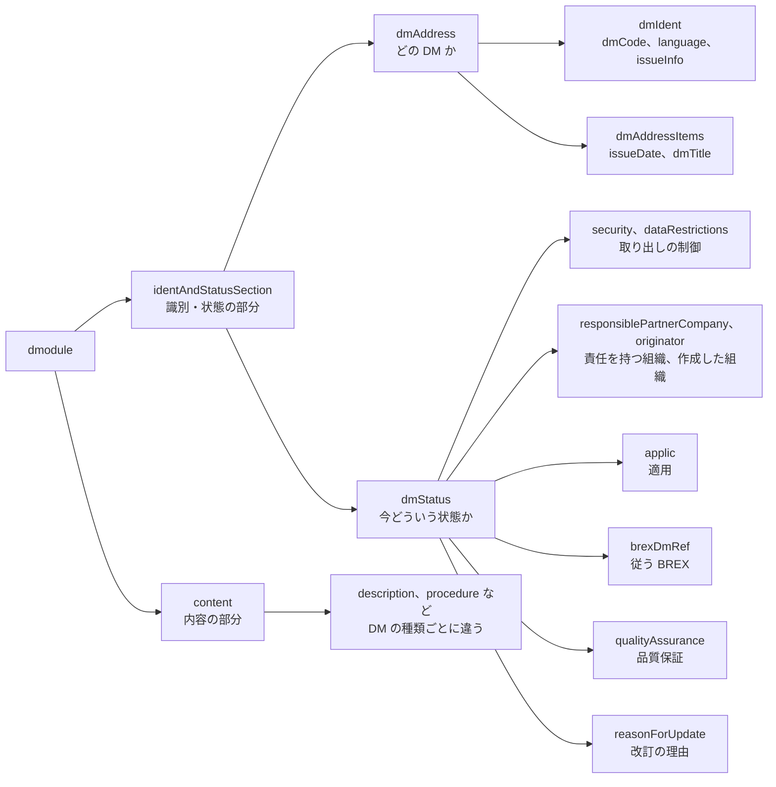
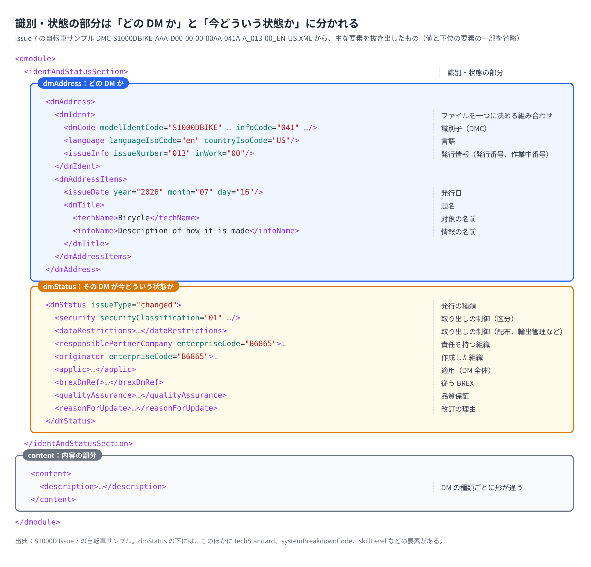
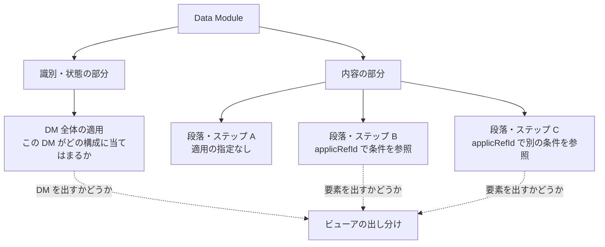
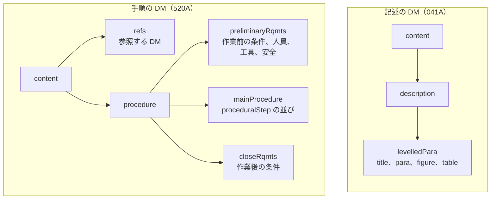

データモジュール（Data Module、DM）には、説明や手順などいくつかの種類があります。どの種類の DM も、「この DM が何で、どの版か」を表す識別の部分と、本文を入れる部分の 2 つからできています。種類によって違うのは、本文の部分の中身だけです。

この二つの分け方は、[公式の概要ページ](https://s1000d.org/?page_id=101)が概念として説明している構造です。XML の要素名は版によって変わります。たとえば識別・状態の部分は、Issue 4.0 以降は `identAndStatusSection`、それより前の版では `idstatus` のような名前です。Issue 6 と Issue 7 の自転車サンプルと既定 BREX も `identAndStatusSection` を使っています。タグの名前で検索するときは、先に対象の版を決めてください。版ごとの名前の違いは[第11章](https://zenn.dev/shuji_bonji/books/s1000d-intro/viewer/issues-and-cautions)で説明します。

## 構造図

次の図は、Issue 7 の自転車サンプルの記述 DM（`DMC-S1000DBIKE-AAA-D00-00-00-00AA-041A-A_013-00_EN-US.XML`）の要素を、主なものに絞って木の形にしたものです。



識別・状態の部分は、`dmAddress` と `dmStatus` の二つに分かれます。`dmAddress` は「どの DM か」を、`dmStatus` は「その DM が今どういう状態か」を持ちます。`dmStatus` の下には、図に載せたもののほかにも、`techStandard`、`systemBreakdownCode`、`skillLevel` などの要素があります。

同じ DM の XML を、親要素の `identAndStatusSection` を含めて示し、`dmAddress` と `dmStatus` に色を分けると、次のようになります。値と下位の要素の一部は省いています。`dmCode` の属性の読み方は[第5章](https://zenn.dev/shuji_bonji/books/s1000d-intro/viewer/data-module-code)で説明します。

<!--  -->

```html-embed
<div class="dmx out">
<div class="r"><span class="c"><span class="t">&lt;dmodule&gt;</span></span><span class="n">DM 全体</span></div>
<div class="r"><span class="c">  <span class="t">&lt;identAndStatusSection&gt;</span></span><span class="n">識別・状態の部分</span></div>
<div class="in"><div class="dmx"><span class="lb">dmAddress：どの DM か</span>
<div class="r"><span class="c"><span class="t">&lt;dmAddress&gt;</span></span><span></span></div>
<div class="r"><span class="c">  <span class="t">&lt;dmIdent&gt;</span></span><span class="n">以下の 3 つでファイルが決まる</span></div>
<div class="r"><span class="c">    <span class="t">&lt;dmCode</span> <span class="a">modelIdentCode</span>=<span class="v">"S1000DBIKE"</span> <span class="x">…</span> <span class="a">infoCode</span>=<span class="v">"041"</span> <span class="x">…</span><span class="t">/&gt;</span></span><span class="n">識別子（DMC）</span></div>
<div class="r"><span class="c">    <span class="t">&lt;language</span> <span class="a">languageIsoCode</span>=<span class="v">"en"</span> <span class="a">countryIsoCode</span>=<span class="v">"US"</span><span class="t">/&gt;</span></span><span class="n">言語</span></div>
<div class="r"><span class="c">    <span class="t">&lt;issueInfo</span> <span class="a">issueNumber</span>=<span class="v">"013"</span> <span class="a">inWork</span>=<span class="v">"00"</span><span class="t">/&gt;</span></span><span class="n">発行情報</span></div>
<div class="r"><span class="c">  <span class="t">&lt;/dmIdent&gt;</span></span><span></span></div>
<div class="r"><span class="c">  <span class="t">&lt;dmAddressItems&gt;</span></span><span></span></div>
<div class="r"><span class="c">    <span class="t">&lt;issueDate</span> <span class="a">year</span>=<span class="v">"2026"</span> <span class="a">month</span>=<span class="v">"07"</span> <span class="a">day</span>=<span class="v">"16"</span><span class="t">/&gt;</span></span><span class="n">発行日</span></div>
<div class="r"><span class="c">    <span class="t">&lt;dmTitle&gt;</span></span><span class="n">題名</span></div>
<div class="r"><span class="c">      <span class="t">&lt;techName&gt;</span>Bicycle<span class="t">&lt;/techName&gt;</span></span><span class="n">対象の名前</span></div>
<div class="r"><span class="c">      <span class="t">&lt;infoName&gt;</span>Description of how it is made<span class="t">&lt;/infoName&gt;</span></span><span class="n">情報の名前</span></div>
<div class="r"><span class="c">    <span class="t">&lt;/dmTitle&gt;</span></span><span></span></div>
<div class="r"><span class="c">  <span class="t">&lt;/dmAddressItems&gt;</span></span><span></span></div>
<div class="r"><span class="c"><span class="t">&lt;/dmAddress&gt;</span></span><span></span></div>
</div></div>
<div class="in"><div class="dmx st"><span class="lb">dmStatus：その DM が今どういう状態か</span>
<div class="r"><span class="c"><span class="t">&lt;dmStatus</span> <span class="a">issueType</span>=<span class="v">"changed"</span><span class="t">&gt;</span></span><span class="n">発行の種類</span></div>
<div class="r"><span class="c">  <span class="t">&lt;security</span> <span class="a">securityClassification</span>=<span class="v">"01"</span> <span class="x">…</span><span class="t">/&gt;</span></span><span class="n">取り出しの制御（区分）</span></div>
<div class="r"><span class="c">  <span class="t">&lt;dataRestrictions&gt;</span><span class="x">…</span><span class="t">&lt;/dataRestrictions&gt;</span></span><span class="n">取り出しの制御（配布など）</span></div>
<div class="r"><span class="c">  <span class="t">&lt;responsiblePartnerCompany</span> <span class="a">enterpriseCode</span>=<span class="v">"B6865"</span><span class="t">&gt;</span><span class="x">…</span></span><span class="n">責任を持つ組織</span></div>
<div class="r"><span class="c">  <span class="t">&lt;originator</span> <span class="a">enterpriseCode</span>=<span class="v">"B6865"</span><span class="t">&gt;</span><span class="x">…</span></span><span class="n">作成した組織</span></div>
<div class="r"><span class="c">  <span class="t">&lt;applic&gt;</span><span class="x">…</span><span class="t">&lt;/applic&gt;</span></span><span class="n">適用（DM 全体）</span></div>
<div class="r"><span class="c">  <span class="t">&lt;brexDmRef&gt;</span><span class="x">…</span><span class="t">&lt;/brexDmRef&gt;</span></span><span class="n">従う BREX</span></div>
<div class="r"><span class="c">  <span class="t">&lt;qualityAssurance&gt;</span><span class="x">…</span><span class="t">&lt;/qualityAssurance&gt;</span></span><span class="n">品質保証</span></div>
<div class="r"><span class="c">  <span class="t">&lt;reasonForUpdate&gt;</span><span class="x">…</span><span class="t">&lt;/reasonForUpdate&gt;</span></span><span class="n">改訂の理由</span></div>
<div class="r"><span class="c"><span class="t">&lt;/dmStatus&gt;</span></span><span></span></div>
</div></div>
<div class="r"><span class="c">  <span class="t">&lt;/identAndStatusSection&gt;</span></span><span></span></div>
<div class="r"><span class="c">  <span class="t">&lt;content&gt;</span><span class="x">…</span><span class="t">&lt;/content&gt;</span></span><span class="n">内容の部分（省略）</span></div>
<div class="r"><span class="c"><span class="t">&lt;/dmodule&gt;</span></span><span></span></div>
</div>
<style>
.dmx { --c:#2563eb; --bg:#eff6ff; --ink:#1f2937; --tag:#9333ea; --att:#0f766e; --val:#b91c1c; --dim:#9ca3af; --note:#374151; --rule:#d1d5db;
  border:2px solid var(--c); background:var(--bg); border-radius:8px; padding:12px 12px 10px; color:var(--ink);
  font-family:"Hiragino Sans","Noto Sans CJK JP","Yu Gothic",sans-serif; }
.dmx.st { --c:#d97706; --bg:#fffbeb; }
[data-theme="dark"] .dmx { --bg:#172554; --ink:#e5e7eb; --tag:#d8b4fe; --att:#5eead4; --val:#fca5a5; --dim:#6b7280; --note:#d1d5db; --rule:#4b5563; --c:#60a5fa; }
[data-theme="dark"] .dmx.st { --bg:#3b2506; --c:#fbbf24; }
.dmx .lb { display:inline-block; background:var(--c); color:#fff; font-weight:700; font-size:13px; padding:2px 10px; border-radius:999px; margin-bottom:8px; }
[data-theme="dark"] .dmx .lb { color:#111827; }
.dmx .r { display:grid; grid-template-columns:1fr 190px; align-items:center; min-height:22px; }
.dmx .c { font-family:ui-monospace,"SFMono-Regular",Menlo,Consolas,"DejaVu Sans Mono",monospace; font-size:12px; white-space:pre; }
.dmx .n { font-size:12px; color:var(--note); padding-left:10px; border-left:1px dashed var(--rule); }
.dmx .t { color:var(--tag); } .dmx .a { color:var(--att); } .dmx .v { color:var(--val); } .dmx .x { color:var(--dim); }
.dmx.out { --c:#9ca3af; --bg:transparent; border-style:dashed; padding:8px 12px; }
.dmx .in { margin:6px 0 6px 2ch; }
</style>
```

内容の部分（`content`）の中身は、次の「内容の部分」の節で示すので、ここでは省いています。

## 識別・状態の部分

公式の概要ページは、識別・状態の部分が四つの情報を管理すると書いています。自転車サンプルの要素と対応させると、次のようになります。要素との対応は、本書がサンプルから読み取ったものです。

| 管理する情報（公式の概要ページ） | 自転車サンプルの主な要素 |
| --- | --- |
| CSDB の中で DM を管理するための情報 | `dmAddress`（`dmCode`、`language`、`issueInfo`、`issueDate`、`dmTitle`）、`responsiblePartnerCompany`、`originator`、`reasonForUpdate` |
| DM の適用を管理するための情報 | `applic` |
| 品質保証の手続きを管理するための情報 | `qualityAssurance` |
| 取り出しを制御するための情報 | `security`、`dataRestrictions` |

`security` の区分の符号の意味は、版の符号表で確認してください。

### 識別子と発行情報

管理のための情報の中心は、その DM を一つに特定する識別子、データモジュールコード（Data Module Code、DMC）です。DMC の読み方は[第5章](https://zenn.dev/shuji_bonji/books/s1000d-intro/viewer/data-module-code)で説明します。

DMC だけでは、「どの発行の、どの言語の DM か」は決まりません。そのため、識別・状態の部分には、DMC を表す `dmCode` と並んで、言語（`language`）と発行情報（`issueInfo`）があります。`issueInfo` は、発行番号（issue number）と作業中番号（inwork）を持ちます。この要素名は、Issue 4.1、Issue 4.2、Issue 6、Issue 7 のサンプルで確認したものです。それより前の版では、同じ情報を別の要素名で持ちます。

発行情報と言語は DMC の一部ではなく、「同じ DMC の、ある発行の、ある言語のファイル」を指すための情報です。ファイル名での表れ方は、[第3章](https://zenn.dev/shuji_bonji/books/s1000d-intro/viewer/core-concepts)で説明します。

### 適用（applicability）

適用とは、その情報がどの装備のどの構成に当てはまるかを、データとして持たせることです。公式の概要ページは、識別・状態の部分が適用を管理すると書いています。[利点のページ](https://s1000d.org/?page_id=57)も、メタデータと内容による、適用を条件にした検索と取り出しを利点に挙げています。紙のマニュアルで「この派生型の場合は次のページ」と書いていた注記を、データの条件に置き換えるものと考えると分かりやすいでしょう。

適用を付ける単位は、DM 全体だけではありません。DM 全体の適用は、上の構造図の `dmStatus` の下にある `applic` です。Issue 7 の自転車サンプルでは、次の二つの単位で適用を書いています。

- **DM 全体の適用**：識別・状態の部分の `dmStatus` の中にある `applic` に書きます。
- **要素ごとの適用**：内容の部分の要素に `applicRefId` 属性を付け、内容の部分の `referencedApplicGroup` に定義した適用の条件を参照します。属性が付いている要素は、`proceduralStep`、`para`、`dmRef`、`wire` などです。

つまり、DM を表示するかどうかだけでなく、一つの DM の中でどの段落やステップを表示するかも、適用で切り替えられます。Issue 4.2 の既定 BREX も、`dialog`、`dmSeq`、`commonInfoDescrPara` などに付く `applicRefId` を検査しています。条件の定義を置く場所は版によって違うことがあるので、対象の版のスキーマで確認してください。



条件に使う値は、次の三つの表で管理します。

| 表 | 扱うもの |
| --- | --- |
| 適用相互参照表（Applicability Cross-reference Table、ACT） | 製品の属性 |
| 条件相互参照表（Conditions Cross-reference Table、CCT） | 製品の属性以外の条件 |
| 製品相互参照表（Products Cross-reference Table、PCT） | 個々の製品 |

Issue 3.0、Issue 4.0、Issue 7 のスキーマパッケージには、それぞれに対応する `appliccrossreftable.xsd`、`condcrossreftable.xsd`、`prdcrossreftable.xsd` があります。米海軍の NAVSEA の S1000D ガイドも、この三つの表を Issue 3.0 以降について説明しています。どの単位で適用を書くか、どの属性を条件に使うかは、プロジェクトのルールと、対象の版のスキーマで決まります。

## 内容の部分

内容の部分には、作業を行うため、またはシステムを理解するために、利用者が必要とする情報そのものを書きます。内容の部分の形は、DM の種類によって違います。Issue 7 の自転車サンプルの記述 DM（情報コード `041`）と、手順 DM（情報コード `520`、`techName` は “Fork”、`infoName` は “Remove procedures”）を比べると、次のようになります。



記述の DM は、段落（`levelledPara`）の中に、題名、本文、図、表を持ちます。手順の DM は、作業前に満たす条件（`preliminaryRqmts`）、ステップの並び（`mainProcedure`）、作業後の条件（`closeRqmts`）を持ちます。種類ごとの役割の違いは[第6章](https://zenn.dev/shuji_bonji/books/s1000d-intro/viewer/data-module-types)で説明します。

## DM に書くものと書かないもの

公式の概要ページは、DM を独立した情報の単位（stand alone information unit）と呼んでいます。Issue 7 の第1.2章と第4.2章は、“the smallest self-contained information unit within a technical publication”（技術刊行物の中で、それだけで完結する最小の情報の単位）と定義しています。

ここでの「独立」は、CSDB から取り出したときに、その情報としてそのまま読める、という意味です。前後の DM を開かないと何の話か分からないような分け方は、この定義に合いません。そのため、次のように、出版物や冊子のための情報は DM の内容の部分に書きません。

| 情報 | 置く場所 |
| --- | --- |
| 作業や理解に必要な情報そのもの（説明、手順のステップ） | DM の内容の部分 |
| 図の実体 | CSDB の別のファイル。情報管理番号（Information Control Number、ICN）を付け、内容の部分からは参照するだけにする |
| 出版物の中での並び順、目次 | パブリケーションモジュール（PM） |
| ほかの DM への案内（「次のページへ」など） | 内容の部分には案内として書かない。必要なら DMC で参照する |
| この DM の改訂の理由 | 識別・状態の部分の `reasonForUpdate` |

図を別のファイルにすると、同じ図を複数の DM から参照できます。ICN の付け方について、Issue 7 の第4.4章は、CAGE コードを使う方法と、モデル識別コードを使う方法の二つを説明しています。

仕様が求めているのは「独立していること」までで、どこまでを一つの DM にするかは、情報コードと、プロジェクトのビジネスルールで具体的に決めます。

## スキーマは種類ごとに分かれる

DM の外側の形は共通でも、内容の部分を検証するスキーマは、種類ごとに別のファイルになっています。

| 版 | 種類に対応する主なスキーマファイル |
| --- | --- |
| Issue 4.0 | `descript.xsd`、`proced.xsd`、`fault.xsd`、`ipd.xsd`、`wrngdata.xsd`、`crew.xsd`、`brex.xsd`、`checklist.xsd`、`learning.xsd` など |
| Issue 6、Issue 7 | `descript.xsd`、`proced.xsd`、`fault.xsd`、`ipd.xsd`、`wrngdata.xsd`、`wrngflds.xsd`、`schedul.xsd`、`process.xsd`、`crew.xsd`、`brex.xsd`、`brdoc.xsd`、`checklist.xsd`、`learning.xsd`、`frontmatter.xsd`、`pm.xsd` |

`brdoc.xsd` と `frontmatter.xsd` は、Issue 4.0 のパッケージにはありません。Issue 6 と Issue 7 のパッケージには、このほかにデータ型、語彙、XLink などの共通ファイルと、IEEE LOM のスキーマがあります。

新しい版で種類が増えても、識別・状態の部分と内容の部分の二つでできている、という構造は変わりません。増えた種類の要素は、その版のスキーマで定められます。

## 出典

- S1000D. *About S1000D*（Data Module、Data Module Structure）. https://s1000d.org/?page_id=101
- S1000D. *Benefits*. https://s1000d.org/?page_id=57
- Issue 4.1 のスキーマを `xsi:noNamespaceSchemaLocation` で参照している公開テンプレート（`identAndStatusSection`、`dmCode`、`language`、`issueInfo`）. https://github.com/oxygenxml/S1000D/blob/master/templates/Data%20Module.xml
- Issue 4.2 の既定 BREX（ファイル名とスキーマの位置、内容の部分の要素に付く `applicRefId` を検査するルール）. https://github.com/kibook/S1000D/blob/master/csdb/DMC-S1000D-F-04-10-0301-00A-022A-D_001-00_EN-US.XML
- 著者が入手した S1000D の仕様パッケージ。入手先は https://users.s1000d.org/
  - Issue 3.0：XML スキーマの `appliccrossreftable.xsd`、`condcrossreftable.xsd`、`prdcrossreftable.xsd`
  - Issue 4.0：XML スキーマパッケージの `xml_schema_flat` の種類ごとのファイルと、ACT、CCT、PCT のスキーマ
  - Issue 6：XML スキーマパッケージ、自転車サンプルの記述 DM
  - Issue 7：第1.2章、第3.2章、第4.2章、第4.4章、XML スキーマパッケージ、自転車サンプルの記述 DM（`DMC-S1000DBIKE-AAA-D00-00-00-00AA-041A-A_013-00_EN-US.XML`）、手順 DM（`DMC-S1000DBIKE-AAA-D00-00-01-00AA-520A-A_005-00_EN-US.XML`）、`applicRefId` を使う DM
- Naval Surface Warfare Center Carderock Division. *NAVSEA S1000D Tool Acquisition and Guidance*（適用の注釈、`applicRefId`、ACT、CCT、PCT）. https://www.navsea.navy.mil/portals/103/documents/nswc_carderock/navsea%20s1000d%20taag.pdf

## この章のポイント

- DM は、識別・状態の部分（`identAndStatusSection`）と内容の部分（`content`）の二つでできています。識別・状態の部分は、どの DM かを表す `dmAddress` と、状態を表す `dmStatus` に分かれます。
- 識別・状態の部分は、CSDB での管理、適用、品質保証、取り出しの制御を担います。内容の部分の形は、記述の `description`、手順の `procedure` のように、種類によって違います。
- 適用は、DM 全体にも、DM の中の段落やステップにも付けられます。発行番号、作業中番号、言語は、DMC とは別の情報です。
