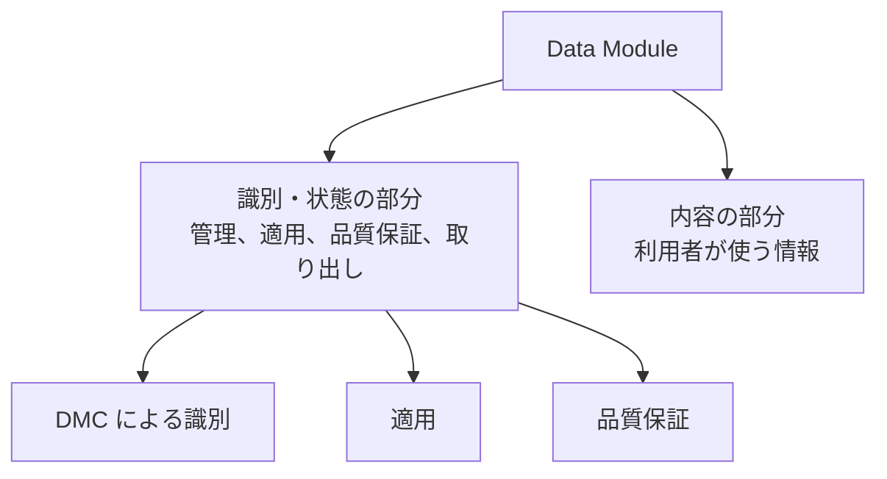

データモジュール（Data Module、DM）は、種類が違っても、外側の形は共通です。公式の概要は、各 DM が二つの部分からなると書いています。識別・状態の部分（identification and status section）と、内容の部分（contents section）です。この二つの分け方は、特定の版の要素名ではなく、概要が概念として説明している構造です。XML の要素名は版で変わります。名前の対照は第11章に置きます。

:::message
この章の概念の説明では、要素名を定義の代わりにしません。Issue 4.0 以降の `identAndStatusSection` と、それより前の `idstatus` のような名前は、同じ概念を指していても、タグとしては別物です。Issue 6 と Issue 7 の自転車サンプルと既定 BREX も `identAndStatusSection` を使っています。タグで検索するときは、対象の Issue を先に決めます。
:::

## 公式が説明している二つの部分

識別・状態の部分は、次の四つを管理するための情報を持ちます。概要のページの列挙を、そのまま項目にします。

- CSDB の中で DM を管理するための情報
- DM の適用（applicability）を管理するための情報
- 品質保証の手続きを管理するための情報
- 取り出しを制御するための情報

内容の部分は、作業を行うため、またはシステムを理解するために、利用者が必要とする情報そのものです。説明の DM と手順の DM では、内容の部分の形が違います。種類ごとの違いは第6章で説明します。識別・状態の部分の役割は、種類が違っても同じです。

## 識別・状態の部分が持つもの

管理のための情報には、その DM がどれかを一意に示す識別子が含まれます。識別子の本体がデータモジュールコード（Data Module Code、DMC）です。DMC の読み方は第5章で扱います。

DMC だけでは、「いつの版の、どの言語の DM か」は決まりません。Issue 4.1 の公開スキーマを参照しているテンプレートと、Issue 4.2 の既定 BREX のファイルでは、DMC を表す `dmCode` の兄弟として、言語（`language`）と発行情報（`issueInfo`）があります。`issueInfo` は発行番号（issue number）と、作業中番号（inwork）を持ちます。ファイル名では、DMC の後ろに `_001-00_EN-US` のように付きます。`001` が発行番号、`00` が作業中番号、`EN-US` が言語です。これは DMC の一部ではありません。同じ DMC の、ある発行のある言語、を指します。

この兄弟要素の名前は、Issue 4.1、Issue 4.2、Issue 6、および Issue 7 のサンプルで確認したものです。Issue 7 の記述サンプル `DMC-S1000DBIKE-AAA-D00-00-00-00AA-041A-A_013-00_EN-US.XML` では、`dmCode` の兄弟として `language`（`en` / `US`）と `issueInfo`（発行番号 `013`、作業中番号 `00`）があります。Issue 6 の同じ DMC のファイルは発行番号 `012`、作業中番号 `00`、言語は同じく `en` / `US` です。それより前の版では、同じ情報を別の要素名で持ちます。

適用は、その情報がどの装備のどの構成に当てはまるかを、データとして持たせることです。概要は、識別・状態の部分が適用を管理すると書いています。利点のページは、メタデータと内容による、適用を条件にした検索と取り出しを利点に挙げています。紙の注記「この派生型の場合は次のページ」を、データの条件に移す、という理解で足ります。適用をどの粒度で書くか、どの属性を条件に使うかは、プロジェクトのルールと、対象の版のスキーマで決まります。

品質保証の情報は、その DM がどの検証を通ったかを管理するためのものです。取り出しの制御には、セキュリティの区分のように、誰が取り出せるかに関わる情報が含まれます。区分の符号の意味は、版の符号表で確認します。本書は符号の一覧を写しません。

## 内容の部分が持たないもの

内容の部分は、その DM の情報そのものです。出版物の目次、他の章への「次ページ」、冊子の改訂履歴の全体は、内容の部分の役割ではありません。出版物としての並びはパブリケーションモジュールが持ちます。改訂の理由の記録は、識別・状態の側で管理する、という整理が仕様の考え方です。

図の実体も、原則として内容の部分に埋め込みません。内容の部分は図を参照し、図のファイルは情報管理番号（Information Control Number、ICN）で CSDB の中に置きます。こうすると、同じ図を複数の DM から参照できます。Issue 7 の第4.4章は、CAGE コードに基づく方法と、モデル識別コードに基づく方法の二つを説明しています。桁の表は版のその章にあり、本書は写しません。

## 単独で意味が通る、という条件

公式の概要は、DM を独立した情報の単位（stand alone information unit）と呼んでいます。Issue 7 の第1.2章と第4.2章は、これを “the smallest self-contained information unit within a technical publication” と書いています。独立とは、ファイルが一つだ、という意味だけではありません。その単位を CSDB から取り出したとき、その情報として読める、ということです。

手順の DM であれば、その作業の手順として読めます。説明の DM であれば、その対象の説明として読めます。前後の DM を開かないと主語が分からない、というような分割は、この定義に合いません。どこまでを一つの DM にするかは、情報コードと、プロジェクトのビジネスルールで具体化します。仕様は「独立していること」を要求し、何行で分割するかはプロジェクトが決めます。

## スキーマは種類ごとに分かれる

DM の外側は共通でも、内容の部分を検証するスキーマは種類ごとに分かれます。Issue 4.0 のスキーマ URL を列挙している公開文書には、`descript.xsd`、`fault.xsd`、`ipd.xsd`、`crew.xsd`、`brex.xsd` が別ファイルとしてあり、同じ一覧に `checklist.xsd` と `learning.xsd` も現れます。この一覧の抜粋には、手順用と配線用のファイル名は含まれていませんでした。Issue 4.0 にそのファイルが無かった、とまでは言いません。

Issue 7 の XML スキーマパッケージには、種類に対応するファイルとして `descript.xsd`、`proced.xsd`、`fault.xsd`、`ipd.xsd`、`wrngdata.xsd`、`wrngflds.xsd`、`schedul.xsd`、`process.xsd`、`crew.xsd`、`brex.xsd`、`brdoc.xsd`、`checklist.xsd`、`learning.xsd`、`frontmatter.xsd`、`pm.xsd` があります。Issue 6 のスキーマパッケージにも、ここに挙げたファイル名があります。これらは、それぞれの Issue のファイル名です。Issue 4.0 の抜粋に無かった名前を、Issue 4.0 にもあったことにはしません。どちらのパッケージにも、このほかにデータ型や語彙、XLink などの共通ファイルと、IEEE LOM のスキーマの木があります。DTD のファイルは、この二つのスキーマパッケージの一覧にはありませんでした。ファイルが分かれていても、識別・状態の部分の役割は、概要が説明する共通の構造のままです。

新しい版で種類が増えても、本書の「二つの部分」という説明は概要の概念に沿ったものです。増えた種類の要素は、その版のスキーマが定めます。

## 出典

- S1000D. *About S1000D*（Data Module、Data Module Structure）. https://s1000d.org/?page_id=101
- S1000D. *Benefits*. https://s1000d.org/?page_id=57
- Issue 4.1 のスキーマを `xsi:noNamespaceSchemaLocation` で参照している公開テンプレート（`identAndStatusSection`、`dmCode`、`language`、`issueInfo`）. https://github.com/oxygenxml/S1000D/blob/master/templates/Data%20Module.xml
- Issue 4.2 の既定 BREX のファイル名とスキーマ位置. https://github.com/kibook/S1000D/blob/master/csdb/DMC-S1000D-F-04-10-0301-00A-022A-D_001-00_EN-US.XML
- RWS Contenta S1000D の文書が列挙している Issue 4.0 のスキーマ URL（`descript.xsd`、`fault.xsd`、`ipd.xsd`、`crew.xsd`、`brex.xsd`、`checklist.xsd`、`learning.xsd`）. https://docs.rws.com/en-US/contenta-s1000d-5.9-866363/supported-schemas-15425
- 著者が入手した S1000D Issue 6 のパッケージ（XML スキーマパッケージ、自転車サンプルの記述 DM）。入手先は https://users.s1000d.org/
- 著者が入手した S1000D Issue 7 のパッケージ（第1.2章、第3.2章、第4.2章、XML スキーマパッケージ、自転車サンプルの記述 DM）。入手先は https://users.s1000d.org/

## この章のポイント

- DM は、識別・状態の部分と内容の部分からなる。この分け方は公式の概要が説明する共通の構造である。
- 識別・状態の部分は、CSDB での管理、適用、品質保証、取り出しの制御を持つ。内容の部分は、利用者に必要な情報そのものを持つ。
- 発行番号、作業中番号、言語は、Issue 4.1、Issue 4.2、Issue 6、Issue 7 のサンプルでは DMC の兄弟情報であり、DMC そのものではない。要素名は版で変わる。
