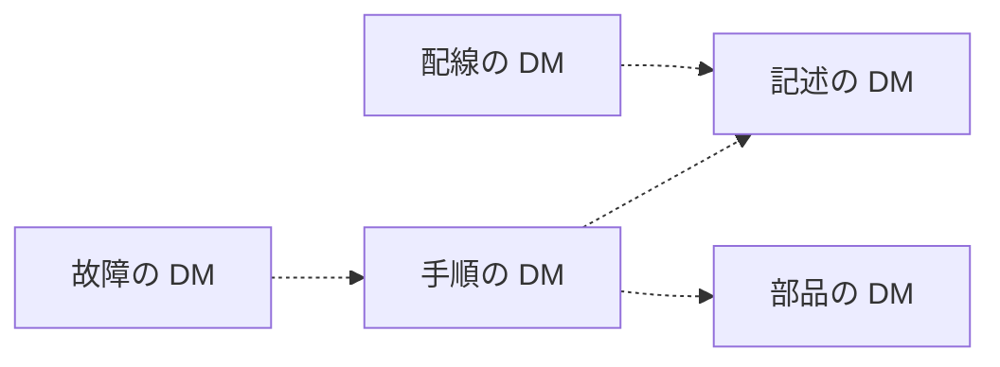

データモジュール（Data Module、DM）には、説明、手順、故障、部品、配線など、書く情報に応じた種類があります。種類は、内容の部分にどの情報を独立して持たせるかの区別です。識別・状態の部分の役割は、どの種類でも同じです。

公式の概要ページは、種類の例として名前を挙げていますが、種類ごとの定義は書いていません。この章では、よく使われる五つの種類（記述、手順、故障、部品、配線）を、「独立した情報の単位」という DM の定義に沿って説明します。

## 公式の概要ページが挙げている種類

| 概要ページの名称 | 内容と、本書での扱い |
| --- | --- |
| Crew | 乗員や操作者向けの情報。名前の紹介にとどめる |
| Description | 記述。この章で説明する |
| Procedural | 手順。この章で説明する |
| Fault | 故障。この章で説明する |
| Illustrated Parts Data | 図解部品データ。この章で説明する |
| Schedules | 整備計画の情報（点検の間隔や定期整備など）。名前の紹介にとどめる |
| Wiring | 配線。この章で説明する |
| Process Module | 対話的な表示の流れを記述する種類。第7章で説明する |
| Business Rules Exchange | プロジェクトのルールをやり取りするための種類。第8章で説明する |

Schedules について、概要ページには名前しか書かれていません。Issue 4.0 を解説した公開の実装資料では、整備計画の情報（maintenance planning information）と説明されています。

なお、概要ページでは、この一覧のすぐ後に共通ソースデータベース（Common Source Data Base、CSDB）の説明が続いていますが、CSDB は DM の種類ではなく、DM を保管する場所です。

### 版による種類の違い

種類は、版が新しくなると増えます。Issue 4.0 のスキーマパッケージには、上の表に対応するものとして、`descript.xsd`、`proced.xsd`、`fault.xsd`、`ipd.xsd`、`schedul.xsd`、`wrngdata.xsd`、`wrngflds.xsd`、`process.xsd`、`crew.xsd`、`brex.xsd` があり、ほかに `checklist.xsd`、`learning.xsd`、`pm.xsd` などがあります。Issue 6 と Issue 7 のスキーマパッケージには、これらに加えて `brdoc.xsd` と `frontmatter.xsd` があります。使う版のスキーマのファイルの一覧が、その版の種類の一覧になります。

## 記述（Description）

記述の DM が持つのは、対象が何か、どのような構成で、どのように機能するか、という説明です。作業の手順、部品の発注情報、配線の接続表は、記述の DM には書きません。それらが必要な場合は、それぞれの種類の DM を参照します。

Issue 7 の自転車サンプルでは、情報コード `041` の DM `S1000DBIKE-AAA-D00-00-00-00AA-041A-A` に、`techName` “Bicycle” と `infoName` “Description of how it is made” が付いています。スキーマは `descript.xsd` です。自転車全体が「どのように作られているか」を、一つの DM として取り出せます。

同じサンプルには、システムコードが `DA1` の `S1000DBIKE-AAA-DA1-00-00-00AA-041A-A`（`techName` は “Brake system”）や、モデル識別コードが `BRAKE` の記述 DM もあります。情報コードが同じでも、製品の階層や製品が違えば、別の DM です。Issue 6 の自転車サンプルにも、同じ三つの DMC の DM があります。

## 手順（Procedural）

手順の DM が持つのは、一つの作業の手順です。対象の一般的な説明や、部品カタログの全体は持ちません。手順の中で説明が必要な場合は記述の DM を、部品が必要な場合は部品の DM を参照します。

Issue 7 の自転車サンプルには、情報コード `121` と `258` の手順の DM があります。どちらもスキーマは `proced.xsd` で、`121` の `infoName` は “Pre-operation procedures (crew)”（乗車前の作業）、`258` の `infoName` は “Other procedures to clean”（その他の清掃の手順）です。乗車前の作業と清掃が、説明の DM とは別の情報コードを持つ、別の DM になっていることが分かります。なお、これらはサンプルの標題であり、情報コードの表の定義そのものではありません。

手順の本文は、ステップの並びです。ステップの中に安全上の警告、必要な工具、作業後の確認を書く場所は、版のスキーマが用意しています。そのうちどれを必須にするかは、プロジェクトの BREX で決めます。要素名は版によって変わるので、使う版のスキーマで確認してください。

## 故障（Fault）

故障の DM が持つのは、故障に関する情報です。概要ページは “Fault” という名前を挙げているだけで、故障の切り分けの手順の形までは書いていません。実際には、症状から疑わしい箇所へ進むための情報や、故障の報告に関する情報を、通常の操作手順とは別の DM に分けて置く使い方をします。

通常の操作手順と故障の切り分けを一つの DM に混ぜると、操作の手順を直すたびに、故障の切り分けまで改訂の対象になってしまいます。種類を分けるのは、更新の単位を分けるためです。故障の DM の要素の構造は、使う版の fault のスキーマで確認してください。

## 部品（Illustrated Parts Data）

図解部品データ（Illustrated Parts Data）の DM が持つのは、図と対応付けた部品の情報です。どの図の、どの品目が、どの部品番号か、という情報です。その部品を取り外す手順は、手順の DM が持ちます。

図解部品データは、ATA の図解部品カタログ（Illustrated Parts Catalog）と目的が近い種類です。ただし、目的が近いことと、ATA のカタログの仕様と同じデータをそのまま納品できることは別です。データの対応は、プロジェクトで使う版と、相手の仕様の両方で確認する必要があります。

## 配線（Wiring）

配線の DM が持つのは、配線に関する情報です。系統の一般的な説明は記述の DM が持ち、配線の接続、電線、経路のデータを配線の DM が持ちます。接続表の要素名は、版のスキーマで確認してください。

配線の図も、ほかの種類と同じように、情報管理番号（Information Control Number、ICN）を付けて CSDB に置き、DM から参照します。図を配線の DM の中にだけある画像として埋め込まない、という考え方は、第4章で説明したとおりです。

## 種類に共通すること

五つの種類は、内容が違うだけで、次の点は共通です。

- それぞれが独立した DM で、自分の DMC を持つ。
- 識別・状態の部分で、適用、品質保証、取り出しを管理する。
- 内容の部分には、その種類の情報だけを書く。
- ほかの種類の情報が必要な場合は、参照で結ぶ。
- 出版物の中での並び順は、DM の中ではなく、パブリケーションモジュールが決める。

破線は、必要に応じて参照できる関係です。参照を置くかどうかは、その DM にどの情報を独立して持たせるかによって決まります。

## 出典

- S1000D. *About S1000D*（情報の種類の例示）. https://s1000d.org/?page_id=101
- S1000D. Issue 4.1 のダウンロード説明（Bike sample に Descriptive、Procedural、BREX の例があると記載）. https://users.s1000d.org/ProductDescription.aspx?ProductID=16
- Adobe FrameMaker 10, *Data module types*（Issue 4.0 の Schedule の説明）. https://help.adobe.com/en_US/framemaker/s1000d/WS9ad62b8fb4f8a997-4a02f1412e146f7d2a-8000.html
- 著者が入手した S1000D Issue 4.0 のパッケージ（XML スキーマパッケージの `xml_schema_flat`）。入手先は https://users.s1000d.org/
- 著者が入手した S1000D Issue 6 のパッケージ（自転車サンプルの `041`、`121`、`258`、スキーマパッケージの `descript.xsd` と `proced.xsd`）。入手先は https://users.s1000d.org/
- 著者が入手した S1000D Issue 7 のパッケージ（自転車サンプルの `041`、`121`、`258`、スキーマパッケージの `descript.xsd` と `proced.xsd`）。入手先は https://users.s1000d.org/
- 自転車サンプルの標題と DMC が印刷されている公開の出版物. https://www.docuneering.com/s1000d/demo/pdf/PMC-S1000DBIKE-C3002-LOAP1-00_000-02_EN-US.pdf

## この章のポイント

- 公式の概要ページが名前を挙げている種類のうち、記述、手順、故障、部品、配線は、それぞれ別の DM として独立した情報を持ちます。
- 同じ対象でも、説明と手順は情報コードが違う別の DM になります。自転車サンプルの `041` と `121`、`258` がその例です。
- 種類の完全な一覧は、使う版のスキーマで確認します。Crew、Schedules、Process、BREX も概要ページに名前があり、本書では代表的な種類に絞って説明しています。
