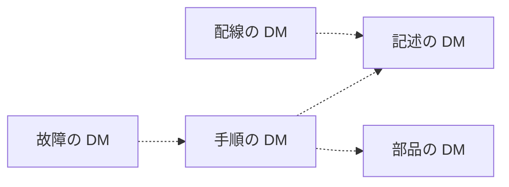

データモジュール（Data Module、DM）の種類は、内容の部分に何を独立して持たせるかの区別です。識別・状態の部分の役割は種類が違っても共通です。公式の概要は、種類の例として名前を列挙しています。種類ごとの定義の文は、概要ページにはありません。この章では、よく使われる五種類を、公式の定義である「独立した情報の単位」に沿って説明します。すべての種類は扱いません。

概要が例として挙げている名前は、次のとおりです。

| 概要ページの名称 | この章での扱い |
| --- | --- |
| Crew | 操作者向けの情報。名前のみ確認し、詳細には入らない |
| Description | この章で扱う。記述 |
| Procedural | この章で扱う。手順 |
| Fault | この章で扱う。故障 |
| Illustrated Parts Data | この章で扱う。部品 |
| Schedules | スケジュールに関する種類として名前がある。定義の文は概要にない |
| Wiring | この章で扱う。配線 |
| Process Module | 対話的な表示の流れに関係する種類。第7章で位置だけ説明する |
| Business Rules Exchange | プロジェクトのルールを交換する種類。第8章で説明する |

概要の一覧の直後に、共通ソースデータベース（Common Source Data Base、CSDB）の説明が続いています。CSDB は DM の種類ではありません。保管場所です。

種類は版が進むと増えます。Issue 4.0 のスキーマ URL を列挙している公開文書には、概要の例に対応するものとして `descript.xsd`、`fault.xsd`、`ipd.xsd`、`crew.xsd`、`brex.xsd` があり、加えて `checklist.xsd` と `learning.xsd` があります。この抜粋では、手順用と配線用のファイル名は確認できませんでした。

Issue 7 のスキーマパッケージには、上の名前に加えて `proced.xsd`、`wrngdata.xsd`、`wrngflds.xsd`、`schedul.xsd`、`process.xsd`、`brdoc.xsd`、`frontmatter.xsd`、`pm.xsd` があります。Issue 6 のスキーマパッケージにも、これらのファイル名があります。これは、それぞれの Issue のファイル名です。Issue 4.0 の抜粋に無かった名前を、Issue 4.0 にもあったことにはしません。使う版のスキーマのファイル一覧が、その版の種類の一覧です。

## 記述（Description）

記述の DM が独立して持つのは、対象が何か、どう構成され、どう機能するか、という説明です。作業の手順、部品の発注情報、配線の接続表は、この DM にまとめません。それらが必要なら、それぞれの種類の DM を参照します。

Issue 7 の自転車サンプルは、情報コード `041` の DM `S1000DBIKE-AAA-D00-00-00-00AA-041A-A` に、`techName` “Bicycle” と `infoName` “Description of how it is made” を付けています。スキーマの宣言は `descript.xsd` です。自転車全体の「どのように作られているか」が、一つの DM として取り出せます。同じサンプルには、システムコードだけが `DA1` の `S1000DBIKE-AAA-DA1-00-00-00AA-041A-A` があり、`techName` は “Brake system”、`infoName` は同じ “Description of how it is made” です。製品の階層が違えば、同じ情報コードでも別の DM です。サンプルには、モデル識別そのものが `BRAKE` の記述 DM もあります。自転車のブレーキ系統と、`BRAKE` という別のモデル識別を、一つの DM として読まないでください。Issue 6 の自転車サンプルにも、同じ三つの DMC があり、`techName` と `infoName` は同じです。スキーマの宣言は `http://www.s1000d.org/S1000D_6/xml_schema_flat/descript.xsd` です。発行番号は、自転車全体が `012`、`S1000DBIKE` のブレーキが `010`、`BRAKE` が `004` です。

## 手順（Procedural）

手順の DM が独立して持つのは、一つの作業の手順です。対象の一般的な説明や、部品カタログの全表は持ちません。手順の中で説明が必要なら、記述の DM を参照します。部品が必要なら、部品の DM を参照します。

Issue 7 の同じ自転車サンプルには、情報コード `121` の DM と `258` の DM があります。どちらもスキーマの宣言は `proced.xsd` です。`121` の `infoName` は “Pre-operation procedures (crew)”、`258` の `infoName` は “Other procedures to clean” です。これはサンプルの標題です。情報コード表の定義そのものとして、全版に一般化しません。ここで押さえるのは、乗車前の作業と清掃が、説明の DM とは別のコードで、別の DM になっている、という事実です。Issue 6 の同じ DMC も、スキーマの宣言は `proced.xsd` で、`infoName` は同じです。発行番号はどちらも `011`、`issueDate` は 2024-06-19 です。

手順の本文は、ステップの列です。ステップの中に、安全上の警告を置く位置、必要な工具を書く位置、終わったあとの確認を書く位置は、版のスキーマが枠を用意し、プロジェクトの BREX が必須かどうかを足します。枠の要素名は版で変わるため、この章では書きません。

## 故障（Fault）

故障の DM が独立して持つのは、故障に関する情報です。概要は “Fault” という名前を挙げているだけで、切り分けの手順の形までは書いていません。実装の上では、現象から疑い箇所へ進む情報や、故障の報告に関する情報を、通常の操作手順とは別の DM に置く、という使い方をします。

通常の操作手順と故障の切り分けを一つの DM に混ぜると、操作の DM を直すたびに切り分けまで改訂の対象になります。種類を分けるのは、更新の単位を分けるためです。故障の DM の要素構造は、入手した版の fault のスキーマで確認します。

## 部品（Illustrated Parts Data）

図解部品データ（Illustrated Parts Data）の DM が独立して持つのは、図と対応した部品の情報です。どの図番の、どの品目が、どの部品番号か、という情報です。その部品を取り外す手順は、手順の DM が持ちます。

部品の DM は、ATA の図解部品カタログと目的が近い種類です。目的が近いことと、ATA のカタログ仕様と同じデータをそのまま納品できることは、別の問題です。データの対応は、プロジェクトが使う版と、相手の仕様の両方で確認します。本書はその対応表を作りません。

## 配線（Wiring）

配線の DM が独立して持つのは、配線に関する情報です。系統の一般的な説明は記述の DM が持ち、配線の接続、ワイヤ、経路に関するデータを配線の DM が持ちます。概要は “Wiring” という名前を挙げています。接続表の要素名は版のスキーマで確認します。

配線の図も、他の種類と同じく、情報管理番号（Information Control Number、ICN）で参照する図として CSDB に置きます。図を配線の DM の中にだけ存在する画像として埋め込まない、という整理は第4章と同じです。

## 種類をまたいで共通すること

五種類は、内容が違うだけで、次の点は共通です。

- それぞれが独立した DM であり、自分の DMC を持つ
- 識別・状態の部分で、適用、品質保証、取り出しを管理する
- 内容の部分に、その種類の情報だけを置く
- 他の種類の情報が必要なら、参照で結ぶ
- 出版物の中での並びは、DM の中ではなくパブリケーションモジュールが決める

破線は、必要なら参照できる関係です。参照を置くかどうかは、その DM に何を独立して持たせるかで決まります。

## 出典

- S1000D. *About S1000D*（情報の種類の例示）. https://s1000d.org/?page_id=101
- S1000D. Issue 4.1 のダウンロード説明（Bike sample に Descriptive、Procedural、BREX の例があると記載）. https://users.s1000d.org/ProductDescription.aspx?ProductID=16
- 著者が入手した S1000D Issue 6 のパッケージ（自転車サンプルの `041`、`121`、`258`、スキーマパッケージの `descript.xsd` と `proced.xsd`）。入手先は https://users.s1000d.org/
- 著者が入手した S1000D Issue 7 のパッケージ（自転車サンプルの `041`、`121`、`258`、スキーマパッケージの `descript.xsd` と `proced.xsd`）。入手先は https://users.s1000d.org/
- 自転車サンプルの標題と DMC が印刷されている公開の出版物. https://www.docuneering.com/s1000d/demo/pdf/PMC-S1000DBIKE-C3002-LOAP1-00_000-02_EN-US.pdf
- RWS Contenta S1000D の文書が列挙している Issue 4.0 のスキーマ URL（確認した範囲は `descript.xsd`、`fault.xsd`、`ipd.xsd`、`crew.xsd`、`brex.xsd`、`checklist.xsd`、`learning.xsd`）。この抜粋に手順用と配線用のファイル名は無い. https://docs.rws.com/en-US/contenta-s1000d-5.9-866363/supported-schemas-15425

## この章のポイント

- 概要が名前を挙げている種類のうち、記述、手順、故障、部品、配線は、それぞれ別の DM として独立した情報を持つ。
- 同じ対象でも、説明と手順は情報コードが違う別の DM になる。自転車サンプルの `041` がその例である。
- 種類の完全な一覧は版のスキーマにある。Schedules、Crew、Process、BREX も概要に名前があり、本書は代表例に絞っている。
