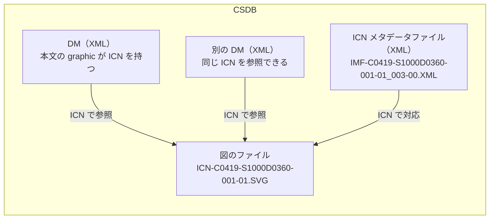
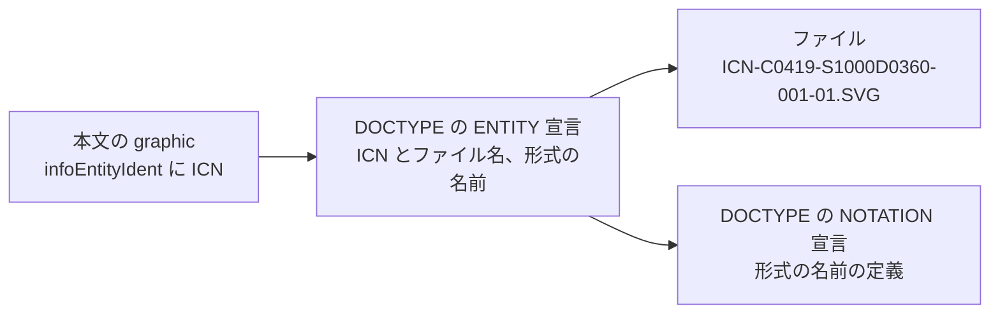
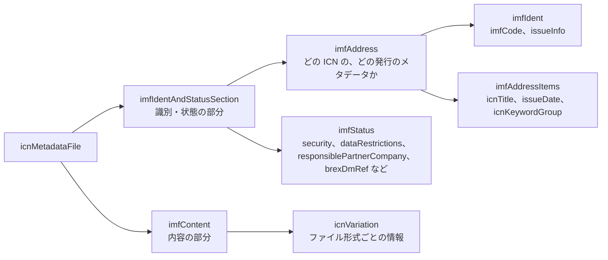
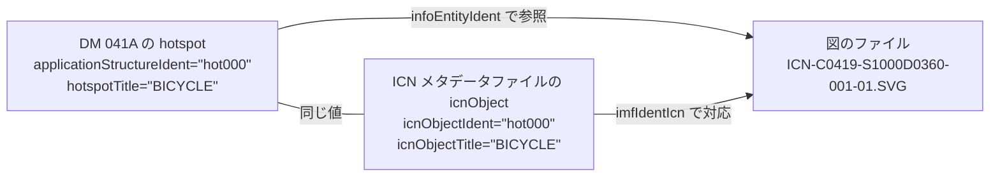

データモジュール（DM）の本文には、図や動画のファイルを埋め込みません。図や動画は CSDB の中の別のファイルとして保管し、DM の本文からは識別子で参照します。その識別子が、情報管理番号（Information Control Number、ICN）です。

この章では、ICN で管理するもの、ICN の 2 つの書式、DM から図とマルチメディアを参照する仕組み、図の管理の情報を持つ ICN メタデータファイルを、Issue 7 の仕様と自転車サンプルを使って説明します。

:::message
この章の要素名、属性名、ICN の書式は、Issue 7 の仕様書とスキーマパッケージで確認したものです。ICN メタデータファイルのスキーマ（`icnmetadata.xsd`）は、Issue 4.2 のスキーマパッケージにはありますが、Issue 4.0 と Issue 4.1 のスキーマパッケージにはありません。対象の版のスキーマで確認してください。
:::

## ICN で管理するもの

Issue 7 の第4.4章によると、DM に付ける図の 1 枚 1 枚と、マルチメディアのオブジェクトには、作成元が ICN を付けなければなりません。添付するその他のデータには、ICN を付けても、実際のファイル名を使ってもかまいません。CSDB の中では、ICN が図、マルチメディア、添付するデータを一つに特定し、一つ以上の DM との関係を作るために使われます。

| 管理するもの | 例 | DM の中で参照する要素 |
| --- | --- | --- |
| 図 | 外観図、分解図、配線図 | `graphic`（`figure` の中） |
| 記号 | 危険を表す絵表示 | `symbol` |
| マルチメディア | 3D のモデル、音声、動画、アニメーション | `multimediaObject`（`multimedia` の中） |
| その他のデータ | 安全データシートの PDF など | 参照する要素は用途によって違う |

ICN はファイル形式に依存しません。同じ ICN の図を、SVG と PNG のように別の形式のファイルで持つこともできます。Issue 7 の自転車サンプルには、`ICN-C0419-S1000D0360-001-01.SVG` と `ICN-C0419-S1000D0360-001-01.PNG` の両方があります。

自転車サンプルには、ICN の付いたファイルが 65 件あります。拡張子の内訳は、CGM が 40 件、PNG が 11 件、JPG が 8 件、SVG が 5 件、GIF が 1 件です。

DM、図、ICN メタデータファイルの関係は、次のとおりです。



第4.4章は、ICN を一度付ければ、その図を複数の DM で使うときにも付け直す必要はない、と書いています。同じ図を複数の DM から参照できるのは、図が DM の外にあるからです。

## ICN の書式

第4.4章は、ICN の書式を 2 つ定めています。CAGE コード（企業や組織に割り当てられるコード）を使う書式と、DM の DMC と同じモデル識別コードを使う書式です。どちらを使うかは、プロジェクトが決めます（ビジネスルールの決定点 BRDP-S1-00344）。

どちらの書式も、先頭に `ICN-` を付け、区切りにハイフンを入れて書きます。例外は、データ送付票（DDN）の `entityControlNumber` 要素で、ここには `ICN-` を付けずに書きます。

### CAGE コードを使う書式

自転車サンプルの ICN は、65 件すべてがこの書式です。`ICN-C0419-S1000D0360-001-01` を区切ると、次のようになります。

```html-embed
<div class="icn">
<div class="part key" style="grid-column:2/5">ICN を一つに決める部分</div>
<div class="part sec" style="grid-column:5">識別子に<br>含まれない</div>
<div class="chip pre" style="grid-column:1">ICN</div>
<div class="chip key" style="grid-column:2">C0419</div>
<div class="chip key" style="grid-column:3">S1000D0360</div>
<div class="chip key" style="grid-column:4">001</div>
<div class="chip sec last" style="grid-column:5">01</div>
<div class="attrs pre" style="grid-column:1"><span class="an">接頭辞</span></div>
<div class="attrs key" style="grid-column:2"><span class="an">作成元の CAGE コード</span><span class="av">5 文字</span></div>
<div class="attrs key" style="grid-column:3"><span class="an">一意の番号</span><span class="av">5〜10 文字</span></div>
<div class="attrs key" style="grid-column:4"><span class="an">発行番号</span><span class="av">3 桁</span></div>
<div class="attrs sec" style="grid-column:5"><span class="an">セキュリティ区分</span><span class="av">2 桁</span></div>
</div>
<style>
.icn { --key:#7c3aed; --keybg:#f5f3ff; --sec:#6b7280; --secbg:#f3f4f6; --ink:#1f2937; --sub:#4b5563; --sep:#9ca3af;
  display:grid; grid-template-columns:.8fr 1.1fr 1.9fr .9fr 1fr; column-gap:14px; row-gap:8px;
  min-width:560px; padding:12px 8px; color:var(--ink); font-family:"Hiragino Sans","Noto Sans CJK JP","Yu Gothic",sans-serif; }
[data-theme="dark"] .icn { --key:#a78bfa; --keybg:#2e1065; --sec:#9ca3af; --secbg:#1f2937; --ink:#e5e7eb; --sub:#cbd5e1; --sep:#6b7280; }
.icn .part { display:flex; align-items:center; justify-content:center; font-size:12px; font-weight:700; text-align:center; padding:4px 6px; border-radius:6px; color:#fff; }
.icn .part.key { background:var(--key); } .icn .part.sec { background:var(--sec); }
[data-theme="dark"] .icn .part { color:#0b1220; }
.icn .chip { position:relative; text-align:center; font-family:ui-monospace,"SFMono-Regular",Menlo,Consolas,"DejaVu Sans Mono",monospace;
  font-size:15px; font-weight:700; padding:6px 0; border:2px solid; border-radius:6px; }
.icn .chip.pre { border-color:var(--sep); border-style:dashed; color:var(--sub); }
.icn .chip.key { border-color:var(--key); background:var(--keybg); color:var(--key); }
.icn .chip.sec { border-color:var(--sec); background:var(--secbg); color:var(--sec); }
.icn .chip:not(.last)::after { content:"-"; position:absolute; right:-12px; top:50%; transform:translateY(-50%); color:var(--sep); font-weight:700; }
.icn .attrs { border-top:2px solid; padding-top:6px; }
.icn .attrs.pre { border-color:var(--sep); } .icn .attrs.key { border-color:var(--key); } .icn .attrs.sec { border-color:var(--sec); }
.icn .an { display:block; font-size:12px; line-height:1.3; }
.icn .av { display:block; font-size:11px; color:var(--sub); margin-top:2px; }
</style>
```

| 部分 | 長さ | 第4.4章の決まり |
| --- | --- | --- |
| 作成元の CAGE コード | 英数字 5 文字 | 図、マルチメディア、その他のデータを作った作成元の CAGE コード |
| 一意の番号 | 英数字 5〜10 文字 | 作成元のコードごとに一意にする |
| 発行番号 | 数字 3 桁 | `001` から始め、更新するたびに上げる |
| セキュリティ区分 | 数字 2 桁 | 使われる場所に関係なく、図そのものの区分。プロジェクトと同じ区分の値を使う |

一意の番号の長さは、サンプルの中でも違います。危険の絵表示の `ICN-B6865-GHS02-001-01` は 5 文字（`GHS02`）、自転車の外観図の `ICN-C0419-S1000D0360-001-01` は 10 文字（`S1000D0360`）です。

第4.4章は、最後の部分のセキュリティ区分は一意の識別子に含まれない、と書いています。ICN を一つに決めるのは、作成元のコード、一意の番号、発行番号の 3 つです。

### モデル識別コードを使う書式

もう一つの書式は、DM の DMC と同じモデル識別コード、システム差異コード、SNS を ICN に含めます。自転車サンプルにはこの書式の ICN が無いため、第4.4章の例を区切って示します。

```text
ICN-S1000DLIGHTING-ABCD-D00000000-0-U8025-54321-A-001-01
```

| 部分 | この例の値 | 第4.4章の決まり |
| --- | --- | --- |
| モデル識別コード | `S1000DLIGHTING` | DMC のモデル識別コードと同じ作り（第4.3.1章） |
| システム差異コード | `ABCD` | DMC のシステム差異コードと同じ作り（第4.3.2章） |
| SNS | `D00000000` | DMC の SNS と同じ作り（第4.3.3章） |
| 責任を持つ会社のコード | `0` | 図などに責任を持つ会社や組織のコード。値はプロジェクトや組織が決める（BRDP-S1-00348） |
| 作成元のコード | `U8025` | CAGE コードを使う書式と同じ |
| 一意の番号 | `54321` | 英数字 5 文字。モデル識別コードごと、作成元ごとに一意にする |
| 変種コード | `A` | 英字 1 文字。`A` が基の図、`B` が最初の変種 |
| 発行番号 | `001` | CAGE コードを使う書式と同じ |
| セキュリティ区分 | `01` | CAGE コードを使う書式と同じ |

変種とは、基の図に書き足したり、拡大・縮小、切り取り、回転、反転、注記の追加をしたりしたものです。CAGE コードを使う書式には、変種コードの部分はありません。

第4.4章は、Issue 4.0 より前の版で付けた ICN のうち、発行番号が 2 桁のものと、セキュリティ区分が 1 桁のものは、そのまま使い続けてよいと書いています。

## ICN の発行番号

ICN は、DM の状態とは関係なく、図そのものの更新の状態を表します。図を更新したら、ICN の発行番号を上げます。セキュリティ区分を変えたときも、新しい発行番号にします。

ICN には発行番号が含まれるので、図を更新して発行番号が上がると、ICN そのものが変わります。新しい図を使う DM は、参照する ICN を新しいものに書き換えます。

| 変わるもの | DM の発行番号 | ICN の発行番号 |
| --- | --- | --- |
| DM の本文を直した | 上がる | 変わらない |
| 図を直した | 新しい図を使うなら、ICN の書き換えに伴って上がる | 上がる |

DMC には DM の発行番号が含まれず、ICN には図の発行番号が含まれます。この違いは、ファイルを一つに決める仕組みの違いです。DM の発行情報の扱いは、[第3章](https://zenn.dev/shuji_bonji/books/s1000d-intro/viewer/core-concepts)で説明しています。

## DM から参照する仕組み

DM の本文から図やマルチメディアを参照する要素は、`graphic`、`symbol`、`multimediaObject` の 3 つです。どれも、ICN を `infoEntityIdent` 属性に書きます。

Issue 7 のスキーマでは、`infoEntityIdent` 属性の型は `xs:ENTITY` です。そのため、ICN とファイルの対応は、DM の DOCTYPE の中に実体（ENTITY）として宣言します。

### 図（graphic）

[第4章](https://zenn.dev/shuji_bonji/books/s1000d-intro/viewer/data-module-structure)と[第5章](https://zenn.dev/shuji_bonji/books/s1000d-intro/viewer/data-module-code)で読んだ記述 DM（`DMC-S1000DBIKE-AAA-D00-00-00-00AA-041A-A_013-00_EN-US.XML`）は、自転車の外観図を次のように参照しています。要素の一部は省いています。

```xml
<?xml version="1.0" encoding="UTF-8"?>
<!DOCTYPE dmodule [
<!ENTITY ICN-C0419-S1000D0360-001-01 SYSTEM "ICN-C0419-S1000D0360-001-01.SVG" NDATA svg>
<!NOTATION svg PUBLIC "-//TEI//NOTATION W3C Scalable Vector Graphics Format//EN">
]>
<dmodule …>
  …
  <figure id="fig-0001">
    <title>Complete bicycle</title>
    <graphic infoEntityIdent="ICN-C0419-S1000D0360-001-01">
      <hotspot id="fig-0001-gra-0001-hot-0000"
               applicationStructureIdent="hot000"
               applicationStructureName="0"
               hotspotType="CALLOUT"
               hotspotTitle="BICYCLE"
               objectDescr="BICYCLE"/>
      …
    </graphic>
  </figure>
  …
</dmodule>
```

ICN とファイルの対応は、3 か所に分けて書かれています。

| 場所 | 書くこと | この例 |
| --- | --- | --- |
| 本文の `graphic` | ICN だけ | `infoEntityIdent="ICN-C0419-S1000D0360-001-01"` |
| DOCTYPE の `ENTITY` 宣言 | ICN に対応するファイル名と、形式の名前 | ファイル名は `ICN-C0419-S1000D0360-001-01.SVG`、形式の名前は `svg` |
| DOCTYPE の `NOTATION` 宣言 | 形式の名前の定義 | `svg` は W3C の Scalable Vector Graphics の形式 |



本文には ICN だけを書き、ファイル名と形式は DOCTYPE に書きます。同じ ICN の図を PNG で使う場合は、DOCTYPE の宣言だけを変えれば済みます。

`graphic` の中の `hotspot` は、図の中の部品などの位置を指す要素です。`applicationStructureIdent` の値（`hot000`）は、後で説明する ICN メタデータファイルの中の値と対応しています。

### 記号（symbol）

`symbol` は、文の中に置く記号を参照します。自転車サンプルのブレーキパッドの清掃手順（`DMC-BRAKE-AAA-DA1-10-00-00AA-251A-A_005-00_EN-US.XML`）では、必要な消耗品（消毒用アルコール）の危険の表示に、GHS の絵表示を 2 つ参照しています。

```xml
<supplyDescr id="sup-0001">
  <name>Rubbing alcohol</name>
  …
  <hazards>
    <hazard>
      <symbol infoEntityIdent="ICN-B6865-GHS02-001-01"/>
      <symbol infoEntityIdent="ICN-B6865-GHS07-001-01"/>
      …
    </hazard>
  </hazards>
</supplyDescr>
```

この DM の DOCTYPE には、2 つの ICN を SVG のファイルに対応させる `ENTITY` 宣言があります。

### マルチメディア（multimediaObject）

マルチメディアは、`multimedia` 要素の中の `multimediaObject` で参照します。Issue 7 のスキーマでは、`multimediaType` 属性の値は `3D`、`audio`、`video`、`other` の 4 つです。

自転車サンプルの使用前の手順（`DMC-S1000DBIKE-AAA-D00-00-00-00AA-121A-A_012-00_EN-US.XML`）は、油圧ブレーキの動きを GIF のアニメーションで示しています。

```xml
<proceduralStep>
  <para>Check the hydraulic brake system function.</para>
  <multimedia>
    <title>Hydraulic brake function</title>
    <multimediaObject autoPlay="1"
                      fullScreen="0"
                      infoEntityIdent="ICN-C0419-S1000D0384-001-01"
                      multimediaType="other"/>
  </multimedia>
</proceduralStep>
```

`autoPlay`、`fullScreen` のように、再生の仕方を指定する属性もあります。どの形式のマルチメディアを使ってよいかは、仕様ではなくプロジェクトが決めます。

## ICN メタデータファイル

Issue 7 の第3.9.2.7章によると、ICN メタデータファイルは、図やマルチメディアについての管理の情報を CSDB に保管し、やり取りするためのファイルです。図やマルチメディアのファイルの中身は外部の形式なので、S1000D の管理の情報を書く場所がありません。その情報を、別の XML のファイルに持たせます。

第3.9.2.7章は、ICN メタデータファイルは DM ではなく、独自の定義を持つが、DM と同じく識別・状態の部分と内容の部分の 2 つに分かれる、と書いています。



[第4章](https://zenn.dev/shuji_bonji/books/s1000d-intro/viewer/data-module-structure)の DM の構造と比べると、`dmodule` が `icnMetadataFile` に、`identAndStatusSection` が `imfIdentAndStatusSection` に、`content` が `imfContent` に対応しています。`imfStatus` の下には、DM の `dmStatus` と同じ名前の要素（`security`、`dataRestrictions`、`brexDmRef`、`qualityAssurance` など）が並びます。

### 自転車サンプルで読む

自転車の外観図（`ICN-C0419-S1000D0360-001-01`）の ICN メタデータファイルは、`IMF-C0419-S1000D0360-001-01_003-00.XML` です。主な部分を抜き出すと、次のようになります。値と要素の一部は省いています。

```xml
<icnMetadataFile …>
  <imfIdentAndStatusSection>
    <imfAddress>
      <imfIdent>
        <imfCode imfIdentIcn="C0419-S1000D0360-001-01"/>
        <issueInfo issueNumber="003" inWork="00"/>
      </imfIdent>
      <imfAddressItems>
        <icnTitle>Bicycle</icnTitle>
        <issueDate year="2026" month="07" day="16"/>
        <icnKeywordGroup>
          <icnKeyword>mountain</icnKeyword>
          …
        </icnKeywordGroup>
      </imfAddressItems>
    </imfAddress>
    <imfStatus>
      <security securityClassification="01" commercialClassification="cc51"/>
      …
    </imfStatus>
  </imfIdentAndStatusSection>
  <imfContent>
    <icnVariation fileExtension="svg">
      <icnContents>
        <icnObjectGroup>
          <icnObject icnObjectIdent="hot000"
                     icnObjectName="0"
                     icnObjectType="CALLOUT"
                     icnObjectTitle="BICYCLE"/>
          …
        </icnObjectGroup>
      </icnContents>
    </icnVariation>
    <icnVariation fileExtension="png"/>
  </imfContent>
</icnMetadataFile>
```

この例から、次の 3 つのことが読み取れます。

- **ICN との対応**：`imfCode` の `imfIdentIcn` 属性に、`ICN-` を除いた ICN（`C0419-S1000D0360-001-01`）が書かれています。
- **メタデータファイル自身の発行番号**：`issueInfo` の発行番号は `003` で、ICN の発行番号（`001`）とは別です。ファイル名の `_003-00` もこの発行番号です。図そのものは変えずに、メタデータだけを 3 回発行したことになります。
- **形式ごとの情報**：`icnVariation` が `svg` と `png` の 2 つあります。同じ ICN の図を 2 つの形式で持っていることが、メタデータからも分かります。

### hotspot との対応

ICN メタデータファイルの `icnObject` は、図の中の部品などを一つずつ表します。DM の `hotspot` の `applicationStructureIdent` 属性の値は、この `icnObject` の `icnObjectIdent` 属性の値と同じです。



第3.9.2.7章は、配線図や油圧系統図などで、IETP が流れをたどって表示したり、スイッチや弁の動きを模擬したりするための情報も、ICN メタデータファイルに持たせられると書いています。自転車サンプルの `IMF-C0419-S1000D0392-002-01_001-00.XML` には、そのための `icnComponent`、`icnConnection`、`icnFlow` などの要素があります。

### やり取りするときの扱い

自転車サンプルのデータ送付票（`DDN-S1000DBIKE-B6865-B6865-2026-00001.XML`）には、送付するファイルとして、`ICN-C0419-S1000D0360-001-01.SVG`、`ICN-C0419-S1000D0360-001-01.PNG`、`IMF-C0419-S1000D0360-001-01_003-00.XML` の 3 つが並んでいます。図のファイルと ICN メタデータファイルは、別々のファイルとして送ります。

## その他のデータ

第4.4章は、その他のデータには ICN を付けても、実際のファイル名を使ってもよいとしています。

自転車サンプルの清掃手順（`DMC-S1000DBIKE-AAA-D00-00-00-00AA-258A-A_012-00_EN-US.XML`）は、安全データシートの PDF を、ICN ではない名前の実体で宣言し、`externalPubRef` 要素から参照しています。

```xml
<!DOCTYPE dmodule [
…
<!ENTITY EXT-Sticky_stuff-Safety_sheet SYSTEM "Sticky%20stuff%20-%20Safety%20sheet.pdf" NDATA pdf>
…
]>
…
<externalPubRef extEntityIdent="EXT-Sticky_stuff-Safety_sheet">
  <externalPubRefIdent>
    <externalPubCode>SafeS-12-156B</externalPubCode>
    <externalPubTitle>Sticky stuff - Safety sheet</externalPubTitle>
    …
```

参照する属性は、図の `infoEntityIdent` ではなく `extEntityIdent` です。DOCTYPE で実体を宣言し、本文からその名前で参照する仕組みは、図と同じです。

## 出典

- 著者が入手した S1000D の仕様パッケージ。入手先は https://users.s1000d.org/
  - Issue 4.0、Issue 4.1：XML スキーマパッケージの `xml_schema_flat`（`icnmetadata.xsd` が無いことの確認）
  - Issue 4.2：XML スキーマパッケージの `icnmetadata.xsd`、自転車サンプルの ICN メタデータファイル
  - Issue 7：第3.9.2.7章、第4.4章、XML スキーマパッケージの `descript.xsd` と `icnmetadata.xsd`、自転車サンプルの DM（`041A`、`121A`、`258A`、`BRAKE` の `251A`）、ICN の付いたファイル、ICN メタデータファイル、データ送付票。仕様書の表紙の日付は 2026-07-16

## この章のポイント

- 図、記号、マルチメディアは DM の外の別のファイルで、ICN で識別します。ICN はファイル形式に依存せず、同じ図を複数の DM から参照できます。
- ICN の書式は、CAGE コードを使うものと、モデル識別コードを使うものの 2 つです。どちらも発行番号とセキュリティ区分で終わり、セキュリティ区分は一意の識別子に含まれません。
- DM は本文の `graphic`、`symbol`、`multimediaObject` の `infoEntityIdent` に ICN を書き、ICN とファイル名の対応は DOCTYPE の `ENTITY` 宣言に書きます。
- ICN メタデータファイルは DM ではありませんが、DM と同じく識別・状態の部分と内容の部分に分かれ、図の管理の情報と、図の中の部品などの情報を持ちます。
