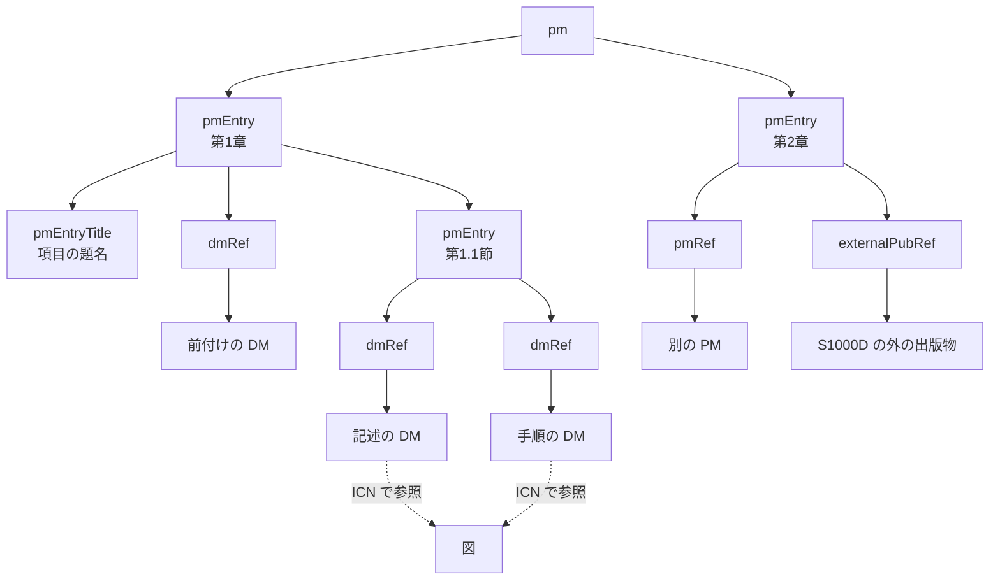
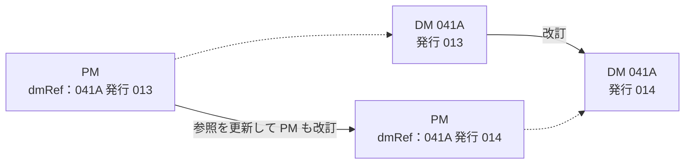
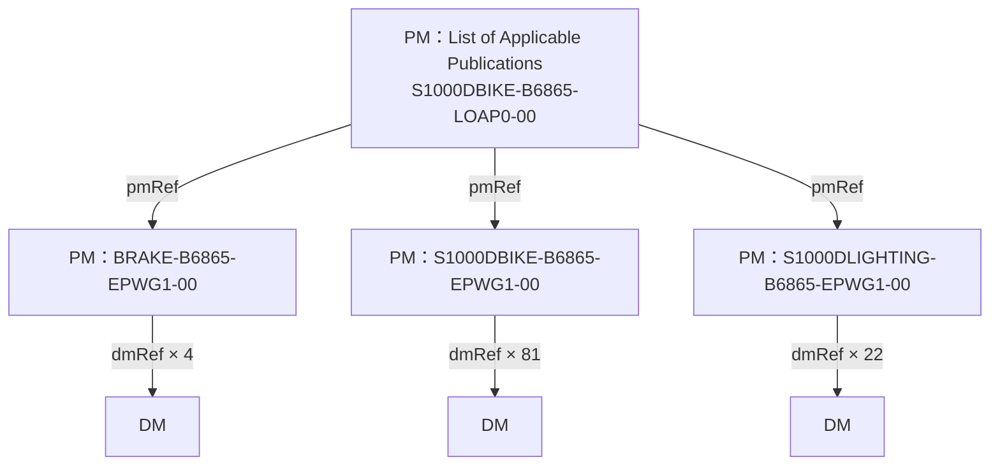

パブリケーションモジュール（Publication Module、PM）は、どのデータモジュール（DM）を、どの順序と階層で並べて一つの出版物にするかを書いたものです。本文は持たず、DM を参照するだけです。同じ DM と PM から、紙や PDF のようなページ型の出版物も、画面で対話的に読む IETP（Interactive Electronic Technical Publication）も作れます。

この章では、PM の役割、PM の識別子（PMC）の読み方、PM から DM と PM を参照する方法、出力の種類、IETP と IETM の関係、対話的な表示の流れを記述する Process データモジュールを説明します。

## PM が持つもの

[公式の概要ページ](https://s1000d.org/?page_id=101)には、PM の定義は書かれていません。Issue 7 の第4.9章は、DM から作る出版物を定義し、準備し、管理するために PM を使う、と書いています。PM も DM と同じように、識別子、状態の部分、内容の部分を持ちます。内容の部分には、納品する順序と構造に沿って、DM、従来の技術出版物、ほかの PM への参照を書きます。手順の本文や図の実体は、PM には書きません。

版ごとに確認できることは、次のとおりです。

- Issue 4.0、Issue 6、Issue 7 のスキーマパッケージでは、`pm.xsd` が `descript.xsd` とは別のファイルです。PM は、記述の DM の一種ではありません。
- Issue 7 の第4.9.1章は、PM の要素として `identAndStatusSection`、`pmAddress`、`pmIdent`、`pmEntry` を挙げています。Issue 6 の第4.9.1章も `pmEntry` を挙げ、出版物の各項目が、DM、出版物、S1000D 以外の出版物、ほかの項目への参照を含むと書いています。
- Issue 4.2 の既定 BREX は、やり取りする XML の最上位の要素の一つに `pm` を挙げ（Chap 1.4.2）、出版物の項目の種類を表す属性 `pmEntryType` を検査しています（Chap 3.9.6.1）。

Issue 7 の `pm.xsd` では、`pmEntry` の中に、項目の題名（`pmEntryTitle`）、DM の参照（`dmRef`）、PM の参照（`pmRef`）、S1000D の外の出版物の参照（`externalPubRef`）、入れ子の `pmEntry` を置けます。項目の並び順が出版物の順序になり、`pmEntry` の入れ子が章や節の階層になります。



章と節の名前は、説明のための例です。図では、`pm` と `pmEntry` の間にある内容の部分（`content`）と、識別・状態の部分（`identAndStatusSection`）を省いています。

手順の本文と、情報管理番号（Information Control Number、ICN）の付いた図は、DM の側にあります。PM が決めるのは、階層と順序だけです。そのため、同じ DM を別の PM から参照できます。[第3章](https://zenn.dev/shuji_bonji/books/s1000d-intro/viewer/core-concepts)で説明した「情報を中心にした管理」を、出版物の側から見た仕組みです。

## Publication Module Code の読み方

PM にも、DMC に当たる識別子があります。パブリケーションモジュールコード（Publication Module Code、PMC）です。PMC は PM 自身の識別・状態の部分に、`pmCode` 要素として書かれます。Issue 7 の第4.9.2章によると、PMC は英大文字と数字の 14 文字から 26 文字で、次の四つの区切りでできています。

| 区切り | 属性名 | Issue 7 の第4.9.2章の範囲 |
| --- | --- | --- |
| モデル識別コード | `modelIdentCode` | 英大文字と数字 2 文字から 14 文字。DMC と同じ（第4.3.1章） |
| 発行者 | `pmIssuer` | 英大文字と数字 5 文字。発行者の CAGE コード |
| 出版物の番号 | `pmNumber` | 英大文字と数字 5 文字。発行者が付ける |
| 巻 | `pmVolume` | 数字 2 文字 |

`pmIssuer` の使い方は、プロジェクトの決定点 BRDP-S1-00365 です。Issue 7 の自転車サンプルのファイル `PMC-S1000DBIKE-B6865-EPWG1-00_006-00_EN-US.XML` では、次のように書かれています。DMC と同じく、`_006-00_EN-US` の部分は発行番号、作業中番号、言語で、PMC には含まれません。

```xml
<pmCode modelIdentCode="S1000DBIKE" pmIssuer="B6865" pmNumber="EPWG1" pmVolume="00"/>
```

コードの区切りと属性の対応は、次のとおりです。[第5章](https://zenn.dev/shuji_bonji/books/s1000d-intro/viewer/data-module-code)の DMC の図と同じく、上の段は文字列を先頭から順に区切ったもの、その下は対応する属性と値です。

```html-embed
<div class="pmc">
<div class="part" style="grid-column:1/5">どの発行者の、どの出版物の、何巻目か</div>
<div class="chip m" style="grid-column:1">S1000DBIKE</div>
<div class="chip p" style="grid-column:2">B6865</div>
<div class="chip p" style="grid-column:3">EPWG1</div>
<div class="chip p last" style="grid-column:4">00</div>
<div class="attrs m" style="grid-column:1"><div class="at"><span class="an">modelIdentCode</span><span class="av">= S1000DBIKE</span></div><div class="nt">モデル識別コード<br>DMC と共通</div></div>
<div class="attrs p" style="grid-column:2"><div class="at"><span class="an">pmIssuer</span><span class="av">= B6865</span></div><div class="nt">発行者<br>CAGE コード</div></div>
<div class="attrs p" style="grid-column:3"><div class="at"><span class="an">pmNumber</span><span class="av">= EPWG1</span></div><div class="nt">出版物の番号<br>発行者が付ける</div></div>
<div class="attrs p" style="grid-column:4"><div class="at"><span class="an">pmVolume</span><span class="av">= 00</span></div><div class="nt">巻</div></div>
</div>
<style>
.pmc { --m:#2563eb; --mbg:#eff6ff; --p:#7c3aed; --pbg:#f5f3ff; --ink:#1f2937; --sub:#4b5563; --sep:#9ca3af;
  display:grid; grid-template-columns:1.6fr 1fr 1fr .8fr; column-gap:16px; row-gap:8px;
  min-width:520px; max-width:640px; padding:12px 8px; color:var(--ink); font-family:"Hiragino Sans","Noto Sans CJK JP","Yu Gothic",sans-serif; }
[data-theme="dark"] .pmc { --m:#60a5fa; --mbg:#172554; --p:#c4b5fd; --pbg:#2e1065; --ink:#e5e7eb; --sub:#cbd5e1; --sep:#6b7280; }
.pmc .part { display:flex; align-items:center; justify-content:center; font-size:12px; font-weight:700; padding:4px 6px; border-radius:6px; color:#fff; background:var(--p); }
[data-theme="dark"] .pmc .part { color:#0b1220; }
.pmc .chip { position:relative; text-align:center; font-family:ui-monospace,"SFMono-Regular",Menlo,Consolas,"DejaVu Sans Mono",monospace; font-size:15px; font-weight:700; padding:6px 0; border:2px solid; border-radius:6px; }
.pmc .chip.m { border-color:var(--m); background:var(--mbg); color:var(--m); }
.pmc .chip.p { border-color:var(--p); background:var(--pbg); color:var(--p); }
.pmc .chip:not(.last)::after { content:"-"; position:absolute; right:-13px; top:50%; transform:translateY(-50%); color:var(--sep); font-weight:700; }
.pmc .attrs { border-top:2px solid; padding-top:6px; }
.pmc .attrs.m { border-color:var(--m); } .pmc .attrs.p { border-color:var(--p); }
.pmc .an, .pmc .av { display:block; font-family:ui-monospace,"SFMono-Regular",Menlo,Consolas,"DejaVu Sans Mono",monospace; font-size:11px; line-height:1.3; }
.pmc .av { color:var(--sub); }
.pmc .nt { margin-top:6px; font-size:11px; color:var(--sub); line-height:1.4; }
</style>
```

PMC には、SNS も情報コードもありません。DMC との違いは、[第3章](https://zenn.dev/shuji_bonji/books/s1000d-intro/viewer/core-concepts)の比較表にまとめています。区切りの構成と長さは版によって決まるので、ほかの版ではその版の仕様で確認してください。

## PM から DM と PM を参照する

### dmRef の中身

`pmEntry` の中の `dmRef` は、参照先の DM を二つの部分で書きます。次の図は、Issue 7 の自転車サンプルの PM（`PMC-S1000DBIKE-B6865-EPWG1-00_006-00_EN-US.XML`）が、自転車全体の記述 DM を参照している `dmRef` です。

```html-embed
<div class="dmx out">
<div class="r"><span class="c"><span class="t">&lt;pmEntry&gt;</span><span class="x">…</span></span><span class="n">出版物の項目</span></div><div class="r"><span class="c">  <span class="t">&lt;dmRef&gt;</span></span><span class="n">DM の参照 1 件</span></div>
<div class="in"><div class="dmx"><span class="lb">dmRefIdent：参照先はどの DM の、どの発行・言語か</span>
<div class="r"><span class="c"><span class="t">&lt;dmRefIdent&gt;</span></span><span></span></div>
<div class="r"><span class="c">  <span class="t">&lt;dmCode</span> <span class="a">modelIdentCode</span>=<span class="v">"S1000DBIKE"</span> <span class="x">…</span> <span class="a">infoCode</span>=<span class="v">"041"</span> <span class="x">…</span><span class="t">/&gt;</span></span><span class="n">どの DM か（DMC）</span></div>
<div class="r"><span class="c">  <span class="t">&lt;issueInfo</span> <span class="a">issueNumber</span>=<span class="v">"013"</span> <span class="a">inWork</span>=<span class="v">"00"</span><span class="t">/&gt;</span></span><span class="n">どの発行か</span></div>
<div class="r"><span class="c">  <span class="t">&lt;language</span> <span class="a">languageIsoCode</span>=<span class="v">"en"</span> <span class="a">countryIsoCode</span>=<span class="v">"US"</span><span class="t">/&gt;</span></span><span class="n">どの言語か</span></div>
<div class="r"><span class="c"><span class="t">&lt;/dmRefIdent&gt;</span></span><span></span></div>
</div></div>
<div class="in"><div class="dmx ad"><span class="lb">dmRefAddressItems：表示に使う情報</span>
<div class="r"><span class="c"><span class="t">&lt;dmRefAddressItems&gt;</span></span><span></span></div>
<div class="r"><span class="c">  <span class="t">&lt;dmTitle&gt;</span></span><span class="n">参照を表示するときの題名</span></div>
<div class="r"><span class="c">    <span class="t">&lt;techName&gt;</span>Bicycle<span class="t">&lt;/techName&gt;</span></span><span></span></div>
<div class="r"><span class="c">    <span class="t">&lt;infoName&gt;</span>Description of how it is made<span class="t">&lt;/infoName&gt;</span></span><span></span></div>
<div class="r"><span class="c">  <span class="t">&lt;/dmTitle&gt;</span></span><span></span></div>
<div class="r"><span class="c"><span class="t">&lt;/dmRefAddressItems&gt;</span></span><span></span></div>
</div></div>
<div class="r"><span class="c">  <span class="t">&lt;/dmRef&gt;</span></span><span></span></div><div class="r"><span class="c"><span class="x">…</span><span class="t">&lt;/pmEntry&gt;</span></span><span></span></div>
</div>
<style>
.dmx { --c:#2563eb; --bg:#eff6ff; --ink:#1f2937; --tag:#9333ea; --att:#0f766e; --val:#b91c1c; --dim:#9ca3af; --note:#374151; --rule:#d1d5db;
  border:2px solid var(--c); background:var(--bg); border-radius:8px; padding:12px 12px 10px; color:var(--ink);
  font-family:"Hiragino Sans","Noto Sans CJK JP","Yu Gothic",sans-serif; }
.dmx.st { --c:#d97706; --bg:#fffbeb; }
[data-theme="dark"] .dmx { --bg:#172554; --ink:#e5e7eb; --tag:#d8b4fe; --att:#5eead4; --val:#fca5a5; --dim:#6b7280; --note:#d1d5db; --rule:#4b5563; --c:#60a5fa; }
[data-theme="dark"] .dmx.st { --bg:#3b2506; --c:#fbbf24; }
.dmx .lb { display:inline-block; background:var(--c); color:#fff; font-weight:700; font-size:13px; padding:2px 10px; border-radius:999px; margin-bottom:8px; }
[data-theme="dark"] .dmx .lb { color:#111827; }
.dmx .r { display:grid; grid-template-columns:1fr 190px; align-items:center; min-height:22px; }
.dmx .c { font-family:ui-monospace,"SFMono-Regular",Menlo,Consolas,"DejaVu Sans Mono",monospace; font-size:12px; white-space:pre; }
.dmx .n { font-size:12px; color:var(--note); padding-left:10px; border-left:1px dashed var(--rule); }
.dmx .t { color:var(--tag); } .dmx .a { color:var(--att); } .dmx .v { color:var(--val); } .dmx .x { color:var(--dim); }
.dmx.ad { --c:#0d9488; --bg:#f0fdfa; }
[data-theme="dark"] .dmx.ad { --bg:#042f2e; --c:#2dd4bf; }
.dmx.out { --c:#9ca3af; --bg:transparent; border-style:dashed; padding:8px 12px; }
.dmx .in { margin:6px 0 6px 2ch; }
</style>
```

`dmRefIdent` は、参照先がどの DM の、どの発行の、どの言語かを表します。`dmRefAddressItems` は、題名など、参照を画面や紙に表示するときに使う情報です。

### 発行まで指定するかどうか

Issue 7 の第3.9.5.2.1.2章によると、`dmRefIdent` の中の `issueInfo` は、参照先の DM の特定の発行を指すための情報です。同じ章は、参照先の DM が更新されたときに、発行番号、作業中番号、言語を参照に使うことがどう影響するかを、プロジェクトや組織が理解しておかなければならない、と書いています。

| 参照の書き方 | DM を改訂したとき |
| --- | --- |
| DMC だけ（`dmCode`） | 参照の記述は変わりません。どの発行を出版物に使うかは、参照からは決まりません |
| DMC、発行情報、言語（`dmCode`、`issueInfo`、`language`） | 参照も、新しい発行に書き換えます |

Issue 7 の自転車サンプルの PM では、出版物の項目の中の `dmRef` は、すべて発行情報と言語まで書いています。`S1000DBIKE` の PM では 81 件、`BRAKE` の PM では 4 件、`S1000DLIGHTING` の PM では 22 件です。

### DM を改訂したときの PM

Issue 7 の第4.9.4章は、出版物を更新する必要が生じると、ふつうは対応する PM も更新すると書いています。理由として、項目が変わる場合と、参照している DM などが変わる場合の両方を挙げています。PM の発行情報（`pmIdent` の `issueInfo`）と発行の種類（`pmStatus` の `issueType`）は、DM と同じ規則で更新します。出版物の更新は、変更記録などの前付けの DM にも反映します。



図の発行番号 014 は、説明のための例です。

### PM から PM を参照する

PM は、`pmRef` でほかの PM を参照できます。Issue 7 の自転車サンプルの `PMC-S1000DBIKE-B6865-LOAP0-00_006-00_EN-US.XML`（List of Applicable Publications、適用される出版物の一覧）は、一つの `pmEntry` の中に `pmRef` を三つ持ち、`BRAKE`、`S1000DBIKE`、`S1000DLIGHTING` の三つの PM をまとめています。三つの `pmRef` は、どれも参照先の PM の発行情報まで書いています。



## 出力の種類

CSDB から出版物を作るとき、どの形で出力するかはプロジェクトが選びます。ページの順に読む紙や PDF も、画面で対話的に読む IETP も、同じ DM と PM から作れます。

ただし、元のデータが同じでも、見た目が同じになるとは限りません。たとえば、紙の出版物では、出版するときに適用の条件を当てはめて内容を固定します。IETP では、表示するたびに適用の条件を評価します。見た目と機能は、プロジェクトの出版のルールで決まります。

### 機能マトリックス

Issue 4.1 と Issue 5.0 のダウンロードの説明には、機能マトリックス（functionality matrix）がパッケージに含まれると書かれています。Issue 6 と Issue 7 のパッケージにも含まれています。機能マトリックスは、IETP を含む電子出版物にどの機能を持たせるかを、プロジェクトが選ぶための一覧です。

契約に「IETP を納品すること」とだけ書かれ、機能マトリックスのどの機能を必須にするかが書かれていなければ、納品物の機能はまだ決まっていません。

### 見た目の手引き

Issue 7 の第6.3章は、IETP を、CSDB に DM として保管された前付けと、いくつかの文書から組み立てると書いています。IETP の見た目と、IETP からの印刷について仕様の手引きを使うかどうかは、プロジェクトの決定点 BRDP-S1-00533 です。手引きを使わない場合は、プロジェクトが別に出力の仕様を定めます。

## IETP と IETM

S1000D では IETP という語を使い、米国の文書では IETM（Interactive Electronic Technical Manual）という語を使います。米空軍の [MIL-STD-3048A](https://everyspec.com/MIL-STD/MIL-STD-3000-9999/download.php?spec=MIL-STD-3048A.054327.pdf) は、二つの語を「ほぼ同等（roughly equivalent）」と定義しています。

| 語 | MIL-STD-3048A の定義の要点 |
| --- | --- |
| IETP | 製品の説明、運用、整備に必要な情報を、電子表示装置で対話的に表示できるよう構成したもの。条件分岐を含み、パラメータの値は実行時に決まることがある。米国でより一般的な IETM とほぼ同等 |
| IETM | 非線形に表示するために、非線形に執筆した技術マニュアル。S1000D の IETP とほぼ同等 |

ただし、ほぼ同等だからといって、契約で求められる納品物が同じになるわけではありません。同じ規格の適用範囲では、IETM が紙やページ型の出版物も含む広い意味で使われている箇所もあります。また、米国 DoD のクラス（Class 0 から 5）は、S1000D の機能マトリックスとは別のものです。クラスについては[『IETM入門 — 概念から S1000D まで』](https://zenn.dev/shuji_bonji/books/ietm-overview/viewer/classes)で説明しています。

## Process データモジュール

Process データモジュールは、対話的な表示の中で、どの DM をどの条件で表示するかという流れを、手順の本文とは別に記述するための種類です。公式の概要ページは、DM の種類の例として名前を挙げています。

Issue 7 の第4.11章は、Process データモジュールを、複数の DM やステップを順序づけた手順の流れと説明し、分岐、繰り返し、条件による絞り込み、外部のアプリケーションとの連携を含むと書いています。ただし、出版物全体を一つの Process データモジュールにすることはしない、とも書いています。

Issue 6 と Issue 7 のスキーマパッケージには `process.xsd` があります。Issue 7 の `process.xsd` には、次の要素が定義されています。

| 要素 | 役割 |
| --- | --- |
| `dmSeq`、`dmNode` | DM を表示する順序 |
| `dmIf` | 条件による分岐 |
| `dmLoop` | 繰り返し |
| `dialog` | 利用者への質問 |
| `variableDeclarations`、`variable` | 変数 |

このほかに `assertion` も定義されています。要素の親子関係と属性は、使う版のスキーマで確認してください。押さえておきたいのは、手順の DM がステップの本文を持ち、Process データモジュールが表示の流れを持つ、という役割の分担です。

## 出版について仕様が決めないこと

仕様は、PM で出版物の構造を、DM で本文を定義します。次のことは仕様では決まらず、プロジェクトが決めます。

- 紙、PDF、IETP のどれを納品するか
- IETP の機能マトリックスのどの機能を必須にするか
- Issue 7 の第6.3章の見た目の手引きを使うか、別の出力の仕様にするか
- 適用の条件を、出版するときに当てはめるか、表示するときに評価するか
- 画面のデザイン、目次の文言、検索の対象

これらを決めた文書が、プロジェクトの出版のルールです。そのうち、XML の構造の使い方に関するものを機械で検査できる形にしたのが BREX で、次の章で説明します。画面の色やビューアの製品は、BREX では扱いません。

## 出典

- S1000D. *About S1000D*（DM と CSDB の定義。PM の定義はここにはない）. https://s1000d.org/?page_id=101
- 著者が入手した S1000D の仕様パッケージ。入手先は https://users.s1000d.org/
  - Issue 4.0：XML スキーマパッケージの `xml_schema_flat` の `pm.xsd`
  - Issue 6：第4.9.1章、`pm.xsd`、`process.xsd`、機能マトリックス `S1000D Functionality Matrix.xls`
  - Issue 7：第3.9.5.2.1.2章、第4.9章、第4.9.1章、第4.9.2章、第4.9.4章、第4.11章、第6.3章、`pm.xsd`、`process.xsd` に定義された要素名、機能マトリックス `S1000D Issue 7 Functionality Matrix.xls`、自転車サンプルの PM（`PMC-S1000DBIKE-B6865-EPWG1-00`、`PMC-BRAKE-B6865-EPWG1-00`、`PMC-S1000DLIGHTING-B6865-EPWG1-00`、`PMC-S1000DBIKE-B6865-LOAP0-00`。いずれも発行 006）
- Issue 4.2 の既定 BREX（最上位の要素としての `pm`、属性 `pmEntryType`）. https://github.com/kibook/S1000D/blob/master/csdb/DMC-S1000D-F-04-10-0301-00A-022A-D_001-00_EN-US.XML
- S1000D. Issue 4.1 のダウンロード説明（functionality matrix を同梱）. https://users.s1000d.org/ProductDescription.aspx?ProductID=16
- S1000D. Issue 5.0 のダウンロード説明（functionality matrix を同梱）. https://users.s1000d.org/ProductDescription.aspx?ProductID=34
- Department of Defense. MIL-STD-3048A(USAF). 用語 3.2.17（IETM）、3.2.18（IETP）. https://everyspec.com/MIL-STD/MIL-STD-3000-9999/download.php?spec=MIL-STD-3048A.054327.pdf

## この章のポイント

- PM は DM とは別のもので、DM への参照によって出版物の内容と構造を定義します。
- PM は `dmRef` で DM を、`pmRef` でほかの PM を参照します。参照に発行情報まで書くかどうかはプロジェクトが決め、書く場合は DM を改訂すると PM の参照と PM の発行も更新します。
- 紙や PDF と IETP は、同じ CSDB から作れる別の出力です。IETP の機能は、機能マトリックスとプロジェクトの要求で決まります。
- IETP は S1000D の語、IETM は主に米国の語です。ほぼ同等でも、契約の要求は別に確認します。対話的な表示の流れは、Process データモジュールが記述します。
