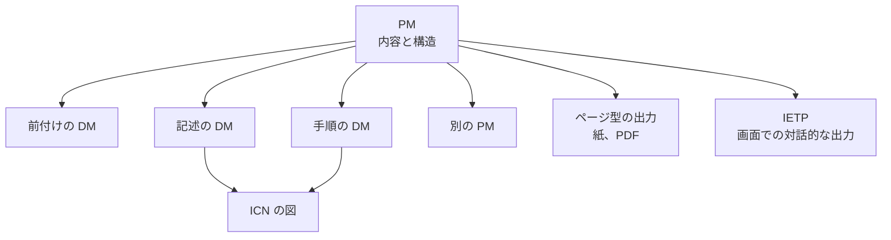

データモジュール（Data Module、DM）は、情報の単位です。読者に渡す整備手順書や画面のマニュアルは、その単位を選んで並べたものです。並べ方を書くオブジェクトが、パブリケーションモジュール（Publication Module、PM）です。画面で対話的に読む出力が、対話型電子技術出版物（Interactive Electronic Technical Publication、IETP）です。IETP は、S1000D の出力の一つです。

## PM が持つもの

公式の概要ページは、DM と共通ソースデータベース（Common Source Data Base、CSDB）を定義していますが、PM の定義の文は載せていません。Issue 7 の第4.9章は、DM から生成する出版物を定義し、準備し、管理するために PM を使う、と書いています。PM は DM に似て、識別子、状態の部分、内容の部分を持ちます。内容の部分は、納品する順序と構造で、DM、従来の技術出版物、または他の PM への参照を含みます。本文のステップや図の実体は、ここには書きません。

版による位置の確認は、次のとおりです。

- Issue 6 と Issue 7 のスキーマパッケージには `pm.xsd` が `descript.xsd` とは別のファイルとしてあります。Issue 4.0 のスキーマパッケージにも、`pm.xsd` が別ファイルとしてあります。PM は、記述の DM の一種ではありません。
- Issue 7 の第4.9.1章の目次は、要素 `identAndStatusSection`、`pmAddress`、`pmIdent`、`pmEntry` を挙げています。これらは Issue 7 の名前です。Issue 6 の第4.9.1章も、要素 `pmEntry` を挙げ、その項目が DM、出版物、S1000D 以外の出版物、または他の項目への参照を含む、と書いています。属性の一覧は写しません。
- Issue 4.2 の既定 BREX は、交換される XML のルート要素の一つに `pm` を挙げ、Chap 1.4.2 を引いています。同じ BREX は、属性 `pmEntryType` を出版物の項目の種類として検査し、Chap 3.9.6.1 を引いています。属性名 `pmEntryType` は Issue 4.2 のファイルで確認したものです。要素名 `pmEntry` を、そのファイルの記述として読み替えません。

手順の本文と、情報管理番号（Information Control Number、ICN）の付いた図は、DM の側に残ります。PM が与えるのは階層と順序です。同じ DM を、別の PM から参照できます。第3章で見た「情報を中心にした管理」を、出版物の側から見た仕組みがこれです。

PM にも識別用のコードがあります。自転車サンプルの出版物には、`PMC-` で始まるコードが印刷されています。コードのフィールド構成は版で決まります。DMC の分解を、そのまま PM のコードに当てはめないでください。

## 出力は一つではない

CSDB から出版物を作るとき、出力の形はプロジェクトが選びます。ページの順に読ませる紙や PDF も、画面で対話的に読ませる IETP も、同じ DM と PM を源にできます。源が同じであることと、紙用に適用を展開して固定した PDF と、表示のたびに適用を評価する IETP が同じ見た目になることは、別の問題です。見た目と機能は、プロジェクトの出版のルールで決まります。

Issue 4.1 と Issue 5.0 のダウンロード説明には、機能マトリックス（functionality matrix）がパッケージに含まれると書いてあります。Issue 6 のパッケージには `S1000D Functionality Matrix.xls`、Issue 7 のパッケージには `S1000D Issue 7 Functionality Matrix.xls` が含まれます。これは、IETP を含む電子出版物の機能を、プロジェクトが選ぶための仕様側の一覧です。本書はその一覧を写しません。契約が「IETP を納品すること」とだけ書き、機能マトリックスのどの行を必須にするかを書いていない場合、納品物の機能はまだ決まっていません。

Issue 7 の第6.3章は、IETP を、CSDB に DM として格納された前付けといくつかの文書から組み立てる、と書いています。見た目と、IETP からの印刷出力についての手引きを使うかどうかは、プロジェクトの決定点 BRDP-S1-00533 です。手引きを使わないなら、プロジェクトが別の出力仕様を定義します。

## IETP と IETM

S1000D が使う語は IETP です。米国の文書が使う語は IETM（Interactive Electronic Technical Manual）です。米空軍の MIL-STD-3048A は、二つの語をほぼ同等（roughly equivalent）だと定義しています。定義の要点は、次のとおりです。

| 語 | MIL-STD-3048A の定義の要点 |
| --- | --- |
| IETP | 製品の説明、運用、整備に必要な情報を、電子表示装置で対話的に表示できるよう構成したもの。条件分岐を含み、パラメータの値は実行時に決まり得る。米国でより一般的な IETM とほぼ同等 |
| IETM | 非線形に表示するために非線形に執筆した技術マニュアル。S1000D の IETP とほぼ同等 |

ほぼ同等であっても、契約の成果物が同じであることにはなりません。同じ規格の適用範囲では、IETM が紙やページ型を含む広い意味で使われている箇所もあります。米国 DoD のクラス（Class 0 から 5）は、S1000D の機能マトリックスそのものではありません。クラスの説明は『IETM入門 — 概念から S1000D まで』にあります。

公式の概要が名前を挙げている Process データモジュールは、対話的な表示で、どの DM をどの条件で出すかという流れを、手順の本文とは別に書くための種類です。Issue 7 の第4.11章は、これを、複数の DM またはステップを順序づけた手順の流れだと書き、分岐、繰り返し、選択的な絞り込み、外部アプリケーションとのインターフェースを含む、と述べています。出版物全体を一つの Process の DM にはしない、とも書いています。流れを表す要素名は、版の process のスキーマにあります。Issue 6 と Issue 7 のスキーマパッケージには `process.xsd` があります。Issue 7 の `process.xsd` には、DM を表示する順序の `dmSeq` と `dmNode`、条件による分岐の `dmIf`、繰り返しの `dmLoop`、利用者への質問の `dialog`、変数の `variableDeclarations` と `variable`、`assertion` が定義されています。要素の親子関係と属性は、本書では写しません。第4.11章の説明は、Issue 7 の本文から読んだものです。手順の DM がステップの本文を持ち、Process の DM が表示の流れを持つ、という役割の分離だけを、ここでは押さえておきます。

## 出版のときに仕様が決めないこと

仕様は、PM で構造を定義し、DM で本文を定義します。次のことは、仕様の外で、プロジェクトが決めます。

- 紙、PDF、IETP の、どれを納品するか
- IETP の機能マトリックスの、どの機能を必須にするか
- Issue 7 の第6.3章が決定点にしている、見た目の手引きを使うか、別の出力仕様にするか
- 適用を出版時に固定するか、表示時に評価するか
- 画面のデザイン、目次の文言、検索の対象

これらを決める文書が、プロジェクトの出版ルールです。ルールのうち、XML の構造の使い方に関するものを機械可読にしたのが BREX です。BREX は次の章で説明します。画面の色や、ビューアの製品名は、BREX の話題ではありません。

## 出典

- S1000D. *About S1000D*（DM と CSDB の定義。PM の定義文はここにはない）. https://s1000d.org/?page_id=101
- 著者が入手した S1000D Issue 4.0 のパッケージ（XML スキーマパッケージの `xml_schema_flat` の `pm.xsd`）。入手先は https://users.s1000d.org/
- Issue 4.2 の既定 BREX（ルート要素としての `pm`、属性 `pmEntryType`）。要素名 `pmEntry` はこの出典では確認していない. https://github.com/kibook/S1000D/blob/master/csdb/DMC-S1000D-F-04-10-0301-00A-022A-D_001-00_EN-US.XML
- 著者が入手した S1000D Issue 6 のパッケージ（第4.9.1章、`pm.xsd`、`process.xsd`、機能マトリックス）。入手先は https://users.s1000d.org/
- 著者が入手した S1000D Issue 7 のパッケージ（第4.9章、第4.9.1章、第4.11章、第6.3章、`pm.xsd`、`process.xsd` に定義された要素名、機能マトリックス）。入手先は https://users.s1000d.org/
- S1000D. Issue 4.1 のダウンロード説明（functionality matrix を同梱）. https://users.s1000d.org/ProductDescription.aspx?ProductID=16
- S1000D. Issue 5.0 のダウンロード説明（functionality matrix を同梱）. https://users.s1000d.org/ProductDescription.aspx?ProductID=34
- Department of Defense. MIL-STD-3048A(USAF). 用語 3.2.17（IETM）、3.2.18（IETP）. https://everyspec.com/MIL-STD/MIL-STD-3000-9999/download.php?spec=MIL-STD-3048A.054327.pdf

## この章のポイント

- PM は DM とは別のオブジェクトであり、出版物の内容と構造を、参照によって定義する。
- 紙や PDF と IETP は、同じ CSDB から出せる別の出力である。IETP の機能は、機能マトリックスとプロジェクトの要求で決まる。
- IETP は S1000D の語、IETM は主に米国の語である。ほぼ同等であっても、契約の要求は別に読む。
