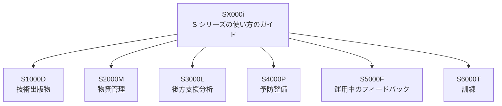

S1000D は、単独の仕様であると同時に、製品支援のための一連の国際仕様の一つです。この一連を S シリーズと呼びます。S1000D の公式サイトの外部リンクは、S1000D をその中の技術出版物の仕様として置き、隣接する仕様を別の名前で紹介しています。S1000D を採用しただけで、隣接する仕様も採用したことにはなりません。

## 公式のリンク集が紹介している仕様

外部リンクのページは、次を紹介しています。SX000i だけが “guide”（ガイド）で、他は仕様または手順仕様です。説明は、リンク集の英語の標題に合わせています。

| 文書 | リンク集の標題 | 扱うこと |
| --- | --- | --- |
| SX000i | International guide for the use of the S-Series Integrated Product Support (IPS) specifications | S シリーズの統合製品支援（Integrated Product Support、IPS）仕様の使い方のガイド |
| S1000D | International specification for technical publications using a common source database | 共通ソースデータベースを用いる技術出版物 |
| S2000M | International specification for material management | 物資の管理 |
| S3000L | International procedure specification for Logistic Support Analysis (LSA) | 後方支援分析の手順 |
| S4000P | International specification for developing and continuously improving preventive maintenance | 予防整備を作り、継続的に改善すること |
| S5000F | International specification for in-service data feedback | 運用開始後のデータのフィードバック |
| S6000T | International specification for training information | 訓練の情報 |

公式の利点のページは、S1000D のデータを LSAR（後方支援分析の記録）などの元データと連携できる、と述べています。連携できる、という記述であり、S3000L のどの版と、どのデータ項目を、どの方向に渡すかまでは書いていません。渡す項目は、両仕様の版と、プロジェクトの取り決めにあります。

Issue 7 の第2.3章が関係を短く扱っているのは、S2000M、ISO 10303 AP 239（PLCS）、SCORM です。同じ章は、S1000D と S2000M がモデル識別の符号化で同じ規則を使うこと、図の規則も第3.9.2章を共有すること、部品カタログを S2000M のデータベースから抽出する方法があること、を書いています。この章は、上のリンク集の仕様をすべて解説してはいません。S1000D を採用しただけで、第2.3章に名前がある仕様も採用したことにはなりません。

図の線は、SX000i が全体の使い方を扱うことを示します。データの流れる向きは、各仕様が別に定めます。

## 境目

S1000D が持つのは、人が読む技術情報を DM にし、CSDB で管理し、PM で出版物にすることでした。隣接する仕様は、別の問いを持ちます。

- S2000M は、部品などの物資をどう管理するかを扱います。整備手順の本文は扱いません。
- S3000L は、後方支援の分析をどう進めるかを扱います。分析の結果を S1000D のどの DM に書くかは、別の取り決めです。
- S4000P は、予防整備の項目をどう作り、どう改善するかを扱います。S1000D の概要が Schedules という種類の名前を挙げていることと、Schedules の DM が S4000P の出力そのものであることは、同じではありません。概要は、その同一性を述べていません。
- S5000F は、運用が始まったあとのデータを、開発や整備の側へどう戻すかを扱います。IETP の画面に手順を表示することとは別の流れです。
- S6000T は、訓練の情報を扱います。IETP で手順を表示するビューアとは、作るものが違います。
- SX000i は、これらの使い方を IPS としてまとめるガイドです。個々の仕様の代わりにはなりません。

第2章で見たとおり、S1000D のスポンサーには ATA e-Business Program が含まれます。外部リンクが紹介している他の S シリーズ仕様の標題は、ASD と AIA の名前で書かれているものが中心です。S1000D だけに ATA が関与する、という整理は、スポンサーのページとリンク集の両方から読めます。他の仕様の表紙の権利表示は、入手した文書で確認します。

## リンク集にある、S シリーズ以外のもの

同じ外部リンクのページは、S シリーズ以外も紹介しています。本書が関係するものは、次の三つです。

- ATA Spec 1000BR。S1000D を実装するための、民間航空のビジネスルール。
- Defense Interest Group のビジネスルール。防衛の共通の層を、S1000D の決定点に基づいてまとめた文書、として紹介されている。
- ASD-STE100。技術文書のための簡略化英語の規格。

これらは S1000D そのものではありません。英語で本文を書くプロジェクトが STE100 を契約で参照することはあります。日本語のプロジェクトに STE100 がそのまま適用される、とはリンク集は書いていません。民間航空のプロジェクトが ATA Spec 1000BR を参照することはあります。防衛のプロジェクトが DIG のルールを参照することはあります。どちらを使うかは契約が指定します。指定がなければ、S1000D の既定 BREX だけでプロジェクトのルールが完結したことにはなりません。第8章のとおり、プロジェクトが決める層が残ります。

Shipdex も、同じページで、海運の技術データとロジスティクスデータの作成と交換を標準化するためのビジネスルールとして紹介されています。S1000D の海上への適用と、Shipdex の採用は、別の決定です。

## 契約での読み分け

「S シリーズに従うこと」とだけ書かれた契約は、七つの文書のどれを、どの版で要求しているかが未定です。技術出版物の納品であれば、少なくとも S1000D の Issue が必要です。部品マスタの交換まで含むなら、S2000M の版が別に必要です。訓練の分析まで含むなら、S6000T の版が別に必要です。

IETP の画面から部品を注文できることと、その注文のデータが S2000M に従っていることも、別です。画面の機能は S1000D の機能マトリックスと出版ルールの話題であり、物資管理の仕様は S2000M の話題です。

## 出典

- S1000D. *External Links*（SX000i、S2000M、S3000L、S4000P、S5000F、S6000T、ATA Spec 1000BR、DIG、Shipdex、ASD-STE100）. https://s1000d.org/?page_id=44
- 著者が入手した S1000D Issue 7 のパッケージ（第2.3章）。入手先は https://users.s1000d.org/
- S1000D. *About S1000D*. https://s1000d.org/?page_id=101
- S1000D. *Benefits*（LSAR などとの連携に触れている記述）. https://s1000d.org/?page_id=57
- S1000D. *S1000D Organizational Structure*（三つのスポンサー）. https://s1000d.org/?page_id=61
- SX000i. https://sx000i.org/
- S2000M. https://www.s2000m.org/
- S3000L. https://www.s3000l.org/
- S4000P. https://www.s4000p.org/
- S5000F. https://www.s5000f.org/
- S6000T. https://www.s6000t.org/
- ASD-STE100. http://www.asd-ste100.org/

## この章のポイント

- S1000D は S シリーズのうち技術出版物を担う仕様である。物資、後方支援分析、予防整備、運用フィードバック、訓練は、それぞれ別の仕様である。
- SX000i は仕様群の使い方のガイドであり、S1000D の代わりにはならない。
- S1000D の採用は、隣接仕様の採用を意味しない。画面の機能と、交換するデータの仕様は、契約の中で別々に指定する。
