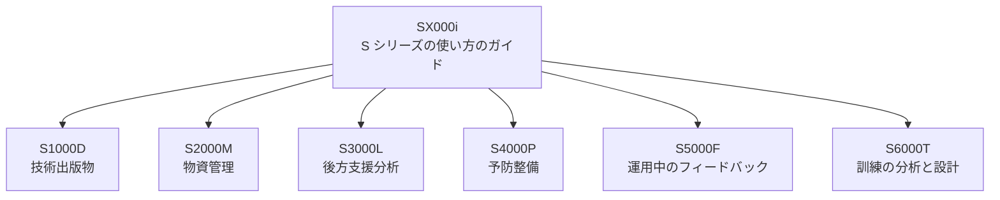

S1000D は、装備の製品支援を扱う一連の国際仕様「S シリーズ」の一つで、そのうち技術出版物を担当しています。部品などの物資の管理、後方支援の分析、予防整備、運用中のデータのフィードバック、訓練は、S シリーズのそれぞれ別の仕様が扱います。S1000D を採用しただけで、ほかの S シリーズの仕様も採用したことにはなりません。

この章では、S シリーズの構成と、S1000D との境目を説明します。

## S シリーズの仕様

S1000D の公式サイトの外部リンクのページは、次の仕様を紹介しています。このうち SX000i だけが「ガイド（guide）」で、ほかは「仕様（specification）」または「手順仕様（procedure specification）」です。英語の標題は、リンク集の表記に合わせています。S6000T だけは、S シリーズのサイトの現在の標題を載せています。

| 文書 | 英語の標題 | 扱うこと |
| --- | --- | --- |
| SX000i | International guide for the use of the S-Series Integrated Product Support (IPS) specifications | S シリーズの統合製品支援（Integrated Product Support、IPS）の仕様の使い方 |
| S1000D | International specification for technical publications using a common source database | 共通ソースデータベースを用いる技術出版物 |
| S2000M | International specification for material management | 物資の管理 |
| S3000L | International procedure specification for Logistic Support Analysis (LSA) | 後方支援分析の手順 |
| S4000P | International specification for developing and continuously improving preventive maintenance | 予防整備の計画を作り、継続的に改善すること |
| S5000F | International specification for in-service data feedback | 運用が始まった後のデータのフィードバック |
| S6000T | International specification for training analysis and design | 訓練の分析と設計 |

S シリーズのサイトは、このほかに、複数の仕様にまたがって使う文書も公開しています。用語集の SX001G、仕様をまたいでデータの形をそろえるための共通データモデル SX002D、UML モデルの読み方の SX004G、XML スキーマの実装ガイドの SX005G（S1000D 以外の仕様が対象）です。

図の線は、SX000i が仕様群全体の使い方を扱っていることを示すものです。データがこの向きに流れることを表すものではありません。データのやり取りは、それぞれの仕様で定められています。

### 開発している組織

第2章で説明したとおり、S1000D のスポンサーは ASD、AIA、ATA e-Business Program の三つです。S シリーズのサイトの著作権表示によると、S1000D 以外の仕様は ASD と AIA が共同で開発しており、ATA e-Business Program が加わっているのは S1000D だけです。個々の仕様の権利の表示は、入手した文書で確認してください。

## S1000D とほかの仕様の境目

S1000D が扱うのは、人が読む技術情報を DM として作り、CSDB で管理し、PM で出版物にすることです。ほかの仕様は、それぞれ別の問題を扱います。

- **S2000M** は、部品などの物資の管理方法を扱います。整備手順の本文は扱いません。
- **S3000L** は、後方支援の分析の進め方を扱います。分析の結果を S1000D のどの DM に書くかは、別に取り決めます。
- **S4000P** は、予防整備の項目の作り方と、改善の方法を扱います。S1000D の概要ページには Schedules という DM の種類がありますが、Schedules の DM が S4000P の出力そのものだとは書かれていません。
- **S5000F** は、運用が始まった後のデータを、開発や整備の側に戻す方法を扱います。IETP の画面に手順を表示することとは別の流れです。
- **S6000T** は、訓練の分析と設計の方法を扱います。IETP で手順を表示するビューアとは、作るものが違います。
- **SX000i** は、これらの仕様を IPS として組み合わせて使う方法をまとめたガイドです。個々の仕様の代わりにはなりません。

### S1000D の仕様書が触れているほかの仕様

公式の利点のページは、S1000D のデータを LSAR（後方支援分析の記録）などの元データと連携できると書いています。ただし、S3000L のどの版の、どのデータ項目を、どちらの向きに渡すかまでは書いていません。渡す項目は、両方の仕様の版と、プロジェクトの取り決めで決まります。

Issue 7 の第2.3章は、S2000M、ISO 10303 AP 239（PLCS）、SCORM との関係を簡単に扱っています。同じ章によると、S1000D と S2000M は、モデル識別コードの付け方に同じ規則を使い、図の規則も第3.9.2章を共有しています。また、部品カタログを S2000M のデータベースから取り出す方法があるとも書かれています。ただし、第2.3章に名前がある仕様も、S1000D を採用しただけで採用したことにはなりません。

## S シリーズ以外の関連文書

外部リンクのページは、S シリーズ以外の文書も紹介しています。本書に関係するものは、次の四つです。

| 文書 | 内容 |
| --- | --- |
| ATA Spec 1000BR | S1000D を民間航空で使うためのビジネスルール |
| Defense Interest Group（DIG）のビジネスルール | 防衛の分野に共通する層のルールを、S1000D の決定点に沿ってまとめたもの |
| ASD-STE100 | 技術文書のための簡略化英語の規格 |
| Shipdex | 海運の技術データとロジスティクスデータの作成とやり取りを標準化するためのビジネスルール |

これらは、S1000D そのものではありません。民間航空のプロジェクトでは ATA Spec 1000BR を、防衛のプロジェクトでは DIG のルールを参照することがありますが、どれを使うかは契約で指定します。指定がない場合でも、S1000D の既定 BREX だけでプロジェクトのルールが決まるわけではなく、第8章で説明したとおり、プロジェクトが決める層が残ります。

ASD-STE100 は、英語で本文を書くプロジェクトの契約で参照されることがあります。日本語のプロジェクトにそのまま適用されるとは、リンク集には書かれていません。Shipdex についても、S1000D を船舶に使うことと、Shipdex を採用することは、別の判断です。

## 契約での読み分け

「S シリーズに従うこと」とだけ書かれた契約では、七つの文書のうち、どれをどの版で求めているかが決まっていません。技術出版物を納品するのであれば、少なくとも S1000D の版が必要です。部品のデータのやり取りまで含むなら S2000M の版、訓練の分析まで含むなら S6000T の版が、それぞれ別に必要です。

また、IETP の画面から部品を発注できることと、その発注のデータが S2000M に従っていることは別の問題です。画面の機能は S1000D の機能マトリックスと出版のルールで決め、物資の管理のデータは S2000M で決めます。

## 出典

- S1000D. *External Links*（SX000i、S2000M、S3000L、S4000P、S5000F、S6000T、ATA Spec 1000BR、DIG、Shipdex、ASD-STE100）. https://s1000d.org/?page_id=44
- 著者が入手した S1000D Issue 7 のパッケージ（第2.3章）。入手先は https://users.s1000d.org/
- S1000D. *About S1000D*. https://s1000d.org/?page_id=101
- S1000D. *Benefits*（LSAR などとの連携に触れている記述）. https://s1000d.org/?page_id=57
- S1000D. *S1000D Organizational Structure*（三つのスポンサー）. https://s1000d.org/?page_id=61
- S-Series サイトの著作権表示（S1000D は AIA、ATA／A4A、ASD。ほかは AIA と ASD）. https://www.s-series.org/
- S-Series. *Resource center*（SX001G、SX002D、SX004G、SX005G）. https://www.s-series.org/resource-center/
- SX000i. https://sx000i.org/
- S2000M. https://www.s2000m.org/
- S3000L. https://www.s3000l.org/
- S4000P. https://www.s4000p.org/
- S5000F. https://www.s5000f.org/
- S6000T. https://www.s6000t.org/ （標題は https://s-series.org/s6000t/about-s6000t ）
- ASD-STE100. http://www.asd-ste100.org/

## この章のポイント

- S1000D は、S シリーズのうち技術出版物を担当する仕様です。物資、後方支援分析、予防整備、運用中のフィードバック、訓練は、それぞれ別の仕様が扱います。
- SX000i は仕様群の使い方のガイドで、S1000D の代わりにはなりません。S1000D 以外の仕様には、ATA e-Business Program は加わっていません。
- S1000D を採用しても、ほかの仕様を採用したことにはなりません。画面の機能と、やり取りするデータの仕様は、契約の中で別々に指定します。
