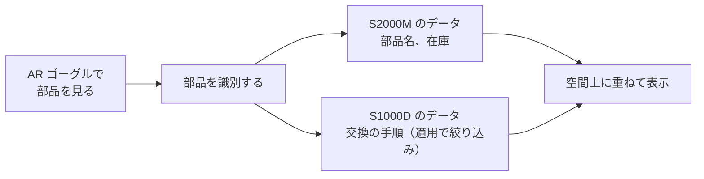

S1000D は 1980 年代に始まった古い仕様ですが、今も改訂が続き、使われる分野と国が広がっています。理由として挙げられるのは、航空機の整備手順だけでなく陸・海の装備や建設などにも使える仕様になったこと、各国の防衛分野や NATO で採用が進んでいること、データの形だけを決めているので画面を今の技術で作れること、3D や VR のような新しい表示方法にも対応できることです。

この章では、これらを公式の資料と仕様書で確かめられる事実として説明します。そのうえで、DX や XR（AR、VR）との関係を、著者の見解として述べます。

## 航空機の整備手順だけの仕様ではなくなった

S1000D は、欧州の航空宇宙の規格として始まりました（第2章）。しかし現在は、航空機の整備手順だけを扱う仕様ではありません。

- **陸と海の装備**：公式の概要ページによると、Issue 2 から陸上と海上の装備が範囲に加わりました。Issue 7 の第1.2章も、空・陸・海のビークルや装備を対象にしています。
- **装備以外の文書**：概要ページは、軍用と民用の装備のほか、建設、方針や手続き、法務文書、組織の文書などにも使えると書いています。Issue 7 の第1.1章も、これまでの経験から、S1000D の原理は技術以外の刊行物にも使えると述べています。
- **現在の用途**：ダウンロードサイトの案内は、防衛（陸・海・空）、民間航空、建設、船舶を挙げています。
- **分野ごとのルール**：民間航空には ATA Spec 1000BR、海運には Shipdex、防衛には DIG のビジネスルールがあり、それぞれの分野で S1000D を使うためのルールが整えられています（第9章）。

S シリーズ全体について、米国航空宇宙工業会（AIA）は、航空宇宙と防衛のために作られた仕様だが、海事、海中、鉄道、建設、農業など、ほかの分野にも使えると書いています。

ただし、使えることと、その分野で同じ効果が得られることは別です。それぞれの分野で使うときは、その分野のビジネスルールと、プロジェクトのルールを決める必要があります。

## 採用の広がり

S シリーズの公式サイトは、S シリーズが欧州の取り組みから国際的な標準に広がったと説明し、次のことを挙げています。

- ATA（S1000D のみ）と AIA との覚書
- 最近加わった国として、カナダ、オーストラリア、韓国、日本
- 2024 年の出来事として、NATO の統合ライフサイクル支援の指針（ALP-10）への組み込み、米国防総省による採用の検討の要請、日本の業界団体 SJAC との覚書

SJAC との覚書は二つあります。一つは S1000D についての覚書で、AIA、A4A、ASD、SJAC の四団体が結びました。もう一つは S シリーズ全体についての覚書で、AIA、ASD、SJAC の三団体が結びました。S シリーズのサイトのニュースによると、これにより SJAC は、主要な委員会と作業部会に参加できるようになりました。

各国の防衛分野でも、S1000D を使うための文書が整えられています。

| 国・組織 | 確認できた文書 |
| --- | --- |
| 米空軍 | S1000D で技術出版物を作るときのビジネスルール MIL-STD-3048 |
| ドイツ軍 | 契約で使える S1000D の版を指定している |
| オーストラリア国防省 | S1000D の IETP の標準 DEF(AUST) IPS-5630 |

ただし、確認した範囲では、これらの文書が S1000D をどの契約でも必須にするとまでは書かれていません。どの版とルールで納品するかは、個々の契約で決まります。

## 表示の技術を自由に選べる

S1000D が決めているのは、データの形です。CSDB の機能は定めておらず（第3章）、ビューアのプログラムも仕様の配布物には含まれていません。画面にどの機能を持たせるかは、プロジェクトが機能マトリックスで選びます（第7章）。

1990 年代の IETM は、専用の電子表示装置で動かすことが前提でした。S1000D では表示の方法が決められていないので、今の技術で画面を作れます。実際に、ブラウザで動く IETP のビューアを製品として提供している企業もあります。本書は特定の製品を推奨しませんが、データの形が共通であれば、表示の部分を作る技術はプロジェクトが選べる、ということです。

## 3D と VR への対応

Issue 7 の仕様書には、3D と VR に関する記述があります。

- 第3.9.2.5章に、対話的な 3D コンテンツ（Interactive 3D content）の規則があります。
- 第6.4.1章（機能マトリックスの機能の定義）と第7.3.3章は、3D モデルを使って、仮想的な組み立てと分解、部品の取り外しと取り付けを、アニメーション、シミュレーション、仮想現実（virtual reality）の考え方で示せると書いています。
- 同じ章は、シミュレーション、アニメーション、仮想現実をどこまで使うかによって、費用が大きく変わるとも注意しています。

また、IETP の 3D の部品を、複数の XR ヘッドセットに同時に表示する仕組みについての米国特許（US10891798、2021 年登録）もあり、その背景の説明で S1000D に触れています。

## 著者の見解：DX と XR

:::message
この節は、上の事実をもとにした著者の見解です。公式サイトや仕様書が述べている内容ではありません。
:::

### DX との相性

S1000D は、技術情報を冊子ではなく、識別コードと適用の条件を持った小さなデータの単位として管理します。これは、紙の書類を電子化するだけでなく、業務の仕組みそのものをデータ中心に変える、いわゆる DX（デジタルトランスフォーメーション）の考え方とよく合っています。古い仕様が改めて注目されている理由の一つは、ここにあると考えます。

### XR は「表現」、S1000D は「データ」

AR や VR のような XR の技術は、情報をどう見せるかという「表現」の技術です。一方 S1000D は、何をどの条件で見せるかを決める「データ」の仕様です。XR の機器や表示方法が変わっても、S1000D で整えたデータはそのまま使えます。

たとえば、次のような整備の環境が考えられます。

作業員が AR ゴーグルで故障した部品を見ると、その部品の名前と在庫の状況（S2000M のデータ）と、交換の手順（S1000D のデータ）が、作業員の視界に重ねて表示される、という環境です。Issue 7 の第2.3章は、S1000D と S2000M がモデル識別コードの付け方に同じ規則を使い、部品カタログを S2000M のデータベースから取り出す方法があると書いています（第9章）。二つのデータをつなぐための前提は、仕様の側にすでにあると言えます。

さらに進めば、S1000D のデータから XR の表示を自動で作ることも考えられます。ただし、そうした仕組みが一般に使われている、と言えるだけの一次資料は確認できていません。仕様書自身も、VR をどこまで使うかで費用が大きく変わると注意しています。現時点では、実現に向けた可能性として捉えるのが適切だと考えます。

## 出典

- S1000D. *About S1000D*（Issue 2 からの範囲、装備以外の文書への適用）. https://s1000d.org/?page_id=101
- S1000D. Downloads（現在の用途）. https://users.s1000d.org/
- S1000D. *External Links*（ATA Spec 1000BR、DIG、Shipdex）. https://s1000d.org/?page_id=44
- Aerospace Industries Association. *S-Series IPS Specifications*（海事、海中、鉄道、建設、農業への適用）. https://www.aia-aerospace.org/standards/s-series-ips/
- S-Series. *Global adoption*（カナダ、オーストラリア、韓国、日本、NATO ALP-10、米国防総省、SJAC との覚書）. https://www.s-series.org/our-specifications/global-adoption/
- S-Series. *Aerospace cooperation boosted by new agreements on S1000D and S-Series specifications*（SJAC との二つの覚書）. https://www.s-series.org/news-and-events/news/aerospace-cooperation-boosted-by-new-agreements-on-s1000d-and-s-series-specifications/
- Department of Defense. MIL-STD-3048A(USAF). https://everyspec.com/MIL-STD/MIL-STD-3000-9999/download.php?spec=MIL-STD-3048A.054327.pdf
- Bundeswehr. *S1000D International specification for technical publications*（契約で使える版）. https://www.bundeswehr.de/de/organisation/unterstuetzungsbereich/logistik/logistikkommando-der-bundeswehr-in-erfurt/einheitliche-materialkatalogisierung-im-logkdobw/s-1000d-international-en-specification-en-for-en-technical-en-publications-en-5707894
- Australian Government, Defence. *Developing S1000D Interactive Electronic Technical Publications Standard*（DEF(AUST) IPS-5630）. https://defence.gov.au/business-industry/industry-governance/developing-s1000d-interactive-electronic-technical-publications-standard
- 著者が入手した S1000D Issue 7 のパッケージ（第1.1章、第1.2章、第2.3章、第3.9.2.5章、第6.4.1章、第7.3.3章）。入手先は https://users.s1000d.org/
- US10891798. *System and method for displaying an asset of an interactive electronic technical publication synchronously in a plurality of extended reality display devices*. https://patents.google.com/patent/US10891798

## この章のポイント

- S1000D は、航空機の整備手順だけの仕様ではなくなりました。Issue 2 から陸と海の装備が加わり、現在は防衛、民間航空、建設、船舶などで使われています。
- 採用は国際的に広がっており、2024 年には NATO の指針への組み込みや、日本の SJAC との覚書がありました。ただし、どの版とルールで納品するかは、個々の契約で決まります。
- S1000D はデータの形だけを決めているので、画面は今の技術で作れます。仕様書には 3D と VR の記述もあります。XR は表現の技術で、S1000D はそのデータを支える、というのが著者の見解です。
