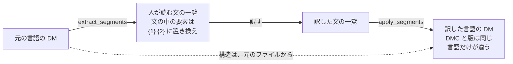

S1000D では、同じ DM の言語の違うものを別のファイルとして持ちます。DMC は同じで、言語と国だけが違います。この付録では、券売機の CSDB にある、日本語の DM と英語の DM を比べて、多言語版がどういう形をしているかを見ます。

## 言語は DM の識別の一部

DM を 1 つに特定するのは、DMC、版、言語の 3 つでした（「[ファイル名から中身を見分ける](https://zenn.dev/shuji_bonji/books/s1000d-practice/viewer/file-names)」）。言語が違えば、別の DM です。

「紙幣ユニットを取り出す」の発行番号 `003` の 2 つのファイルです。

```text
DMC-KENBAIKI-A-10-20-00-05A-520A-D_003-00_JA-JP.XML
DMC-KENBAIKI-A-10-20-00-05A-520A-D_003-00_EN-US.XML
```

言語は `language` 要素の 2 つの属性で書きます。

```xml
<language languageIsoCode="en" countryIsoCode="US"/>
```

| 属性 | 内容 | 書き方 |
| --- | --- | --- |
| [`languageIsoCode`](https://shuji-bonji.github.io/s1000d-stack/ja/reference/s1000d/issue-7/language-iso-code/) | 言語 | 小文字 |
| [`countryIsoCode`](https://shuji-bonji.github.io/s1000d-stack/ja/reference/s1000d/issue-7/country-iso-code/) | 国 | 大文字 |

言語と国を組にするのは、同じ言語でも、国によって書き方が違うためです。使ってよい国はプロジェクトが BREX で絞れます。券売機の組織の BREX は、国を `JP` と `US` の 2 つに絞っています。

## 2 つのファイルの違い

日本語の DM と、英語の DM を行ごとに比べると、違うのは 10 行だけです。

| 違う場所 | 日本語の DM | 英語の DM |
| --- | --- | --- |
| `language` | `ja`・`JP` | `en`・`US` |
| `techName` | 指定席券売機 操作マニュアル（例） | Reserved-seat ticket vending machine operation manual (example) |
| `infoName` | 紙幣ユニットを取り出す | Remove the bill unit |
| 適用性の人が読む文 | すべて | All |
| 更新の理由の文 | 紙幣ユニットの番号を記録する手順を足した。 | Added the step to record the bill unit number. |
| 手順の文（4 つ） | 電源スイッチを切る。など | Turn off the power switch. など |
| 注意の文 | 扉は重いので注意 | The door is heavy. Be careful. |

違うのは、言語の属性と、人が読む文だけです。次のものは 2 つのファイルで同じです。

- DMC と、版
- 要素の並びと、入れ子
- 要素の `id`
- 機密区分、企業コード、BREX への参照
- 参照の先の DMC と、図の ICN

この「構造が同じで、文だけが違う」ことが、多言語版の条件です。構造が違うと、片方の言語にだけある手順や、片方にだけ無い警告が、できてしまいます。

## 訳す対象と、訳さない対象

DM の中の文字列は、訳すものと、訳さないものに分かれます。

| 訳す | 訳さない |
| --- | --- |
| 題名（技術名称、情報名） | DMC、ICN などのコード |
| 段落、手順の文 | 要素の `id` と、それを指す属性 |
| 警告・注意・注記の文 | 機密区分、企業コードなどの属性の値 |
| 表のセル、図の題名 | 適用性の条件（`assert`）の属性の名前と値 |
| 適用性の人が読む文 | 部品番号、製造番号 |

適用性は人が読む文（`displayText`）だけを訳します。機械が読む条件は訳しません。条件の値（`MV-60` など）を訳すと、ACT の定義と合わなくなり、判定ができなくなります。

文の途中に参照や強調の要素が入っていることがあります。

```xml
<para>保守鍵（<internalRef internalRefId="seq-0001" internalRefTargetType="irtt05"/>）で前面扉を開ける。</para>
```

この文を訳すとき、`internalRef` の要素は、訳した文の中の合った場所にそのまま残します。言語によって語の順が変わるので、要素の場所も変わります。要素を取り除いたり、属性の値を変えたりしては、いけません。

## 版をそろえる

券売機の CSDB では、日本語の版と、英語の版が、次のようになっています。

| 発行番号 | 日本語 | 英語 |
| --- | --- | --- |
| `001` | ある | 無い |
| `002` | ある | ある |
| `003` | ある | ある |

英語の DM は、対応する日本語の DM と、同じ発行番号を持っています。日本語の `003` を訳した DM が、英語の `003` です。発行番号がそろっていると、2 つの言語の DM が、同じ内容に対応していることを番号で確かめられます。

日本語の DM を改版したら、英語の DM も、対応する版を作ります。日本語の `003` は、`002` に、「紙幣ユニットの番号を記録する」という手順を足した版です。英語の `003` にも、同じ場所に対応する手順（Record the bill unit number.）があります。

元の言語だけを改版して、訳した言語を改版し忘れると、言語によって、手順の数が違うマニュアルになります。

:::message
訳した DM の発行番号を元の言語の DM とそろえるかどうかは、プロジェクトが決めることです。この例はそろえる運用を取っています。
:::

## 確かめ方

多言語版は次の観点で確かめます。

| 観点 | 確かめること |
| --- | --- |
| 識別 | DMC と版が、元の言語の DM と同じ。言語の属性と、ファイル名の言語が合っている |
| 構造 | 要素の並び、入れ子、`id` が、元の言語の DM と同じ |
| 訳さないもの | コード、属性の値、適用性の条件が、変わっていない |
| 文の中の要素 | 参照や強調の要素が、訳した文にすべて残っている |
| 検証 | 訳した DM も、XSD、BREX、参照の確認を通る |
| 用語 | プロジェクトの用語集と合っている |
| 訳の質 | 意味が合っている。警告と注意は、特に確かめる |

構造が同じかどうかは、2 つのファイルから、人が読む文を取り除いて比べると、確かめられます。残ったものが同じなら、構造は同じです。

訳した DM も DM です。BREX の検査は訳した DM にも行います。券売機の CSDB の英語の DM は、国が `US` なので、組織の BREX の国のルールを通ります。BREX が許していない国の DM を作ると、訳の内容が正しくても、BREX の検査で違反になります。

## S1000D Stack で行う

S1000D Stack では DM の翻訳を次の流れで行います。



s1000d-writer-mcp の [`extract_segments`](https://shuji-bonji.github.io/s1000d-stack/ja/reference/stack/writer/extract-segments/) は、DM から、人が読む文だけを取り出します。コード、属性の値、適用性の条件、`id` は、取り出しません。文の中の要素は、`{1}`・`{2}` のような印に置き換えて返します。訳すときはこの印を訳した文の中に残します。

[`apply_segments`](https://shuji-bonji.github.io/s1000d-stack/ja/reference/stack/writer/apply-segments/) は、訳した文を元の DM の構造に戻して、言語の違う DM を作ります。構造は、訳した文からではなく、元の DM のファイルから取ります。そのため、訳す途中で、構造が変わることがありません。

s1000d-writer-mcp は訳しません。訳の質も判定しません。訳すことと、訳を確かめることは、人、または別のツールが行います。

## この付録のポイント

- 言語の違う DM は、DMC と版が同じで、言語と国だけが違う、別のファイルです。
- 訳した DM は、元の DM と、構造が同じです。違うのは、言語の属性と、人が読む文だけです。
- コード、`id`、属性の値、適用性の条件は、訳しません。
- 元の言語の DM を改版したら、訳した言語の DM も、対応する版を作ります。

## 出典

- 著者が入手した S1000D Issue 7 のパッケージ（仕様書の Chap 3.9.5.1、XML スキーマの `proced.xsd`）。入手先は https://users.s1000d.org/
