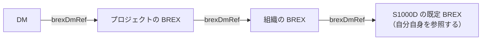

XSD の検証が通った DM を次に BREX で確かめます。XSD が確かめるのは、S1000D の全プロジェクトに共通の構造です。BREX が確かめるのは、その構造の中で、プロジェクトが何を使い、何を使わないと決めたかです。2 つの受け持ちの違いは「[DM と XSD・BREX の関係](https://zenn.dev/shuji_bonji/books/s1000d-practice/viewer/dm-xsd-brex)」でまとめました。

BREX の役割と、仕様とプロジェクトのルールの境界は、入門の「[BREX とビジネスルール](https://zenn.dev/shuji_bonji/books/s1000d-intro/viewer/brex)」で説明しました。この章では、BREX の DM の中身を読み、券売機の DM を実際に検査します。決まりは、仕様書の Chap 4.10.2（BREX の DM）、Chap 4.10.3（既定 BREX）、Chap 7.9（ビジネスルールの処理）にあります。

## BREX の DM の中身

BREX は DM の一種です。券売機のプロジェクトの BREX（`DMC-KENBAIKI-A-00-00-00-00A-022A-D`）の内容です。ルールを 2 つ残して、ほかは省いています。

```xml
<content>
  <brex defaultBrSeverityLevel="brsl02">
    <commonInfo>
      <para>券売機プロジェクトの規則。組織の規則（KBWORKS）に基づく。</para>
    </commonInfo>
    <snsRules>
      <snsDescr>
        <snsSystem>
          <snsCode>10</snsCode>
          <snsTitle>発券部</snsTitle>
          <!-- 下の階層は省略 -->
        </snsSystem>
      </snsDescr>
    </snsRules>
    <contextRules>
      <structureObjectRuleGroup>
        <structureObjectRule>
          <brDecisionRef brDecisionIdentNumber="KB-00002"/>
          <objectPath allowedObjectFlag="2">//dmIdent/dmCode/@infoCode</objectPath>
          <objectUse>使ってよい情報コード</objectUse>
          <objectValue valueForm="single" valueAllowed="022">ビジネスルール（BREX 自身）</objectValue>
          <objectValue valueForm="single" valueAllowed="040">説明</objectValue>
          <objectValue valueForm="single" valueAllowed="130">プロセス</objectValue>
          <objectValue valueForm="single" valueAllowed="411">故障探求</objectValue>
          <objectValue valueForm="range" valueAllowed="500~599">手順</objectValue>
        </structureObjectRule>
        <structureObjectRule>
          <brDecisionRef brDecisionIdentNumber="KB-00003"/>
          <objectPath allowedObjectFlag="2">//security/@securityClassification</objectPath>
          <objectUse>機密区分は 01・02・03 のどれか</objectUse>
          <objectValue valueForm="single" valueAllowed="01">公開</objectValue>
          <objectValue valueForm="single" valueAllowed="02">社内</objectValue>
          <objectValue valueForm="single" valueAllowed="03">限定</objectValue>
        </structureObjectRule>
      </structureObjectRuleGroup>
    </contextRules>
    <nonContextRules>
      <nonContextRule>
        <brDecisionRef brDecisionIdentNumber="KB-00100"/>
        <simplePara>手順の各ステップは 1 つの操作だけを書く</simplePara>
      </nonContextRule>
    </nonContextRules>
  </brex>
</content>
```

内容は 3 つの部分に分かれます。

| 部分 | 入るもの | 機械で検査できるか |
| --- | --- | --- |
| `snsRules` | プロジェクトが使う、システムの番号の体系 | 番号を引くための表として使う |
| `contextRules` | XML の中の場所を指して、使ってよいか、どの値を許すかを書いたルール | できる |
| `nonContextRules` | XML の場所に結び付けられない取り決め。文で書く | できない |

## ルール 1 つの読み方

`structureObjectRule` が、ルール 1 つです。

| 要素・属性 | 内容 |
| --- | --- |
| `brDecisionRef` の `brDecisionIdentNumber` | ルールの番号。違反の報告で、どのルールかを示すのに使う |
| `objectPath` | ルールの対象。XML の中の場所を XPath で書く |
| `objectPath` の `allowedObjectFlag` | 対象を使ってよいか。下の表 |
| `objectUse` | 人が読む説明 |
| `objectValue` | 許す値。複数書いたときは、どれか 1 つに合えばよい |

### `allowedObjectFlag` の 3 つの値

| 値 | 意味 | 違反になるとき |
| --- | --- | --- |
| `0` | 使ってはならない | XPath が指す場所に何かがあるとき |
| `1` | 必ず含める | XPath が指す場所に何も無いとき |
| `2` | 使ってよい。使うなら、決まりのとおりに | 値が、`objectValue` のどれにも合わないとき |

`0` のルールは、「あってはならない状態」を XPath で書く形にも使います。券売機の組織の BREX に、その例があります。

```xml
<objectPath allowedObjectFlag="0">//dmodule[not(identAndStatusSection/dmStatus/brexDmRef)]</objectPath>
<objectUse>すべてのデータモジュールは BREX を参照する</objectUse>
```

この XPath は、「BREX への参照を持たない DM」を指しています。そういう DM があれば違反です。「必ず参照する」という決まりを「参照しない DM は、あってはならない」と書いています。

### 値の書き方

`objectValue` の `valueForm` は、値の書き方を示します。

| `valueForm` | `valueAllowed` の例 | 意味 |
| --- | --- | --- |
| `single` | `040` | その値と一致 |
| `range` | `500~599` | 範囲に入る |
| `pattern` | 正規表現 | 正規表現の全体に一致 |

## BREX は重ねて使う

DM は 1 つの BREX を参照します。その BREX がさらに上位の BREX を参照します。この本では、参照でつながった BREX の 1 つ 1 つを「層」と呼びます。



重ね方の決まりは次のとおりです（Chap 4.10.2）。

- 参照をたどった先は、S1000D の既定 BREX で終わります。既定 BREX は自分自身を参照します。
- 下位の BREX は、上位の BREX を狭めることしかできません。上位が `01`〜`09` を許しているとき、下位は `01`〜`03` に絞れますが、`10` を足すことはできません。
- 下位の BREX は、上位のルールを繰り返して書く必要がありません。DM に当てはまるルールの全体を知るには、参照をたどって、すべての層を読みます。

検査は、層を 1 つにまとめずに、層ごとに行います。どの層にも違反が無いときだけ、合格です（Chap 7.9）。層どうしの矛盾を無くすのは、BREX を書く側の責任で、検査する道具の役割ではありません。

## 既定 BREX のファイル

プロジェクトの BREX と組織の BREX は CSDB にありますが、最後の層の既定 BREX は、仕様パッケージの Default BREX に入っています。`DMC-S1000D-J-04-10-0301-00A-022A-D_001-00_EN-US.XML` というファイルです。ファイル名の読み方は「[ファイル名から中身を見分ける](https://zenn.dev/shuji_bonji/books/s1000d-practice/viewer/file-names)」で説明しました。

このファイルには、S1000D の Issue を表す 1 文字（システム差異コード）に、資料による食い違いがあります。

| 資料 | 既定 BREX のシステム差異コード |
| --- | --- |
| 仕様書の本文（Chap 4.10.3） | `I` |
| 同梱されている既定 BREX のファイル | `J` |
| データ辞書の中の見本 | `X` |

実際に DM から参照するのは同梱されているファイルです。自分の BREX から既定 BREX を参照するときは、ファイルの中の値（`J`）に合わせます。券売機の組織の BREX も、`J` で既定 BREX を参照しています。

## 検査する

### 違反が無い場合

s1000d-verify-mcp の [`verify_data_module`](https://shuji-bonji.github.io/s1000d-stack/ja/reference/stack/verify/verify-data-module/) は、DM が参照する BREX をたどって、層ごとに検査します。券売機の手順の DM を検査した結果です。

| 層 | BREX | 評価したルール | 違反 | 人が確かめるルール |
| --- | --- | --- | --- | --- |
| 1 | 券売機のプロジェクトの BREX | 3 | 0 | 1（KB-00100） |
| 2 | 組織の BREX | 2 | 0 | 0 |
| 3 | S1000D の既定 BREX | 243 | 0 | 1 |

`nonContextRules` のルールは、検査されずに、人が確かめる項目として返ります。「手順の各ステップは 1 つの操作だけを書く」は、道具には判定できません。レビューで、人がこの一覧を見て確かめます。

### 違反がある場合

手順の DM の値を 2 つ、わざと変えて、検査します。

```xml
<security securityClassification="05"/>
<responsiblePartnerCompany enterpriseCode="K0009"/>
```

XSD の検証は通ります。`05` も `K0009` も、スキーマの型には合っているためです。BREX の検査は違反を 2 件返します。

| ルール | 場所 | 実際の値 | 許される値 |
| --- | --- | --- | --- |
| KB-00001 | `…/dmStatus/responsiblePartnerCompany/@enterpriseCode`（24 行） | `K0009` | `K0002` |
| KB-00003 | `…/dmStatus/security/@securityClassification`（23 行） | `05` | `01`、`02`、`03` |

違反の報告には、ルールの番号、場所、実際の値、許される値、ルールの説明（`objectUse`）が入ります。直すときは許される値の中から選びます。1 件目は、許される値が 1 つなので、直し方が決まります。2 件目は 3 つあるので、どれにするかを人が決めます。

### 書く前に、値を引く

DM を作る前に、使おうとしている値が許されているかを確かめられます。s1000d-brex-mcp の [`lookup_value`](https://shuji-bonji.github.io/s1000d-stack/ja/reference/stack/brex/lookup-value/) で、情報コード `720` を券売機の BREX で引いた結果です。

| 項目 | 値 |
| --- | --- |
| 当たったルール | KB-00002 |
| 許される値 | `00P`、`00W`、`022`、`040`、`130`、`411`、`500`〜`599` |
| `720` は許されるか | 許されない |

券売機のプロジェクトでは、取り付けの手順（`720`）の DM を作れません。作る必要が出たら、先に BREX を改版して、値を足します。

## 確かめ方：既定 BREX まで検査されているか

BREX の検査の結果では、違反の数の前に、**何層を検査したか**を見ます。

上の結果は 3 層でした。券売機のプロジェクトの BREX、組織の BREX、S1000D の既定 BREX です。参照をたどった先が既定 BREX で終わっているので、既定 BREX のルールも検査されています。

検査が見ている範囲を、図にします。

```html-embed
<div class="bl">
  <div class="bl-cap">券売機の CSDB で、BREX の検査が見ている範囲</div>
  <div class="bl-row">
    <div class="bl-box bl-dm"><b>手順の DM</b><span>brexDmRef で BREX を 1 つ参照する</span></div>
    <div class="bl-ar" aria-hidden="true"></div>
    <div class="bl-box bl-ok"><em>層 1　検査した</em><b>プロジェクトの BREX</b><span>KENBAIKI　ルール 3 件、人が確かめるルール 1 件</span></div>
    <div class="bl-ar" aria-hidden="true"></div>
    <div class="bl-box bl-ok"><em>層 2　検査した</em><b>組織の BREX</b><span>KBWORKS　ルール 2 件</span></div>
    <div class="bl-ar" aria-hidden="true"></div>
    <div class="bl-box bl-ok"><em>層 3　検査した</em><b>S1000D の既定 BREX</b><span>274 件のうち、手順の DM に当てはまる 243 件。版と変更の印の決まりなど</span></div>
  </div>
  <div class="bl-note">決まりでは、参照をたどった先は既定 BREX で終わります。途中の BREX が既定 BREX を参照していないと、そこで参照が終わり、既定 BREX は検査に入りません。</div>
</div>
<style>
  .bl {
    --bg: #f8fafc; --text: #0f172a; --sub: #475569; --line: #cbd5e1; --card: #ffffff;
    --ok: #dcfce7; --okt: #166534; --ng: #fee2e2; --ngt: #991b1b; --ngb: #ef4444;
    box-sizing: border-box; padding: 16px; border-radius: 8px;
    background: var(--bg); color: var(--text);
    font-family: system-ui, -apple-system, "Hiragino Sans", "Noto Sans JP", sans-serif; font-size: 13px; line-height: 1.5;
  }
  [data-theme="dark"] .bl {
    --bg: #0f172a; --text: #e2e8f0; --sub: #94a3b8; --line: #334155; --card: #1e293b;
    --ok: #14532d; --okt: #dcfce7; --ng: #7f1d1d; --ngt: #fee2e2; --ngb: #f87171;
  }
  .bl * { box-sizing: border-box; }
  .bl-cap { font-weight: 700; margin-bottom: 10px; }
  .bl-row { display: flex; align-items: stretch; gap: 0; }
  .bl-box { flex: 1 1 0; min-width: 0; display: flex; flex-direction: column; gap: 3px; padding: 10px; border-radius: 6px; border: 1px solid var(--line); background: var(--card); }
  .bl-box b { font-size: 13px; }
  .bl-box span { font-size: 11px; color: var(--sub); }
  .bl-box em { font-style: normal; font-size: 11px; font-weight: 700; }
  .bl-ok { background: var(--ok); border-color: transparent; color: var(--okt); }
  .bl-ok span { color: var(--okt); opacity: .9; }
  .bl-ng { background: transparent; border: 2px dashed var(--ngb); }
  .bl-ng em { color: var(--ngb); }
  .bl-self { font-weight: 700; }
  .bl-ar { flex: 0 0 26px; position: relative; }
  .bl-ar::before { content: "→"; position: absolute; top: 50%; left: 50%; transform: translate(-50%, -50%); color: var(--sub); font-size: 16px; }
  .bl-cut::before { content: "×"; color: var(--ngb); font-weight: 700; }
  .bl-note { margin-top: 10px; font-size: 12px; color: var(--sub); }
  @media (max-width: 520px) {
    .bl { padding: 10px; }
    .bl-row { flex-direction: column; }
    .bl-ar { flex-basis: 22px; }
    .bl-ar::before { content: "↓"; }
    .bl-cut::before { content: "×"; }
  }
</style>
```

:::message alert
この例の CSDB は、はじめ、組織の BREX が既定 BREX ではなく自分自身を参照していました。そのときの検査は 2 層で終わり、結果は `passed`（違反 0 件）でした。既定 BREX が検査に入っていないことは、「検査が通った」という結果だけを見ても分かりません。層の数と、それぞれの BREX の名前を見て、はじめて分かります。
:::

既定 BREX には、情報コードの一覧や、版と変更の印の関係のような、どのプロジェクトにも当てはまるルールが入っています。既定 BREX が検査の対象に入っていないと、これらが検査されません。組織の BREX の参照を既定 BREX に直した後は、DM とパブリケーションモジュールの 17 件すべてが 3 層で検査され、違反は 0 件でした。

違反が 0 件でも、誤りが無いとは言えません。直す前の例では、「紙幣ユニットを取り出す」の発行番号 `002` と `003` の DM に、版の状態（`issueType`）も更新の理由も書かれていませんでした。既定 BREX の検査は、この 2 つを違反として報告しませんでした。BREX が検査するのは、ルールとして書かれたことだけです。

既定 BREX だけを指定して検査することもできます。s1000d-brex-mcp の [`check_against_brex`](https://shuji-bonji.github.io/s1000d-stack/ja/reference/stack/brex/check-against-brex/) に、仕様パッケージの既定 BREX を渡します。CSDB の BREX の参照を直せないとき（受け取った CSDB を調べるときなど）に使います。

検査の結果で見るものをまとめます。

| 見るもの | 理由 |
| --- | --- |
| 検査した層の数と、それぞれの BREX | 既定 BREX が入っているか |
| 見つからなかった BREX | 参照の先の BREX が CSDB に無いと、その層から先は検査されない |
| 層ごとの違反 | どの層のルールに違反したか |
| 人が確かめるルール | 機械で検査されていない取り決めが、何件あるか |

## 実装するときの注意

### XPath 1.0 では足りない

BREX の `objectPath` は、XPath で書かれます。Issue 7 の既定 BREX には、ルールが 274 件あります。そのうち 1 件は、XPath 2.0 の書き方（`for … return`、`some … satisfies`）を使っていて、XPath 1.0 だけを実装したライブラリでは評価できませんでした。s1000d-core は、XPath 3.1 を実装したライブラリ（`fontoxpath`）を使っています。

### XPath の結果は 2 種類ある

`objectPath` の XPath は、要素や属性の集まりを返す式（`//security/@securityClassification`）のほかに、真か偽かを返す式（`not(…)` で始まる式）でも書かれます。`allowedObjectFlag` が `0` のルールでは、集まりが空でないことと、結果が真であることの両方を違反として扱います。

違反の場所（行の番号）を報告するには、結果を値ではなく節点として受け取る必要があります。属性を選ぶ XPath を、文字列として評価すると、どの属性だったかが分からなくなります。

### `pattern` の正規表現は、XML スキーマの書き方

`valueForm` が `pattern` のときの正規表現は、XML スキーマの正規表現です。JavaScript の正規表現とは次の点が違います。

- 文字列の全体に一致するかを見ます。先頭と末尾を示す記号を書かなくても、全体の一致です。
- `\i`・`\c` のような、XML の名前のための文字の種類があります。

JavaScript で評価するには変換が要ります。既定 BREX の許す値は、`single` が 1,340 件、`range` が 81 件、`pattern` が 24 件です。

### スキーマごとのルール

`contextRules` には、`rulesContext` 属性で、対象のスキーマを指定できます。指定の無い `contextRules` は、すべての種類の DM に当てはまります。指定のあるものはそのスキーマの DM にだけ当てはまります。検査では、対象の DM のスキーマを見て、共通のルールと、そのスキーマのルールを合わせて使います。手順の DM で評価したルールが、274 件ではなく 243 件だったのは、このためです。

### 既定 BREX を、ファイル名だけで探さない

仕様パッケージの内側の zip を展開したフォルダーの名前は、利用者によって違います。s1000d-core は、フォルダーの名前を決めずに、次の条件にすべて当てはまるファイルを既定 BREX として探します。

- ファイル名が `DMC-S1000D-…-022A-D` の形である
- 中身の DMC がファイル名と一致している
- 自分自身を参照している

ファイル名だけで探してはいけません。データ辞書の見本には、ファイル名の DMC と中身の DMC が違うものがあります。これを既定 BREX として使うと、BREX の参照をたどる処理が、同じ 2 つのファイルの間を行き来して終わりません。対策を入れる前は DM 1 件の検査に 137 秒かかりました。訪れた参照を記録し、中身の DMC が一致するファイルを優先するようにした後は、117 件の DM を 10 秒で検査できました。

### 公式サンプルも既定 BREX に違反する

公式サンプルの DM 105 件を、サンプルの BREX と既定 BREX の 2 層で検査すると、既定 BREX への違反が、合計 55 件出ます。公式サンプルが決まりの手本になるとは限りません。自分の道具の検査の結果を公式サンプルが通るかどうかで確かめるときは、この点に注意します。

## この章のポイント

- BREX のルールは、XML の中の場所（`objectPath`）、使ってよいか（`allowedObjectFlag`）、許す値（`objectValue`）でできています。
- BREX は重ねて使い、検査は層ごとに行います。参照をたどった先は既定 BREX で終わります。
- 検査の結果は、違反の数の前に、何層を検査したかを見ます。既定 BREX が入っていない検査は、通っても、既定 BREX のルールを確かめていません。
- 既定 BREX のシステム差異コードは、仕様書の本文と同梱のファイルで違います。参照するときはファイルの値に合わせます。
- `nonContextRules` の取り決めは、機械で検査されません。人が確かめる項目として残ります。

## 出典

- 著者が入手した S1000D Issue 7 のパッケージ（仕様書の Chap 4.10.2、Chap 4.10.3、Chap 7.9、XML スキーマの `brex.xsd`、既定 BREX、Data Dictionary、Bike Samples）。入手先は https://users.s1000d.org/
- fontoxpath. https://github.com/FontoXML/fontoxpath
