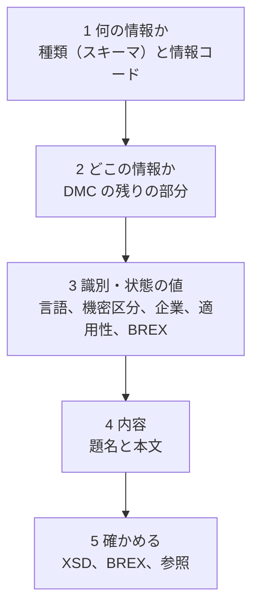
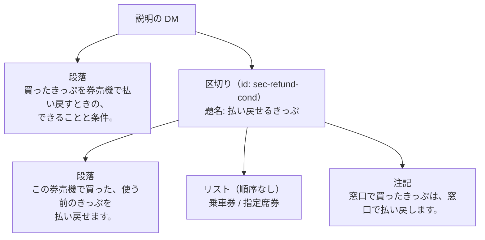

ここまでの章で、DM を読み、確かめる方法を見ました。この章では新しい DM を 1 件作ります。XML を書く前に、書き手が決めることが多くあります。この章は、その「決めること」を順に並べ、最後に、券売機の CSDB に説明の DM を 1 件足します。

## 作る前に決めること



### 1. 種類と情報コード

最初に、DM の種類を決めます。種類は XML スキーマです。説明なら `descript`、手順なら `proced` です。種類が決まると、内容の部分に書ける要素が決まります。

次に、情報コードを決めます。情報コードは、情報の種類を表す 3 桁のコードで、S1000D が一覧を定めています（Chap 8.4.1）。その中から、プロジェクトが使うものを BREX で絞ります。

券売機のプロジェクトで使える情報コードは、前の章で見たとおり、次の 5 つです。

| 情報コード | プロジェクトでの意味 |
| --- | --- |
| `022` | ビジネスルール（BREX 自身） |
| `040` | 説明 |
| `130` | プロセス |
| `411` | 故障探求 |
| `500`〜`599` | 手順 |

これから作るのは、払い戻しについての説明なので、種類は `descript`、情報コードは `040` です。

### 2. DMC の残りの部分

DMC は、情報コードのほかに、製品の中の場所を表す部分を持ちます。

| 部分 | 決め方 | この例の値 |
| --- | --- | --- |
| モデル識別コード | プロジェクトで 1 つ | `KENBAIKI` |
| システム差異コード | 製品の派生を区別する。プロジェクトが決める | `A` |
| システム、サブシステム、サブサブシステム、組立 | 製品の構造の中の場所。プロジェクトの番号の体系（SNS）から選ぶ | `10`・`2`・`0`・`00` |
| 分解コードとバリアント | 同じ場所の中で、対象をさらに分ける | `02`・`A` |
| 情報コードとバリアント | 上で決めた値 | `040`・`A` |
| アイテムロケーションコード | 作業や情報が当てはまる場所の状態 | `D` |

番号の体系は、プロジェクトの BREX の `snsRules` に書かれています。券売機の BREX では、`10` が発券部、その下の `2` が画面、その下の `0` が全般です。払い戻しの画面の説明なので、既にある DM と同じ `10-20-00` にします。

分解コードは、同じ場所・同じ情報コードの DM が既にあるので、重ならない値にします。`040` の DM は、分解コード `00`（券売機の概要）と `01`（用語）が既にあります。新しい DM は `02` です。

DMC は、一度決めて発行すると、変えられません。DMC を変えることは、別の DM を作ることです。ほかの DM やパブリケーションモジュールからの参照も、DMC で書かれているためです。

### 3. 識別・状態の値

| 値 | 決め方 | この例の値 |
| --- | --- | --- |
| 言語と国 | DM の文の言語 | `ja`・`JP` |
| 版 | 新しい DM の最初の発行 | `001-00` |
| 発行日 | 発行する日 | 2026 年 11 月 22 日 |
| 機密区分 | プロジェクトの BREX が許す値から選ぶ | `01`（公開） |
| 責任を持つ企業、作った企業 | 企業コード。BREX が値を決めていることがある | `K0002` |
| 適用性 | どの製品に当てはまるか。少なくとも、人が読む文を書く | すべて |
| 従う BREX | プロジェクトの BREX の DMC | `KENBAIKI-A-00-00-00-00A-022A-D` |
| 品質保証 | 検証の状態 | 検証していない |

どの値も書き手が決めます。道具は値を補いません。機密区分を省いた入力に、道具が `01` を入れて DM を作ると、書き手が決めていない区分で、DM が配られることになります。

### 4. 内容

題名は技術名称と情報名の 2 つです。技術名称は、同じ対象の DM で、同じ書き方にそろえます。券売機の DM は、どれも「指定席券売機 操作マニュアル（例）」です。情報名はその DM の内容を表す名前にします。この例では「きっぷの払い戻し」です。

本文は「[説明と手順の内容を読む](https://zenn.dev/shuji_bonji/books/s1000d-practice/viewer/descriptive-and-procedural)」で見た構造で書きます。

## 作る

s1000d-writer-mcp の [`build_data_module`](https://shuji-bonji.github.io/s1000d-stack/ja/reference/stack/writer/build-data-module/) は、題名、段落、リスト、注記などを木の形で受け取り、XML を組み立てます。書き手は XML を書かず、上で決めた値と、本文の木を渡します。

渡した本文の木を図にします。



できた DM のファイル名は、`DMC-KENBAIKI-A-10-20-00-02A-040A-D_001-00_JA-JP.XML` です。内容の部分は次のとおりです。

```xml
<content>
  <description>
    <para>買ったきっぷを券売機で払い戻すときの、できることと条件。</para>
    <levelledPara id="sec-refund-cond">
      <title>払い戻せるきっぷ</title>
      <para>この券売機で買った、使う前のきっぷを払い戻せます。</para>
      <para><randomList>
          <listItem>
            <para>乗車券</para>
          </listItem>
          <listItem>
            <para>指定席券</para>
          </listItem>
        </randomList></para>
      <note>
        <notePara>窓口で買ったきっぷは、窓口で払い戻します。</notePara>
      </note>
    </levelledPara>
  </description>
</content>
```

識別・状態の部分は「[識別・状態の部分を読む](https://zenn.dev/shuji_bonji/books/s1000d-practice/viewer/ident-and-status)」で見た形と同じです。DMC の分解コードが `02`、情報コードが `040`、発行日が 2026 年 11 月 22 日になっています。

分解コードの `02` は、道具が、CSDB に既にある DM を見て、重ならない番号を付けたものです。番号の付け方の規則（システムの番号、情報コード、アイテムロケーションコード）は、書き手が渡します。

## 確かめる

`build_data_module` は、組み立てた XML をその場で検証します。この DM の結果です。

| 段階 | 結果 |
| --- | --- |
| XSD | `valid`（エラー 0 件、`descript.xsd`） |
| BREX | `passed`（3 層、違反 0 件、人が確かめるルール 2 件） |
| 参照 | `resolved`（1 件。BREX への参照） |

XSD のエラーが残る DM は、書き込む指定をしても、CSDB に書かれません。エラーのある DM を CSDB に入れないためです。

### 作っただけでは終わっていないこと

DM のファイルができても次の 3 つが残っています。

| 残っていること | 理由 | 扱う章 |
| --- | --- | --- |
| パブリケーションモジュールに足す | 足さないと、マニュアルの目次に出てこない | PM でまとめる |
| データ管理リストに足す | プロジェクトで管理している DM の一覧に載っていない | CSDB をフォルダーと Git で持つ |
| 人による内容の検証 | `qualityAssurance` は「検証していない」のまま | — |

## 実装するときの注意

### 読む、作る、直すは、別の経路

s1000d-core は、DM の読み書きを 3 つの経路に分けています。

| 経路 | 方針 |
| --- | --- |
| 読む | 知らない要素で止まらない。読めなかったものは、名前と件数で知らせる |
| 新しく作る | S1000D の一部分だけを書ける。書けない構造を渡されたら、入力の誤りにする。値は補わない |
| 既にある DM を直す | 元の XML を保ったまま、直す場所だけを書き換える |

読む側はどのプロジェクトの DM も対象にします。知らない要素があっても読めるところまで読む必要があります。作る側は、自分が書く XML をすべて分かっていなければなりません。分からない構造を分からないまま書くことはできません。2 つの経路で、扱える範囲が違ってよい、という考え方です。

3 つ目の経路を分けたのは、読んだ木から XML を作り直すと、読み取りが構造として返していない要素と属性が、失われるためです。次の章の改版はこの 3 つ目の経路で行います。

### 値を補わない

検証を通すために、道具が値を入れることはしません。次の入力はどれも誤りとして返します。

- 機密区分の無い入力
- 適用性の無い入力（少なくとも人が読む文が要る）
- 情報コードの規則が無いのに、DMC の採番を求める入力

値を補えば、XSD の検証は通ります。しかし、その値は、誰も決めていない値です。

### 最初の発行の `issueType`

`build_data_module` が作る `001-00` の DM には、`dmStatus` の `issueType` 属性がありません。上の DM も、そうなっています。券売機の CSDB のほかの `001-00` の DM は、`issueType="new"` を手で書き足しています。

既定 BREX には、最初の発行の DM の `issueType` についてのルール（BREX-S1-00030）があります。属性そのものが無い DM は、このルールの条件に当たらず、違反として報告されません。ただし、これは、属性が無いために条件に当たらないだけです。プロジェクトが `issueType` を必ず書くと決めている場合は、書く必要があります。この点は s1000d-core に残っている課題です。

## この章のポイント

- DM を作る前に、種類、情報コード、DMC の残りの部分、識別・状態の値を書き手が決めます。
- 情報コードと機密区分は、プロジェクトの BREX が許す値から選びます。DMC は発行した後は変えられません。
- 道具は値を補いません。決めていない値がある入力は誤りとして返ります。
- DM ができた後に、パブリケーションモジュールとデータ管理リストへの追加が残ります。

## 出典

- 著者が入手した S1000D Issue 7 のパッケージ（仕様書の Chap 4.3、Chap 8.4.1、XML スキーマの `descript.xsd`、既定 BREX）。入手先は https://users.s1000d.org/
- s1000d-core（読む・作る・直すの 3 つの経路）. https://github.com/shuji-bonji/s1000d-core
