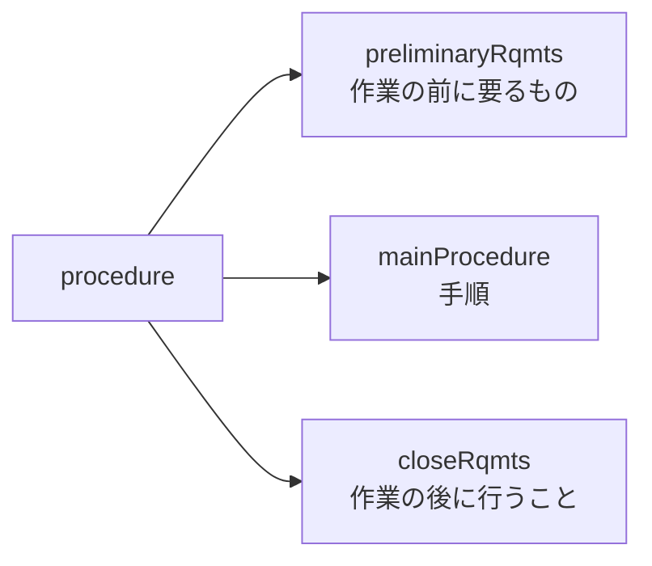

内容の部分（`content`）の構造は、DM の種類ごとに違います。この章では、最もよく使う 2 つの種類、説明（descriptive）と手順（procedural）の内容を読みます。券売機の CSDB では、18 個の XML のうち 12 個がこの 2 種類です。

決まりは、仕様書の Chap 3.9.5.2.2（説明）と Chap 3.9.5.2.3（手順）にあります。段落、リスト、表、図、警告のような、どの種類の DM でも使う共通の要素は、Chap 3.9.5.2.1 の下の各章と、Chap 3.9.3（警告・注意・注記）にあります。

## 説明の DM

説明の DM は物や仕組みがどういうものかを書きます。券売機の CSDB の「券売機の概要」（`DMC-KENBAIKI-A-10-20-00-00A-040A-D`）の内容です。表は行を 1 つだけ残して省いています。

```xml
<content>
  <description>
    <para>何ができる機械か、画面の見方。</para>
    <levelledPara id="sec-what">
      <title>できること</title>
      <para>乗換案内から列車を選んできっぷを買う、きっぷを払い戻す、定期券を更新する、の 3 つができます。</para>
      <para><randomList>
        <listItem>
          <para>乗換案内からの購入</para>
        </listItem>
        <listItem>
          <para>払い戻し</para>
        </listItem>
        <listItem>
          <para>定期券の更新</para>
        </listItem>
      </randomList></para>
    </levelledPara>
    <levelledPara id="sec-screen">
      <title>画面の見方</title>
      <figure>
        <title>トップ画面</title>
        <graphic infoEntityIdent="ICN-K0001-00001-001-01"/>
      </figure>
      <table>
        <tgroup cols="2">
          <thead>
            <row>
              <entry><para>場所</para></entry>
              <entry><para>内容</para></entry>
            </row>
          </thead>
          <tbody>
            <row>
              <entry><para>上</para></entry>
              <entry><para>現在時刻と出発駅</para></entry>
            </row>
          </tbody>
        </tgroup>
      </table>
      <note>
        <notePara>画面はしばらく触れないとトップ画面に戻ります。</notePara>
      </note>
    </levelledPara>
  </description>
</content>
```

| 要素 | 役割 |
| --- | --- |
| `description` | 説明の内容の全体 |
| `levelledPara` | 見出し（`title`）を持つ区切り。中に `levelledPara` を入れて、階層を作れる |
| `para` | 段落 |
| `randomList` / `sequentialList` | 順序の無いリストと、順序のあるリスト。項目は `listItem` |
| `figure` | 図。題名（`title`）と、図のファイルへの参照（`graphic`） |
| `table` | 表。列の数は `tgroup` の `cols`、見出しの行は `thead`、本体は `tbody` |
| `note` | 注記。文は `notePara` に書く |

読むときの注意が 2 つあります。

- **リストは段落の中にあります。** 上の例では、`randomList` が `para` の子です。リストだけの段落、という形です。
- **表のセルの文は、`entry` の中の `para` にあります。** `entry` に直接、文を書く形ではありません。

リストの項目の先頭に付ける記号は [`listItemPrefix`](https://shuji-bonji.github.io/s1000d-stack/ja/reference/s1000d/issue-7/list-item-prefix/)、文の一部の強調は `emphasis` 要素の [`emphasisType`](https://shuji-bonji.github.io/s1000d-stack/ja/reference/s1000d/issue-7/emphasis-type/) で指定します。券売機の CSDB では使っていません。

## 手順の DM

手順の DM は作業のやり方を順番に書きます。内容は 3 つの部分に分かれます。



### 作業の前に要るもの（`preliminaryRqmts`）

決まりは Chap 3.9.5.2.1.9 にあります。券売機の手順の DM はどれも次の形です。

```xml
<preliminaryRqmts>
  <reqCondGroup>
    <noConds/>
  </reqCondGroup>
  <reqSupportEquips>
    <noSupportEquips/>
  </reqSupportEquips>
  <reqSupplies>
    <noSupplies/>
  </reqSupplies>
  <reqSpares>
    <noSpares/>
  </reqSpares>
  <reqSafety>
    <noSafety/>
  </reqSafety>
</preliminaryRqmts>
```

| 要素 | 書くこと | 無いときの書き方 |
| --- | --- | --- |
| `reqCondGroup` | 作業の前に満たしておく条件 | `noConds` |
| `reqSupportEquips` | 要る支援機材（工具など） | `noSupportEquips` |
| `reqSupplies` | 要る消耗品 | `noSupplies` |
| `reqSpares` | 要る交換部品 | `noSpares` |
| `reqSafety` | 安全のための条件 | `noSafety` |

この 5 つは、要るものが無くても、要素を省けません。「無い」と書くための要素（`noConds` など）を置きます。書き忘れたのか、要るものが無いのかを読む人が区別できるようにするためです。

要る人員（`reqPersons`）と、要る技術情報（`reqTechInfoGroup`）も書けます。この 2 つは省けます。

### 手順（`mainProcedure`）

「前面扉を開ける（係員）」（`DMC-KENBAIKI-A-10-20-00-04A-520A-D`）の手順です。

```xml
<mainProcedure>
  <proceduralStep id="stp-open-1">
    <caution>
      <warningAndCautionPara>扉は重いので、両手で支える。</warningAndCautionPara>
    </caution>
    <para>保守鍵で前面扉の鍵を開ける。</para>
    <figure>
      <title>前面扉の取っ手</title>
      <graphic infoEntityIdent="ICN-K0001-00005-001-01"/>
    </figure>
    <proceduralStep id="stp-open-1-1">
      <para>鍵を右に回す。カチッと音がして鍵が外れる。</para>
    </proceduralStep>
    <proceduralStep id="stp-open-1-2">
      <para>取っ手を引く。</para>
    </proceduralStep>
  </proceduralStep>
  <proceduralStep id="stp-open-2">
    <para>保守モードに入る。</para>
  </proceduralStep>
</mainProcedure>
```

この XML の構造と、表示の例を並べます。表示の例は、著者が描いたものです。実際の見た目は、閲覧の道具が決めます。

```html-embed
<div class="pv">
  <div class="pv-col">
    <div class="pv-cap">XML の構造</div>
    <div class="pv-tree">
      <div class="pv-n">mainProcedure</div>
      <div class="pv-n pv-l1">proceduralStep <i>stp-open-1</i></div>
      <div class="pv-n pv-l2 pv-warn">caution</div>
      <div class="pv-n pv-l2">para</div>
      <div class="pv-n pv-l2">figure</div>
      <div class="pv-n pv-l2">proceduralStep <i>stp-open-1-1</i></div>
      <div class="pv-n pv-l2">proceduralStep <i>stp-open-1-2</i></div>
      <div class="pv-n pv-l1">proceduralStep <i>stp-open-2</i></div>
    </div>
  </div>
  <div class="pv-arrow" aria-hidden="true"></div>
  <div class="pv-col">
    <div class="pv-cap">表示の例</div>
    <div class="pv-page">
      <div class="pv-caution"><b>注意</b>扉は重いので、両手で支える。</div>
      <div class="pv-step"><span class="pv-no">1</span>保守鍵で前面扉の鍵を開ける。</div>
      <div class="pv-fig">図 1　前面扉の取っ手</div>
      <div class="pv-step pv-sub"><span class="pv-no">1.1</span>鍵を右に回す。カチッと音がして鍵が外れる。</div>
      <div class="pv-step pv-sub"><span class="pv-no">1.2</span>取っ手を引く。</div>
      <div class="pv-step"><span class="pv-no">2</span>保守モードに入る。</div>
    </div>
  </div>
</div>
<style>
  .pv {
    --bg: #f8fafc; --text: #0f172a; --sub: #475569; --line: #cbd5e1; --card: #ffffff;
    --warn: #fef3c7; --warnt: #92400e; --warnb: #f59e0b; --id: #1d4ed8;
    box-sizing: border-box; padding: 16px; border-radius: 8px; display: flex; gap: 10px; align-items: stretch;
    background: var(--bg); color: var(--text);
    font-family: system-ui, -apple-system, "Hiragino Sans", "Noto Sans JP", sans-serif; font-size: 13px; line-height: 1.5;
  }
  [data-theme="dark"] .pv {
    --bg: #0f172a; --text: #e2e8f0; --sub: #94a3b8; --line: #334155; --card: #1e293b;
    --warn: #78350f; --warnt: #fef3c7; --warnb: #f59e0b; --id: #93c5fd;
  }
  .pv * { box-sizing: border-box; }
  .pv-col { flex: 1 1 0; min-width: 0; display: flex; flex-direction: column; }
  .pv-cap { font-weight: 700; margin-bottom: 8px; }
  .pv-tree, .pv-page { flex: 1; background: var(--card); border: 1px solid var(--line); border-radius: 6px; padding: 10px; }
  .pv-n { font-family: ui-monospace, SFMono-Regular, Menlo, Consolas, monospace; font-size: 12px; padding: 3px 6px; border-left: 2px solid var(--line); margin: 2px 0; }
  .pv-n i { font-style: normal; color: var(--id); }
  .pv-l1 { margin-left: 14px; }
  .pv-l2 { margin-left: 28px; }
  .pv-warn { border-left-color: var(--warnb); }
  .pv-arrow { flex: 0 0 18px; position: relative; }
  .pv-arrow::before { content: "→"; position: absolute; top: 50%; left: 0; color: var(--sub); font-size: 18px; }
  .pv-caution { background: var(--warn); color: var(--warnt); border-left: 4px solid var(--warnb); border-radius: 4px; padding: 6px 8px; margin-bottom: 8px; }
  .pv-caution b { display: block; font-size: 11px; }
  .pv-step { display: flex; gap: 8px; padding: 3px 0; }
  .pv-sub { margin-left: 22px; }
  .pv-no { flex: 0 0 auto; min-width: 22px; font-weight: 700; color: var(--sub); }
  .pv-fig { margin: 4px 0 4px 30px; padding: 10px; border: 1px dashed var(--line); border-radius: 4px; color: var(--sub); font-size: 12px; text-align: center; }
  @media (max-width: 520px) {
    .pv { flex-direction: column; padding: 10px; }
    .pv-arrow { flex-basis: 20px; }
    .pv-arrow::before { content: "↓"; left: 50%; top: 0; }
  }
</style>
```

手順の 1 つ 1 つが `proceduralStep` です。`proceduralStep` の中に `proceduralStep` を入れると、下の階層の手順になります。上の例は、手順 1 の下に 1.1 と 1.2 があり、その後に手順 2 が続きます。

手順の番号は XML に書きません。表示する側が並びと入れ子から番号を付けます。

`proceduralStep` の子は次の順に並べます。

1. 警告（`warning`）と注意（`caution`）
2. 段落（`para`）、注記（`note`）、図（`figure`）、表（`table`）など
3. 下の階層の手順（`proceduralStep`）

警告と注意を先頭に置くのは、作業者が手順を読む前に、危険を知る必要があるためです。段落の後ろに警告を書くと、XSD の検証でエラーになります。

### 警告、注意、注記

| 要素 | 使うとき | 文を書く要素 |
| --- | --- | --- |
| `warning` | 人がけがをする、または死亡するおそれがあるとき | `warningAndCautionPara` |
| `caution` | 機器が壊れるおそれがあるとき | `warningAndCautionPara` |
| `note` | 作業の助けになる補足 | `notePara` |

使い分けの決まりは Chap 3.9.3 にあります。上の例の「扉は重いので、両手で支える」が、どれに当たるかは、内容で決まります。扉が落ちて人がけがをするおそれがあるなら、`caution` ではなく `warning` です。XML の構造は、どちらでも正しいので、道具では見つけられません。レビューで人が確かめる点です。

### 作業の後に行うこと（`closeRqmts`）

作業の後に満たしておく条件を `reqCondGroup` に書きます。無いときは `noConds` を置きます。この要素も省けません。

## 確かめ方

### 構造として読む

s1000d-reader-mcp の [`read_data_module`](https://shuji-bonji.github.io/s1000d-stack/ja/reference/stack/reader/read-data-module/) は、内容を XML ではなく、節点の木として返します。節点は、段落や手順などの 1 つ 1 つで、木は、それを親子の関係で並べたものです。「前面扉を開ける（係員）」を、概要だけを返す指定（`section` が `outline`）で読んだ結果を表にしました。

| 番号 | `id` | 最初の文 |
| --- | --- | --- |
| 1 | `stp-open-1` | 保守鍵で前面扉の鍵を開ける。 |
| 1.1 | `stp-open-1-1` | 鍵を右に回す。 |
| 1.2 | `stp-open-1-2` | 取っ手を引く。 |
| 1.3 | `stp-open-1-3` | 雨よけのカバーを先に外す。 |
| 2 | `stp-open-2` | 保守モードに入る。 |
| 3 | `stp-open-3` | 作業が終わったら扉を閉めて鍵をかける。 |

応答には木の大きさも入ります。この DM は、節点が 12 個で、手順が 6 個、注意が 1 個、図が 2 個です。大きな DM は、先に概要を読んで、必要な部分を決めてから、全文を読みます。

### 読めなかったものが無いか

読み取りの結果には、`unknownElements` と `notReadElements` という 2 つの欄があります。

| 欄 | 入るもの |
| --- | --- |
| `unknownElements` | 道具が知らない要素。要素の名前と件数 |
| `notReadElements` | 道具が知っているが、構造として返していない要素。要素の名前と件数 |

2 つとも空なら、その DM の内容は、すべて構造として返っています。券売機の DM はどれも空です。空でないときは、返ってきた木だけを見て「この DM にはこれしか書かれていない」と判断してはいけません。

### 人が見る観点

構造が正しいことと、内容が適切であることは、別です。次の点は人が確かめます。

- 警告と注意の使い分けが危険の内容と合っているか
- 1 つの手順に複数の操作が入っていないか（券売機のプロジェクトの BREX は、これを人が確かめるルールとして持っています）
- 作業の前に要るものが、本当に無いのか、書き忘れなのか

## 実装するときの注意

### 知らない要素があっても読み取りを止めない

S1000D のスキーマは大きく、説明と手順だけでも、数百の要素の型があります。読み取りの道具が、知らない要素に出会ったときに、エラーにして止まる方法と、何も知らせずに飛ばす方法があります。どちらにも問題があります。止まると、その DM のほかの部分も読めません。何も知らせずに飛ばすと、読めなかったことが利用者に伝わりません。

s1000d-core は 3 つ目の方法を取っています。知らない要素は飛ばして読み進め、何を飛ばしたかを名前と件数で返します。上の `unknownElements` と `notReadElements` が、その欄です。

### 手順の段落は手順の文にまとめる

`proceduralStep` の直下の `para` は、手順の文そのものです。s1000d-core は、これを別の節点にせず、手順の節点の `text` にまとめます。手順 1 つが、節点 1 つに対応する方が、扱いやすいためです。

ただし、まとめると、段落ごとの場所が分からなくなります。段落を 1 つだけ取り除く、という編集ができません。そのため、場所を返す指定のときだけ、まとめた段落ごとの場所を手順の節点に添えています。

### 作業の前に要るものは形が多い

`preliminaryRqmts` の中は、人員、文書、機材、消耗品、部品のそれぞれに識別の番号、数量、単位などの書き方があります。公式サンプルの手順の DM 41 件で、読んだ結果からもう一度 XML を作って元と比べたところ、要素と属性 2,527 個のうち、最初は 898 個が失われました。人員・文書・条件の形を直した後は 631 個になりました。

読んだ木から XML を作り直す方法では、これだけの要素と属性が失われます。s1000d-core が、既にある DM を直すときに、作り直しではなく、元の XML の一部だけを書き換える方法を取っているのは、このためです。

## この章のポイント

- 説明の DM は、`levelledPara` で区切り、段落・リスト・図・表・注記を並べます。
- 手順の DM は、作業の前に要るもの、手順、作業の後に行うこと、の 3 つの部分でできています。要るものが無いときも「無い」と書く要素を置きます。
- 手順の中では警告と注意を段落より前に書きます。
- 構造が正しくても、警告と注意の使い分けのような内容の適切さは、人が確かめます。

## 出典

- 著者が入手した S1000D Issue 7 のパッケージ（仕様書の Chap 3.9.3、Chap 3.9.5.2.1.9、Chap 3.9.5.2.2、Chap 3.9.5.2.3、XML スキーマの `descript.xsd`・`proced.xsd`、Bike Samples）。入手先は https://users.s1000d.org/
