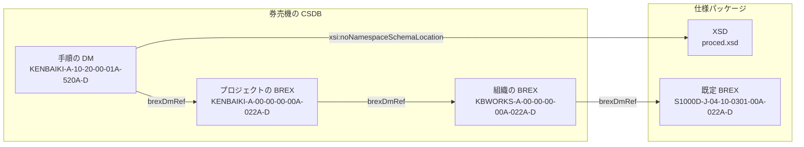
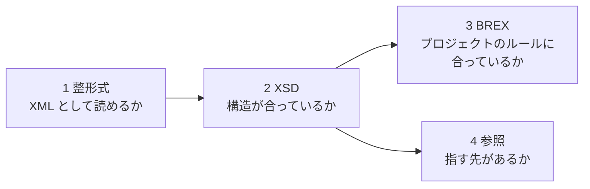

ここまでの章で、DM の XML を読みました。次の 2 つの章では、DM が S1000D の決まりに合っているかを、XSD と BREX で確かめます。その前にこの章で、1 件の DM が何を基準に確かめられるのかと、2 つの基準の受け持ちの違いをまとめて見ます。

XSD と BREX は、書き終えた DM を確かめるときだけに使うものではありません。DM を作るときにも、何に従って書くかを決める基準になります。決まりは、仕様書の Chap 4.10.2（BREX の DM）と Chap 7.9（ビジネスルールの処理）にあります。

## 1 件の DM が指す 2 つの基準

DM は、自分を確かめる基準を自分で指しています。「[識別・状態の部分を読む](https://zenn.dev/shuji_bonji/books/s1000d-practice/viewer/ident-and-status)」で見た、ルート要素の属性と `brexDmRef` の 2 か所です。券売機の手順の DM（`DMC-KENBAIKI-A-10-20-00-01A-520A-D`）では、次のように書かれています。

```xml
<dmodule xmlns:xsi="http://www.w3.org/2001/XMLSchema-instance"
  xsi:noNamespaceSchemaLocation="http://www.s1000d.org/S1000D_7/xml_schema_flat/proced.xsd">
  <identAndStatusSection>
    …
    <dmStatus …>
      …
      <brexDmRef>
        <dmRef>
          <dmRefIdent>
            <dmCode modelIdentCode="KENBAIKI" systemDiffCode="A" systemCode="00" … infoCode="022" …/>
          </dmRefIdent>
        </dmRef>
      </brexDmRef>
```

| 指している場所 | 指す先 | その基準で確かめること |
| --- | --- | --- |
| `xsi:noNamespaceSchemaLocation` | XSD の `proced.xsd` | 構造 |
| `brexDmRef` | プロジェクトの BREX の DM（`KENBAIKI-A-00-00-00-00A-022A-D`） | プロジェクトのルール |

BREX の DM も `brexDmRef` で上位の BREX を指しているので、参照をたどると、最後は S1000D の既定 BREX に着きます。この DM から基準をたどった全体は、次のようになります。



基準のファイルは 2 か所に分かれています。

| 置き場所 | 基準 | 誰が書くか |
| --- | --- | --- |
| 仕様パッケージ | XSD、既定 BREX | S1000D。読者は配布物を入手して置く（「[仕様パッケージを用意する](https://zenn.dev/shuji_bonji/books/s1000d-practice/viewer/spec-package)」） |
| CSDB | プロジェクトの BREX、組織の BREX | プロジェクトと組織。DM と同じように CSDB で管理する |

BREX も DM の一種なので、BREX 自身も XSD で検証されます。券売機の 2 つの BREX は、どちらも `brex.xsd` を指しています。

## XSD と BREX の受け持ち

2 つの基準は、確かめることが重なりません。

| 観点 | XSD | BREX |
| --- | --- | --- |
| 誰が決めるか | S1000D。全プロジェクトに共通 | プロジェクトと組織。最後の層の既定 BREX だけは S1000D が決める |
| 何を確かめるか | 要素と属性の名前、順、個数、値の型 | その構造の中で、何を使い、何を使わないか。どの値を許すか |
| 書き方 | XSD のファイル | BREX の DM（情報コード `022`）。対象の場所を XPath で書く |
| 1 件の DM に対する数 | 1 本 | 参照をたどった層の数だけ。券売機の DM では 3 層 |

違いは、機密区分（`securityClassification`）を例にすると分かります。XSD は、2 桁の番号であれば通します。券売機のプロジェクトの BREX は、そのうち `01`（公開）、`02`（社内）、`03`（限定）だけを許しています。`05` と書いた DM は、XSD の検証を通り、BREX の検査で違反になります。

BREX は、XSD が決めた構造の上に、プロジェクトの使い方を重ねるものです。XSD が許していない書き方を、BREX で許すことはできません。

## 確かめる段階

DM を確かめる作業は、XSD と BREX のほかに、XML として読めるかと、参照の先があるかを合わせた 4 つの段階に分かれます。前の段階が通っていないと、後の段階の結果は当てになりません。



| 段階 | 確かめること | 扱う章 |
| --- | --- | --- |
| 整形式 | タグが閉じている、などの XML としての正しさ | XSD で確かめる |
| XSD | 要素と属性の名前、順、必須、値の型 | XSD で確かめる |
| BREX | プロジェクトが決めた、値と構造の使い方 | BREX で確かめる |
| 参照 | 指す先の DM・図・`id` があるか | 参照と図をたどる |

どの段階も、内容が正しいかまでは確かめません。警告にすべきものを注意に書いている、といった誤りは、人がレビューで見つけます。

## 作るときにも同じ基準を使う

DM を作るときは、どの XSD と、どの BREX に従うかを、書く前に決めます。「[DM を作る](https://zenn.dev/shuji_bonji/books/s1000d-practice/viewer/create-data-module)」の「作る前に決めること」の、種類（スキーマ）と、識別・状態の値の `brexDmRef` がこれに当たります。

基準は、書いている最中にも使えます。

| 基準 | 書いている最中の使い方 |
| --- | --- |
| XSD | XML エディターに読み込ませると、その場所に置ける要素の候補が出て、誤りがその場で示される |
| BREX | 書く前に、属性の値がプロジェクトで許されているかを引いておく（「[BREX で確かめる](https://zenn.dev/shuji_bonji/books/s1000d-practice/viewer/brex-validation)」の「書く前に、値を引く」） |

書き終えた後に XSD と BREX で確かめるのは、書いている最中に使った基準と同じものです。基準を決めずに書き始めると、後で検証したときに、何に合わせて直せばよいかが決まりません。

## 確かめ方

1 件の DM が指す基準を、実際にたどれたかは、s1000d-verify-mcp の [`verify_data_module`](https://shuji-bonji.github.io/s1000d-stack/ja/reference/stack/verify/verify-data-module/) の結果で確かめられます。上の手順の DM を検証した結果です。

| 段階 | 使った基準 | 結果 |
| --- | --- | --- |
| XSD | XML Schema Package の中の `proced.xsd` | `valid`（エラー 0 件） |
| BREX の層 1 | `KENBAIKI-A-00-00-00-00A-022A-D`（プロジェクト） | 評価したルール 3 件、違反 0 件、人が確かめるルール 1 件 |
| BREX の層 2 | `KBWORKS-A-00-00-00-00A-022A-D`（組織） | 評価したルール 2 件、違反 0 件 |
| BREX の層 3 | `S1000D-J-04-10-0301-00A-022A-D`（既定 BREX） | 評価したルール 243 件、違反 0 件、人が確かめるルール 1 件 |
| 参照 | CSDB | `resolved`（DM への参照 1 件、図 1 件） |

1 回の検証の結果に、図の矢印のすべての先が現れています。XSD のファイルの場所と、BREX の層ごとの DMC を見て、図のとおりにたどれているかを確かめます。層の数が図より少ないときは、途中の BREX が見つからなかったか、参照が既定 BREX まで届いていません。

## 実装するときの注意

### BREX を探す場所は 2 つ

BREX の参照をたどる処理は、DM と同じ CSDB だけを探すと、既定 BREX が見つかりません。既定 BREX は CSDB ではなく、仕様パッケージにあるためです。s1000d-verify-mcp は、BREX を、CSDB のフォルダーと、仕様パッケージのフォルダーの両方から探します。

### DM の種類はスキーマの名前で決める

DM がどの XSD に従うかは、`xsi:noNamespaceSchemaLocation` の URL の末尾のファイル名で決まります。DMC の情報コードからは決めません。情報コードが表すのは情報の種類で、XML の構造の種類ではないためです。s1000d-core は、この URL から、スキーマの名前と S1000D の Issue を取り出しています。

## この章のポイント

- DM は、従う XSD を `xsi:noNamespaceSchemaLocation` で、従う BREX を `brexDmRef` で指しています。BREX の参照をたどると、最後は既定 BREX に着きます。
- XSD と既定 BREX は仕様パッケージに、プロジェクトと組織の BREX は CSDB にあります。
- XSD は全プロジェクトに共通の構造を、BREX はその構造の中でのプロジェクトの使い方を確かめます。BREX で XSD より広く許すことはできません。
- 作るときも、確かめるときも、同じ XSD と BREX を基準にします。

## 出典

- 著者が入手した S1000D Issue 7 のパッケージ（仕様書の Chap 4.10.2、Chap 7.9、XML Schema Package、既定 BREX）。入手先は https://users.s1000d.org/
- 券売機の例の CSDB（手順の DM、プロジェクトの BREX、組織の BREX）. https://github.com/shuji-bonji/s1000d-examples
- s1000d-verify-mcp 0.11.0（`verify_data_module` の結果）. https://github.com/shuji-bonji/s1000d-verify-mcp
