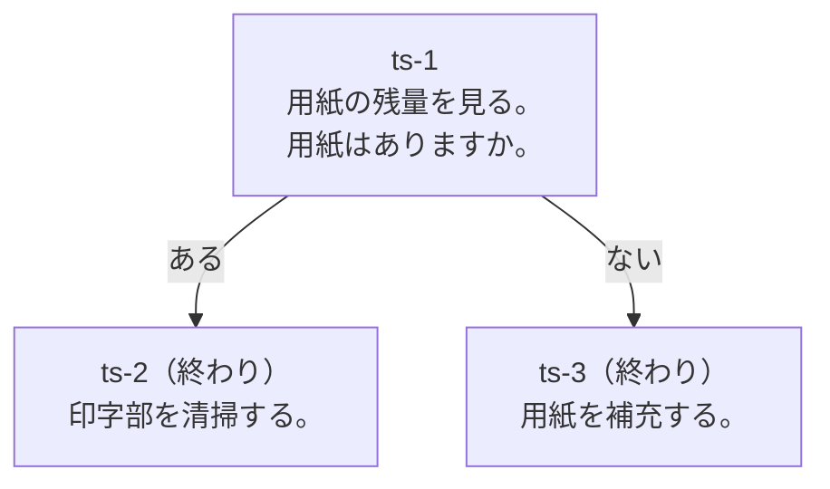

説明と手順の DM は上から下へ読めば内容が分かります。この章で扱う 2 つの種類は、読む人の答えや、その場の状況によって、次に読む場所が変わります。故障探求の DM は問いと答えで原因を絞り込みます。プロセスの DM は、条件によって、表示する DM を切り替えます。

決まりは、仕様書の Chap 3.9.5.2.4（故障の情報）と Chap 3.9.5.2.10（プロセスの DM）にあります。プロセスの DM の管理は Chap 4.11 にあります。

## 故障探求の DM

故障の DM（スキーマは `fault.xsd`）には、故障を報告する形と、故障を切り分ける手順の形があります。券売機の CSDB にあるのは後者です。「きっぷが出てこない」（`DMC-KENBAIKI-A-10-20-00-00A-411A-D`）の内容です。作業の前に要るものは、手順の DM と同じ形なので、省いています。

```xml
<content>
  <faultIsolation>
    <faultIsolationProcedure>
      <isolationProcedure>
        <preliminaryRqmts>
          <!-- 手順の DM と同じ形 -->
        </preliminaryRqmts>
        <isolationMainProcedure>
          <isolationStep id="ts-1">
            <action>用紙の残量を見る。</action>
            <isolationStepQuestion>用紙はありますか。</isolationStepQuestion>
            <isolationStepAnswer>
              <listOfChoices>
                <choice nextActionRefId="ts-2">ある</choice>
                <choice nextActionRefId="ts-3">ない</choice>
              </listOfChoices>
            </isolationStepAnswer>
          </isolationStep>
          <isolationProcedureEnd id="ts-2">
            <action>印字部を清掃する。</action>
          </isolationProcedureEnd>
          <isolationProcedureEnd id="ts-3">
            <action>用紙を補充する。</action>
          </isolationProcedureEnd>
        </isolationMainProcedure>
        <closeRqmts>
          <reqCondGroup>
            <noConds/>
          </reqCondGroup>
        </closeRqmts>
      </isolationProcedure>
    </faultIsolationProcedure>
  </faultIsolation>
</content>
```

| 要素 | 役割 |
| --- | --- |
| `isolationStep` | 切り分けの 1 段。行う作業（`action`）、問い（`isolationStepQuestion`）、答え（`isolationStepAnswer`）を持つ |
| `choice` | 答えの選択肢。`nextActionRefId` に、その答えを選んだときに進む先の `id` を書く |
| `isolationProcedureEnd` | 切り分けの終わり。ここまで来たら行う作業を `action` に書く |

この DM の流れを図にすると、次のようになります。



手順の DM との違いは、進む先が、並びの順ではなく、`nextActionRefId` で決まる点です。XML の中で `ts-2` が `ts-1` のすぐ下にあっても、「ない」と答えた人は `ts-2` を読みません。

## プロセスの DM

プロセスの DM（スキーマは `process.xsd`）は、ほかの DM をどの順に、どの条件で見せるかを書きます。自分では手順の文を持たず、ほかの DM を参照します。

「乗換案内からきっぷを買う」（`DMC-KENBAIKI-A-10-20-00-00A-130A-D`）の内容です。参照先の DMC の属性は、情報コードと分解コードだけを残して省いています。

```xml
<content>
  <process>
    <variableDeclarations>
      <variable valueType="boolean" variableName="cond1"/>
      <variable valueType="boolean" variableName="cond2"/>
    </variableDeclarations>
    <dmSeq>
      <dmNode>
        <title>STEP1</title>
        <dmRef><!-- 分解コード 00、情報コード 520 の DM --></dmRef>
      </dmNode>
      <dmNode>
        <title>STEP2</title>
        <dmRef><!-- 分解コード 01、情報コード 520 の DM --></dmRef>
      </dmNode>
      <dmNode>
        <title>STEP3</title>
        <dmRef><!-- 分解コード 02、情報コード 520 の DM --></dmRef>
      </dmNode>
      <dmIf id="cond1">
        <expression humanReadableForm="残高が足りているとき">
          <variableRef variableName="cond1"/>
        </expression>
        <dmThenSeq>
          <dmNode>
            <title>STEP1</title>
            <dmRef><!-- 分解コード 00、情報コード 520 の DM --></dmRef>
          </dmNode>
        </dmThenSeq>
      </dmIf>
      <dmIf id="cond2">
        <expression humanReadableForm="残高が不足しているとき">
          <variableRef variableName="cond2"/>
        </expression>
        <dmThenSeq>
          <dmNode>
            <title>STEP3-2</title>
            <dmRef><!-- 分解コード 03、情報コード 520 の DM --></dmRef>
          </dmNode>
        </dmThenSeq>
      </dmIf>
    </dmSeq>
  </process>
</content>
```

| 要素 | 役割 |
| --- | --- |
| `variableDeclarations` | このプロセスで使う変数の宣言。名前（`variableName`）と型（`valueType`） |
| `dmSeq` | 上から順に進む並び |
| `dmNode` | 並びの 1 つ。見せる DM を `dmRef` で指す |
| `dmIf` | 条件。`expression` の式が真のときに、`dmThenSeq` の中へ進む |
| `expression` | 条件の式。`humanReadableForm` は、式を人が読める文にしたもの |

この DM は、STEP1 から STEP3 までを順に見せた後、残高が足りていれば STEP1 に戻り、足りていなければ STEP3-2 を見せます。

:::message
この DM の変数 `cond1` と `cond2` は、宣言されていますが、値を決める部分がありません。体験型マニュアルのデータから変換して作ったもので、画面の遷移の条件を名前だけ移しています。実際のプロセスの DM では、利用者への問い（ダイアログ）や、外部から受け取った値で、変数の値を決めます。その書き方は Chap 3.9.5.2.10.2 と Chap 3.9.5.2.10.3 にあり、この本では扱いません。
:::

### プロセスの DM は表示する側の働きを前提にする

プロセスの DM は、紙に印刷しても、そのままでは使えません。条件を評価して、次に見せる DM を選ぶ仕組みが、表示する側に要ります。仕様書は、この仕組みを logic engine と呼んで、Chap 3.9.5.2.10.4 で説明しています。

プロセスの DM を使うかどうかは、納め先の閲覧の道具が、この仕組みを持っているかを確かめてから決めます。

## 確かめ方

### 進む先がすべてあるか

故障探求の DM では、`nextActionRefId` が指す `id` が、同じ DM の中にあるかを確かめます。指す先が無いと、その答えを選んだ人は、次に進む先がありません。XSD の検証は、`id` を指す属性の先が実在することまでは確かめますが、次の 2 つは確かめません。

- どの答えからも指されていない段が無いか
- どの答えを選んでいっても、終わり（`isolationProcedureEnd`）に着くか

この 2 つは、上のような図を書いて、人が確かめます。

プロセスの DM では、`dmRef` が指す DM が、CSDB にあるかを確かめます。s1000d-verify-mcp の [`check_references`](https://shuji-bonji.github.io/s1000d-stack/ja/reference/stack/verify/check-references/) で券売機のプロセスの DM を確かめると、参照は 6 件で、すべて CSDB にあります（BREX への参照が 1 件、手順の DM への参照が 5 件）。

### 構造として読む

s1000d-reader-mcp の [`read_data_module`](https://shuji-bonji.github.io/s1000d-stack/ja/reference/stack/reader/read-data-module/) で、故障探求の DM を読んだ結果です。問いと選択肢が節点の項目として返ります。

| 番号 | 要素 | `id` | 作業 | 問い | 選択肢と進む先 |
| --- | --- | --- | --- | --- | --- |
| 1 | `isolationStep` | `ts-1` | 用紙の残量を見る。 | 用紙はありますか。 | ある → `ts-2`、ない → `ts-3` |
| 2 | `isolationProcedureEnd` | `ts-2` | 印字部を清掃する。 | — | — |
| 3 | `isolationProcedureEnd` | `ts-3` | 用紙を補充する。 | — | — |

表の「番号」は XML の中の並びの順です。作業者が進む順ではありません。

プロセスの DM を読むと、`dmNode` と `dmIf` の木が返ります。`dmIf` の節点には、人が読める文（`humanReadableForm`）が問いとして入り、式は書かれたままの形で添えられます。道具は式を評価しません。

## 実装するときの注意

### 番号と、進む順を混ぜない

故障探求の段に、並びの順で番号を付けると、利用者はそれを進む順だと受け取ります。s1000d-core は、並びの番号と、選択肢ごとの進む先（`nextActionRefId`）の両方を返します。画面に出すときは進む先をたどる形にします。

### 式を評価しない

プロセスの DM の式は、変数、演算、外部の値の参照を含みます。読み取りの道具が式を評価すると、変数の値をどこから取るかという、表示する側の働きまで、読み取りの道具が持つことになります。s1000d-core は、式を評価せず、書かれた形のまま返します。

### 故障を報告する形は要素の種類が多い

故障の DM のもう 1 つの形（`faultReporting`）は、検出した故障、切り分けた故障、関連する故障などの種類があり、交換する単位（LRU）や、試験の値の範囲を持ちます。公式サンプルには 4 種類の故障が 1 件ずつあるだけです。公式サンプルに無い要素の読み取りは、スキーマから形を決めて、自作の XML でテストしています。

## この章のポイント

- 故障探求の DM は、答えの選択肢（`choice`）の `nextActionRefId` で、進む先が決まります。XML の中の並びは進む順ではありません。
- プロセスの DM は、ほかの DM を条件に応じて順に見せます。条件を評価する仕組みが表示する側に要ります。
- 進む先の `id` があることは道具で確かめられます。どの答えを選んでも終わりに着くかは、人が図を書いて確かめます。

## 出典

- 著者が入手した S1000D Issue 7 のパッケージ（仕様書の Chap 3.9.5.2.4、Chap 3.9.5.2.10、Chap 4.11、XML スキーマの `fault.xsd`・`process.xsd`、Bike Samples）。入手先は https://users.s1000d.org/
