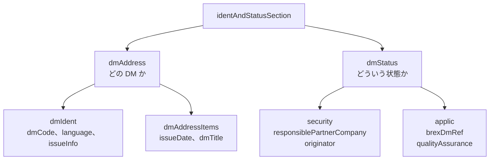

DM の XML は、識別・状態の部分（`identAndStatusSection`）と、内容の部分（`content`）の 2 つでできています。識別・状態の部分には、本文を読まなくても分かる管理の情報が集まっています。どの DM か、どの版か、誰が責任を持つか、どの製品に当てはまるか、どのルールに従うか、検証が済んでいるか、です。

この章では、券売機の手順の DM を例に、識別・状態の部分を上から順に読みます。決まりは、仕様書の Chap 3.9.5.1（識別・状態の部分）にあります。入門の「[Data Module の基本構造](https://zenn.dev/shuji_bonji/books/s1000d-intro/viewer/data-module-structure)」が概念を説明しているので、この章は要素と属性を扱います。

## 全体の形



`dmAddress` は DM を特定するための情報です。`dmStatus` はその DM の状態と扱い方の情報です。

券売機の手順の DM の値を入れると、次のようになります。

```html-embed
<div class="is">
  <div class="is-col">
    <div class="is-cap">dmAddress<span>どの DM か</span></div>
    <div class="is-card">
      <div class="is-row"><i>dmCode</i><b>KENBAIKI-A-10-20-00-01A-520A-D</b></div>
      <div class="is-row"><i>language</i><b>ja / JP</b></div>
      <div class="is-row"><i>issueInfo</i><b>001-00</b></div>
      <div class="is-row"><i>issueDate</i><b>2026-10-25</b></div>
      <div class="is-row"><i>techName</i><b>指定席券売機 操作マニュアル（例）</b></div>
      <div class="is-row"><i>infoName</i><b>乗換案内からきっぷを買う - STEP2</b></div>
    </div>
    <div class="is-foot">上の 3 つが、ファイル名になります。</div>
  </div>
  <div class="is-col">
    <div class="is-cap">dmStatus<span>どういう状態か</span></div>
    <div class="is-card">
      <div class="is-row"><i>security</i><b>01</b><em>配ってよいか</em></div>
      <div class="is-row"><i>responsiblePartnerCompany</i><b>K0002</b><em>誰が責任を持つか</em></div>
      <div class="is-row"><i>originator</i><b>K0002</b><em>誰が作ったか</em></div>
      <div class="is-row"><i>applic</i><b>すべて</b><em>どの製品に当てはまるか</em></div>
      <div class="is-row"><i>brexDmRef</i><b>KENBAIKI-…-022A-D</b><em>どのルールに従うか</em></div>
      <div class="is-row"><i>qualityAssurance</i><b>unverified</b><em>検証が済んでいるか</em></div>
    </div>
  </div>
</div>
<style>
  .is {
    --bg: #f8fafc; --text: #0f172a; --sub: #475569; --line: #cbd5e1; --card: #ffffff; --key: #1d4ed8; --q: #166534; --qbg: #dcfce7;
    box-sizing: border-box; padding: 16px; border-radius: 8px; display: flex; gap: 12px; align-items: stretch;
    background: var(--bg); color: var(--text);
    font-family: system-ui, -apple-system, "Hiragino Sans", "Noto Sans JP", sans-serif; font-size: 13px; line-height: 1.5;
  }
  [data-theme="dark"] .is {
    --bg: #0f172a; --text: #e2e8f0; --sub: #94a3b8; --line: #334155; --card: #1e293b; --key: #93c5fd; --q: #dcfce7; --qbg: #14532d;
  }
  .is * { box-sizing: border-box; }
  .is-col { flex: 1 1 0; min-width: 0; display: flex; flex-direction: column; }
  .is-cap { font-family: ui-monospace, SFMono-Regular, Menlo, Consolas, monospace; font-weight: 700; margin-bottom: 8px; }
  .is-cap span { margin-left: 8px; font-family: system-ui, -apple-system, "Hiragino Sans", "Noto Sans JP", sans-serif; font-weight: 400; font-size: 12px; color: var(--sub); }
  .is-card { flex: 1; background: var(--card); border: 1px solid var(--line); border-radius: 6px; padding: 4px 10px; }
  .is-row { display: flex; flex-wrap: wrap; align-items: baseline; gap: 2px 8px; padding: 6px 0; border-bottom: 1px solid var(--line); }
  .is-row:last-child { border-bottom: none; }
  .is-row i { flex: 0 0 100%; font-style: normal; font-family: ui-monospace, SFMono-Regular, Menlo, Consolas, monospace; font-size: 11px; color: var(--key); }
  .is-row b { font-weight: 600; word-break: break-all; }
  .is-row em { margin-left: auto; font-style: normal; font-size: 11px; padding: 1px 6px; border-radius: 3px; background: var(--qbg); color: var(--q); }
  .is-foot { margin-top: 6px; font-size: 11px; color: var(--sub); }
  @media (max-width: 520px) {
    .is { flex-direction: column; padding: 10px; }
    .is-row { padding: 4px 0; }
  }
</style>
```

## ルート要素で、種類と S1000D の Issue が分かる

識別・状態の部分の前に、ルート要素を見ます。

```xml
<dmodule xmlns:xsi="http://www.w3.org/2001/XMLSchema-instance"
  xsi:noNamespaceSchemaLocation="http://www.s1000d.org/S1000D_7/xml_schema_flat/proced.xsd">
```

`xsi:noNamespaceSchemaLocation` の値は、この DM が従う XML スキーマを指しています。ここから 2 つのことが分かります。

| URL の部分 | 分かること |
| --- | --- |
| `S1000D_7` | S1000D の Issue が 7 であること |
| `proced.xsd` | DM の種類が手順であること |

DM の種類は、DMC の情報コードではなく、このスキーマの名前で決まります。券売機の CSDB では、`descript`（説明）、`proced`（手順）、`process`（プロセス）、`fault`（故障）、`brex` の 5 種類を使っています。

## `dmAddress`：どの DM か

```xml
<dmAddress>
  <dmIdent>
    <dmCode modelIdentCode="KENBAIKI" systemDiffCode="A" systemCode="10"
      subSystemCode="2" subSubSystemCode="0" assyCode="00" disassyCode="01"
      disassyCodeVariant="A" infoCode="520" infoCodeVariant="A" itemLocationCode="D"/>
    <language languageIsoCode="ja" countryIsoCode="JP"/>
    <issueInfo issueNumber="001" inWork="00"/>
  </dmIdent>
  <dmAddressItems>
    <issueDate year="2026" month="10" day="25"/>
    <dmTitle>
      <techName>指定席券売機 操作マニュアル（例）</techName>
      <infoName>乗換案内からきっぷを買う - STEP2</infoName>
    </dmTitle>
  </dmAddressItems>
</dmAddress>
```

| 要素 | 内容 | 見るところ |
| --- | --- | --- |
| `dmCode` | DMC を部分ごとの属性に分けたもの | ファイル名の DMC と一致しているか |
| `language` | 言語（[`languageIsoCode`](https://shuji-bonji.github.io/s1000d-stack/ja/reference/s1000d/issue-7/language-iso-code/)）と国（[`countryIsoCode`](https://shuji-bonji.github.io/s1000d-stack/ja/reference/s1000d/issue-7/country-iso-code/)） | 言語は小文字、国は大文字で書く |
| `issueInfo` | 版。発行番号と作業中番号 | 「[DM を直し、改版する](https://zenn.dev/shuji_bonji/books/s1000d-practice/viewer/revise-data-module)」で扱う |
| `issueDate` | 発行日。年・月・日が別の属性 | 版を上げたときに、日付も変えたか |
| `techName` | 技術名称。何についての DM か | 同じ対象の DM で、同じ書き方になっているか |
| `infoName` | 情報名。どういう情報か | 情報コードの意味と合っているか |

`dmIdent` の 3 つ（DMC、言語、版）が、前の章で見たファイル名になります。

## `dmStatus`：どういう状態か

```xml
<dmStatus issueType="new">
  <security securityClassification="01"/>
  <responsiblePartnerCompany enterpriseCode="K0002"/>
  <originator enterpriseCode="K0002"/>
  <applic>
    <displayText>
      <simplePara>すべて</simplePara>
    </displayText>
  </applic>
  <brexDmRef>
    <dmRef>
      <dmRefIdent>
        <dmCode modelIdentCode="KENBAIKI" systemDiffCode="A" systemCode="00"
          subSystemCode="0" subSubSystemCode="0" assyCode="00" disassyCode="00"
          disassyCodeVariant="A" infoCode="022" infoCodeVariant="A" itemLocationCode="D"/>
      </dmRefIdent>
    </dmRef>
  </brexDmRef>
  <qualityAssurance>
    <unverified/>
  </qualityAssurance>
</dmStatus>
```

子の要素はスキーマが決めた順に並びます。順を入れ替えると、XSD の検証でエラーになります。

### 機密区分（`security`）

[`securityClassification`](https://shuji-bonji.github.io/s1000d-stack/ja/reference/s1000d/issue-7/security-classification/) は、DM の機密区分です。値は 2 桁の番号で、どの番号がどの区分かは、S1000D ではなくプロジェクトが決めます（決まりは Chap 3.6）。

券売機のプロジェクトの BREX は、使える値を 3 つに絞り、意味を付けています。

| 値 | 券売機のプロジェクトでの意味 |
| --- | --- |
| `01` | 公開 |
| `02` | 社内 |
| `03` | 限定 |

別のプロジェクトでは同じ `01` が別の区分を表します。番号だけを見て、公開してよいと判断してはいけません。その DM が参照している BREX か、プロジェクトのビジネスルールで、番号の意味を確かめます。

機密区分は、DM の全体のほかに、本文の要素にも付けられます。DM の全体が `01` でも、ある段落だけが `02` ということがあります。

### 責任を持つ企業と、作った企業

`responsiblePartnerCompany` は、その DM に責任を持つ企業です。`originator` はその DM を作った企業です。どちらも、企業コードを `enterpriseCode` に書きます。企業の名前を子の `enterpriseName` に書くこともできます。

### 適用性（`applic`）

その DM がどの製品に当てはまるかです。この例では、人が読む文（`displayText`）だけがあり、「すべて」と書かれています。機械が判定するための式を持つ DM は、「[適用性で出し分ける](https://zenn.dev/shuji_bonji/books/s1000d-practice/viewer/applicability)」で扱います。

### 従う BREX（`brexDmRef`）

その DM が従う BREX の DM への参照です。1 つの DM が参照できる BREX は 1 つだけです。この例は、券売機のプロジェクトの BREX（情報コード `022`）を参照しています。BREX による検査は「[BREX で確かめる](https://zenn.dev/shuji_bonji/books/s1000d-practice/viewer/brex-validation)」で扱います。

### 品質保証（`qualityAssurance`）

その DM の内容が、検証されているかどうかです（決まりは Chap 3.7）。

| 書き方 | 意味 |
| --- | --- |
| `<unverified/>` | 検証していない |
| `<firstVerification verificationType="…"/>` | 1 回目の検証が済んでいる。`verificationType` は、検証の方法 |
| `<secondVerification verificationType="…"/>` | 2 回目の検証が済んでいる |

券売機の DM は、ほとんどが `unverified` です。組織の BREX の DM と、「紙幣ユニットを取り出す」の発行番号 `002` の DM が、`firstVerification` で、検証の方法が `tabtop`（机上）になっています。

:::message
ここでいう検証は内容が正しいかを人が確かめる作業のことです。XSD の検証や BREX の検査とは別のものです。これらの検査が通っても、`qualityAssurance` の値は変わりません。
:::

### この例に無いもの

`dmStatus` にはほかの要素も書けます。この本で扱うものは次の 3 つです。

| 要素・属性 | 内容 | 扱う章 |
| --- | --- | --- |
| `dmStatus` の `issueType` 属性 | 版の状態 | DM を直し、改版する |
| `reasonForUpdate` | 更新の理由 | DM を直し、改版する |
| `applicCrossRefTableRef` | 適用性の表への参照 | 適用性で出し分ける |

## 確かめ方

識別・状態の部分は次の観点で見ます。

| 観点 | 見るもの |
| --- | --- |
| 特定できるか | DMC・版・言語が、ファイル名と一致している |
| 版が合っているか | `issueInfo` と `issueDate` が、発行の記録と合っている |
| 配ってよいか | `securityClassification` の値と、プロジェクトでのその値の意味 |
| ルールに従っているか | `brexDmRef` が、プロジェクトの決めた BREX を指している |
| 使ってよい状態か | `qualityAssurance` が、プロジェクトの求める段階になっている |

s1000d-reader-mcp の [`read_data_module`](https://shuji-bonji.github.io/s1000d-stack/ja/reference/stack/reader/read-data-module/) は、識別・状態の部分を `identAndStatus` として返します。上の XML を読んだ結果の一部です。

```json
{
  "issueInfo": { "issueNumber": "001", "inWork": "00" },
  "issueDate": "2026-10-25",
  "techName": "指定席券売機 操作マニュアル（例）",
  "infoName": "乗換案内からきっぷを買う - STEP2",
  "securityClassification": "01",
  "applicDisplayText": "すべて",
  "qualityAssurance": "unverified"
}
```

機密区分は、識別・状態の部分だけを読んだときでも、本文だけを読んだときでも、応答の先頭に必ず入ります。読んだ内容を別の場所に出すかどうかを、機密区分を見ずに決めることが無いようにするためです。

## 実装するときの注意

### 種類と Issue はスキーマの URL から決める

DM の種類を DMC の情報コードから決めてはいけません。情報コードが表すのは情報の種類で、XML の構造の種類ではありません。s1000d-core は、`xsi:noNamespaceSchemaLocation` の URL から、スキーマの名前と S1000D の Issue を取り出します。

### 値を解釈しない

機密区分の番号、企業コード、品質保証の検証の方法は、プロジェクトが意味を決める値です。s1000d-core は、書かれた値のまま返し、意味を付けません。`01` を「公開」と読み替えるのは、その DM が参照する BREX を読んだ後で、利用する側が行います。

### 本文の要素の機密区分を数える

DM の全体の機密区分だけを返すと、本文の中のより高い区分の要素を見落とします。s1000d-reader-mcp は、本文の要素に書かれた機密区分を値ごとの件数として一緒に返します。

## この章のポイント

- 識別・状態の部分は、`dmAddress`（どの DM か）と `dmStatus`（どういう状態か）に分かれます。
- DM の種類と S1000D の Issue は、ルート要素が指すスキーマの URL で分かります。
- 機密区分の番号の意味はプロジェクトが決めます。番号だけで判断しません。
- `qualityAssurance` は、人による内容の検証の状態です。XSD の検証や BREX の検査の結果ではありません。

## 出典

- 著者が入手した S1000D Issue 7 のパッケージ（仕様書の Chap 3.6、Chap 3.7、Chap 3.9.5.1、XML スキーマの `proced.xsd`）。入手先は https://users.s1000d.org/
