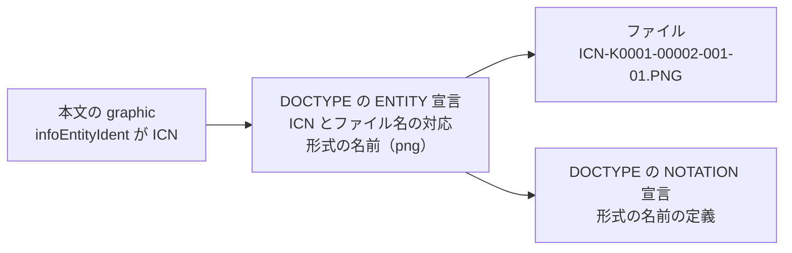

DM は 1 件だけでは完結しません。ほかの DM、同じ DM の中の別の場所、図のファイルを指しています。指した先が無いと、読む人は先へ進めません。この章では、参照の種類と書き方、指した先があるかの確かめ方を説明します。

決まりは、仕様書の Chap 3.9.5.2.1.2（参照）と Chap 3.9.5.2.1.7（図とマルチメディア）にあります。ICN の決まりは Chap 4.4 にあります。

## 参照の種類

| 参照 | 指す先 | 書く要素・属性 |
| --- | --- | --- |
| DM への参照 | ほかの DM | `dmRef` |
| パブリケーションモジュールへの参照 | パブリケーションモジュール | `pmRef` |
| 内部の参照 | 同じ DM の中の要素 | `internalRef` |
| 図への参照 | 図、動画などのファイル | `graphic`・`multimediaObject` の `infoEntityIdent` |
| 適用性への参照 | 適用性の文 | `applicRefId`（「[適用性で出し分ける](https://zenn.dev/shuji_bonji/books/s1000d-practice/viewer/applicability)」で扱う） |

## DM への参照（`dmRef`）

プロセスの DM が手順の DM を指している部分です。

```xml
<dmRef>
  <dmRefIdent>
    <dmCode modelIdentCode="KENBAIKI" systemDiffCode="A" systemCode="10"
      subSystemCode="2" subSubSystemCode="0" assyCode="00" disassyCode="01"
      disassyCodeVariant="A" infoCode="520" infoCodeVariant="A" itemLocationCode="D"/>
  </dmRefIdent>
  <dmRefAddressItems>
    <dmTitle>
      <techName>指定席券売機 操作マニュアル（例）</techName>
    </dmTitle>
  </dmRefAddressItems>
</dmRef>
```

| 要素 | 内容 | 必要か |
| --- | --- | --- |
| `dmRefIdent/dmCode` | 指す先の DMC | 必要 |
| `dmRefIdent/issueInfo` | 指す先の版 | 省ける |
| `dmRefIdent/language` | 指す先の言語 | 省ける |
| `dmRefAddressItems/dmTitle` | 指す先の題名の写し | 省ける |

指す先は、ファイル名ではなく、DMC で書きます。ファイルの置き場所が変わっても参照は変わりません。

### 版を書くか、書かないか

上の例は版を書いていません。「この DMC の DM」を指していて、どの版かは決めていません。CSDB に複数の版があるときに、どの版が使われるかは、閲覧ソフトや出力の設定で決まります。

版を書いた参照は、「この DMC の、この版の DM」を指します。指した版が CSDB に無ければ、DMC が同じ別の版があっても、その参照は合っていません。

どちらにするかは参照の目的で決まります。本文から手順を案内する参照は、多くの場合、版を書きません。指す先が改版されるたびに、参照する側も直すことになるためです。レビューの指摘のように、「この版のこの場所」を指す必要があるときは、版を書きます。券売機の CSDB では、コメントからの参照だけが、版を書いています。

### DM の中の場所を指す

`dmRef` の `referredFragment` 属性に指す先の DM の中の要素の `id` を書くと、その DM の特定の場所を指せます。指す先の DM から、その `id` を持つ要素を取り除くと、この参照は、指す先が無くなります。

### 題名の写し

`dmRefAddressItems` の題名は、指す先の題名の写しです。指す先の題名を変えても写しは変わりません。上の例は、技術名称だけを写していて、情報名（「乗換案内からきっぷを買う - STEP2」）を写していません。題名を画面に出すときは、写しではなく、指す先の DM から読むのが確実です。

## 内部の参照（`internalRef`）

同じ DM の中の図、表、手順、工具などを指します。券売機の CSDB には例が無いので、形だけを示します。

```xml
<para>保守鍵（<internalRef internalRefId="seq-0001" internalRefTargetType="irtt05"/>）で前面扉を開ける。</para>
```

| 属性 | 内容 |
| --- | --- |
| `internalRefId` | 指す先の要素の `id` |
| [`internalRefTargetType`](https://shuji-bonji.github.io/s1000d-stack/ja/reference/s1000d/issue-7/internal-ref-target-type/) | 指す先の種類（図、表、手順、支援機材など） |

`internalRefTargetType` は、指す先の種類を指す側に書く属性です。指す先の要素の種類と、この値が食い違っていても、XSD の検証は通ります。値と指す先が合っているかは別に確かめます。

## 図への参照

図は DM の XML の中に入りません。別のファイルにして、ICN で指します。指し方は 3 つの場所に分かれています。

```xml
<?xml version="1.0" encoding="UTF-8"?>
<!DOCTYPE dmodule [
<!ENTITY ICN-K0001-00002-001-01 SYSTEM "ICN-K0001-00002-001-01.PNG" NDATA png>
<!NOTATION png PUBLIC "-//W3C//NOTATION Portable Network Graphics//EN">
]>
<dmodule …>
  …
  <figure>
    <title>到着駅の選択画面</title>
    <graphic infoEntityIdent="ICN-K0001-00002-001-01"/>
  </figure>
  …
</dmodule>
```



| 場所 | 書くこと |
| --- | --- |
| 本文の `graphic` | ICN だけ。ファイル名も形式も書かない |
| DOCTYPE の `ENTITY` 宣言 | ICN に対応するファイル名と、形式の名前 |
| DOCTYPE の `NOTATION` 宣言 | 形式の名前の定義 |

本文が ICN だけを持つのは、図のファイルの形式を変えても、本文を変えずに済むようにするためです。

動画や 3D モデルは、`multimedia` 要素の中の `multimediaObject` で指します。指し方は図と同じです。券売機の「前面扉を開ける（係員）」は、PNG の図と、STEP という形式の 3D モデルを指しています。

```xml
<multimedia>
  <title>前面扉の 3D モデル</title>
  <multimediaObject multimediaType="3D" infoEntityIdent="ICN-K0001-00006-001-01"/>
</multimedia>
```

使ってよい形式はプロジェクトが BREX で決めます。S1000D は 3D の形式を 1 つに決めていません。

## 確かめ方

s1000d-verify-mcp の [`check_references`](https://shuji-bonji.github.io/s1000d-stack/ja/reference/stack/verify/check-references/) は、1 件の DM の参照をすべて集めて、指す先があるかを返します。「前面扉を開ける（係員）」を確かめた結果です。

| 種類 | 確かめた数 | 指す先が無い数 |
| --- | --- | --- |
| `dmRef` | 1 | 0 |
| `pmRef` | 0 | 0 |
| ICN | 2 | 0 |
| `internalRef` | 0 | 0 |
| 適用性への参照 | 0 | 0 |

`dmRef` の 1 件は BREX への参照です。本文に書いた参照だけでなく、識別・状態の部分の参照も数えます。

ICN の 2 件は、図の PNG と、3D モデルの STEP です。どちらも、宣言されたファイルが CSDB のフォルダーにあります。

指す先が無いときの結果も見ます。CSDB の写しを作り、3D モデルのファイルを取り除いて、同じ DM を確かめます。ICN の「指す先が無い数」が 1 になり、次の理由が返ります。

```text
File ICN-K0001-00006-001-01.STEP declared for ICN-K0001-00006-001-01 is not in the CSDB
```

`ENTITY` 宣言はあるが、宣言されたファイルが CSDB のフォルダーに無い、という意味です。実際の納品では、この状態は、図の入れ忘れです。

指す先が無い理由は種類ごとに分かれて返ります。

| 理由 | 意味 |
| --- | --- |
| `not-found` | 指す先の DM・パブリケーションモジュールが、CSDB に無い |
| `no-entity-declaration` | 本文の ICN に対応する `ENTITY` 宣言が、DOCTYPE に無い |
| `file-not-found` | `ENTITY` 宣言はあるが、宣言されたファイルが無い |
| `no-such-id` | 内部の参照が指す `id` が、DM の中に無い |

### 仕様書を指す参照

ビジネスルールの文書などには、S1000D の仕様書の章を指す `dmRef` があります。仕様書の各章は、モデル識別コードが `S1000D` の DM として番号が付いているためです。この参照の先は CSDB にはありません。無くて正しい参照です。

`check_references` は、モデル識別コードが `S1000D` の DM への参照を、指す先が無い参照とは分けて数えます。混ぜて数えると、直す必要のある参照が、見つけにくくなるためです。公式サンプルでは、`dmRef` 1,843 件のうち 960 件が CSDB に無く、そのうち 954 件が仕様書を指す参照でした。

## 実装するときの注意

### 拡張子の違いを許さない

公式サンプルに、`ENTITY` 宣言では PNG のファイルを指しているのに、同梱されているのは同じ名前の SVG のファイル、という図が 1 件あります。s1000d-core は、これを `file-not-found` として返します。拡張子が違っても見つかったことにする処理は入れていません。宣言どおりにファイルが置かれていないことは、納品の検査で見つけたい事実だからです。

### DOCTYPE を読めるパーサーが要る

`ENTITY` 宣言と `NOTATION` 宣言は、DOCTYPE の中（内部 DTD サブセット）にあります。XML を JSON に変換する種類のパーサーには、これを読み飛ばすものがあります。図への参照を解決するには、宣言を取り出せるパーサーが要ります。公式サンプルでは、DM 106 件のうち 31 件が、DOCTYPE に `ENTITY` 宣言を持っています。

### 版を指定した参照は少ない

公式サンプルで、`dmRef` に版が付いているのは 2 件だけです。版の食い違いが見つかることは少ないのですが、見つかったときは、意図して版を指定した参照なので、重要です。s1000d-core は、版の食い違いを、指す先が無いこととは別の項目として返します。

## この章のポイント

- `dmRef` は DMC で DM を指します。版を書かなければ、どの版かを決めない参照です。
- 図は、本文の ICN、DOCTYPE の `ENTITY` 宣言、ファイル、の 3 つがそろって、たどれます。
- 指す先が無い参照は理由ごとに分けて確かめます。仕様書を指す参照は CSDB に無くて正しい参照です。

## 出典

- 著者が入手した S1000D Issue 7 のパッケージ（仕様書の Chap 3.9.5.2.1.2、Chap 3.9.5.2.1.7、Chap 4.4、XML スキーマの `proced.xsd`、Bike Samples）。入手先は https://users.s1000d.org/
