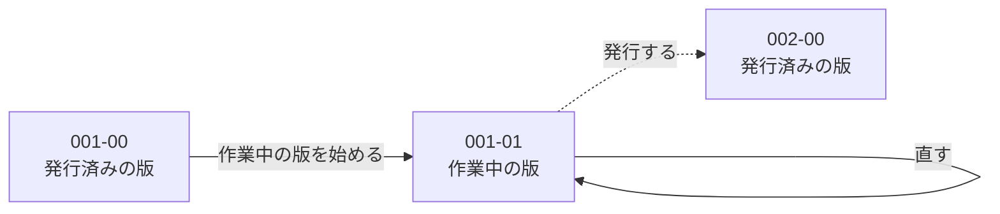

発行したデータモジュール（DM）を直すときは、ファイルを上書きしません。作業中の版を新しいファイルとして始め、何を変えたかを XML の中に記録します。この章では、版を表す番号、版の状態、更新の理由、変更の印の 4 つの決まりを説明し、券売機の手順の DM を 1 件、実際に改版します。

決まりは、S1000D Issue 7 の仕様書の Chap 3.5、Chap 3.9.5.1、Chap 3.9.5.2.1.1 と、既定 BREX にあります。仕様書の文章は載せず、自分の言葉で書いて、章と Para の番号を添えます。属性の値の一覧は [S1000D リファレンス（非公式）](https://shuji-bonji.github.io/s1000d-stack/ja/reference/s1000d/issue-7/)にあります。

## 版を表す 2 つの番号

DM の版（issue）は、`issueInfo` 要素の 2 つの属性で表します。

```xml
<issueInfo issueNumber="001" inWork="00"/>
```

| 属性 | 意味 | 変わるとき |
| --- | --- | --- |
| [`issueNumber`](https://shuji-bonji.github.io/s1000d-stack/ja/reference/s1000d/issue-7/issue-number/) | 発行番号です。最初の発行が `001` です | 発行のたびに 1 つ上がります（Chap 3.5 の Para 2.3.1） |
| [`inWork`](https://shuji-bonji.github.io/s1000d-stack/ja/reference/s1000d/issue-7/in-work/) | 作業中番号です。`00` は発行済みの版、`01` 以降は作業中の版です | 発行までの作業の途中を示すために上げます（Chap 3.5 の Para 2.3.2） |

:::message
S1000D は、DM の版を version ではなく issue と呼びます。番号の名前も、issue number（発行番号）と inwork number（作業中番号）です。この本では「バージョン」という語を製品のバージョンの意味にだけ使います。
:::

2 つの番号は、ファイル名にも `_001-00_` の形で入ります。`001-00` を直し始めると `001-01` になり、発行すると `002-00` になります。



`001-00` のファイルは、`001-01` を始めた後も CSDB に残します。発行済みの版は、その版で示した変更の記録を保持したまま残すためです（Chap 3.9.5.2.1.1 の Para 2.1.1）。

## 版の状態

`dmStatus` 要素の [`issueType`](https://shuji-bonji.github.io/s1000d-stack/ja/reference/s1000d/issue-7/issue-type/) 属性は、その版がどういう版かを示します。値は 8 つあります（Chap 3.9.5.1）。発行済みの DM を直すときに選ぶのは次の 3 つです。

| 値 | どういう版か | 変更の印 |
| --- | --- | --- |
| `changed` | 変更があり、変えた場所を変更の印で示している版 | 付けます |
| `revised` | 全体を改訂した版 | 付けません（既定 BREX の BREX-S1-00033） |
| `status` | 識別・状態の部分だけを更新した版 | 本文を変えない版なので、この章では扱いません |

残りの 5 つは、最初の発行までの `new`、削除を示す `deleted`、削除した DM を復帰させる `rinstate-changed`・`rinstate-revised`・`rinstate-status` です。

どの値にするかは書き手が決めます。手順を 1 つ足した版でも、足した場所を示すなら `changed`、示さずに全体を見直した版として出すなら `revised` になります。XML を見ただけでは決まりません。プロジェクトのビジネスルールが、どちらを使うかを定めている場合は、それに従います。

## 更新の理由

なぜ変えたかは、`dmStatus` の中の `reasonForUpdate` 要素に文で書きます。

```xml
<reasonForUpdate id="rfu-0001" updateReasonType="urt02">
  <simplePara>券売機のソフトウェアの更新で変わった、到着駅の選択画面の操作に合わせた。</simplePara>
</reasonForUpdate>
```

| 属性 | 意味 |
| --- | --- |
| `id` | 本文の変更の印から、この理由を指すための名前です |
| [`updateReasonType`](https://shuji-bonji.github.io/s1000d-stack/ja/reference/s1000d/issue-7/update-reason-type/) | 変更の種類です。`urt01` が編集上の変更、`urt02` が技術的な変更です。`urt03`〜`urt05` は、マークアップだけ、適用性だけ、参照だけの変更です |
| [`updateHighlight`](https://shuji-bonji.github.io/s1000d-stack/ja/reference/s1000d/issue-7/update-highlight/) | `1` のとき、この理由をハイライトの DM に載せます |

決まりは 3 つあります。

- 理由 1 つにつき、`reasonForUpdate` を 1 つ書きます。同じ理由で複数の場所を変えたときは、どの場所も同じ `reasonForUpdate` を指します。理由が違えば、`reasonForUpdate` を分けます（Chap 3.9.5.2.1.1 の Para 2.1.3）。
- 編集上の変更（`urt01`）の理由を指す変更の印は、付けません（Para 2.2）。誤字の修正のように手順の意味が変わらない変更は、理由だけを書きます。
- `updateReasonType` を書かない `reasonForUpdate` は、技術的な変更として扱われます（Para 2.2）。

`issueType` が `changed` でない版は、発行番号が `002` 以降であれば、`reasonForUpdate` が 1 つ以上必要です（既定 BREX の BREX-S1-00038）。

## 変更の印

どこを変えたかは、変えた要素に 3 つの属性を付けて示します。この本では 3 つをまとめて「変更の印」と呼びます。

```xml
<proceduralStep changeType="add" changeMark="1" reasonForUpdateRefIds="rfu-0001">
  <para>駅名の先頭の文字を押し、表示された候補から到着駅を選ぶ。</para>
</proceduralStep>
```

| 属性 | 意味 |
| --- | --- |
| [`changeType`](https://shuji-bonji.github.io/s1000d-stack/ja/reference/s1000d/issue-7/change-type/) | `add`（足した）、`modify`（変えた）、`delete`（取り除いた）のどれかです |
| [`changeMark`](https://shuji-bonji.github.io/s1000d-stack/ja/reference/s1000d/issue-7/change-mark/) | `1` のとき、表示する側が変更バーなどの目印を出します。`0` のときは出しません |
| [`reasonForUpdateRefIds`](https://shuji-bonji.github.io/s1000d-stack/ja/reference/s1000d/issue-7/reason-for-update-ref-ids/) | 理由である `reasonForUpdate` の `id` です |

変更の印の決まりは次のとおりです。どれも Chap 3.9.5.2.1.1 にあります。

- **印は、前の発行済みの版からの差を表します**（Para 2.1.1）。`001-01` の印は、`001-00` から何が変わったかを示します。
- **取り除く要素は、消さずに残します**（Para 2.4.1）。`changeType="delete"` を付けて、要素を XML の中に置いたままにします。読む人に、何が無くなったかを見せるためです。
- **`add`・`delete` の印を付けた要素の子には、印を付けなくて構いません**（Para 2.4.1）。親の印が子も含みます。
- **`modify` の印を付けた要素の中には、`add`・`modify`・`delete` の印を付けた要素を置けます**（Para 2.4.1）。
- **警告と注意は全体に印を付けます**（Para 2.7）。中の一部の語だけを変えたときも、印を付ける先は `warning`・`caution` 要素です。利用者が警告と注意を全部読み直す必要があるためです。

変更の印を置けるのは、`issueType` が `changed` などの版だけです（既定 BREX の BREX-S1-00036）。`revised` の版の本文に印があると、違反になります（BREX-S1-00033）。

:::message
表と図の変更の印には、付け方が複数あります（Para 2.5、Para 2.6）。どの付け方を使うかはプロジェクトが決めます。この章では扱いません。
:::

## 手を動かす

券売機の CSDB から、手順の DM「乗換案内からきっぷを買う - STEP2」を改版します。ファイルは `DMC-KENBAIKI-A-10-20-00-01A-520A-D_001-00_JA-JP.XML` です。

想定は、券売機のソフトウェアが更新されて、到着駅の選択画面が次のように変わった、というものです。

- 駅名の先頭の文字から、到着駅の候補を選べるようになった。
- 「取り消し」のボタンの名前が「戻る」に変わった。

2 つとも同じ理由（ソフトウェアの更新）による変更なので、`reasonForUpdate` は 1 つにします。

### 改版の前

`001-00` の識別・状態の部分と手順の部分です。

```xml
<issueInfo issueNumber="001" inWork="00"/>
```

```xml
<dmStatus issueType="new">
  <security securityClassification="01"/>
  <!-- 中略 -->
  <qualityAssurance>
    <unverified/>
  </qualityAssurance>
</dmStatus>
```

```xml
<proceduralStep id="scr-station">
  <title>STEP2</title>
  <para>到着駅を選びます。</para>
  <!-- 注記と図は省略 -->
  <proceduralStep id="hs-station-next">
    <para>次へを押す。「STEP3」に進む。</para>
  </proceduralStep>
  <proceduralStep id="hs-station-cancel">
    <para>取り消しを押す。「STEP1」に進む。</para>
  </proceduralStep>
</proceduralStep>
```

### 1. 作業中の版を始める

最初に決めるのは `issueType` です。変えた場所を変更の印で示すので、`changed` にします。

s1000d-writer-mcp の [`start_revision`](https://shuji-bonji.github.io/s1000d-stack/ja/reference/stack/writer/start-revision/) に、元のファイルと `issueType` を渡します。結果は、新しいファイル `DMC-KENBAIKI-A-10-20-00-01A-520A-D_001-01_JA-JP.XML` として書かれます。変わるのは 2 行です。

```diff xml
-        <issueInfo issueNumber="001" inWork="00"/>
+        <issueInfo issueNumber="001" inWork="01"/>
```

```diff xml
-    <dmStatus issueType="new">
+    <dmStatus issueType="changed">
```

`001-00` のファイルは変わりません。元のファイルと 1 バイトずつ比べて、同じであることを確かめました。

元の版が前の改版の変更の印を持っていた場合は、このときに取り除かれます。印は「前の発行済みの版からの差」なので、次の版に持ち越さないためです。この DM は最初の発行なので、取り除くものはありませんでした。

ここで取り除かれるのは、変更の印（`changeType` などの属性）です。`changeType="delete"` を付けて残した要素そのものを、次の版でどう扱うかは、仕様書に明記がありません。s1000d-writer-mcp は、次の版を始めるときに、その要素も取り除きます。ほかのツールやプロジェクトでは扱いが違う可能性があるので、プロジェクトの決まりを確かめてください（「実装するときの注意」の 2）。

### 2. 手順を足し、変更の印を付ける

[`edit_data_module`](https://shuji-bonji.github.io/s1000d-stack/ja/reference/stack/writer/edit-data-module/) で、「次へを押す」の手順の前に、新しい手順を足します。変更の印を付ける指定として、次の 3 つを渡します。どれも書き手が決める値で、ツールは補いません。

| 決めること | この例の値 |
| --- | --- |
| 理由の文 | 券売機のソフトウェアの更新で変わった、到着駅の選択画面の操作に合わせた。 |
| `updateReasonType` | `urt02`（技術的な変更） |
| `changeMark` | `1`（目印を表示する） |

結果では、足した手順に `changeType="add"` が付き、`dmStatus` に `reasonForUpdate` が 1 つ増えます。`id` は、文書の中に無い値（`rfu-0001`）が作られます。

### 3. 同じ理由で、手順を置き換える

「取り消しを押す」の手順を「戻るを押す」に置き換えます。1 回の呼び出しで、取り除く操作と、その後ろに足す操作を渡します。理由は手順 2 と同じなので、新しい理由を足さず、既にある `rfu-0001` を指します。

取り除く操作を指定しても要素は消えません。`changeType="delete"` が付いて残ります。

### 改版の後

`001-01` の識別・状態の部分と手順の部分です。

```xml
<dmStatus issueType="changed">
  <security securityClassification="01"/>
  <!-- 中略 -->
  <qualityAssurance>
    <unverified/>
  </qualityAssurance>
  <reasonForUpdate id="rfu-0001" updateReasonType="urt02">
    <simplePara>券売機のソフトウェアの更新で変わった、到着駅の選択画面の操作に合わせた。</simplePara>
  </reasonForUpdate>
</dmStatus>
```

```xml
<proceduralStep id="scr-station">
  <title>STEP2</title>
  <para>到着駅を選びます。</para>
  <!-- 注記と図は省略 -->
  <proceduralStep changeType="add" changeMark="1" reasonForUpdateRefIds="rfu-0001">
    <para>駅名の先頭の文字を押し、表示された候補から到着駅を選ぶ。</para>
  </proceduralStep>
  <proceduralStep id="hs-station-next">
    <para>次へを押す。「STEP3」に進む。</para>
  </proceduralStep>
  <proceduralStep id="hs-station-cancel" changeType="delete" changeMark="1" reasonForUpdateRefIds="rfu-0001">
    <para>取り消しを押す。「STEP1」に進む。</para>
  </proceduralStep>
  <proceduralStep changeType="add" changeMark="1" reasonForUpdateRefIds="rfu-0001">
    <para>戻るを押す。「STEP1」に進む。</para>
  </proceduralStep>
</proceduralStep>
```

改版の前と後を、表示の例で並べます。表示の例は、著者が描いたものです。実際の見た目は、閲覧ソフトが決めます。この例では、足した手順と取り除いた手順に、`changeType` の値を札として付けています。

```html-embed
<div class="cm">
  <div class="cm-col">
    <div class="cm-cap">001-00（発行済みの版）</div>
    <div class="cm-page">
      <div class="cm-step"><span class="cm-no">1</span>到着駅を選びます。</div>
      <div class="cm-step cm-sub"><span class="cm-no">1.1</span>次へを押す。「STEP3」に進む。</div>
      <div class="cm-step cm-sub"><span class="cm-no">1.2</span>取り消しを押す。「STEP1」に進む。</div>
    </div>
  </div>
  <div class="cm-col">
    <div class="cm-cap">001-01（作業中の版）の表示の例</div>
    <div class="cm-page">
      <div class="cm-step"><span class="cm-no">1</span>到着駅を選びます。</div>
      <div class="cm-step cm-sub cm-add"><span class="cm-tag">add</span>駅名の先頭の文字を押し、表示された候補から到着駅を選ぶ。</div>
      <div class="cm-step cm-sub"><span class="cm-no"></span>次へを押す。「STEP3」に進む。</div>
      <div class="cm-step cm-sub cm-del"><span class="cm-tag">delete</span><s>取り消しを押す。「STEP1」に進む。</s></div>
      <div class="cm-step cm-sub cm-add"><span class="cm-tag">add</span>戻るを押す。「STEP1」に進む。</div>
      <div class="cm-rfu"><b>更新の理由　rfu-0001（urt02）</b>券売機のソフトウェアの更新で変わった、到着駅の選択画面の操作に合わせた。</div>
    </div>
  </div>
</div>
<style>
  .cm {
    --bg: #f8fafc; --text: #0f172a; --sub: #475569; --line: #cbd5e1; --card: #ffffff;
    --add: #16a34a; --addbg: #dcfce7; --del: #dc2626; --delbg: #fee2e2; --rfu: #eff6ff; --rfub: #3b82f6;
    box-sizing: border-box; padding: 16px; border-radius: 8px; display: flex; gap: 12px; align-items: stretch;
    background: var(--bg); color: var(--text);
    font-family: system-ui, -apple-system, "Hiragino Sans", "Noto Sans JP", sans-serif; font-size: 13px; line-height: 1.5;
  }
  [data-theme="dark"] .cm {
    --bg: #0f172a; --text: #e2e8f0; --sub: #94a3b8; --line: #334155; --card: #1e293b;
    --add: #4ade80; --addbg: #14532d; --del: #f87171; --delbg: #7f1d1d; --rfu: #1e3a8a; --rfub: #60a5fa;
  }
  .cm * { box-sizing: border-box; }
  .cm-col { flex: 1 1 0; min-width: 0; display: flex; flex-direction: column; }
  .cm-col:last-child { flex-grow: 1.5; }
  .cm-cap { font-weight: 700; margin-bottom: 8px; }
  .cm-page { flex: 1; background: var(--card); border: 1px solid var(--line); border-radius: 6px; padding: 10px; }
  .cm-step { display: flex; gap: 8px; padding: 4px 6px; margin: 2px 0; border-left: 4px solid transparent; }
  .cm-sub { margin-left: 16px; }
  .cm-no { flex: 0 0 auto; min-width: 22px; font-weight: 700; color: var(--sub); }
  .cm-add { border-left-color: var(--add); background: var(--addbg); }
  .cm-del { border-left-color: var(--del); background: var(--delbg); }
  .cm-tag { flex: 0 0 auto; align-self: flex-start; font-family: ui-monospace, Menlo, Consolas, monospace; font-size: 10px; font-weight: 700; padding: 1px 5px; border-radius: 3px; border: 1px solid currentColor; }
  .cm-add .cm-tag { color: var(--add); }
  .cm-del .cm-tag { color: var(--del); }
  .cm-rfu { margin-top: 10px; padding: 8px; border-radius: 4px; background: var(--rfu); border-left: 4px solid var(--rfub); font-size: 12px; }
  .cm-rfu b { display: block; font-size: 11px; }
  @media (max-width: 520px) {
    .cm { flex-direction: column; padding: 10px; }
  }
</style>
```

元の 88 行のうち、変わったのは 3 行（`issueInfo`、`dmStatus` の開始タグ、「取り消しを押す」の手順の開始タグ）で、足されたのは 9 行です。ほかの行は空白と改行を含めて元のままです。

:::message
誤字の修正のような編集上の変更は、変更の印を付けずに本文を直し、`updateReasonType` が `urt01` の理由だけを足します。理由だけを足す操作は、[`add_reason_for_update`](https://shuji-bonji.github.io/s1000d-stack/ja/reference/stack/writer/add-reason-for-update/) です。
:::

### この章で行わないこと

`001-01` を発行して `002-00` にする操作は、この章では行いません。発行には、発行日（`issueDate`）、品質保証（`qualityAssurance`）、データ管理リスト（DML）の更新が関わります。上の例でも、`issueDate` と `qualityAssurance` は `001-00` のときのままです。CSDB 全体での版の持ち方は、「CSDB をフォルダーと Git で持つ」の章で扱います。

## 確かめる

改版した DM を 3 つの方法で確かめます。

| 確かめること | 方法 | この例の結果 |
| --- | --- | --- |
| XML の構造がスキーマに合っているか | s1000d-verify-mcp の [`verify_data_module`](https://shuji-bonji.github.io/s1000d-stack/ja/reference/stack/verify/verify-data-module/) の XSD の検証 | `valid`（エラー 0 件） |
| BREX の決まりに合っているか。版と変更の印の決まりを含む | 同じツールの BREX の検査。DM が参照する券売機の BREX から、組織の BREX、既定 BREX へと参照をたどります | `passed`（3 層、違反 0 件。人が確かめるルールが 2 件） |
| 書いた内容が、意図したとおりに読めるか | s1000d-reader-mcp の [`read_data_module`](https://shuji-bonji.github.io/s1000d-stack/ja/reference/stack/reader/read-data-module/) で読み直す | 下の表 |

:::message
版と変更の印の決まり（BREX-S1-00030 など）は、既定 BREX にあります。BREX の検査が既定 BREX までたどっていないと、この決まりは検査されません。自分のプロジェクトでも、BREX の検査が何層をたどったかを、結果で確かめてください。
:::

`read_data_module` の応答で見る場所は、次の 4 つです。

| 応答の場所 | この例の値 |
| --- | --- |
| `identAndStatus.issueInfo` | `issueNumber` が `001`、`inWork` が `01` |
| `identAndStatus.issueType` | `changed` |
| `identAndStatus.reasonForUpdates` | 1 件。`id` が `rfu-0001`、`updateReasonType` が `urt02` |
| `content.changeMarks` | 3 件。文書の順に `add`・`delete`・`add`。3 件とも `rfu-0001` を指す |

版と変更の印に関わる既定 BREX のルールは次の 4 つです。BREX の検査で違反が出たときはここから見ます。

| ルール | 内容 | 機械で判定できるか |
| --- | --- | --- |
| BREX-S1-00030 | `issueType` の `new` を使える版と、`new` でなければならない版 | できる |
| BREX-S1-00036 | 変更の印を置ける `issueType` | できる |
| BREX-S1-00038 | `reasonForUpdate` が必要な版 | できる |
| BREX-S1-00044 | 編集上の変更に変更の印を付けない | できない（人が確かめる） |

:::message alert
XSD の検証と BREX の検査が通っても、S1000D に準拠していることにはなりません。この 2 つが確かめるのは、構造と、機械で判定できるルールだけです。理由の文が変更の内容と合っているか、`updateReasonType` の選び方がプロジェクトの決まりに合っているかは、人が確かめます。
:::

## 実装するときの注意

この節は、S1000D を処理するコードを書く人に向けた内容です。DM を作るだけの人は読み飛ばして構いません。s1000d-core で改版の操作を実装したときに分かった点を 5 つ書きます。

### 1. 仕様書の表と既定 BREX が食い違っている

仕様書の Chap 3.9.5.1 の Table 3 は、`001-00` の次の作業中の版（`001-01`）の `issueType` を `new` としています。一方、既定 BREX の BREX-S1-00030 は、版が `000-NN` でも `001-00` でもない DM の `new` を違反にします。`001-01` で `new` の DM は、表には合い、既定 BREX には違反します。

どちらに合わせるかをコードは決められません。s1000d-core は、`issueType` を必ず入力で受け取ります。`001-00` から始めるときだけ `new` も受け付け、選んだ結果が既定 BREX に違反することを応答で知らせます。上の例は `changed` を選んだので、この食い違いには当たりません。

### 2. `delete` の印が付いた要素を次の版でどうするか

`changeType="delete"` を付けて残した要素を、次の版でどう扱うかは、仕様書の読んだ範囲（Chap 3.5 と Chap 3.9.5.2.1.1 の全体）に書かれていません。s1000d-core は、次の作業中の版を始めるときに、その要素を取り除きます。「印は前の発行済みの版からの差を表す」という決まりからの解釈で、仕様書に明記された動きではありません。

取り除く要素の `id` を残る部分が指しているときは、版を始めずに断ります。上の例の `hs-station-cancel` も、`002-00` の次の版を始めるときに取り除かれます。

### 3. 要素を移したときの印

`changeType` の値は `add`・`modify`・`delete` の 3 つで、要素を移したときの印の付け方は、仕様書にありません。全文から、並べ替えや移動を表す語を探しましたが、変更の印に関わる記述は見つかりませんでした。

s1000d-core は、同じ親の中の移動だけを受け付けて、親の要素に `modify` を付けます。親が変わる移動は断り、取り除く操作と足す操作に分けて指定してもらいます。元の場所に `delete` の印を付けた写しを残す方法は、同じ `id` を持つ要素が 2 つになるので採りませんでした。

### 4. `revised`・`status` で始めた版は、理由が 1 つも無い状態になる

作業中の版を始めるときに、前の版の `reasonForUpdate` をすべて取り除きます。`issueType` を `revised`・`status` にして始めた版は、本文に変更の印を付けないので、印と一緒に理由が足されることもありません。発行番号が `002` 以降であれば、そのままでは BREX-S1-00038 に違反します。

このため、変更の印を付けずに、理由だけを足す入口が要ります。s1000d-core では次の 3 つに分けました。

| 入口 | 本文の変更の印 | `reasonForUpdate` | 使う場面 |
| --- | --- | --- | --- |
| 編集と一緒に、新しい理由を渡す | 付ける | 1 つ足す | その理由による最初の編集 |
| 編集と一緒に、既にある理由の `id` を渡す | 付ける | 変えない | 同じ理由による 2 回目からの編集 |
| 理由だけを足す | 付けない | 1 つ足す | 編集上の変更。`revised`・`status` の版 |

2 つ目の入口が無いと、編集のたびに `reasonForUpdate` が増えて、「同じ理由の変更は同じ `reasonForUpdate` を指す」という決まりに沿えません。

### 5. DOM を書き出し直すと、変えていない行まで変わる

XML を DOM に読み込み、属性を足して文字列に書き出し直す方法では、変えていない行も変わります。属性の引用符、空要素の書き方、空白と改行が、書き出す側の決まりに置き換わるためです。S1000D の公式サンプル（Bike Samples）の DM と PM の 110 件を何も変えずに読んで書き出し直したところ、91,215 行のうち 26,258 行（29 %）が変わりました。

CSDB を Git で持つ場合、この差分は、改版で何を変えたかを読めなくします。s1000d-core は、元の文字列の中で、編集した範囲だけを書き換えます。上の例で変わった行が 3 行で済んでいるのはこのためです。

## この章のポイント

- 発行済みの DM は上書きせず、`inWork` を `01` にした新しいファイルとして、作業中の版を始めます。元の版は CSDB に残します。
- `issueType` は、変えた場所を変更の印で示すなら `changed`、示さないなら `revised`、識別・状態の部分だけの更新なら `status` です。書き手が決めます。プロジェクトに定めがあれば、それに従います。
- 変更の理由は `reasonForUpdate` に書き、変えた要素の `reasonForUpdateRefIds` からその `id` を指します。同じ理由の変更は、同じ `reasonForUpdate` を指します。
- 取り除く要素は、`changeType="delete"` を付けて残します。編集上の変更には変更の印を付けません。
- 確かめるのは、XSD、プロジェクトの BREX、既定 BREX、読み直しの 4 つです。通っても S1000D に準拠しているという判定にはなりません。

## 出典

- 著者が入手した S1000D Issue 7 のパッケージ（仕様書の Chap 3.5、Chap 3.9.5.1、Chap 3.9.5.2.1.1、XML スキーマの `proced.xsd`、既定 BREX の BREX-S1-00030・00033・00036・00038・00044）。入手先は https://users.s1000d.org/
- S1000D Stack の S1000D リファレンス（非公式）. https://shuji-bonji.github.io/s1000d-stack/ja/reference/s1000d/issue-7/
- s1000d-core（改版の操作の実装）. https://github.com/shuji-bonji/s1000d-core
